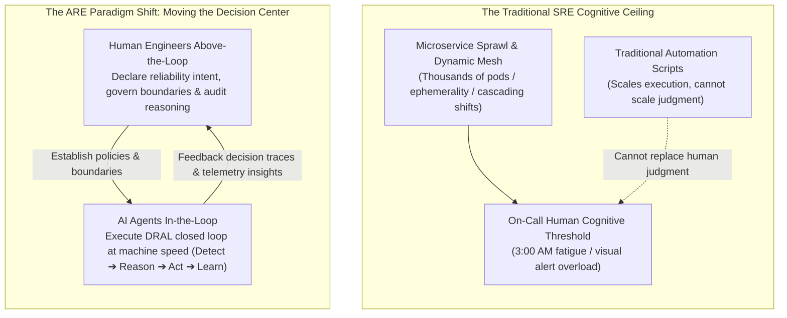
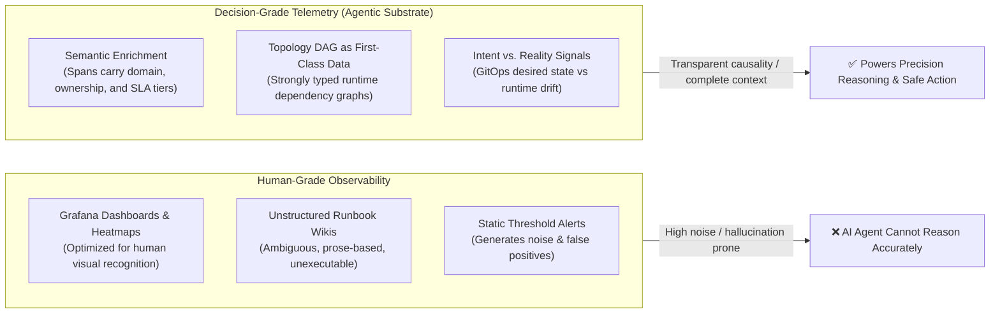
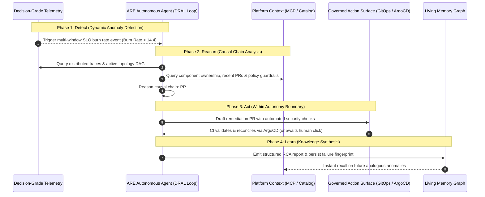

# 04-EX

# From Organizational Knowledge to Decision-Grade Telemetry: Agentic Reliability Engineering and the DRAL Autonomous Loop

In Chapter 4, we explored how Retrieval-Augmented Generation (RAG) and the Model Context Protocol (MCP) transform internal engineering documentation, service catalogs, and code templates into machine-readable "static organizational memory." We learned how to empower AI agents to cite established organizational standards accurately when generating scaffolding or answering architectural queries.

However, when engineering teams attempt to deploy this "static knowledge" directly into live production operations, they inevitably collide with an acute cognitive disconnect:

> **"Static knowledge teaches an AI agent how a system was originally designed; it cannot tell the agent what that system is actually experiencing under live production stress."**

Consider this scenario: at 3:00 AM, a critical incident erupts, with the checkout service error rate spiking to 25%. If an on-call engineer turns to an AI assistant equipped solely with static RAG knowledge and asks, *"What is happening and how do we fix it?"*, the assistant will likely retrieve architectural wikis and output a polite, generic checklist: *"Please check database connection pool limits, verify Redis cluster health, and monitor microservice latency..."*
In a high-pressure outage, this advice is textbook-correct yet operationally useless. On-call engineers do not need an exhaustive enumeration of hypothetical failure modes; they need **precise causal attribution that pierces through telemetry noise to isolate the single root cause immediately**.

This is where the discipline of **Agentic Reliability Engineering (ARE)** (originating from O'Reilly's foundational work) converges with platform engineering.

As a dedicated extension to Chapter 4, this chapter bridges the blind spot of static document retrieval. We explore how to infuse AI agents with **Decision-Grade Telemetry**, dissect the **DRAL Autonomous Loop (Detect-Reason-Act-Learn)**, and introduce **Five Flagship Agentic SLOs** to rigorously quantify the quality of autonomous machine reasoning.

---

# The Cognitive Ceiling: Why Traditional SRE Automation Must Evolve

To grasp agentic reliability, one must first recognize the structural ceiling traditional Site Reliability Engineering (SRE) encounters in modern distributed architectures.



## Automation Scales Execution, Not Judgment
Over the past decade, the industry constructed countless operational automations: automated pod restarts, horizontal pod autoscalers, and traffic failovers. However, these tools represent **deterministic conditional branches (If-This-Then-That)**.

When production systems fail in novel, emergent ways (the "unknown-unknowns")—such as cascaded timeouts across distributed meshes coupled with connection pool deadlocks—deterministic scripts fail. The alert storms inevitably escalate into jarring PagerDuty calls, dragging human engineers out of bed.

The fundamental bottleneck is not tooling, but a **Cognitive Ceiling**:

1. **Alert Fatigue**: Human attention budgets are strictly bounded. When an infrastructure cascade triggers alerts across hundreds of services simultaneously, human cognition cannot synthesize the root cause in minutes.
2. **Diagnostic Silos**: Engineers maintain specialized mental models of their own components. Cross-service incidents devolve into protracted cross-team triage debates.

## The Paradigm Shift: From "In-the-Loop" to "Above-the-Loop"
Agentic Reliability Engineering formalizes a crucial role reversal: **When system complexity outstrips human intuition, AI agents must become standard actors within the operational loop.**

* **Human-Above-the-Loop**: Engineers step above the operational fireline. They focus on **defining reliability intent (SLOs)**, **enforcing rigid Autonomy Boundaries**, and auditing the decision quality of agent interventions.
* **Agent-In-the-Loop**: Autonomous agents continuously analyze millions of telemetry signals at millisecond scale, reasoning across dependencies and executing governed remediations within authorized guardrails.

---

# The Foundational Substrate: From Human Dashboards to Decision-Grade Telemetry

If AI agents are to assume operational reasoning responsibilities, what data must they consume?

This highlights the direct intersection between Chapter 4's knowledge foundations and live operations: **Over 90% of current observability data is engineered for human eyes and visual pattern recognition, presenting high noise-to-signal ratios for machines.**



## What is Decision-Grade Telemetry?

In ARE, Decision-Grade Telemetry refers to **signals engineered from inception for an entity that must make an autonomous decision, rather than an entity that merely looks at a screen**.

It embodies three non-negotiable principles:

### 1. Semantic Enrichment
Standard distributed traces record `HTTP GET /api/v1/orders` taking `120ms`. To an LLM, these numbers lack actionable context.
Decision-Grade Telemetry mandates that telemetry producers inject organizational dimensions directly into OpenTelemetry span attributes at runtime:

* `business.domain`: `ecommerce-checkout`
* `service.tier`: `tier-1-mission-critical`
* `service.owner`: `team-order-platform`
* `sla.latency_target_ms`: `80`
* `git.commit_sha`: `a8f3d1b`
* `deployment.environment`: `production-us-east`

When an autonomous agent receives an enriched trace, it does not need to cross-reference disconnected documentation wikis—**the telemetry itself carries verified ownership and architectural context**.

### 2. Topology as First-Class Data
Humans rely on fallible memory to trace microservice call chains. AI agents require strongly typed, machine-readable **Dynamic Directed Acyclic Graphs (DAGs)**.
Decision-Grade Telemetry exposes upstream/downstream relationships, dependency criticality, and fallback behaviors as structured data models. When downstream databases degrade, agents trace failure propagation paths deterministically.

### 3. Intent vs. Reality Signals
Catastrophic production failures frequently stem from divergences between expected configuration and actual cluster state. Decision-Grade Telemetry bridges observability with GitOps:

* **Intent**: Replicas, memory limits, and timeouts declared in Git.
* **Reality**: Actual container memory saturation and network latencies reported by runtime agents.
* **Deviation Signals**: Control planes compute configuration drift continuously, allowing agents to instantly differentiate between software bugs, configuration drift, and underlying hardware degradation.

---

# The Autonomous Operational Engine: The DRAL Loop

Backed by Decision-Grade Telemetry, how do autonomous agents act?

Agentic Reliability Engineering structures operational interventions around the **DRAL Loop (Detect ➔ Reason ➔ Act ➔ Learn)**:



## 1. Detect: Dynamic SLO Burn Rates over Static Thresholds
Static CPU thresholds (>85%) produce endless noise. The DRAL loop triggers based on **multi-window, multi-burn-rate SLO error budgets**.
Only when user experience is actively degrading and the error budget is depleting dangerously does the detection engine awaken the agent, bundling a high-fidelity 5-minute telemetry snapshot to eliminate exploratory searching.

## 2. Reason: Causal Attribution over Statistical Correlation
Naive AIOps algorithms rely on statistical correlation (*"Service A latency spiked when Node B disk I/O increased, therefore they are correlated"*), which is routinely misled by background noise.
Within the DRAL loop, agents synthesize Chapter 4's MCP entity models and Chapter 11's Backstage service definitions to perform **causal chain analysis**:

* Follow parent-child span relationships across OpenTelemetry traces;
* Verify downstream dependency health;
* Cross-reference Git commit and feature flag changes over the preceding hour;
* Isolate the exact causal chain responsible for the degradation.

## 3. Act: Governed Action within Autonomy Boundaries
Once diagnosis is complete, agents operate within rigid **Autonomy Boundaries**:

* *Tier-3 Non-Critical Services*: Agents autonomously restart crashing pods or rollback canary tracks without human intervention.
* *Tier-1 Core Transaction Engines*: Agents are restricted to read-only diagnostics or drafting Pull Requests requiring human approval.
* **Governed Delivery**: Actions are never executed via raw cluster socket connections; **changes flow strictly through GitOps (ArgoCD) or Backstage templates**, guaranteeing complete auditability.

## 4. Learn: Automating Experience Capture into Living Knowledge
Incident mitigation is not the final step. Rather than leaving post-mortems in buried markdown files, the agent structures the **failure fingerprint, causal chain, and remediation patch** into machine-readable knowledge entries.
This data is committed back into Chapter 9's **Living Memory Graph**, transforming transient production outages into enduring institutional intelligence.

---

# Quantifying Machine Judgment: Five Flagship Agentic SLOs

When platform teams introduce autonomous operational agents, leaders invariably ask: **"How do we know the AI is actually improving reliability rather than introducing secondary outages?"**

Traditional metrics (Availability, MTTR) measure system uptime, not the quality of machine reasoning. ARE formalizes **Five Agentic SLOs**:

| Metric | Symbol | Core Question | Production Baseline Target |
| :--- | :--- | :--- | :--- |
| **Autonomous Resolution Rate** | **ARR** | What percentage of production incidents are **completely remediated by agents within the autonomy boundary** without human paging? | Mature Target: **60% ~ 80%** |
| **Decision Quality SLO** | **DQ-SLO** | What percentage of agent-generated root cause hypotheses and remedies are **verified as correct upon post-incident audit**? | Strict Safety Target: **≥ 95%** |
| **Reasoning Latency SLO** | **RL-SLO** | What is the total duration elapsed between anomaly trigger and the generation of an accurate remediation plan? | P1 Incident Target: **< 45 seconds** |
| **Autonomy Escalation SLO** | **AE-SLO** | When facing low-confidence anomalies or out-of-boundary risks, **does the agent gracefully escalate control to human operators**? | Compliance Target: **100% adherence** |
| **Context Efficiency** | **CE** | How economically does the agent resolve incidents in terms of **minimal token consumption and tool invocation round-trips**? | Average Target: **≤ 8 tool calls / incident** |

---

# Hands-on Pipeline: Building Decision-Grade Telemetry with OpenTelemetry and MCP

Let us turn this theory into executable infrastructure code. How do we configure OpenTelemetry Collectors and MCP servers to deliver Decision-Grade Telemetry?

## 1. OpenTelemetry Semantic Enrichment Processor

In the Kubernetes OpenTelemetry Collector configuration, utilize the `transform` processor to inject organizational dimensions:

```yaml
apiVersion: v1
kind: ConfigMap
metadata:
  name: otel-collector-config
  namespace: platform-system
data:
  otel-collector-config.yaml: |
    receivers:
      otlp:
        protocols:
          grpc:
          http:

    processors:
      # Decision-Grade Telemetry Enrichment Processor
      transform:
        error_mode: ignore
        trace_statements:
          - context: span
            statements:
              # Inject business domain and ownership from Kubernetes namespace metadata
              - set(attributes["platform.tier"], "tier-1-mission-critical") where attributes["k8s.namespace.name"] == "production-checkout"
              - set(attributes["platform.owner_team"], "team-checkout") where attributes["service.name"] == "order-service"
              - set(attributes["platform.slo_budget_burn"], "active") where attributes["http.status_code"] >= 500

      batch:
        timeout: 1s
        send_batch_size: 256

    exporters:
      prometheus:
        endpoint: "0.0.0.0:8889"
      otlp/storage:
        endpoint: "tempo:4317"
        tls:
          insecure: true

    service:
      pipelines:
        traces:
          receivers: [otlp]
          processors: [transform, batch]
          exporters: [otlp/storage]
```

## 2. Declaring the MCP Decision Telemetry Tool

Within your platform MCP server, expose strongly typed causal diagnostic tools rather than raw SQL or PromQL interfaces:

```typescript
import { McpServer } from "@modelcontextprotocol/sdk/server/mcp.js";
import { z } from "zod";

const server = new McpServer({
  name: "platform-decision-telemetry-mcp",
  version: "1.0.0"
});

server.tool(
  "analyze_service_incident",
  "Fetches decision-grade causal telemetry for a designated service, including topology DAGs, failing traces, and configuration drift",
  {
    serviceName: z.string().describe("Target microservice identifier, e.g., order-service"),
    timeWindowMinutes: z.number().default(15).describe("Analysis time window in minutes")
  },
  async ({ serviceName, timeWindowMinutes }) => {
    // 1. Query runtime dependency topology DAG
    const topology = await fetchServiceTopology(serviceName);
    
    // 2. Retrieve traces tagged with active SLO budget burn attributes
    const criticalSpans = await fetchCriticalTraces(serviceName, timeWindowMinutes);
    
    // 3. Query GitOps repository for configuration drift over the past hour
    const configDrift = await detectGitOpsDrift(serviceName);

    return {
      content: [
        {
          type: "text",
          text: JSON.stringify({
            service: serviceName,
            status: "ANALYSIS_COMPLETE",
            topologyGraph: topology,
            causalIndicators: {
              failingDownstream: "payment-gateway-proxy",
              exceptionPattern: "ConnectionTimeoutException: pool exhausted",
              recentDeploymentDiff: configDrift.latestCommit
            },
            prescribedActionBoundary: "CAN_PROPOSE_PULL_REQUEST"
          }, null, 2)
        }
      ]
    };
  }
);
```

By querying this single tool, the autonomous agent retrieves **topology, failure fingerprints, and GitOps commit histories in a single round-trip**, maximizing **Context Efficiency (CE)**.

---

# Reader Notes: A Practitioner's Perspective on Chapter 4-EX

> **"An AI agent without decision-grade telemetry is a blind entity flailing in production; grounded in causal feedback loops, it becomes an indispensable co-pilot."**

### 💡 Practitioner Mindset: Scaling Judgment in the AI Era
Platform engineering is often conceptualized as building developer portals (Backstage) and paving self-service Golden Paths. Chapter 4-EX expands this vision: **The primary consumer of internal platforms in the coming decade will be autonomous AI agents.**
If our platforms only produce visual dashboards intended for human eyes, teams will remain perpetually trapped in on-call firefighting. Bridging static knowledge (Chapter 4) with Decision-Grade Telemetry is the paved path toward genuine autonomy.

### 🎯 Key Takeaways
1. **Unifying the Static and Dynamic**:
   - Chapter 4's RAG/MCP specifies *how the system should be constructed (spatial architecture)*;
   - Chapter 4-EX's Decision-Grade Telemetry captures *how the system is currently behaving under load (temporal dynamics)*;
   - Together, they unlock true Situational Awareness.
2. **The DRAL Loop is the Autonomous Pulse**:
   - Detect (SLO burn rate) ➔ Reason (Topology causality) ➔ Act (Governed GitOps boundaries) ➔ Learn (Living memory graph).
3. **Rigorous Measurement over Hype**:
   - Quantify agent deployments using **ARR**, **DQ-SLO (≥95%)**, and **Context Efficiency (CE)**.

### ⚠️ Production Pitfalls
* **Dumping Raw Logs into Models**: Streaming raw, unparsed logs directly into prompts spikes reasoning latency beyond two minutes and inflates inference costs; perform semantic enrichment at the collector boundary.
* **Ungoverned Autonomy Boundaries**: Never grant agents direct write access to production clusters until DQ-SLO consistently exceeds 95%; funnel all changes through peer-reviewed GitOps Pull Requests.

### 🛠️ Action Checklist
* [ ] Audit your OpenTelemetry collectors: are spans annotated with organizational dimensions (`team.owner`, `service.tier`)?
* [ ] Identify the top three recurring production failure patterns with your SRE team and map their causal diagnostic flows into standardized DRAL loops.
* [ ] Prototype a high-level MCP diagnostic tool that aggregates live dependency topology with GitOps drift to power Chapters 5 and 7 operational workflows.

---

# Further Reading

* **Agentic Reliability Engineering Web Reader**: [https://tedmax100.github.io/agentic-reliability-engineering-zh-tw/](https://tedmax100.github.io/agentic-reliability-engineering-zh-tw/)
* **OpenTelemetry Semantic Conventions**: [https://opentelemetry.io/docs/specs/semconv/](https://opentelemetry.io/docs/specs/semconv/)
* **Google SRE Workbook: Implementing Service Level Objectives**: [https://sre.google/workbook/implementing-slos/](https://sre.google/workbook/implementing-slos/)
