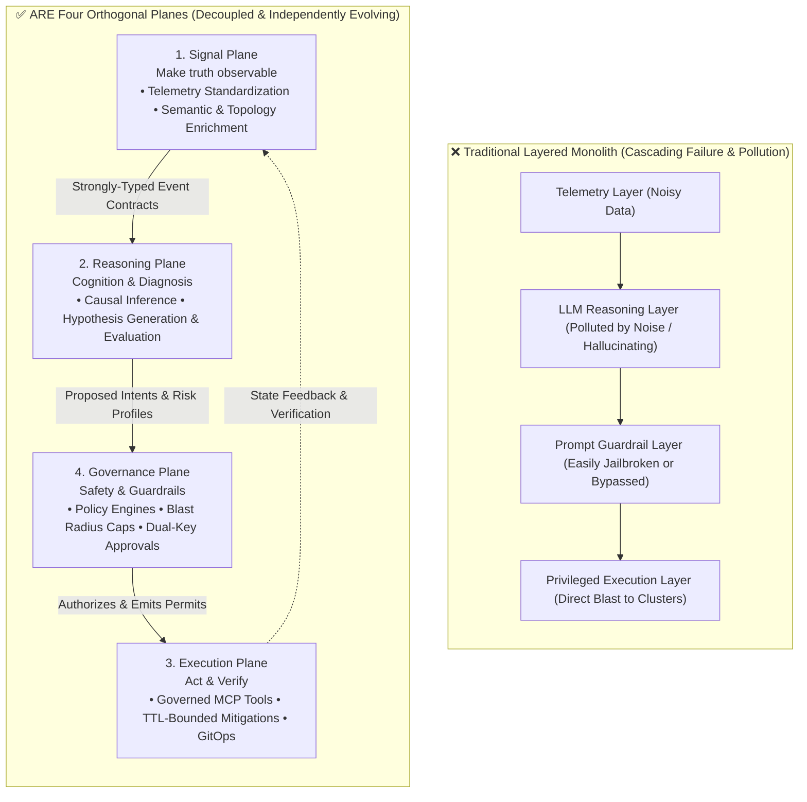
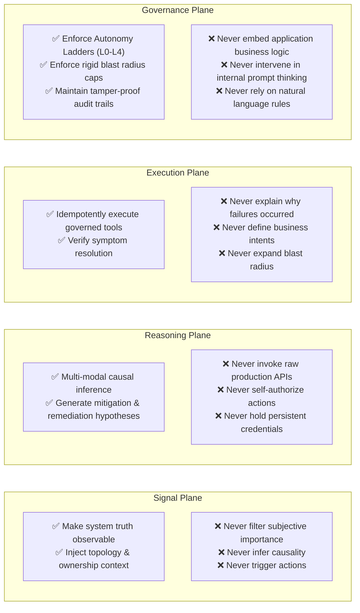
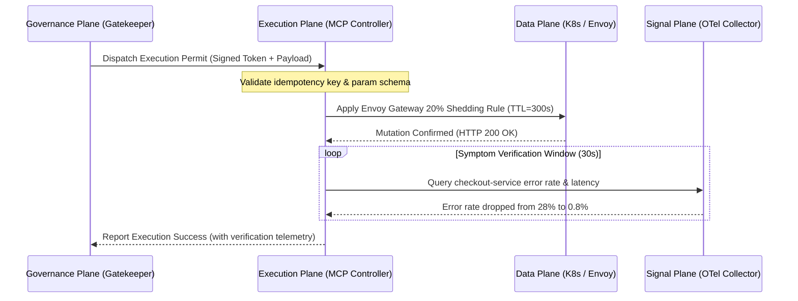

# 06-EX

# Agentic Architectural Syntax: Decoupling Signal, Reasoning, Execution, and Governance Planes

In Chapter 6, we established agentic AI as the next evolutionary paradigm in DevOps, exploring the foundational primitives required to transition from personal agents (such as OpenClaw and `SKILL.md`) to multi-tenant, production-grade agents: memory, tools, scheduling, and governance.

However, when engineering teams first attempt to deploy autonomous agents across internal platforms, the most frequent—and catastrophic—architectural mistake is constructing a **"Monolithic Agent"**:

```
[Raw Telemetry / Alerts] ──> ( Monolithic LLM Agent: Simultaneously parsing metrics, diagnosing root causes, running bash/kubectl directly, and self-policing via Prompt ) ──> [Production Outage]
```

Under this monolithic agent design:
* The agent connects directly to noisy, raw monitoring streams;
* The agent performs open-ended, divergent reasoning inside an unconstrained prompt;
* The agent wields high-privilege credentials or raw `kubectl` access directly against production clusters;
* Security and compliance rely entirely on fragile prompt-level instructions like *"Please be careful and do not delete critical databases."*

The moment this naive architecture enters high-concurrency, dynamic cloud-native environments, it triggers disastrous cascading failures: accidental deletions caused by hallucinations, database thread pool exhaustion caused by thundering herd effects, and completely opaque, non-auditable black-box changes.

This is precisely why Chapter 6 of **Agentic Reliability Engineering (ARE)**, *"Architecture of Agentic Reliability Systems"*, establishes an indispensable architectural grammar: **decoupling agentic systems into four strictly orthogonal planes—the Signal Plane, Reasoning Plane, Execution Plane, and Governance Plane**.

This chapter moves beyond the toy-grade monolithic agent antipattern, examining the architectural responsibilities, orthogonal laws, and platform engineering substrates that enable these four planes to operate reliably in production.

---

# Why "Planes" Rather than "Layers"?

In traditional software engineering, we default to "Layered Architectures"—presentation layer, business logic layer, data access layer. However, when architecting autonomous operational agents, **hierarchical layering is inherently perilous**.

Layers imply vertical dependencies and cascade failure propagation: if the bottom telemetry layer degrades, corruption flows upward into the reasoning layer, ultimately triggering runaway actions in the execution layer.

ARE deliberately adopts the **"Plane"** philosophy originating from telecommunications and distributed networking:



### The Three Iron Laws of Orthogonal Planes:

1. **Orthogonality**: Each plane fulfills a distinct responsibility and intersects with others exclusively via strongly-typed contracts. A failure or anomaly in one plane must never compromise the integrity of another.
2. **Fault Isolation**: Degraded signals must never directly trigger execution; divergent reasoning must never possess raw cluster tokens; and **tightening policies in the Governance Plane must never require rewriting reasoning models or MCP tool code in the Execution Plane**.
3. **Decoupled Evolution**: You can upgrade your foundation models in the Reasoning Plane (e.g., from Claude 3.5 to GPT-5 or Gemini 2.0) without altering Kubernetes Operators in the Execution Plane or OPA/Gatekeeper rules in the Governance Plane.

---

# Plane Responsibilities: What Each Plane Does and NEVER Does

To ensure each plane enforces rigid operational constraints, we must define clear boundaries for what each plane **must do** and **must NEVER do**:



---

## 1. The Signal Plane: The Objective Mirror of System Truth

The single mandate of the Signal Plane is to **make system truth observable**.

In conventional operations, signals consist of raw Prometheus time-series metrics, unstructured text logs, and disconnected traces. These formats were designed as compromises for human visual inspection on Grafana dashboards.

In an agentic architecture, the Signal Plane transforms raw data through three platform capabilities (detailed in Chapter 4 Extension):
1. **Normalization**: Adhering strictly to OpenTelemetry (OTel) semantic conventions, neutralizing syntactic discrepancies across heterogenous middleware.
2. **Semantic Contextualization**: The moment telemetry is emitted, the platform correlates it against the Backstage Software Catalog to inject service ownership (`team-payment`), criticality tiers (`tier-1-critical`), and upstream/downstream dependency graphs.
3. **Drift Detection**: Continuously comparing Git-declared desired states against runtime states, emitting discrete drift events.

### Strongly-Typed Signal Output Schema:
```json
{
  "$schema": "https://specs.choreo.dev/telemetry/v1/signal.json",
  "signal_id": "sig-prod-checkout-88392",
  "timestamp": "2026-10-26T14:32:00Z",
  "type": "SLO_BREACH_DETECTED",
  "entity": {
    "service": "checkout-service",
    "project": "core-ecommerce",
    "environment": "production",
    "owner": "team-payment",
    "catalog_ref": "component:core-ecommerce/checkout-service"
  },
  "metrics": {
    "sli_error_rate": 0.28,
    "slo_threshold": 0.005,
    "burn_rate_1h": 14.2
  },
  "correlated_symptoms": [
    "upstream_envoy_503_surge",
    "redis_connection_pool_exhausted"
  ],
  "topology_context": {
    "downstream": ["inventory-api", "payment-gateway", "redis-cluster"],
    "blast_radius_tier": "critical-revenue"
  }
}
```

> **Iron Law of the Signal Plane**: The Signal Plane reports objective facts. It **never infers who is to blame**, and it **never contains operational instructions**.

---

## 2. The Reasoning Plane: Cognition, Diagnosis, and Hypothesis Evaluation

The Reasoning Plane serves as the cognitive brain. Receiving objective facts from the Signal Plane, it retrieves explicit organizational knowledge (Backstage TechDocs, Git commit history, OpenAPI contracts) via GraphRAG to conduct rigorous **causal inference**.

The Reasoning Plane is far more than an LLM prompt invocation; it is a collaborative multi-agent loop:
1. **Symptom De-noising**: Filtering cascade alarms during alert storms to identify the primary root trigger.
2. **Hypothesis Generation**: Evaluating recent Git deployments, configuration drifts, or downstream saturations.
3. **Action Bifurcation (Mitigation vs. Remediation)**: In accordance with Chapter 7 Extension, prioritizing sub-3-minute **transient mitigation proposals** to halt revenue bleeding, followed by peer-reviewed **permanent remediation PR proposals**.

### Strongly-Typed Decision Output Schema:
```json
{
  "$schema": "https://specs.choreo.dev/agentic/v1/decision.json",
  "decision_id": "dec-20261026-091",
  "signal_ref": "sig-prod-checkout-88392",
  "agent_id": "sre-diagnostics-agent-v3",
  "root_cause_hypothesis": "Redis connection pool exhaustion causing upstream checkout thread starvation",
  "confidence_score": 0.94,
  "confidence_rationale": "Commit v2.4.1 deployed 10 mins ago set pool_timeout to 0, resulting in deadlock accumulation",
  "proposed_actions": [
    {
      "phase": "MITIGATION",
      "action_type": "TEMPORARY_TRAFFIC_SHEDDING",
      "tool_target": "openchoreo.gateway/apply_ttl_ratelimit",
      "params": {
        "service": "checkout-service",
        "shed_percentage": 20,
        "ttl_seconds": 300
      },
      "blast_radius_estimate": {
        "affected_instances_ratio": 0.10,
        "risk_tier": "LOW"
      }
    },
    {
      "phase": "REMEDIATION",
      "action_type": "GIT_PULL_REQUEST",
      "tool_target": "openchoreo.gitops/create_fix_pr",
      "params": {
        "repo": "ecommerce/checkout-manifests",
        "branch": "fix/restore-pool-timeout",
        "commit_message": "fix(config): revert pool_timeout back to 2000ms"
      }
    }
  ]
}
```

> **Iron Law of the Reasoning Plane**: The Reasoning Plane proposes hypotheses and actions. Regardless of whether its confidence score is 0.99 or 0.50, **it never possesses authority to invoke production infrastructure directly**.

---

## 3. The Execution Plane: Governed Mutation and Symptom Verification

The Execution Plane functions as the hands of the system, translating abstract decisions into physical cluster state transitions.

In modern platform engineering, the Execution Plane never permits AI agents to SSH into nodes or execute raw `kubectl` commands. Instead, it exposes a **governed action surface via Model Context Protocol (MCP) and cloud-native control plane controllers**:

1. **MCP Tool Standardization**: All permissible operations are exposed as strongly-typed MCP tools (e.g., `scale_component`, `apply_envoy_filter`, `rollback_release`) with schema-enforced parameters.
2. **Enforced Idempotency**: Running an operation multiple times produces identical end-states, neutralizing retry storm hazards.
3. **Mandatory Transient TTLs**: All mitigation mutations (e.g., rate limits, circuit breakers) must carry a Time-to-Live (TTL). Upon expiration, the platform controller automatically purges the rule, eliminating forgotten technical debt.
4. **Symptom Verification Loop**: After applying a change, the Execution Plane actively queries the Signal Plane: *"Did this mutation restore healthy SLO error rates?"*



> **Iron Law of the Execution Plane**: The Execution Plane validates **whether symptoms have disappeared**. It **never explains causality, never invents intents**, and never substitutes an unauthorized action if an authorized action fails.

---

## 4. The Governance Plane: The Non-Negotiable Safety Interlock

If the Reasoning Plane is the accelerator seeking rapid problem resolution, the Governance Plane is the **non-negotiable safety brake**.

The Governance Plane maintains zero-trust oversight over every proposal emitted by the Reasoning Plane. As established in Chapter 8 Extension, this plane enforces two physical interlocks:

### 1. The Autonomy Ladder Engine
The Governance Plane computes authorizations dynamically based on:
$$\text{Authorization} = f(\text{Agent Level } L_n, \text{Action Risk Tier}, \text{Historical Decision Quality SLO } \text{DQ-SLO})$$

| Autonomy Tier | Operational Scope | Governance Enforcement Rule |
| :--- | :--- | :--- |
| **L0 (Advisory)** | Diagnostics reports, log aggregation | Auto-granted; read-only access exclusively |
| **L1 (Drafting)** | PR generation, mitigation templates | Emits drafts; requires human single-click approval in Backstage |
| **L2 (Conditional)** | Pre-approved actions (e.g., stateless pod restart) | Auto-granted only if blast radius $\le 15\%$ and whitelisted; posts async notice |
| **L3 (High Autonomy)** | Cross-service shedding, traffic shift | **Dual-Key Interlock**: Requires programmatic co-signature from independent Safety Critic Agent |
| **L4 (Full Autonomy)** | Adaptive topology rebalancing, chaos | Governed by platform tripwires; immediate fallback to L0 on anomaly |

### 2. Hard Blast Radius Caps
The Governance Plane is implemented in deterministic code, refusing to rely on fragile prompt instructions:

```typescript
// Governance Plane: API Gateway Deterministic Interlock
export class GovernancePlaneGuard {
  private readonly MAX_BLAST_RADIUS_RATIO = 0.15; // Enforce rigid 15% cap

  public async evaluatePermit(decision: AgentDecision): Promise<PermitResult> {
    // 1. Rigid blast radius verification
    if (decision.blast_radius_estimate.affected_instances_ratio > this.MAX_BLAST_RADIUS_RATIO) {
      return {
        authorized: false,
        reason: `[GOVERNANCE-REJECTED] Blast radius (${decision.blast_radius_estimate.affected_instances_ratio * 100}%) exceeds legal hard cap (15%)`
      };
    }

    // 2. Dual-key verification for high-risk L3 actions
    if (decision.requires_dual_key) {
      const criticApproval = await this.verifyCriticSignature(decision.decision_id);
      if (!criticApproval.valid) {
        return {
          authorized: false,
          reason: `[GOVERNANCE-REJECTED] Lacks co-signature from independent Critic Agent`
        };
      }
    }

    // 3. Append to immutable hash audit trail
    await this.auditLog.appendRecord({
      decision_id: decision.decision_id,
      action: decision.proposed_actions,
      timestamp: Date.now()
    });

    return { authorized: true };
  }
}
```

> **Iron Law of the Governance Plane**: Modifying governance policies (e.g., lowering blast radius thresholds or updating whitelists) **never requires rewriting operational automation or retraining models**. It is expressed purely as declarative Policy-as-Code.

---

# End-to-End Orchestration: The Four Planes in an Incident

Here is how the four planes interact during a real-time production outage:

```mermaid
sequenceDiagram
    autonumber
    actor Dev as Human On-Call (Above-the-loop)
    participant SP as 1. Signal Plane
    participant RP as 2. Reasoning Plane
    participant GP as 4. Governance Plane
    participant EP as 3. Execution Plane
    participant Data as Data Plane (Envoy / K8s)

    Note over Data: Checkout Service experiences thread starvation; 503 spike
    Data->>SP: Emit raw OTel spans & metric breach
    Note over SP: Correlate Backstage ownership;<br/>Emit structured SLO breach event
    SP->>RP: Dispatch Decision-Grade Telemetry (topology + drift)
    
    Note over RP: Run causal graph & GraphRAG diagnosis;<br/>Identify Redis connection leak;<br/>Formulate: 20% traffic shed (TTL=5m) + Fix PR
    RP->>GP: Submit Action Permit Request (Confidence: 0.94)

    Note over GP: Deterministic policy checks:<br/>1. Impact 10% ≤ 15% (Passed)<br/>2. Agent at Level 2 (Whitelisted action passed)<br/>3. Compute SHA-256 audit record
    GP->>EP: Issue Cryptographically Signed Execution Permit

    EP->>Data: Apply Envoy Gateway rate limit via OpenChoreo MCP (TTL=300s)
    Data-->>EP: Mutation Confirmed
    
    loop Symptom Verification Window
        EP->>SP: Query real-time SLI error rate
        SP-->>EP: Error rate normalized (0.2%)
    end
    
    EP->>GP: Report symptom cleared
    GP->>Dev: Dispatch async incident summary (Mitigation metrics + pending fix PR)
```

In this pipeline:
1. The **Signal Plane** never triggered a pod restart on its own;
2. The **Reasoning Plane** diagnosed causality without possessing production credentials;
3. The **Governance Plane** enforced deterministic boundaries via code, preventing privilege escalation;
4. The **Execution Plane** enacted change under an MCP sandbox and verified recovery objectively;
5. The **Human Engineer** stayed **above the loop**, reviewing the audit trail and approving the permanent fix PR.

---

# Platform Readiness Checklist: The Four Planes

Before enabling autonomous operations in production, platform teams should evaluate their architectural maturity against this rubric:

| Plane | Core Verification Item | Naive / Toy Implementation | Production Ready (ARE Standard) |
| :--- | :--- | :--- | :--- |
| **Signal Plane** | Telemetry semantics & contextualization | Raw Prometheus metrics and flat text logs | OpenTelemetry standard; signals bound to Backstage Catalog ownership & topology |
| **Reasoning Plane** | Decision structure & action bifurcation | Single prompt handles investigation and execution simultaneously | Strict separation of sub-3m mitigation vs. 15-30m fix; outputs strongly-typed JSON decisions |
| **Execution Plane** | Governed action surface & verification | Agent uses raw `kubectl` or unconstrained bash scripts | Model Context Protocol (MCP) tools with built-in idempotency, TTLs, and symptom verification |
| **Governance Plane** | Safety policy implementation | Natural language prompting (*"Please do not delete data"*) | Deterministic OPA / gateway code enforcing $\le 15\%$ blast radius and dynamic L0-L4 ladders |

---

# Summary

Introducing AI agents to an internal developer platform cannot be accomplished by simply plugging an LLM into an API. Without rigid architectural boundaries, machine speed becomes disaster speed.

By decoupling agentic reliability into four orthogonal planes—**Signal, Reasoning, Execution, and Governance**:
* Platform engineering gains a clear **architectural grammar**;
* SRE teams gain **physical brakes** against runaway autonomous behavior;
* Cloud-native platforms achieve genuine **adaptive, cognitive resilience**.

In the upcoming *[Chapter 7](ch07.html)* and *[Chapter 7 Extension](ch07_ex.html)*, we translate this four-plane grammar into operational pipelines, assembling production-ready multi-agent systems that autonomously triage and remediate complex cloud-native failures.
