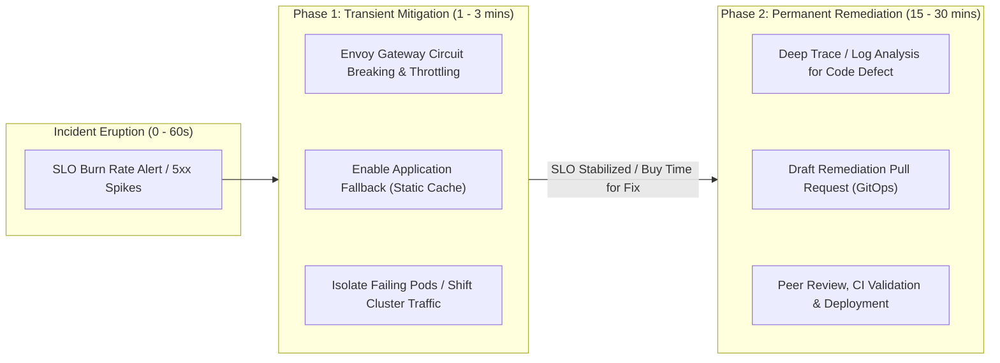
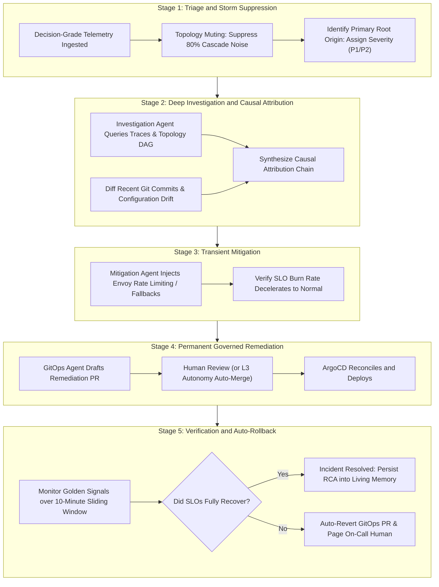
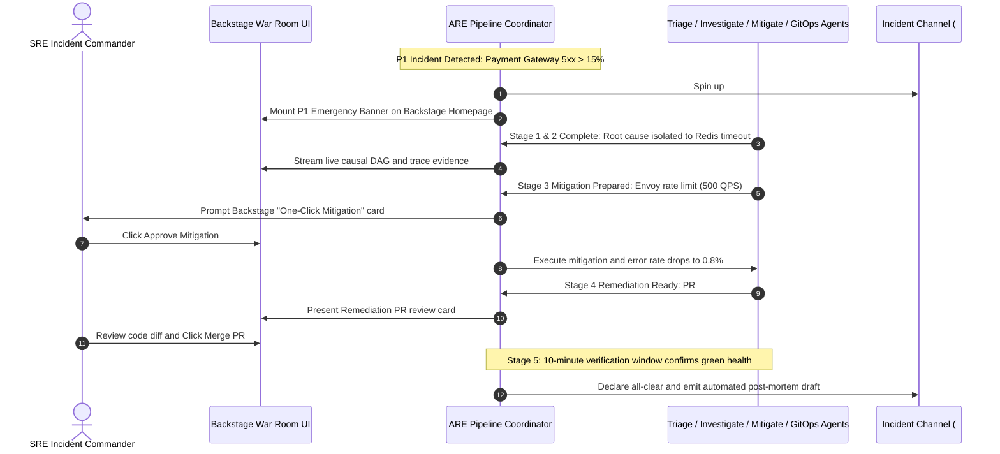

# 07-EX

# Agent-Driven Incident Response Pipelines and Production Self-Healing Practice

In Chapter 7, we achieved a compelling milestone: within a local `kind` cluster, we deployed an autonomous multi-agent system consisting of a `DiagnosticsAgent` (cluster inspection specialist), a `GitOpsAgent` (change proposal specialist), and a central `Coordinator`. When `my-first-app` crashed due to an image tag typo, this system parsed intent, diagnosed root causes, and successfully restored application health within five minutes through a governed GitHub Pull Request and ArgoCD reconciliation.

This practical exercise verified the feasibility of transitioning "From Insight to Action." However, when engineering teams attempt to extrapolate this prototype into enterprise production, they quickly encounter an operational reality gap:

> **"In complex production incidents, outages rarely boil down to a simple typo fix. When ten microservices cascade into failure and database thread pools exhaust, an SRE's first priority is to stop the bleeding, not spend twenty minutes waiting for CI/CD builds and PR reviews!"**

In real-world outages:

1. **Alert Storms**: A single database latency spike triggers hundreds of downstream alerts within seconds. Which service originated the failure?
2. **Mitigation vs. Remediation Inversion**: Generating bug fixes and merging pull requests takes time (linting, tests, reviews, builds). During the critical first three minutes, customers are actively impacted. Systems demand **sub-minute transient mitigation** (rate limiting, circuit breaking, fallback routing) rather than prolonged deployment pipelines.
3. **Verification and Anti-Regression Loops**: After changes apply, has system health genuinely recovered? Or has the intervention triggered secondary, latent failures?

This is where Chapter 7 of **Agentic Reliability Engineering (ARE)**—"The Agent-Driven Incident Response Pipeline"—delivers vital architectural structure.

As a dedicated extension to Chapter 7, this chapter elevates our initial multi-agent diagnostic prototype into a **production-grade five-stage incident response pipeline: Triage ➔ Investigate ➔ Mitigate ➔ Remediate ➔ Verify**.

---

# Core Mindset: Separating Transient Mitigation from Permanent Remediation

In traditional operations, engineers often conflate "mitigation" with "remediation." In ARE, they occupy distinct temporal windows and operational boundaries:



* **Mitigation (Stopping the Bleeding)**:
  - **Objective**: Rapidly arrest cascading failures, contain blast radiuses, and bring user experience back within acceptable SLO thresholds.
  - **Mechanisms**: Typically **transient, reversible, and non-destructive**. Examples include dynamic rate limiting at the Envoy Gateway, toggling read-only database replicas, or activating static cached responses.
  - **Time Window**: Executed within **1 to 3 minutes**.
* **Remediation (Curing the Disease)**:
  - **Objective**: Permanently eradicate the underlying root cause to prevent recurrence.
  - **Mechanisms**: Involves **durable code or configuration updates**. Examples include patching memory leak bugs, tuning garbage collection flags, or adjusting Kubernetes resource manifests via Pull Requests.
  - **Time Window**: Typically executed over **15 to 30 minutes** through rigorous peer reviews and CI pipelines.

**"Mitigate first to buy time; remediate permanently to cure the disease."** This is the fundamental tenet of production-grade operational agents.

---

# The Five-Stage Autonomous Incident Response Pipeline

ARE deconstructs complex incident handling into a disciplined five-stage pipeline orchestrated by specialized autonomous agents:



## Stage 1: Triage and Storm Suppression
When an outage strikes, monitoring systems emit thousands of alerts in seconds.

* **Triage Specialist Agent**:
  - Leverages the topology DAGs introduced in Chapter 4-EX to trace dependencies upstream;
  - Automatically suppresses downstream cascade alarms (Cascade Muting);
  - Isolates the originating service and assigns an unambiguous priority within 5 seconds (e.g., P1 blocker vs P3 minor degradation).

## Stage 2: Deep Investigation and Causal Attribution
* **Investigation Specialist Agent**:
  - Targets failing spans across OpenTelemetry traces rather than running blind string grep searches;
  - Queries Git repositories via MCP for code changes, manifest updates, or feature flag flips over the preceding hour;
  - Computes causal attribution chains with explicit Confidence Scores (e.g., `98% Confidence: Connection pool exhaustion caused by PR #42 timeout reduction`).

## Stage 3: Transient Mitigation
* **Mitigation Specialist Agent**:
  - Verifies current Autonomy Boundaries;
  - Dispatches governed MCP mitigation tools to inject runtime Envoy Gateway policies:
    1. Degrades non-essential calls (recommendations, history) to cached fallbacks;
    2. Implements token-bucket rate limiting on core checkout traffic to protect underlying databases;
  - Verifies within 60 seconds that SLO burn rates stabilize.

## Stage 4: Permanent Governed Remediation
Once the bleeding stops, permanent resolution begins:

* **GitOps Specialist Agent** (expanding Chapter 7):
  - Drafts an audited Pull Request implementing the structural fix;
  - Automatically links investigative traces, logs, and causal findings in the description;
  - Enforces CI compliance and policy tests per Chapter 8;
  - Upon engineer approval via Backstage, ArgoCD reconciles the deployment.

## Stage 5: Verification and Auto-Rollback
Deployment does not conclude the incident:

* **Verification Specialist Agent**:
  - Tracks the four Golden Signals (Latency, Traffic, Errors, Saturation) across a 10-minute sliding window;
  - **Auto-Rollback Guard**: If error rates do not decline as projected, or if secondary anomalies trigger, the agent immediately issues a revert PR to rollback the change within 30 seconds, gracefully paging on-call human engineers.

---

# The War Room Cockpit: Backstage Integration

In production operations, autonomous pipelines do not execute in an unmonitored vacuum; they integrate directly into developer workstations and war room interfaces:



## Hands-On Code: Declaring an MCP Transient Mitigation Tool

To empower mitigation agents safely, platform teams register **Mitigation Tools** with strict temporal and policy boundaries:

```typescript
import { McpServer } from "@modelcontextprotocol/sdk/server/mcp.js";
import { z } from "zod";

const server = new McpServer({
  name: "are-incident-mitigation-mcp",
  version: "1.0.0"
});

server.tool(
  "apply_transient_mitigation",
  "Applies temporary, time-bounded (TTL) traffic shaping and fallback rules at the Envoy Gateway to stop cascading failures",
  {
    targetService: z.string().describe("Target service name, e.g., payment-service"),
    mitigationAction: z.enum(["RATE_LIMIT_50_PERCENT", "ENABLE_STATIC_FALLBACK", "CIRCUIT_BREAK_DOWNSTREAM"])
      .describe("Approved transient mitigation action"),
    durationMinutes: z.number().min(5).max(60).default(15)
      .describe("Mitigation TTL in minutes (automatically expires to prevent lingering degradation)")
  },
  async ({ targetService, mitigationAction, durationMinutes }) => {
    // 1. Guardrail validation
    const allowed = await verifyMitigationBoundary(targetService, mitigationAction);
    if (!allowed) {
      throw new Error(`[ARE-GUARDRAIL-REJECTED] Service ${targetService} not authorized for ${mitigationAction}`);
    }

    // 2. Inject Envoy Gateway dynamic traffic rule with TTL
    const result = await injectGatewayFilter(targetService, mitigationAction, durationMinutes);

    // 3. Persist tamper-evident audit record
    await appendAuditTrail({
      actor: "ARE-Mitigation-Specialist",
      action: mitigationAction,
      target: targetService,
      ttl: `${durationMinutes}m`,
      timestamp: new Date().toISOString()
    });

    return {
      content: [
        {
          type: "text",
          text: JSON.stringify({
            status: "MITIGATION_APPLIED",
            service: targetService,
            action: mitigationAction,
            activeUntil: new Date(Date.now() + durationMinutes * 60000).toISOString(),
            message: `Transient mitigation active on ${targetService}. Automatically expires in ${durationMinutes} minutes.`
          }, null, 2)
        }
      ]
    };
  }
);
```

### Why This Design Matters
1. **Mandatory TTL (Time-to-Live)**: Manual temporary limits applied during outages are routinely forgotten, leaving services degraded for months. ARE mitigation tools enforce an automated TTL expiration, preventing permanent accidental degradation.
2. **Guardrail Boundary Verification**: The agent must validate target services against platform security policies before runtime gateways accept modifications.

---

# Reader Notes: A Practitioner's Perspective on Chapter 7-EX

> **"In the deep waters of distributed architectures, flawless code patches are a luxury; immediate, governed mitigation is survival."**

### 💡 Practitioner Mindset: Cultivating Emergency Field-Medic Intuition
Chapter 7 proved how agents automate pull requests. Chapter 7-EX injects practical realism: **Do not treat AI agents as remote typists during outages; equip them with the instinct of battlefield emergency medics.**
When cardiac arrest occurs, doctors do not perform open-heart surgery immediately; they administer CPR and defibrillation to stabilize vital signs first. Platform engineers must provide agents with transient mitigation levers (Envoy throttling, circuit breakers, cache fallbacks) to stabilize systems before executing structural fixes.

### 🎯 Key Takeaways
1. **The Five-Stage Closed Pipeline**:
   - Triage (Mute noise) ➔ Investigate (Causal links) ➔ Mitigate (Stop bleeding) ➔ Remediate (GitOps fix) ➔ Verify (Rollback guard).
2. **Mitigation vs. Remediation**:
   - Mitigation: Fast (1~3 mins), temporary (strict TTL), highly reversible;
   - Remediation: Thorough (15~30 mins), governed (PR + peer review), durable.
3. **War Room Role Alignment**:
   - Humans govern critical decisions via single-click authorizations (Human-above-the-loop);
   - Agents process telemetry cascades and orchestrate multi-specialist tasks.

### ⚠️ Production Pitfalls
* **Mitigation without TTLs**: Unexpired rate limits lead to prolonged, unmonitored degradation.
* **Skipping Verification Windows**: Assuming an outage is resolved when a PR merges is dangerous; enforce a mandatory 10-minute sliding window to ensure stability before declaring recovery.

### 🛠️ Action Checklist
* [ ] Audit your microservice fleet: do core APIs expose dynamic fallback and throttling switches configurable via Envoy Gateway?
* [ ] Prototype a transient mitigation tool in your local Chapter 7 lab cluster, simulating a two-stage "Rate-Limit then Draft PR" workflow.
* [ ] Analyze your organization's last two major post-mortems: what percentage of time was lost between initial alert noise and effective mitigation? Could a Triage agent accelerate that phase?

---

# Further Reading

* **Agentic Reliability Engineering Chapter 7**: [https://tedmax100.github.io/agentic-reliability-engineering-zh-tw/ch07.html](https://tedmax100.github.io/agentic-reliability-engineering-zh-tw/ch07.html)
* **Envoy Gateway Traffic Management**: [https://gateway.envoyproxy.io/](https://gateway.envoyproxy.io/)
* **Google SRE Book - Managing Incidents**: [https://sre.google/sre-book/managing-incidents/](https://sre.google/sre-book/managing-incidents/)
