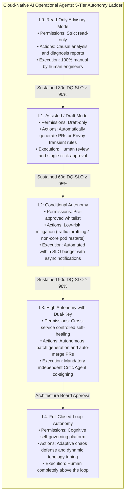
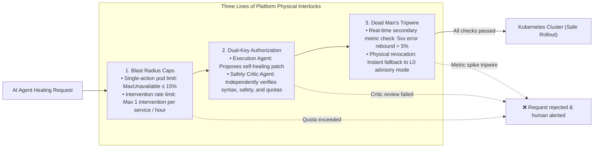

# 08-EX

# Governed Autonomy: The Autonomy Ladder and Safety Interlock Framework

In Chapter 8, we established the security, compliance, and identity governance foundation for enterprise platform engineering in the AI era. We thoroughly explored defensive controls against prompt injection, memory poisoning, delegated trust abuse, and privilege escalation, backing them with cryptographic hash-chained audit trails.

However, when shifting focus from "defending against external adversaries" to "internal autonomous operational agents" (as implemented in Chapter 7 and Chapter 7-EX), senior architects and VPs of Engineering face an even more unsettling concern:

> **"In high-stakes production systems, catastrophic outages are rarely caused by external hackers; they are triggered by well-intentioned, overly privileged internal autonomous agents making catastrophic errors."**

Consider the following disaster scenarios:

* A self-healing agent detects intermittent database connection timeouts and decides to restart all order microservice Pods across the cluster simultaneously to clear alerts. This triggers an instantaneous thundering herd storm that overwhelms the primary database, leading to a company-wide outage.
* A FinOps cost-optimization agent notices minimal traffic during off-peak night hours and scales the production database replica count down to 1. When an unexpected global promotional flash sale lands hours later, the single replica collapses instantly under load.

This is the life-or-death challenge addressed in Chapter 11 ("Governed Autonomy") of *Agentic Reliability Engineering* (ARE):

> **"Autonomy is never a binary all-or-nothing switch. It is a strictly governed ladder that an agent must climb gradually, backed by formal safety interlocks, mathematical validation, and proven historical accuracy."**

This chapter serves as the practical extension to Chapter 8. We will architect an enterprise-grade **Autonomy Ladder (L0 through L4)**, implement hard **Blast Radius Caps**, and enforce **Dual-Key Authorization**, guaranteeing that as operational agents unlock unprecedented velocity, they remain rigidly bounded within immutable safety guardrails.

---

# The Autonomy Ladder: From L0 to L4

In mature engineering organizations, an intern on their third day is never granted root access to production clusters. Likewise, an AI agent newly introduced into the platform must never be granted unconstrained autonomy.

Drawing inspiration from autonomous driving levels, ARE establishes a five-tier **Autonomy Ladder** tailored for cloud-native platform agents:



### 1. L0: Read-Only Advisory Mode

* **Positioning**: The agent acts strictly as a "copilot."
* **Boundaries**: Read-only access permissions (e.g., querying Prometheus metrics, inspecting OTel traces, reading the Backstage software catalog).
* **Behavior**: The agent informs engineers: *"I detected signs of connection pool exhaustion; recommend executing the following command..."* It possesses zero write or execution privileges.

### 2. L1: Assisted / Draft Mode

* **Positioning**: The standard baseline adopted in Chapters 5 and 7.
* **Boundaries**: The agent is permitted to generate structured change artifacts (such as GitHub Pull Requests or Envoy transient rate-limiting manifests), but **cannot apply changes autonomously**.
* **Behavior**: Changes reside in Git repositories awaiting human peer review and merge approvals via Backstage or GitHub.

### 3. L2: Conditional Autonomy

* **Positioning**: Machine-speed mitigation for localized, low-risk scenarios.
* **Boundaries**: Platform teams define explicit whitelists (e.g., non-critical services, stateless workloads, transient throttling).
* **Behavior**: When an incident strictly matches predefined policy criteria, the agent autonomously executes mitigations within **the TTL constraints described in Chapter 7-EX** (such as applying localized rate limiting), immediately broadcasting asynchronous notifications to Slack.

### 4. L3: High Autonomy with Dual-Key Review

* **Positioning**: Mature, production-grade self-healing.
* **Boundaries**: The agent is permitted to initiate and automatically merge remediations across core production services.
* **Hard Counterbalance**: Enforces **Dual-Key Authorization**—any remediation proposed by the execution agent must be reviewed by an independently deployed **Safety Critic Agent** equipped with separate prompts and verification logic. Both keys must be turned before changes are applied.

### 5. L4: Full Closed-Loop Autonomy

* **Positioning**: Cognitive, self-adaptive platforms of the future.
* **Boundaries**: The platform exhibits autonomous self-healing, proactive chaos defense, and dynamic architectural tuning. Human engineers operate strictly **"above the loop,"** intervening only when an agent explicitly triggers an AE-SLO escalation.

---

# Hard Guardrails: Physical Safety Interlocks

To ensure an autonomous agent never triggers compounding cascading failures, the platform must enforce three non-bypassable physical interlocks at the infrastructure layer:



## 1. Blast Radius Caps
At the code level, regardless of how confident an agent is in its reasoning, every action must be constrained by rigid quotas:

* **Instance Ratio Cap**: In a single self-healing action, the number of Pods restarted or replaced must never exceed **15%** of the microservice's total running instances.
* **Intervention Rate Limiting**: An agent is limited to a maximum of 2 interventions per namespace within a rolling 60-minute window. Exceeding this threshold triggers an immediate lockout and escalates to human on-call engineers.

## 2. Dual-Key Authorization
Launching a missile on a nuclear submarine requires two officers to turn independent keys simultaneously. High-risk production self-healing similarly cannot rely on a single LLM grading its own homework:

* **Execution Agent**: Collects telemetry, performs causal reasoning, and drafts remediation patches (e.g., updating a `ReplicaSet` or tuning Envoy Gateway configurations).
* **Safety Critic Agent**: Powered by an independent model and prompt template, dedicated exclusively to finding flaws. It does not generate solutions; it strictly audits:
  1. Does the patch include unauthorized privilege escalations?
  2. Does the proposed change exceed blast radius quotas?
  3. Does the patch comply with the security and compliance baselines established in Chapter 8?
* The platform controller (e.g., OpenChoreo Controller or GitOps operator) applies changes only when the Critic Agent provides a valid asymmetric cryptographic signature.

## 3. Dead Man's Tripwire
The platform's final fail-safe mechanism.

If within 90 seconds following an agent's mitigation (e.g., rate-limiting or canary rollout), core business golden signals degrade instead of improving—causing a **secondary spike (e.g., a 5% increase in global 5xx errors)**:

* The underlying platform controller **trips the dead man's wire**;
* Instantly revokes all write credentials and tokens assigned to the agent;
* Triggers an immediate rollback to the previous known-good state;
* Globally downgrades the agent's permissions back to **L0 Advisory Mode**, firing high-priority PagerDuty alerts to summon human responders.

---

# Hands-On Implementation: Autonomy Policy Engine

In platform engineering, we do not rely on an LLM's "moral self-discipline." Deterministic code must intercept every tool invocation before it reaches the control plane. Below is an enterprise TypeScript implementation of an **Autonomy Guardrail Middleware** placed between agent action dispatchers and the Kubernetes API:

```typescript
import { Request, Response, NextFunction } from "express";

interface AgentActionPayload {
  agentId: string;
  autonomyLevel: "L0" | "L1" | "L2" | "L3" | "L4";
  targetService: string;
  actionType: "RESTART_PODS" | "TRAFFIC_SHED" | "MODIFY_CONFIG" | "DELETE_RESOURCE";
  affectedInstanceRatio: number; // Projected ratio of affected Pods (0.0 ~ 1.0)
  criticApprovalSignature?: string;
}

export class AutonomyPolicyEngine {
  // Deterministic safety constants
  private static readonly MAX_ALLOWED_BLAST_RADIUS = 0.15; // Max 15% blast radius
  private static readonly RECENT_INTERVENTIONS = new Map<string, number>();

  public static async enforceGuardrails(payload: AgentActionPayload): Promise<{ allowed: boolean; reason?: string }> {
    // Check 1: Strictly forbid destructive deletion operations
    if (payload.actionType === "DELETE_RESOURCE") {
      return { allowed: false, reason: "[POLICY-CRITICAL] Autonomous agents are strictly forbidden from deleting resources!" };
    }

    // Check 2: L0 Advisory mode has zero write access
    if (payload.autonomyLevel === "L0") {
      return { allowed: false, reason: "[POLICY-L0-RESTRICTED] Agent is currently in L0 Advisory mode with no write permissions." };
    }

    // Check 3: Enforce hard Blast Radius Cap
    if (payload.affectedInstanceRatio > this.MAX_ALLOWED_BLAST_RADIUS) {
      return {
        allowed: false,
        reason: `[BLAST-RADIUS-EXCEEDED] Requested instance impact is ${(payload.affectedInstanceRatio * 100).toFixed(1)}%, exceeding the 15% safety limit!`
      };
    }

    // Check 4: L3 actions require independent Critic Agent Dual-Key signature
    if (payload.autonomyLevel === "L3") {
      const isCriticValid = await this.verifyCriticSignature(payload.criticApprovalSignature);
      if (!isCriticValid) {
        return { allowed: false, reason: "[DUAL-KEY-MISSING] L3 operation lacks valid signature from independent Safety Critic Agent!" };
      }
    }

    // Record and increment intervention frequency
    this.recordIntervention(payload.targetService);
    return { allowed: true };
  }

  private static async verifyCriticSignature(signature?: string): Promise<boolean> {
    if (!signature) return false;
    // Verify asymmetric cryptographic signature from independent critic service
    return signature.startsWith("CRITIC_SIG_VALIDATED_");
  }

  private static recordIntervention(service: string) {
    const current = this.RECENT_INTERVENTIONS.get(service) || 0;
    this.RECENT_INTERVENTIONS.set(service, current + 1);
  }
}
```

### Why Deterministic Guardrails Are Impervious

* **Immunity to Jailbreaking & Prompt Injection**: Even if an adversary manages to manipulate an agent's reasoning via malicious context injection, the underlying deterministic TypeScript engine ruthlessly terminates any execution violating blast radius or signature requirements. Probabilistic language models cannot override compiled deterministic validation logic.

---

# Practitioner Notes: Key Insights on Chapter 8-EX

> **"Engineering trust is never built on naive optimism; it is grounded in mathematically enforced boundaries and rigorous verification."**

### 💡 Mindset Shift: Autonomy Is Earned, Not Granted
When debating AI autonomy, engineering teams often polarize between "extreme paranoia (forbidding AI from touching any system)" and "reckless abandon (granting root access to LLMs)." Chapter 8-EX establishes the **Autonomy Ladder** to break this false dichotomy:

* Newly deployed agents strictly start at L0 (Advisory) and L1 (PR drafting);
* Using the Langfuse tracing and DQ-SLO metrics introduced in earlier chapters, the platform team continuously monitors diagnostic accuracy;
* Only after maintaining a verified accuracy rate of 98%+ for 90 consecutive days does the architecture board unlock L2 and L3 permissions via configuration. This **progressive trust model** is the only sustainable path to executive confidence.

### 🎯 Core Takeaways

1. **Five-Tier Autonomy Ladder**:
   - L0 Advisory ➔ L1 Draft/PR ➔ L2 Conditional Whitelist ➔ L3 Dual-Key High Autonomy ➔ L4 Full Closed-Loop Adaptive.
2. **Three Inviolable Interlocks**:
   - Blast Radius Caps (MaxUnavailable ≤ 15%);
   - Dual-Key Independent Signing (separation between Executor and Critic);
   - Dead Man's Tripwire (circuit break to L0 on golden signal spikes).
3. **Deterministic Code Wrapping Probabilistic Models**:
   - Never prompt an LLM to "please do not restart more than 10% of Pods";
   - Enforce hard limits in API gateway middleware.

### ⚠️ Production Pitfalls

* **The "Self-Grading" Trap**: Asking the same model in the same context "Is this change safe?" almost always yields an agreeable response due to self-affirmation bias. The Critic Agent must run with a completely isolated context, independent prompts, or an entirely distinct model architecture.
* **Unbounded Intervention Loops**: Without strict frequency limiting, an agent reacting to oscillation may reconfigure cluster policies every 60 seconds. Hard limits on hourly interventions are mandatory.

### 🛠️ Tomorrow's Action Items

* [ ] Audit platform API keys and tokens: Ensure no agent credentials possess destructive capabilities (e.g., dropping databases or deleting production namespaces). Revoke them immediately at the IAM layer.
* [ ] Collaborate with security and SRE teams to draft an internal "AI Agent Autonomy Grading Specification" based on the L0-L4 ladder.
* [ ] Implement a blast radius middleware filter (limiting affected instances to ≤ 15%) in your operational Model Context Protocol (MCP) servers.

---

# Further Reading

* **Agentic Reliability Engineering, Chapter 11: Governed Autonomy**: [https://tedmax100.github.io/agentic-reliability-engineering-zh-tw/ch11.html](https://tedmax100.github.io/agentic-reliability-engineering-zh-tw/ch11.html)
* **Open Policy Agent (OPA) Official Documentation**: Declarative policy as code for cloud-native infrastructure: [https://www.openpolicyagent.org/](https://www.openpolicyagent.org/)
* **NIST AI Risk Management Framework (AI RMF 1.0)**: Guidelines for governance and trustworthiness in autonomous systems: [https://www.nist.gov/itl/ai-risk-management-framework](https://www.nist.gov/itl/ai-risk-management-framework)
