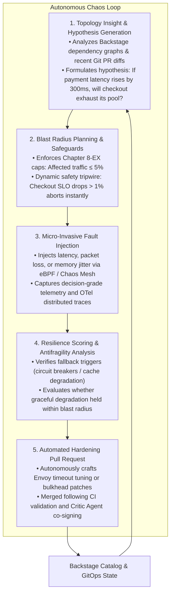
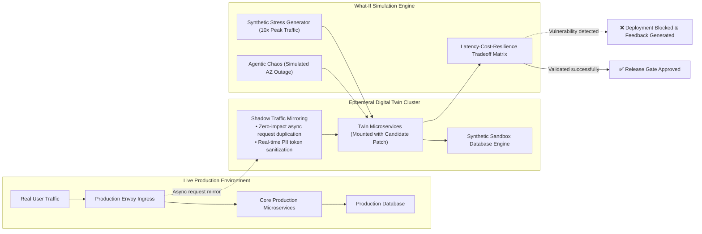

# 09-EX

# Autonomous Chaos Engineering and Digital Twins: From Passive Defense to Predictive Platform Resilience

In Chapter 9, we explored the future architectural vision of platform engineering—from deconstructing the "Agentic Harness" as a standard architectural pattern, to the declarative packaging of "Governance-as-a-module" and "Context-as-a-module," and elevating agent evaluation to a first-class engineering discipline with "Evals-as-CI."

However, on the road toward fully autonomous platforms, engineering teams encounter a pivotal philosophical and architectural question:

> **"In Chapter 7, we established reactive self-healing during incidents. In Chapter 8-EX, we erected rigid safety guardrails (Governed Autonomy). But must we perpetually sit before dashboards, passively waiting for catastrophic production failures before validating our system's true resilience?"**

The answer is an unequivocal no.

In Chapters 9, 10, and 12 of *Agentic Reliability Engineering* (ARE), a transformative answer emerges:
**"Shift the role of operational agents from reactive firefighters to proactive red/blue team commanders and digital twin simulation engines."**

Traditional chaos engineering (such as Netflix's early Chaos Monkey) relied on human engineers inventing manual hypotheses and scheduling blunt scripts to terminate random Pods. In today's complex cloud-native microservices and distributed service meshes, true system vulnerabilities lurk within **tail latency cascades**, **retry storms**, and **cache-stampede deadlocks**—subtle edge cases that human intuition alone cannot comprehensively anticipate.

This chapter serves as the practical extension to Chapter 9, detailing two foundational pillars of next-generation platform architecture:

1. **Autonomous Agentic Chaos**: AI agents continuously inspect real-time service topologies and Git pull requests, formulate hypothesis-driven fault injection experiments, uncover latent failure modes, and autonomously generate remediation PRs.
2. **Cloud-Native Digital Twins & Shadow Rehearsal**: High-fidelity shadow environments where counterfactual simulations run safely before any architectural change or automated remediation touches live production.

---

# The Autonomous Chaos Loop: From Reactive Mitigation to Continuous Probing

The primary pitfalls of conventional chaos testing are blind disruption and disproportionate risk: teams either hesitate to inject faults into production or apply overly destructive hammer blows (like powering down an entire node) that reveal nothing about nuanced application logic resilience.

Within the ARE framework, AI agents integrate directly with cloud-native chaos meshes (such as Chaos Mesh or LitmusChaos) to orchestrate a closed **Autonomous Chaos Loop**:



### Hypothesis-Driven over Random Disruption
Before triggering an experiment, an AI agent must formalize and submit a structured scientific hypothesis:

* **Steady State**: System operates within established baseline health (99.9% request latency $\le 120\text{ms}$, error rate $\le 0.01\%$).
* **Fault Injection**: Introduce $350\text{ms}$ artificial latency to gRPC calls between `Order-Service` and `Payment-Gateway`.
* **Expected Behavior**: The local circuit breaker on `Order-Service` trips after 3 consecutive timeouts, gracefully falling back to an asynchronous queue with user-perceived latency remaining under $200\text{ms}$.
* **Abort Conditions**: If the global 5xx error rate spikes by more than $0.5\%$, all injected faults are instantly purged.

If the experiment reveals that the circuit breaker failed to open—causing `Order-Service` thread pools to saturate and block upstream ingress—the AI agent identifies an **unhandled cascading failure risk**. It immediately localizes the issue within Helm charts or application code, opening an automated Pull Request to tune timeouts and configure bulkheads.

---

# Platform Digital Twins and Counterfactual Rehearsal

In aerospace engineering and Formula 1 racing, engineers never test uncalibrated engine packages directly on race day; they rehearse millions of virtual laps inside supercomputer-driven digital wind tunnels.

In software platform engineering, many teams still treat canary deployments on live users as their ultimate safety net. However, for mission-critical banking, telecommunications, or healthcare workloads, impacting even $1\%$ of live production traffic carries unacceptable legal and financial penalties.

ARE Chapter 12 introduces the practice of **Cloud-Native Reliability Digital Twins**:



### 1. Shadow Traffic Mirroring and PII Sanitization
Leveraging Envoy Gateway or Istio `Request Mirroring`, the platform asynchronously duplicates live production traffic to an ephemeral digital twin environment without introducing latency to live requests. At the twin gateway, an agent sanitizes JWT tokens, credentials, and personally identifiable information (PII) using one-way deterministic hashing.

### 2. What-If Counterfactual Simulation
Prior to production rollout, an AI simulation agent spins up parallel hypothetical scenarios inside the digital twin:

* **Scenario A (Demand Shock)**: Under an unexpected 10x Black Friday traffic surge, can the newly updated Horizontal Pod Autoscaler (HPA) scale out within 45 seconds, or will cold-start delays trigger massive connection drops?
* **Scenario B (Cloud Partition)**: If a single cloud availability zone suffers a physical fiber cut, does the revised ingress topology fail over cleanly to secondary zones within 3 seconds?

Only when candidate changes successfully withstand these rigorous counterfactual stress tests does the platform deployment controller promote the PR to production.

---

# Hands-On Implementation: Declarative Agentic Chaos Controller

In Kubernetes platforms, AI-driven chaos experiments are standardized via Custom Resource Definitions (CRDs), integrating resilience testing into declarative GitOps workflows. Below is a TypeScript implementation of a controlled chaos experiment controller featuring hard blast radius limits and real-time tripwires:

```typescript
import { KubernetesObject, CustomObjectsApi } from "@kubernetes/client-node";

// CRD Spec for declarative agentic chaos experiments
export interface AgenticChaosExperimentSpec {
  targetService: string;
  targetNamespace: string;
  steadyStateSLO: {
    metric: string;
    threshold: number; // e.g., p99 latency < 200ms
  };
  injectedFault: {
    type: "LATENCY" | "PACKET_LOSS" | "CPU_STRESS" | "POD_FAILURE";
    intensityMs?: number;
    intensityPercent?: number;
  };
  blastRadius: {
    maxTrafficRatio: number; // Max allowed traffic impact, e.g., 0.05 (5%)
    maxDurationSeconds: number; // Max duration, e.g., 180s
  };
  safetyTripwire: {
    secondaryMetric: string;
    abortThreshold: number; // e.g., error rate > 1.0% triggers immediate abort
  };
}

export class AgenticChaosController {
  private k8sApi: CustomObjectsApi;

  constructor(apiClient: CustomObjectsApi) {
    this.k8sApi = apiClient;
  }

  // Controlled execution workflow invoked by autonomous agent
  public async executeControlledExperiment(spec: AgenticChaosExperimentSpec): Promise<void> {
    console.log(`[CHAOS-CONTROLLER] Received chaos experiment request for ${spec.targetService}...`);

    // Hard guardrail check: Enforce maximum blast radius policy
    if (spec.blastRadius.maxTrafficRatio > 0.10) {
      throw new Error("[SECURITY-VIOLATION] Experiment requested traffic impact exceeds the 10% hard safety cap!");
    }

    // Step 1: Baseline steady-state health verification
    const isBaselineHealthy = await this.verifySteadyState(spec.steadyStateSLO);
    if (!isBaselineHealthy) {
      console.warn("[ABORT] Service baseline health is currently sub-optimal. Fault injection forbidden!");
      return;
    }

    // Step 2: Inject targeted micro-fault (via eBPF / Envoy dynamic filter)
    await this.applyFaultInjection(spec.targetService, spec.injectedFault);
    console.log(`[INJECTED] Successfully injected ${spec.injectedFault.type} into ${spec.targetService}...`);

    // Step 3: Real-time Dead Man's Tripwire polling loop
    const timer = setInterval(async () => {
      const tripwireTriggered = await this.checkSafetyTripwire(spec.safetyTripwire);
      if (tripwireTriggered) {
        console.error("[TRIPWIRE-TRIPPED] Secondary metrics breached safety threshold! Aborting fault injection immediately!");
        clearInterval(timer);
        await this.purgeFaultInjection(spec.targetService);
        await this.notifySRETeam("Autonomous chaos experiment tripped safety wire; environment restored cleanly.");
      }
    }, 5000);

    // Step 4: Time-to-Live bounded auto-cleanup
    setTimeout(async () => {
      clearInterval(timer);
      await this.purgeFaultInjection(spec.targetService);
      console.log("[COMPLETED] Experiment duration reached. Fault purged. Commencing resilience evaluation.");
    }, spec.blastRadius.maxDurationSeconds * 1000);
  }

  private async verifySteadyState(slo: any): Promise<boolean> {
    // Queries Prometheus or Datadog metrics
    return true; 
  }

  private async applyFaultInjection(service: string, fault: any): Promise<void> {
    // Interacts with Chaos Mesh or Envoy dynamic proxy APIs
  }

  private async purgeFaultInjection(service: string): Promise<void> {
    // Removes all injected latency and packet loss filters
  }

  private async checkSafetyTripwire(tripwire: any): Promise<boolean> {
    // Real-time evaluation of canary failure metrics
    return false;
  }

  private async notifySRETeam(message: string): Promise<void> {
    // Dispatches Slack / PagerDuty incident notification
  }
}
```

---

# Practitioner Notes: Key Insights on Chapter 9-EX

> **"A platform that never tests its breaking points in peacetime is guaranteed to collapse under pressure at the worst possible moment."**

### 💡 Mindset Shift: From Passive Defense to Antifragile Evolution
Conventional reliability engineering is fundamentally reactive: wait for alerts, summon human responders or operational agents, and scramble to triage damage. Chapter 9-EX demonstrates the pursuit of **Antifragility**—empowering platforms to grow stronger by actively absorbing controlled, bounded micro-stresses.

* Autonomous agents utilize low-traffic maintenance windows to run targeted resilience probes against recently modified microservices;
* Through digital twin shadow mirroring, new architectural versions withstand simulated crises before seeing a single real customer;
* Engineers no longer fear Friday deployments because candidate code has already proven its durability across 10x traffic bursts and dependency partition simulations.

### 🎯 Core Takeaways

1. **Hypothesis-Driven Autonomous Chaos**:
   - Replaces blunt, random pod killing with scientific hypotheses (steady state baseline, bounded perturbation, expected fallback, and automated abort tripwires).
2. **Shadow Traffic & Compliance Sanitization**:
   - Zero-latency request mirroring feeds digital twins, while API gateways strictly scrub sensitive PII.
3. **Counterfactual Multi-Universe Rehearsal**:
   - Evaluates changes against extreme scenarios (flash-crowd demand, availability zone partition) using multi-objective tradeoff analysis (latency vs. cost vs. resilience).
4. **Deterministic Tripwires as Non-Negotiable Backstops**:
   - Regardless of an agent's confidence, the underlying controller enforces an immutable 5-second polling loop to terminate experiments if secondary metrics degrade.

### ⚠️ Production Pitfalls

* **Injecting Chaos During Sub-Optimal Health**: If a service is already experiencing elevated error rates or resource saturation, injecting additional chaos turns an experiment into a live catastrophe. Controllers must strictly verify baseline steady-state health before injecting faults.
* **Leaking Shadow Write Traffic**: When mirroring traffic to digital twins, all downstream mutation sinks (such as payment gateways, third-party webhooks, and persistent production storage) must be rigorously mocked. Otherwise, mirrored shadow requests will result in duplicated financial charges or customer communications!

### 🛠️ Tomorrow's Action Items

* [ ] Review current staging environments: Does their architecture and data fidelity support realistic shadow testing? If not, explore ephemeral virtual clusters (such as vCluster) for on-demand digital twins.
* [ ] Select a non-critical stateless microservice in your internal development platform and pilot a micro-latency injection test equipped with an automated abort tripwire.
* [ ] Integrate Backstage and OpenChoreo dependency catalogs into your testing pipeline as structural inputs for autonomous chaos planning.

---

# Further Reading

* **Agentic Reliability Engineering, Chapters 9 & 10: Autonomous Chaos Architecture & Proactive Resilience**: [https://tedmax100.github.io/agentic-reliability-engineering-zh-tw/ch09.html](https://tedmax100.github.io/agentic-reliability-engineering-zh-tw/ch09.html)
* **Agentic Reliability Engineering, Chapter 12: Digital Twins and Counterfactual Simulation**: [https://tedmax100.github.io/agentic-reliability-engineering-zh-tw/ch12.html](https://tedmax100.github.io/agentic-reliability-engineering-zh-tw/ch12.html)
* **Chaos Mesh Official Documentation**: Cloud-native chaos testing orchestration: [https://chaos-mesh.org/](https://chaos-mesh.org/)
* **Principles of Chaos Engineering**: Fundamental practices and industry guidelines: [https://principlesofchaos.org/](https://principlesofchaos.org/)
