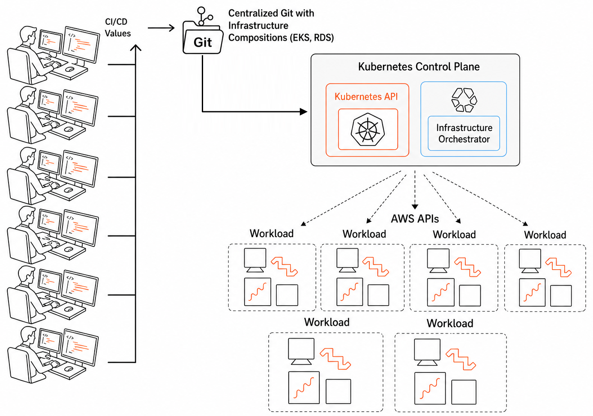
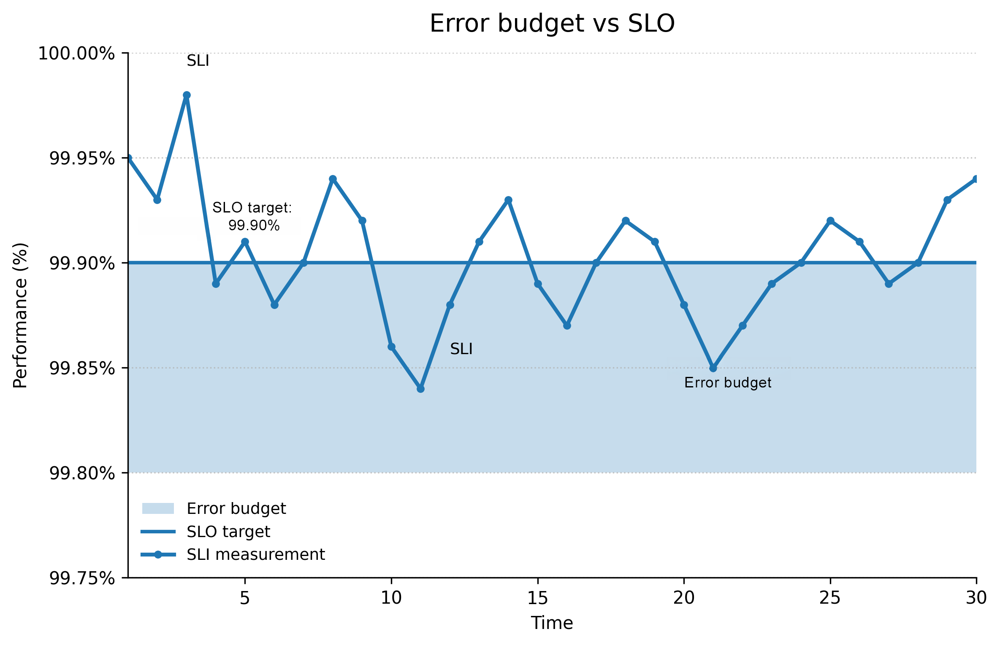
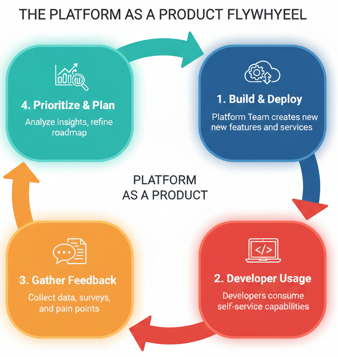

# 1

# Platform Engineering and Developer Experience

Have you ever felt like you're navigating a maze just to get your code into production? You want to build great features, but instead, you are stuck wrestling with infrastructure, deciphering cryptic error messages, and trying to connect a dozen different tools that don't want to talk to each other. We have felt that pain. We have seen teams lose countless hours, not building great products but fighting the complexity of the systems underneath.

For years, our journey in software development has been a battle against this complexity. We celebrated when we moved from low-level code to high-level languages, and again when we left behind physical servers for the cloud. Each step, like DevOps, was an attempt to build a higher bridge over the technical swamp, aiming to reduce the mental weight on developers and speed up innovation. Platform engineering was the next logical step on this quest. We thought we could finally build a smooth, paved road for our developers with self-service tools for everything they needed. Yet, we soon discovered that we hadn't eliminated the complexity; we had just moved it. Now, developers faced a new kind of confusion, and we, the platform teams, found ourselves responsible for building and maintaining this incredibly sophisticated internal product. Does this sound familiar?

This chapter is about the next leap forward, the one we believe will finally help us tame the beast:  **AI-driven platform engineering** . We will tackle the tough questions that we still struggle with. How do we lift the heavy cognitive load from our developers? How can we prove that our platform is not just a cost center but a powerhouse for business value? And how do we finally start treating our internal platform like a real product, with real users who deserve a great experience?

Our goal is to show you how artificial intelligence, from smart automation to helpful AI agents, can change the game. We will explore how AI helps us transform platform engineering from a reactive firefighting team into a proactive, self-improving engine that boosts developer productivity and makes the business more agile. We are not just talking about automating tasks. We will show how AI gives our platforms the intelligence to manage complexity on its own, anticipate what developers will need next, and create a developer experience that feels almost effortless.

In this chapter, we will break down:

* **The real productivity challenges developers face** and how self-service platforms, using tools like Kubernetes operators and Infrastructure as Code (IaC), are the first step to solving them.
* **How to measure what truly matters** . We will go beyond simple metrics and dive into SRE, DORA metrics, SLOs, SLAs, and SLIs to connect our platform's performance to real business goals, like happy users and revenue growth.
* **How to think beyond automation and treat your platform as a product** . This is a mindset shift. We will explore how to use product management thinking to build a platform that developers love, with a clear, value-driven roadmap for the future.

# The evolution of DevOps into AI-driven platform engineering

Imagine a developer spending hours debugging memory leaks or manually provisioning servers, their creativity stifled by complex infrastructure tasks. Over our careers in technology, we've seen this struggle evolve as the industry embraced abstraction to reduce cognitive load. From low-level code to cloud orchestration, these advancements laid the groundwork for platform engineering, a discipline that automates operational complexity, empowering developers to focus on innovation and delivering business value.

How do developers navigate the growing complexity of modern software systems? Much like cars and airplanes revolutionized travel by making it faster and more efficient, technology has evolved through abstractions that simplify development. From high-level languages such as Python and Java to React and microservices, tools like containerization and Kubernetes have streamlined application deployment and orchestration. These *vehicles* for innovation enable developers to build complex systems with less effort, boosting productivity and accelerating time-to-market.

Yet, tools like Kubernetes also introduce entropy (complexity from diverse configuration options) that can challenge developers if unmanaged. Today, AI-driven platforms address this by intelligently automating and optimizing workflows.

This journey of abstraction leads to platform engineering, a natural evolution of DevOps that empowers developers to focus on solving problems and delivering business value, as we'll explore next.

## The emergence of platform engineering

Platform engineering takes this principle of abstraction to the next level, focusing on streamlining the developer experience and automating operational tasks. This reflects a growing recognition of the value of dedicated teams focused on enabling developers to build and deploy software quickly and efficiently. The primary abstraction that platform engineering offers is an enhanced developer experience through automation. Gone are the days of developers raising tickets to create Git repositories, provision cloud resources, or set up CI/CD pipelines. Instead, these operational tasks are automated through self-service platforms. These platforms enforce security and governance guardrails, such as automated compliance checks, and manage cloud provisioning. Instead of spending valuable time on these often tedious and error-prone tasks, developers can focus on what they do best: writing code and building innovative solutions. Platform engineering aims to eliminate operational cognitive load. The platform team acts as an internal provider, offering pre-built infrastructure, services, and tools that allow developers to quickly and easily deploy applications.

We remember the days when setting up a development environment could take days or even weeks. This involved configuring servers, installing software, and managing dependencies, a time-consuming, error-prone, and often frustrating process. Now, with well-implemented platform engineering practices, it can be done in minutes. Using tools such as **Infrastructure as Code** ( **IaC** ), containerization, and automated deployment pipelines, platform teams can create standardized and repeatable environments that can be spun up quickly and easily. This shift is transformative for developer productivity and satisfaction. However, although self-service capabilities resolved the initial bottleneck of manual ticket requests, they introduced a new challenge: managing the growing complexity of these internal platforms. This is precisely where AI enters as the next essential layer of abstraction, turning our platforms from static tools into more intelligent systems.

By freeing developers from the burden of operational complexities, platform engineering allows them to be more productive, creative, and focused on delivering value to the business.

This shift isn't just about convenience; it's about enabling faster innovation and driving business agility. Looking ahead, we're seeing the emergence of  *platforms of platforms* , which empower developers in the modern software landscape. This significant change signifies a move toward more flexible software development environments. These meta-platforms expose APIs within the platform engineering layer, enabling the creation of even higher-level abstractions. This architectural evolution allows for greater customization, efficiency, and scalability. This concept highlights the critical role of platform engineering in connecting disparate systems and streamlining workflows.

The benefits of this approach are clear in high-performing organizations that embrace it and suggest that platform engineering not only improves efficiency but also contributes to enhanced business outcomes. However, this trend isn't just about technology; it's a holistic approach that encompasses people and processes too. As Gene Kim, co-author of " *The Phoenix Project* ," often says, " *Improving daily work is even more important than doing daily work.* " Platform engineering embodies this principle by continuously improving the developer's daily experience. By focusing on automation, self-service capabilities, and streamlined workflows, platform teams aim to reduce friction and empower developers to be more productive and focused. This philosophy goes beyond mere tools and delves into the human element, prioritizing developer satisfaction and effectiveness.

In our view, the trajectory from punch cards to platform engineering represents more than just technological progress. It's a fundamental shift in how we approach software development. It's about empowering developers to focus on what they do best: creating innovative solutions to real-world problems. By abstracting away the complexities of infrastructure and operations, we're opening new possibilities for creativity and innovation in software development. This shift will lead to faster development cycles, more agile teams, and the ability to deliver value to customers more quickly. The future of software development is tied to the continued evolution of platform engineering and the *platforms of platforms* that will shape the next generation of digital innovation.

## The current state: AI-driven platforms

At the time of writing, we're taking part in a genuine shift in platform engineering, one that is being transformed by AI, particularly agentic AI, which autonomously optimizes systems. The traditional platform engineering approaches we've discussed have evolved rapidly, and we're experiencing a significant transformation in how we build, maintain, and interact with platforms.

Integrating AI into platform engineering has moved far beyond simple automation. It's now about creating intelligent conversational interfaces between developers and their infrastructure. Just as earlier abstractions created new forms of entropy in our systems, AI introduces its own complexity. However, unlike previous technological advances, AI systems can actively work to manage this entropy through self-optimization and autonomous problem resolution.

Building on the concept of platforms of platforms, which we discussed earlier, the integration of **Large Language Models** ( **LLMs** ) with platform engineering has been greatly facilitated by the **Model Context Protocol** ( **MCP** ). MCP servers don't create this integration themselves but rather provide a standardized way for LLMs to interact with various platform APIs. This enables LLMs to act as an intelligent layer that understands context, previous interactions, and complex requirements, and can translate human intent into precise technical implementations across multiple platform services. For instance, a developer could use natural language to request the creation of a new microservice. Alternatively, an LLM, using MCP, could troubleshoot a failing deployment by correlating logs across microservices, analyzing recent configuration changes in Git, and suggesting a remediation patch. This API-based approach allows organizations to expose their platform capabilities as tools for LLMs, creating a more flexible and extensible ecosystem. This advancement represents a significant step toward more intuitive and efficient platform management, where the complexity of multiple underlying systems is abstracted away through intelligent, context-aware interfaces.

The emergence of agentic AI has redefined the platform engineering landscape. AI is no longer just a tool but an active participant in the platform engineering ecosystem. These agentic AI systems can proactively identify potential issues, suggest optimizations, and even implement approved changes autonomously. The potential of AI-driven platform engineering extends far beyond operational efficiency. We're now working with what we call  **cognitive platforms** , systems that not only learn from user behavior and automatically adjust their configurations but also anticipate future needs and proactively evolve. These platforms can predict resource needs, optimize costs in real time, and even suggest architectural improvements based on a sophisticated analysis of usage patterns and performance metrics.

Security and compliance in platform engineering have been both revolutionized and complicated by AI. On one hand, advanced AI systems have enhanced our ability to continuously monitor security postures, automatically update policies based on new threats, and even simulate potential security scenarios to prepare defenses proactively. This predictive security approach has become crucial as regulatory frameworks around AI and cloud computing continue to evolve rapidly. On the other hand, the integration of AI has introduced new security concerns. The danger of AI being provided extensive access privileges, coupled with its capacity for autonomous decision-making and the theoretical risk of self-modifying behaviors, has created new challenges in securing our platforms.

Integrating AI into platform engineering, while transformative, has not been without its complexities. Questions about AI governance, the reliability of AI-driven decisions, and the need for human oversight continue to be active areas of discussion in the community. The very power that makes AI effective in managing complexity also raises concerns about its potential to introduce new forms of risk if not properly controlled. Yet, just as each previous abstraction layer introduced its own form of entropy, AI represents a unique turning point: a technology capable of not just creating but also managing complexity autonomously, provided we implement the right safeguards and governance models.

The shift from punch cards to AI-driven platform engineering highlights not only technological progress but also a transformation in how teams create, operate, and innovate together. By abstracting away not just the complexities of infrastructure and operations, but also the intricacies of decision-making and optimization, we're opening a new range of possibilities for software development and operations.

As we look to the future, it's clear that the synergy between platform engineering and AI will continue to deepen. Through standardized protocols like MCP, cognitive platforms are becoming a reality, enabling LLMs to interact seamlessly with our tools and systems. We're moving toward a world where platforms don't just abstract away complexity but actively work to optimize and evolve themselves, leading to levels of efficiency, reliability, and innovation that we're only beginning to imagine.

# Developer productivity challenges and self-service capabilities

As we explored in the previous section, the evolution from DevOps to platform engineering has been driven by the need to abstract away complexity and reduce cognitive load for developers. However, this journey hasn't been without its challenges. The very advancements that aimed to simplify developers' lives have, in some cases, introduced new complexities and responsibilities. Before we look at how AI is changing this space, it helps to understand the developer challenges we have today and the role of self-service capabilities in addressing them.

Developers face a multifaceted set of challenges that continue to create significant cognitive load, despite our best efforts to streamline their work. The modern developer juggles an overwhelming array of responsibilities, from managing complex infrastructure and navigating an ever-expanding toolkit to ensuring security compliance and optimizing system performance. They find themselves constantly context-switching between coding, debugging, deployment, and operational tasks, which can significantly impact their productivity and focus. The time spent on infrastructure and service setup often overshadows the time dedicated to developing core business logic, leading to frustration and decreased efficiency. These challenges are further compounded by the need to stay current with rapidly evolving technologies and methodologies, creating a perpetual learning curve that can be both exhilarating and exhausting.

## The rise of automation and self-service

The journey began when a group of DevOps pioneers recognized these challenges. They started creating automation scripts to provision resources like databases, virtual machines, and cloud services (Kubernetes clusters, API gateways, and event buses). Their goal was simple yet ambitious: automate everything while maintaining security parameters and architectural rules.

As teams adopted Terraform, the IaC movement gained momentum. This approach allowed developers to define and manage infrastructure in code, enabling version control, collaboration, and repeatability. However, this solution brought its own set of challenges.

While automation scripts and IaC solved the repeatability problem, they created a new challenge: how to make these capabilities accessible to developers in a self-service way. Early attempts involved using existing tools such as Jenkins for job execution and Rundeck for process automation. Teams would create web interfaces or CLI tools to trigger these automated processes, but these solutions were often fragmented and difficult to maintain. Each team might create their own tools and interfaces, leading to a proliferation of similar but slightly different solutions across organizations. This fragmentation led to an important realization: infrastructure automation needed to be treated as a product, not just a collection of scripts. Organizations began to understand that delivering self-service capabilities required the same attention to user experience, documentation, and support as any other software product. This shift in mindset, from treating platforms as a project to treating them as a product, set the stage for more sophisticated solutions.

## The rise of internal developer platforms (IDPs)

The shift toward developer autonomy didn't start with modern portals. Long before Backstage, platforms like Cloud Foundry were already pioneering self-service infrastructure. Developers were constantly blocked, hunting for the right person, the right script, or the right document. It was frustrating, and it slowed everything down. Then, these new portals appeared, acting like a central town square in the middle of the jungle. Suddenly, there was a single place to go. With friendly interfaces, clear templates, and automated workflows, developers were handed a map and a compass. They could finally focus on building, not on fighting the environment around them. This was more than just a new tool. It was a profound shift. We began to see our internal platforms not as a collection of scripts and servers, but as a product, with our developers as the valued customers.

But the journey wasn't over. While the "town square" was great, managing the complex machinery of the cloud felt like a separate, deeply technical job. It was like having a beautiful, simple dashboard for your car, but still needing to be an expert mechanic every time you wanted to add a new feature. How could we bring that complexity into a world developers already understood?

This is where the next revolution began, with the rise of  **Kubernetes operators** . We saw powerful tools emerge, including **Helm** for packaging applications and  **Crossplane** , **Kube Resource Orchestrator** ( **kro** ), and **AWS Controllers for Kubernetes** ( **ACK** ) for managing infrastructure. These weren't just tools; they were translators. They taught Kubernetes to speak the language of the cloud providers directly. Suddenly, a database, a message queue, or a storage bucket wasn't an external thing you had to provision through another console. It became a native resource you could request right from your Kubernetes cluster. By shifting to this centralized, declarative model, we create a single source of truth that transcends simple infrastructure provisioning. It allows us to consolidate fragmented workflows, such as CI/CD pipelines and security policy enforcement, directly into the platform's core. This fundamentally simplifies the engine, and importantly, lowers the cognitive load for the platform team. By allowing the system to handle these patterns autonomously, we divert distractions away from platform engineers, enabling them to focus on high-value architectural work rather than acting as ticket-takers. For developers, this was a game changer; we weren't just giving them a nicer dashboard; we were fundamentally simplifying the engine they lived in. *Figure 1.1* shows how a Kubernetes control plane centralizes infrastructure management and consolidates fragmented pipelines:

Figure 1.1: Using Kubernetes as a control plane (Kubernetes operators)

By shifting to this centralized control plane model, we fix our fragmented workflows and set the stage to look at how this setup changes the work of our platform teams.

## The redistribution of cognitive load

However, it's crucial to understand that this evolution doesn't eliminate complexity; it redistributes it. Historically, the burden of maintaining these powerful abstractions fell entirely on platform teams. They had to possess a deep understanding of both the underlying infrastructure and the nuanced needs of their developers. While this work is vital for delivering business value, it often left platform engineers drowning in a sea of tickets, troubleshooting, and manual intervention, creating a constant, heavy cognitive load that stifled their own innovation.

The introduction of artificial intelligence and machine learning into this space is finally shifting this dynamic. We are moving beyond simply abstracting infrastructure for developers; we are now using AI to act as a force multiplier for the platform team itself. As these technologies mature, they offer a way to divert those endless, distracting "mechanical" tasks away from human engineers toward intelligent automation. Imagine AI systems that don't just provision resources, but proactively detect and resolve infrastructure issues, predict scaling needs, and optimize performance before a human even realizes there is a problem. By handling the "day-to-day" of the platform, AI frees platform engineers from the role of ticket-takers, allowing them to focus on high-level architecture and the strategic evolution of the ecosystem.

Throughout this journey, each evolution has brought us closer to a more sustainable balance. From manual scripts to self-service platforms and Kubernetes operators, we have been building the foundation for this next phase. Finding the right equilibrium remains critical: we strive to simplify the developer's life while simultaneously safeguarding the platform team's focus and the system's security. Efficiency is about ensuring that both our infrastructure and our human talent are utilized effectively.

As we look to the future, organizations with established standardization and well-defined responsibilities will be best positioned to leverage AI effectively. AI's role will be to orchestrate and enhance existing processes, acting as the ultimate "platform assistant." For instance, in a GitOps workflow, AI might propose configuration changes via pull requests, but the execution and governance remain anchored in the controller, adhering to the patterns the platform team has codified.

This journey isn't just about new tools; it's about understanding the evolving needs of our entire engineering organization. Leading organizations will effectively combine standardization, clear responsibility allocation, and AI to create truly empowering ecosystems where neither the developer nor the platform engineer is overwhelmed. As we move into our discussion on metrics, we'll explore how different organizations have tackled these challenges and what we can learn from their experiences. We'll see how companies have strategically used metrics not just to measure velocity, but to drive innovation, optimize the internal developer experience, and ensure that technology initiatives align with both business goals and the health of the teams building them.

# Measuring success with SRE, MTTR, DORA metrics, SLOs, SLAs, and SLIs

After exploring the evolution of platform engineering and examining developer productivity challenges, we arrive at a crucial question: *How do we measure the success of our platform initiatives?*

The answer lies in metrics, but choosing and implementing the right measurements is not as straightforward as it might seem. For years, we have been guided by metrics in almost every facet of our lives. From our earliest days, we were encouraged by our parents to aim for good grades and focus on our studies, an early introduction to the way numbers and benchmarks shape our path forward. We are not saying this is bad, but we often lose sight of the main purpose of studying: gaining knowledge and preparing for future professional success.

In our professional careers, we often fall into the trap of misusing metrics. We focus on goals like reducing costs, decreasing the number of incidents, improving SLAs, and staying within the error budget.

The problem is that employees measured by these numbers often meet their targets without understanding the real business reason behind them. They may not realize the ultimate objective is to:

* Deliver features for users faster
* Keep the service available during a critical sales event
* Divert operational distractions away from platform engineers to intelligent systems
* Reduce the day-to-day cognitive load for the entire engineering organization

This is like how a team might install a complete observability stack like Prometheus, with dozens of pre-built dashboards, but only ever use the handful of metrics that are critical to their service.

In the end, tracking metrics for their own sake, without a clear business-focused intent, is pointless. We risk chasing numbers that don't truly matter to the success of the business.

Success in business, when viewed through the lens of technology metrics, is a multifaceted concept that goes beyond traditional financial indicators. It involves a delicate balance between operational efficiency, customer satisfaction, innovation capacity, and long-term sustainability. In the digital age, technology has become the backbone of most business operations, making it crucial to align technical performance with overall business objectives.

The true measure of success lies in how effectively an organization can leverage its technological capabilities to drive business growth, enhance customer experiences, and maintain a competitive edge in the market. This requires a holistic approach to metric selection and analysis, where each technical indicator is directly tied to a business outcome. For instance, system uptime isn't just about maintaining a high percentage; it's about ensuring consistent service delivery that translates into customer trust and loyalty.

Success in this context is also not static. As businesses evolve and customer expectations shift, the metrics that define success must also adapt. This dynamic nature requires a continuous reevaluation of what constitutes success and how it's measured. It's not uncommon for organizations to find that metrics that once indicated success may become less relevant over time, requiring the adoption of new, more pertinent indicators.

Ultimately, the success of a business in terms of tech metrics should be gauged by how well these metrics reflect the company's ability to meet its strategic goals, satisfy its customers, and drive innovation. This means looking beyond surface-level technical performance to understand the broader impact on business operations, market position, and future growth potential.

## Connecting tech metrics to business success

Here are the top seven metrics commonly used by companies to measure success using tech metrics:

* **Customer Satisfaction Score** ( **CSAT** ) or **Net Promoter Score** ( **NPS** ) for user experience
* **Revenue Per User** ( **RPU** ) or **Average Revenue Per User** ( **ARPU** ) for revenue
* **User engagement rate** (for example, daily active users/monthly active users) for adoption
* **System reliability** (for example, the uptime percentage, error rates) for uptime
* **Time to market** for new features
* **Cost efficiency** (for example, the infrastructure costs per user) for savings
* **Innovation index** (for example, the percentage of revenue from new products/features) for growth

Imagine a fictional e-commerce company, *TechShop* * Global* , that faced significant challenges with their digital platform performance. With millions of daily visitors and a complex product catalog, they needed to revolutionize their approach to platform reliability and user experience metrics.

The company initiated their transformation by implementing a comprehensive cloud-native architecture using AWS services. They leveraged Amazon EKS for container orchestration and implemented event-driven architecture using EventBridge and SQS. This strategic move yielded impressive results: deployment times dropped from 30 days to just 5 minutes, matching success patterns seen in the financial sector.

Their data analysis revealed a critical insight: a 2.3-second delay in product page loading resulted in a 40% drop in the conversion rate. This discovery emphasized the crucial relationship between technical performance and business outcomes.

Through detailed user behavior analysis, they found that customers who experienced three or more search failures during a shopping session were 65% less likely to return within the next week. This metric became a key driver for their technical improvements.

To address these challenges, TechShop Global implemented several innovative solutions:

* Developed a sophisticated caching strategy using AWS integration services
* Implemented AI-powered predictive scaling mechanisms
* Created a custom platform engineering solution for workload optimization

The business impact was substantial:

* Increased customer revenue by 46% within six months
* Reduced operational costs by 50%
* Improved platform reliability from 99.90% to 99.99%
* Decreased time-to-market for new features from 6 months to 7 weeks

Additionally, TechShop Global saw improvements in three key areas:

* **Customer Satisfaction Score** ( **CSAT** ): The CSAT score increased from 3.8 to 4.7 out of 5, reflecting the enhanced user experience and platform reliability.
* **User ****e****ngagement ****r** **ate** : The ratio of daily active users to monthly active users improved from 0.3 to 0.5, indicating a significant increase in regular platform usage.
* **Innovation ****i** **ndex** : The percentage of revenue from new products and features launched in the past year rose from 15% to 28%, demonstrating the company's improved ability to innovate and bring new offerings to market.

This case demonstrates how modern cloud architecture and platform engineering, when properly implemented, can transform both technical metrics and business outcomes. The success metrics show that focusing on platform performance, user experience, customer satisfaction, engagement, and innovation directly correlates with business growth and customer satisfaction. Let's dive into the world of platform engineering metrics and understand how they shape modern business success.

## Core platform engineering metrics

Having watched the evolution of these metrics, we can tell you that they've become increasingly sophisticated and business-focused over the years.

Platform engineering metrics have evolved significantly from simple uptime measurements to complex indicators of business health. The most critical metrics in today's landscape include:

* Deployment frequency
* Lead time for changes
* Mean time to recovery (MTTR)
* Platform adoption rate
* Change failure rate
* Infrastructure provisioning time
* Developer satisfaction score (DSAT)

Now, let us share something that many platform teams often overlook: the importance of error budgets and Service Level Objectives (SLOs). In our experience working with various organizations, we've found that understanding these concepts can dramatically improve how teams operate. Error budgets, for instance, provide a scientific way to balance innovation with reliability.

Speaking of reliability metrics, let's break down the essential components:

* Service Level Agreement (SLA)
* Service Level Objective (SLO)
* Service Level Indicator (SLI)

*Figure 1.2* shows how SLI performance is measured against an SLO target and how periods below the target consume the error budget.

Figure 1.2: Error budget versus SLO (service level objective)

SLAs represent our promises to customers, while SLOs are our internal targets that should be more stringent than SLAs. SLIs are the actual measurements we use to track our performance. DORA metrics, introduced by the DevOps Research and Assessment team, help us understand how well we're delivering software.

The technical operations metrics deserve special attention. **Mean Time to Recovery** ( **MTTR** ) measures how quickly we can bounce back from failures. **Recovery Time Objective** ( **RTO** ) and **Recovery Point Objective** (RPO) help us plan for disasters and ensure business continuity. What's particularly interesting is how these metrics interact with **Business Impact Analysis** ( **BIA** ) to create a comprehensive understanding of our system's resilience.

When it comes to developer experience metrics, we need to think about both quantitative and qualitative measurements. Time to first deployment, platform adoption rate, and self-service success rate provide hard data, while developer satisfaction surveys and feedback sessions give us crucial qualitative insights.

We've noticed that successful organizations tend to focus on a balanced scorecard approach. They combine technical metrics like deployment frequency and error rates with business metrics like feature adoption and revenue impact. This holistic approach ensures that platform engineering efforts directly contribute to business success. Moving on to implementation, it's crucial to establish baseline measurements before making improvements. For example, when measuring MTTR, start by tracking current recovery times and then set realistic improvement goals.

Finally, let's talk about the future of platform engineering metrics. As systems become more complex and distributed, we're seeing new metrics emerge. Observability, user journey tracking, and AI-assisted performance optimization are becoming increasingly important. But remember, the key is to always tie these measurements back to business value.

# Beyond automation, platform as a product

The evolution of platform engineering has brought us to a fascinating intersection where technology meets product thinking. Having discussed the journey from DevOps to platform engineering, developer productivity challenges, and success metrics, we can now explore how treating platforms as products transforms their impact on organizations.

Modern platform teams are increasingly adopting product management methodologies, moving away from the traditional project-based approach. This shift represents a fundamental change in how we think about internal developer platforms. According to the  *State of Platform Engineering Report (Volume 3)* , organizations treating platforms as products are seeing measurable impacts, with 22.13% reporting significant improvements in key metrics and 31.97% noting slight improvements in areas like deployment frequency and time to market. However, measurement remains a challenge, with 44.67% of organizations not tracking any metrics at all, indicating room for maturity growth in how platform success is evaluated and demonstrated.

The role of **product owners** ( **POs** ) in platform teams has become increasingly crucial. These **POs** must balance technical requirements with user needs, much like their counterparts in customer-facing products. They work closely with platform engineers to ensure that features align with developer workflows and organizational goals.

*Figure 1.3* illustrates this continuous product cycle, from building and deploying platform capabilities to gathering feedback and refining the roadmap.

Figure 1.3: Platform as a product

Now, in terms of practical implementation, successful platform products require clear documentation, intuitive interfaces, and robust support systems. Companies such as GitHub and GitLab have set high standards in this regard, with their platforms becoming benchmarks for developer experience. Their success demonstrates how treating internal tools with the same care as external products leads to higher adoption rates and better outcomes.

The metrics we discussed earlier become even more critical when viewing platforms as products. Customer satisfaction scores, time-to-market metrics, and platform adoption rates serve as key performance indicators that guide product decisions. This data-driven approach helps platform teams prioritize features that deliver the most value to their developer customers.

Security and compliance, which we touched on earlier, take on new dimensions in this product-centric approach. Platform teams must balance user experience with organizational requirements, creating guardrails that protect without impeding productivity. The self-service capabilities we discussed become core features in the platform product, requiring careful design and continuous improvement.

Looking forward, the integration of AI and natural language processing is revolutionizing how developers interact with platforms. This evolution represents the next frontier in platform engineering, where complex tasks can be accomplished through simple, natural language commands.

Platform teams are now experimenting with AI-powered assistants that can help with everything from code reviews to infrastructure provisioning. These tools understand context and can suggest optimal configurations based on historical data and best practices. The potential for AI to transform platform engineering is immense, and we'll explore this in detail in the next chapters. From *[Chapter 4](https://learning.oreilly.com/library/view/agentic-ai-for/9781806386659/Chapter_4.xhtml#h1_79)* onward, every hands-on chapter is backed by working code you can run yourself, published in the book's companion repository at [https://github.com/PacktPublishing/Agentic-AI-for-Platform-Engineering](https://github.com/PacktPublishing/Agentic-AI-for-Platform-Engineering).

The future of platform engineering lies in creating intelligent, user-centric products that evolve with their users' needs.

As we've observed in our work with various organizations, the most successful platforms are those that maintain a strong feedback loop with their users and continuously adapt to changing requirements.

Management buy-in becomes crucial when treating platforms as products. Organizations need to understand that platforms require ongoing investment and development, just like any other product. Product thinking in platform engineering isn't just about tools and features. It's about creating an ecosystem that empowers developers while maintaining organizational standards. This approach has proven to be transformative, leading to better outcomes for both platform teams and their users.

In our experience working with various organizations, the shift to treating platforms as products marks a significant evolution in how we approach developer enablement. As we move forward, the integration of AI and natural language interfaces will further enhance this approach, making platforms more accessible and powerful than ever before.

# Summary

The evolution from DevOps to AI-driven platform engineering is more than simply a technological progression; it is a fundamental shift in how we approach software development. We have traveled from the manual struggles of configuring servers, a time-consuming and error-prone process, to a new era where intelligent, declarative systems act as force multipliers for our entire organization. By treating our internal platforms as products and moving toward centralized, intelligent orchestration, we are finally addressing the core challenges of developer productivity.

Crucially, this journey has taught us that complexity cannot simply be ignored; it must be managed. By using AI not just to abstract away infrastructure but to act as a partner in operations, we are successfully redistributing cognitive load, freeing both developers and platform engineers from repetitive, mechanical tasks. As we move forward, the synergy between standardized practices, product-centric management, and AI-driven automation will continue to empower teams to focus on what truly matters: innovation, business value, and delivering high-quality experiences to our users. The future belongs to those who build these intelligent ecosystems, where systems optimize themselves and platform teams are free to focus on the strategic architecture that drives the next generation of digital success.

# Further reading

* Kim, G., Behr, K., & Spafford, G. (2013).  *The Phoenix Project: A Novel About IT, DevOps, and Helping Your Business Win* . IT Revolution Press.
* Platform Engineering. (2024).  *State of Platform Engineering Report Volume 3* . [https://platformengineering.org/reports/state-of-platform-engineering-vol-3](https://platformengineering.org/reports/state-of-platform-engineering-vol-3)
* Forsgren, N., Humble, J., & Kim, G. (2018).  *Accelerate: The Science of Lean Software and DevOps: Building and Scaling High Performing Technology Organizations* . IT Revolution Press.
