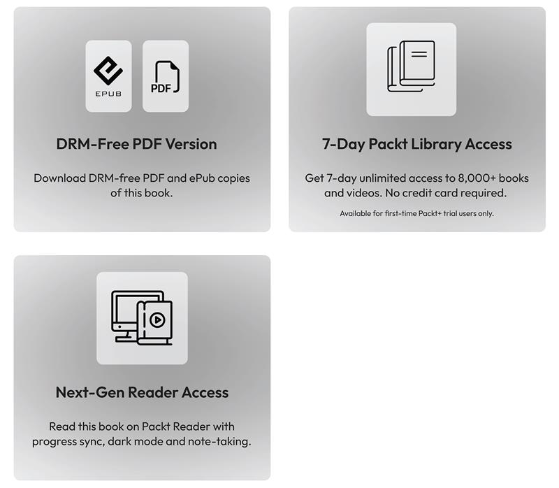
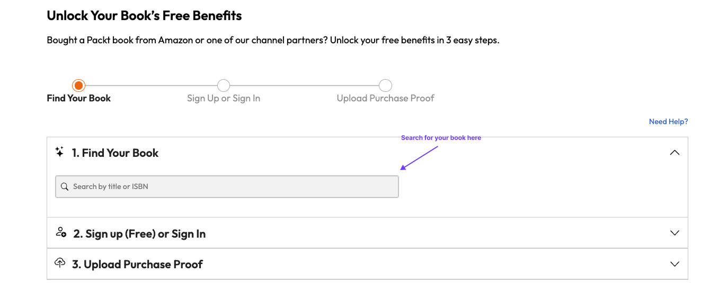

# 10

# Unlock Your Exclusive Benefits

Your copy of this book includes the following exclusive benefits:

Follow the guide below to unlock them. The process takes only a few minutes and needs to be completed once.

# Unlock this Book's Free Benefits in three Easy Steps

## Step 1

Keep your purchase invoice ready for  *Step 3* . If you have a physical copy, scan it using your phone and save it as a PDF, JPG, or PNG.

For more help on finding your invoice, visit `[packtpub.com/en-us/unlock?step=1](https://packtpub.com/en-us/unlock?step=1)`.

If you bought this book directly from Packt, no invoice is required. After  *Step 2* , you can access your exclusive content right away.

## Step 2

Scan the QR code or go to `[packtpub.com/unlock](https://packtpub.com/unlock)`.

On the page that opens (similar to *Figure **1* *0*  *.* *1* on desktop), search for this book by name and select the correct edition.

Figure 10.1: Packt unlock landing page on desktop

## Step 3

After selecting your book, sign in to your Packt account or create one for free. Then upload your invoice (PDF, PNG, or JPG, up to 10 MB). Follow the on-screen instructions to finish the process.

## Need Help

If you get stuck and need help, visit `[packtpub.com/unlock-benefits/help](https://packtpub.com/unlock-benefits/help)` for a detailed FAQ on how to find your invoices and more. This QR code will take you to the help page.

