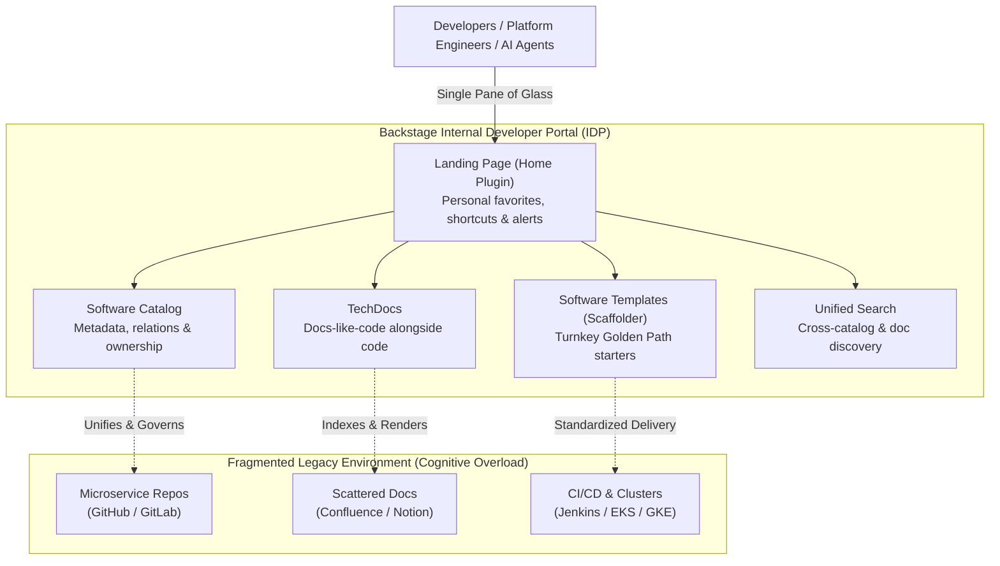
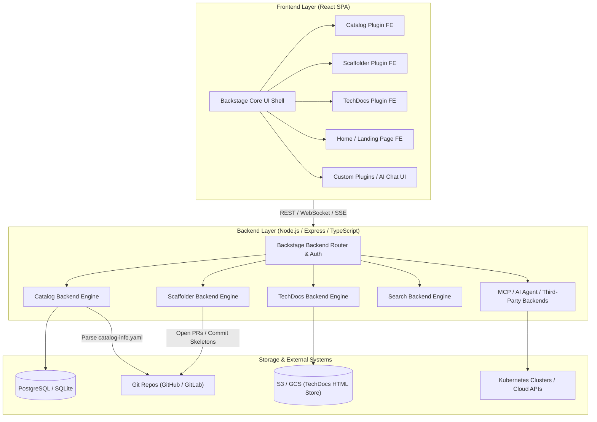
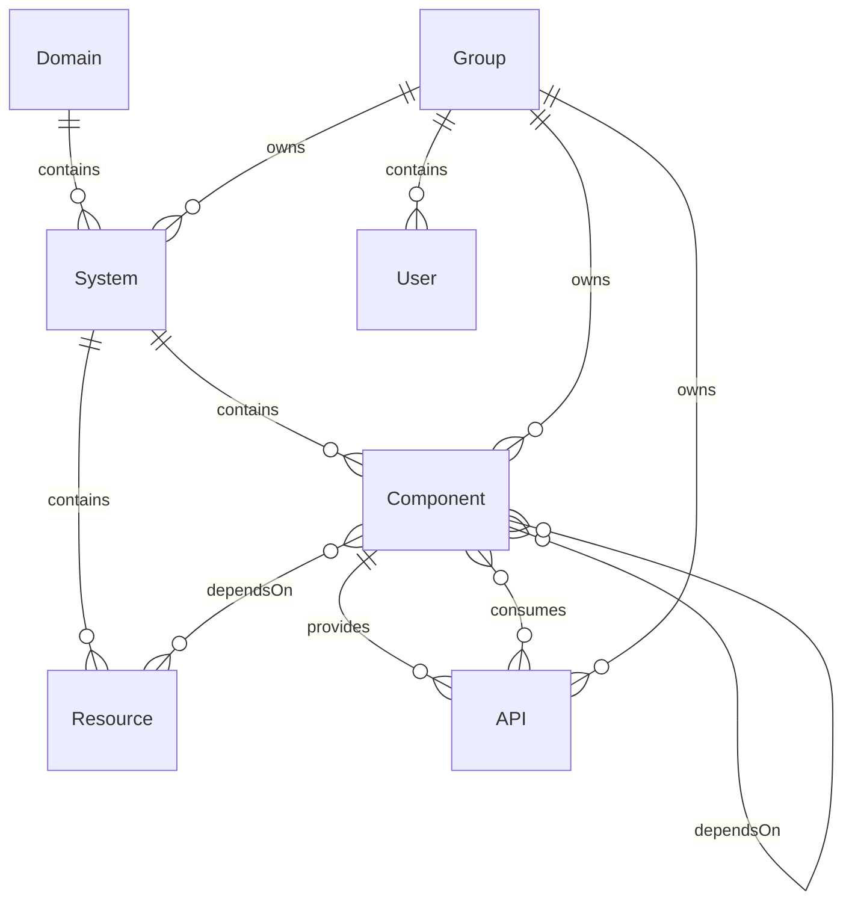
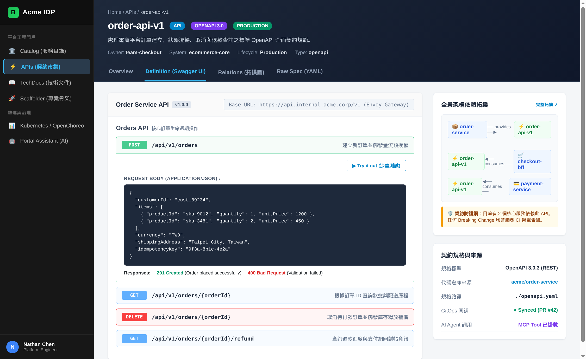
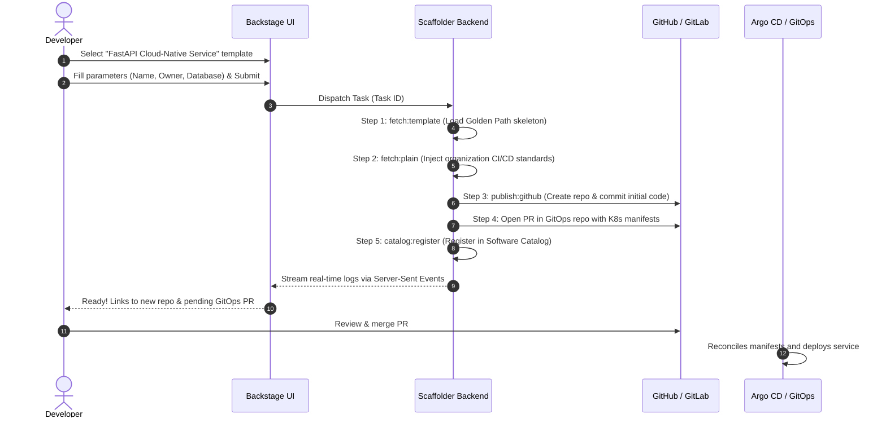
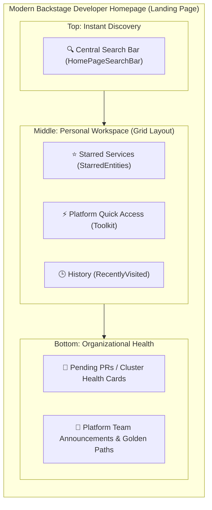
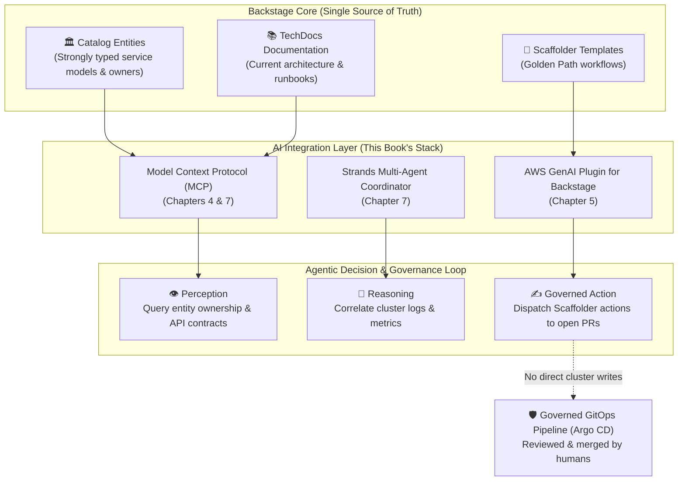

# 11

# Backstage: The Core Internal Developer Portal and Platform Engineering Practice

In the journey of scaling software engineering, almost every organization inevitably collides with the exact same "cognitive wall": when the number of microservices skyrockets from dozens to hundreds or even thousands, when cloud infrastructure sprawls across numerous accounts and clusters, and when disparate toolchains, deployment scripts, and operational runbooks are scattered across countless wikis, Slack channels, and engineers' heads, developer experience inevitably slides toward chaos and suffocating complexity.

Have you ever experienced these recurring pains?

* A newly onboarded engineer spends three full weeks just figuring out "how to set up the local development environment" and "who actually owns this particular service";
* To spin up a new microservice, developers resort to hunting down old repositories, copying and pasting obsolete code, inadvertently replicating deprecated dependencies, security-flawed Dockerfiles, and non-compliant CI/CD pipelines;
* During a production incident, SREs and on-call engineers scramble frantically, only to discover that the API documentation has been outdated for two years, and the true contract only exists in some unrecorded pull request.

It is precisely from this quagmire that the **Internal Developer Portal (IDP)** emerged, with **Backstage** indisputably becoming the flagship framework of the platform engineering movement.

This chapter provides a comprehensive, 360-degree deep dive into Backstage. Guided by the [official Backstage documentation hub](https://backstage.io/docs/landing-page/doc-landing-page), we explore Backstage's origins, architectural philosophy, and four core pillars (**Software Catalog, Software Templates, TechDocs, and Search**). Furthermore, we unpack custom **Landing Page / Home Plugin** mechanics, and bridge it with the central theme of this book—examining how Backstage acts as both the **perception layer** and the **governed action surface** for **Agentic AI** in modern platform engineering.

---

# Origins of Backstage and Its Platform Engineering Mission

Before diving into architectural specifics, let us return to where it all began: Spotify.

## Spotify's Dilemma and the "Software Wilderness"

In the mid-to-late 2010s, Spotify underwent exponential business and engineering growth. To empower engineering teams with ultimate autonomy, Spotify adopted a decentralized "squad" organizational model and embraced microservices. While this model accelerated early innovation, the side effects became acute as the engineering organization expanded to thousands of engineers and thousands of microservices:

1. **Information Silos and Cognitive Overload**: No single person could see the full picture. Engineers didn't know if a service already existed, frequently reinventing the wheel; wanting to consume an internal API, they had no clear way to identify who owned it.
2. **Fragmentation and Loss of Standards**: Every squad selected their own programming languages, frameworks, CI/CD tools, and monitoring setups. Enforcing a company-wide security patch or infrastructure upgrade was nearly impossible.
3. **The Onboarding Marathon**: New hires had to sift through dozens of obsolete Confluence pages and ask around in Slack channels, often taking weeks or months before their first pull request made it to production.

Spotify realized a fundamental truth: **Autonomy without a well-defined "Paved Road" (or "Golden Path") descends into chaos.**

To grant developers genuine autonomy without crushing them under cognitive load, Spotify kicked off an internal project in 2016 to build a centralized developer portal—the genesis of Backstage.



## From Internal Tool to CNCF Graduated Project

In 2020, Spotify made a landmark decision: open-source Backstage and donate it to the **Cloud Native Computing Foundation (CNCF)**.

Catalyzed by the global open-source community, Backstage gained massive enterprise adoption. Organizations such as Netflix, American Airlines, Expedia, Epic Games, and Toyota adopted and contributed to the project. In 2024, Backstage officially graduated from the CNCF, joining the ranks of Kubernetes, Prometheus, and Envoy as a **CNCF Graduated Project**, cementing its position as the de facto standard for internal developer portals worldwide.

## Internal Developer Portal (Portal) vs. Platform

In platform engineering discourse, the terms "Internal Developer Portal" (IDP) and "Internal Developer Platform" (IDP) are frequently conflated. They serve distinct yet tightly coupled roles:

* **The Internal Developer Platform**: The underlying mesh of automated infrastructure capabilities—Kubernetes clusters, cloud resources, CI/CD pipelines, and infrastructure-as-code controllers (e.g., Crossplane, Terraform).
* **The Internal Developer Portal (e.g., Backstage)**: The **front-of-house UI and Single Pane of Glass** for this platform. It does not run workloads directly; rather, it structures, contextualizes, and unifies service definitions, operational actions, and documentation, providing engineers with an intuitive, consistent, and governed interface.

As described in Chapter 1: *"It acts like a central town square in the middle of the jungle. Suddenly, there is a single place to go."*

---

# System Architecture and Technology Stack

Backstage is not an off-the-shelf SaaS tool; it is a **highly modular developer portal framework**. Its design philosophy is: **The Core is merely a lightweight shell; all concrete capabilities are delivered as Plugins.**



## Frontend Architecture
* **React + TypeScript**: The entire web frontend is a modern single-page application (SPA).
* **Material-UI (MUI)**: Delivers a cohesive, customizable design system.
* **Composable Routing**: Plugins decouple via RouteRefs. For example, the Scaffolder plugin links directly to a newly scaffolded Catalog entity view without hardcoding URLs.

## Backend Architecture
* **Node.js + TypeScript + Express**: Handles business logic, proxying, scheduling, and asynchronous processing.
* **Knex.js + PostgreSQL**: SQLite is supported for local prototyping, but production deployments require PostgreSQL. Each plugin maintains its own schema within the database.
* **Plugin-First Modular Backends**: Every capability is published as an independent npm module (e.g., `@backstage/plugin-catalog-backend`, `@backstage/plugin-scaffolder-backend`).

## System Evolution: Legacy vs. New Backend/Frontend Systems

Backstage has evolved toward a declarative, extension-point-driven architecture:

| Dimension | Legacy System | New Backend & Frontend System |
| :--- | :--- | :--- |
| **Backend Wiring** | Manual boilerplate in `packages/backend/src/plugins/*.ts` | Declarative Dependency Injection via `createBackendModule` and `createBackendPlugin` |
| **Extension Points** | Direct object passing; difficult to intercept core logic | **Extension Points** allowing clean, third-party plugin customization at boot time |
| **Frontend Customization** | Hardcoded JSX trees in `App.tsx` | Declarative overrides in `app-config.yaml` or extension configurations |
| **Version Alignment** | `@backstage/create-app` 0.7.x (baseline used for the verified labs in Chapters 5 & 7) | `@backstage/create-app` 0.8.x+ (current mainline open-source standard) |

---

# Core Pillar 1: Software Catalog

If Backstage is the central hub of an engineering organization, the **Software Catalog** is its digital nervous system.

## Metadata as Code

Before software catalogs, microservice inventories lived in spreadsheets or wikis that decomposed into obsolescence within weeks.

Backstage inverts this dynamic via **Metadata as Code**:

1. Every service's metadata lives alongside its code in a declarative `catalog-info.yaml` at the root of its Git repository.
2. Developers maintain their metadata through Git pull requests, leveraging standard code review workflows.
3. The Backstage backend periodically scans repositories, parses the YAML files, validates schemas, and synchronizes the catalog database.

## Entity Model System

Backstage structures organization topology through a strongly typed entity model:



### Core Entity Kinds
* **`Component`**: Fundamental software unit (e.g., backend `service`, frontend `website`, shared `library`, or ETL `pipeline`).
* **`API`**: Contract exposed by a component, supporting OpenAPI, gRPC/Protobuf, GraphQL, and AsyncAPI.
* **`Resource`**: Infrastructure needed by components (e.g., AWS RDS database, S3 bucket, Kafka cluster, or Redis instance).
* **`System`**: Bounded functional group aggregating related components, APIs, and resources (e.g., "Checkout System").
* **`Domain`**: High-level Domain-Driven Design (DDD) business boundary (e.g., "E-Commerce Core", "Logistics").
* **`Group` & `User`**: Organizational structure and ownership. Every entity **must have an explicit `owner`**, eliminating unmaintained orphan services.

## Production `catalog-info.yaml` Example

```yaml
apiVersion: backstage.io/v1alpha1
kind: Component
metadata:
  name: order-service
  description: Core microservice handling checkout, order transitions, and payment settlement
  annotations:
    github.com/project-slug: acme-corp/order-service
    backstage.io/techdocs-ref: dir:.
    argocd/app-name: order-service-prod
    prometheus.io/rule: order_error_rate
    pagerduty.com/integration-key: d3b07384d113edec49eaa6238ad5ff00
  tags:
    - java
    - spring-boot
    - tier-1
    - payment
  links:
    - url: https://dashboard.grafana.internal/d/order-metrics
      title: Order Service Real-Time Grafana Dashboard
      icon: dashboard
spec:
  type: service
  lifecycle: production
  owner: team-checkout
  system: ecommerce-core
  providesApis:
    - order-api-v1
  consumesApis:
    - payment-gateway-api
    - inventory-api
  dependsOn:
    - resource:order-db-cluster
    - resource:order-kafka-topic
```

### Why This YAML Matters for Platform Teams
1. **Annotation-Driven Plugin Integration**: Adding `argocd/app-name` embeds ArgoCD live sync and deployment health directly into the service's Backstage tab; `pagerduty.com/integration-key` displays the active on-call engineer in real time.
2. **Automated Dependency Topology**: `providesApis`, `consumesApis`, and `dependsOn` allow Backstage to construct interactive dependency graphs. When an outage occurs, on-call engineers see upstream blast radiuses instantly.

---

## Deep Dive: API Catalog and OpenAPI/Swagger Interactive Experience

In distributed microservice architectures, engineers frequently battle **"undiscoverable API specifications"**, **"stale documentation"**, and **"lack of verifiable test sandboxes"**. Backstage treats APIs as first-class entities (`kind: API`) on par with `Component`, powered by the out-of-the-box `@backstage/plugin-api-docs` plugin to deliver an enterprise-wide API marketplace and interactive documentation hub.

### 1. Declaring the `kind: API` Contract Entity
Beyond declaring the service itself (`Component`), teams register the explicit interface contract in Git:

```yaml
apiVersion: backstage.io/v1alpha1
kind: API
metadata:
  name: order-api-v1
  title: Order Service Core RESTful API Specification
  description: Standard OpenAPI spec for order creation, state transitions, cancellations, and refunds
  tags:
    - rest
    - openapi-v3
    - payment
    - v1
spec:
  type: openapi          # Supports openapi, asyncapi, graphql, grpc
  lifecycle: production
  owner: team-checkout
  system: ecommerce-core
  definition:
    $text: ./openapi.yaml  # Pattern A: Read static OpenAPI specification directly from Git repo
    # $text: https://api.internal.example.com/v3/api-docs # Pattern B: Dynamically fetch from runtime endpoint
```

### 2. Two-Way Association: Declaring API Providers and Consumers
Inside the microservice's `catalog-info.yaml`, the `providesApis` and `consumesApis` properties bind services into a unified dependency graph:

```yaml
apiVersion: backstage.io/v1alpha1
kind: Component
metadata:
  name: order-service
spec:
  type: service
  owner: team-checkout
  system: ecommerce-core
  providesApis:
    - order-api-v1      # Declares that this service implements and exposes order-api-v1
  consumesApis:
    - payment-gateway-api
    - inventory-api     # Declares downstream dependency on inventory and payment APIs
```

### 3. Developer Experience: Swagger UI Rendering and Topology Safety
Once registered into the Backstage Catalog, developers gain three immediate capabilities:
1. **Unified API Marketplace**: The "APIs" tab on the Backstage sidebar indexes every REST, GraphQL, and gRPC interface across the organization with full-text search and ownership traceability.
2. **Embedded Swagger UI / OpenAPI Sandboxes**: Selecting `order-api-v1` renders an interactive Swagger UI / Redoc viewer directly in the portal. Engineers can inspect paths, schema payloads, and trigger `Try it out` requests without setting up custom Swagger instances.
3. **Dependency Impact Analysis**: When `inventory-api` plans a breaking change or deprecation, the platform dependency graph instantly pinpoints that `order-service` is an active consumer, preventing blind upstream outages.



Figure 11.1: Embedded Swagger UI in Backstage with Microservice Dependency Protection

### 4. CI/CD Closed-Loop: The "Never-Stale" Contract Pipeline
To eliminate the classic drift where code changes but documentation lags behind, platform teams integrate **Code-First extraction** directly into CI:
* **FastAPI Example**: Extract the live OpenAPI schema during the CI build stage:
  ```bash
  python -c "import json; from main import app; print(json.dumps(app.openapi()))" > openapi.json
  ```
* **GitOps Auto-Sync**: When a PR merges into `main`, CI exports the verified `openapi.yaml`. Backstage consumes the updated artifact via Git polling or webhooks, guaranteeing that portal documentation is always synchronized with production container binaries.

---

# Core Pillar 2: Software Templates (Scaffolder)

If the Software Catalog solves service discovery, the **Scaffolder (Software Templates)** solves engineering velocity and standardization.

## The Copy-Paste Trap vs. The Golden Path

Without software templates, creating a new microservice usually looks like this:

* An engineer copies an existing service created three years ago;
* Deprecated runtime versions (e.g., Python 3.8) are carried over;
* Outdated CI configurations skip critical vulnerability scans;
* Kubernetes manifests lack Pod Disruption Budgets (PDBs) and resource requests/limits, causing cluster instability later on.

With Backstage Scaffolder:

* An engineer clicks "Create...", selects a curated Golden Path template;
* An interactive multi-step form gathers service name, ownership, and options;
* In under 30 seconds, the backend automatically:
  1. Clones the verified skeleton with latest LTS runtimes and security standards;
  2. Substitutes parameters;
  3. Creates a new Git repository and commits the boilerplate;
  4. Automatically registers the component with Backstage Catalog;
  5. Opens a pull request against the GitOps repository to register the ArgoCD Application.



## Declarative Template Manifest

Templates are themselves declared as entities (`kind: Template`):

```yaml
apiVersion: scaffolder.backstage.io/v1beta3
kind: Template
metadata:
  name: cloudnative-fastapi-template
  title: Cloud-Native FastAPI Microservice
  description: Production-ready Python service with OpenTelemetry, multi-stage Dockerfile, and ArgoCD manifests
  tags:
    - python
    - fastapi
    - kubernetes
spec:
  owner: team-platform
  type: service

  parameters:
    - title: Basic Information
      required:
        - component_id
        - owner
      properties:
        component_id:
          title: Service Identifier
          type: string
          description: Lowercase alphanumeric characters and hyphens only
          ui:field: EntityName
        description:
          title: Service Description
          type: string
        owner:
          title: Owning Team
          type: string
          ui:field: OwnerPicker
          ui:options:
            catalogFilter:
              kind: Group

    - title: Infrastructure Options
      properties:
        enable_database:
          title: Provision Dedicated PostgreSQL Database?
          type: boolean
          default: true
        target_cluster:
          title: Target Deployment Cluster
          type: string
          enum:
            - k8s-dev-cluster
            - k8s-stage-cluster
          default: k8s-dev-cluster

  steps:
    - id: template
      name: Render Template Skeleton
      action: fetch:template
      input:
        url: ./skeleton
        values:
          component_id: ${{ parameters.component_id }}
          description: ${{ parameters.description }}
          owner: ${{ parameters.owner }}
          enable_database: ${{ parameters.enable_database }}

    - id: publish
      name: Publish to GitHub
      action: publish:github
      input:
        allowedHosts: ['github.com']
        description: ${{ parameters.description }}
        repoUrl: github.com?owner=acme-corp&repo=${{ parameters.component_id }}
        defaultBranch: main
        repoVisibility: internal

    - id: register
      name: Register in Software Catalog
      action: catalog:register
      input:
        repoContentsUrl: ${{ steps.publish.output.repoContentsUrl }}
        catalogInfoPath: '/catalog-info.yaml'

  output:
    links:
      - title: Open Source Repository
        url: ${{ steps.publish.output.remoteUrl }}
      - title: View Entity in Backstage
        entityRef: ${{ steps.register.output.entityRef }}
```

---

# Core Pillar 3: TechDocs (Docs-like-Code)

Documentation typically suffers from one universal failure: **it lives disconnected from the code, quickly rots, and is impossible to find.**

## What is TechDocs?

TechDocs implements Spotify's **Docs-like-Code** paradigm:

1. **Docs Live Alongside Code**: Documentation is written in Markdown inside `/docs` within the application repo, accompanied by a `mkdocs.yml` manifest.
2. **Reviewed with Every PR**: Changes to business logic require corresponding documentation updates in the same pull request.
3. **Centralized Build & Reading**: While docs are distributed across thousands of git repositories, Backstage aggregates, builds, and renders them into a unified reader UI with full-text search.

```mermaid
flowchart LR
    subgraph Repo["Git Repository"]
        Src["Application Code /src"]
        Docs["Markdown Files /docs/*.md"]
        MkDocs["mkdocs.yml"]
    end

    subgraph CI["CI/CD Pipeline (GitHub Actions)"]
        Builder["techdocs-cli generate<br/>(Markdown to static HTML)"]
        Publisher["techdocs-cli publish<br/>(Push to Object Storage)"]
        Builder --> Publisher
    end

    subgraph Storage["Cloud Object Storage"]
        Bucket[("AWS S3 / GCS / MinIO<br/>(Compiled HTML assets)")]
    end

    subgraph Portal["Backstage Portal (Reader UI)"]
        TDR["TechDocs Reader Plugin<br/>(Proxies, caches & renders documentation)"]
    end

    Repo -->|git push| CI
    Publisher --> Bucket
    Bucket -->|Fetch assets| TDR
    TDR -->|Rendered docs| Dev["👨‍💻 Engineers / Architects"]
```



## Generation Modes
* **Local Mode**: The Backstage backend spins up a local Docker container running `spotify/techdocs` on-demand when a user requests a doc page. Suitable only for local testing.
* **External (Out-of-band / CI) Mode (Production Standard)**: CI pipelines run `techdocs-cli generate` and `publish` upon git push, publishing static HTML assets to S3, GCS, or MinIO. The Backstage backend acts as a fast, cached, secure storage proxy.

---

# Core Pillar 4: Search Platform

When an organization scales to hundreds of services and thousands of documentation pages, federated search becomes the glue holding the developer portal together.

## Search Architecture
* **Collators**: Periodic or event-driven workers that extract data from sources. Backstage provides `DefaultCatalogCollator` and `DefaultTechDocsCollator`, and supports custom collators for Slack, Jira, or Confluence.
* **Search Engines**:
  * **Lunr**: Lightweight, in-memory search engine with zero external dependencies, perfect for small teams.
  * **PostgreSQL**: Reuses relational database full-text indexing.
  * **Elasticsearch / OpenSearch**: Recommended for enterprise scale, providing distributed clustering, customizable query boosting, and typo tolerance.
* **Search UI**: Composable frontend featuring autocomplete, type filters, and result highlighting.

---

# Customizing the Landing Page / Home Plugin

As highlighted in the official [Backstage Landing Page Guide](https://backstage.io/docs/landing-page/doc-landing-page), configuring an effective landing page is critical to driving platform adoption.

## Why Customize the Landing Page?

By default, Backstage routes users directly to `/catalog`. While functional, dropping an engineer into a table of 2,000 components induces cognitive fatigue.

**The Landing Page is the primary developer workstation.** Powered by `@backstage/plugin-home`, platform teams craft customized dashboards that prioritize relevance over raw inventory.



## Setup and Configuration

### Step 1: Install Package
```bash
yarn --cwd packages/app add @backstage/plugin-home
```

### Step 2: Route Mapping
Map root route `/` to the Home plugin.

**In the New Frontend System:**
```yaml
app:
  extensions:
    - page:home:
        config:
          path: /
```

**In Legacy App.tsx:**
```tsx
import { HomepageCompositionRoot } from '@backstage/plugin-home';
import { CustomHomePage } from './components/home/CustomHomePage';

const routes = (
  <FlatRoutes>
    <Route path="/" element={<HomepageCompositionRoot />}>
      <CustomHomePage />
    </Route>
    <Route path="/catalog" element={<CatalogIndexPage />} />
  </FlatRoutes>
);
```

### Step 3: Composing Widgets with Grid Layout
```tsx
import React from 'react';
import { Grid } from '@material-ui/core';
import {
  HomePageSearchBar,
  HomePageStarredEntities,
  HomePageToolkit,
  HomePageTopVisited,
} from '@backstage/plugin-home';

export const CustomHomePage = () => {
  const tools = [
    {
      label: 'ArgoCD Deployment Hub',
      url: 'https://argocd.internal.net',
      icon: ,
    },
    {
      label: 'Grafana Observability',
      url: 'https://grafana.internal.net',
      icon: ,
    },
    {
      label: 'Vault Secrets Portal',
      url: 'https://vault.internal.net',
      icon: ,
    },
  ];

  return (
    <div style={{ padding: 24 }}>
      <Grid container spacing={3}>
        <Grid item xs={12}>
          <HomePageSearchBar placeholder="Search services, APIs, and TechDocs..." />
        </Grid>

        <Grid item xs={12} md={6}>
          <HomePageStarredEntities title="My Monitored Services" />
        </Grid>

        <Grid item xs={12} md={6}>
          <HomePageToolkit tools={tools} title="Platform Tools Quick Access" />
        </Grid>

        <Grid item xs={12}>
          <HomePageTopVisited title="Frequently Visited Resources" />
        </Grid>
      </Grid>
    </div>
  );
};
```

---

# Hands-on Walkthrough: Scaffolding Backstage from Scratch

## 1. Prerequisites
* **Node.js**: Active LTS (v18 or v20).
* **Package Manager**: Yarn 1.x (Classic) or Modern Yarn via Corepack.
* **Docker**: Required for local container builds and TechDocs generation.
* **Git**: Installed and configured.

## 2. Generate the Monorepo
```bash
npx @backstage/create-app@latest
```
Follow the interactive prompts to name your app (e.g., `my-internal-portal`). The CLI scaffolds frontend and backend workspaces and installs dependencies.

## 3. Directory Layout
```text
my-internal-portal/
├── packages/
│   ├── app/                 # React frontend application
│   │   ├── src/             # App.tsx, routes, UI components
│   │   └── package.json
│   └── backend/             # Node.js backend server
│       ├── src/             # Plugins and service factories
│       └── package.json
├── app-config.yaml          # Global core configuration (ports, auth, catalog locations)
├── app-config.local.yaml    # Local uncommitted overrides (secrets)
├── catalog-entities.yaml    # Local mock entities
├── lerna.json               # Monorepo management
└── package.json             # Workspace root
```

## 4. Run Locally
```bash
yarn dev
```
This starts both the backend (`http://localhost:7007`) and frontend (`http://localhost:3000`). Navigate to `http://localhost:3000` to interact with your new portal.

---

# Deep Convergence: Backstage and Agentic AI for Platform Engineering

We now return to the core theme of this book: **How does Agentic AI synergize with Platform Engineering?**

In naive demonstrations, AI agents are often granted raw shell access to execute `kubectl` or cloud CLI commands. In enterprise production, this is an unacceptable reliability and security risk. **AI agents require boundaries, grounding, and strict governance.**

This is where Backstage provides indispensable value. Backstage serves as the **Perception Layer** and **Governed Action Surface** for autonomous operational agents:



## 1. Perception Layer: Grounding Agents in Strongly Typed Truth
LLMs natively lack enterprise context.

* **Catalog as an Organizational Knowledge Graph**: As shown in Chapters 4 and 5, Backstage Catalog provides structured, machine-readable facts. Exposing Catalog entities via MCP ensures agents identify true service owners and dependencies without hallucination.
* **TechDocs as Anti-Drift Grounding**: Because TechDocs evolves alongside source code, agents retrieving API docs get verified, current documentation rather than stale wikis.

## 2. Governed Action Surface: Golden Paths as Safety Guardrails
Chapters 6 and 7 explore autonomous agents in operational workflows.

* Granting agents direct `kubectl apply` credentials invites catastrophic failure.
* Instead, **Backstage Scaffolder templates serve as the agent's action surface**. When an agent resolves an incident or provisions resources, it triggers a template to open a Pull Request.
* **The agent reasons in natural language, but executes through the same audited GitOps pipeline used by human engineers.**

## 3. Unified Human-in-the-Loop Cockpit
With `@aws/genai-plugin-for-backstage` (explored in Chapter 5), developers access the assistant directly inside Backstage:

* An engineer types: *"Add an autoscaling policy to this service"*;
* The assistant retrieves context from the active component page, formats the Kubernetes HPA manifest, and generates a pull request;
* The engineer reviews, approves, and merges. ArgoCD reconciles. This frictionless synergy defines the frontier of modern platform engineering.

---

# Enterprise Adoption Pitfalls and Best Practices

### 1. Treating Backstage as an Off-the-Shelf SaaS
Backstage is a **framework**, not a turnkey application like Jira. It requires a dedicated platform engineering team proficient in TypeScript, React, and Node.js.

### 2. Rotting Catalog Syndrome
Without automated enforcement, `catalog-info.yaml` files become outdated.

* **Mitigation**: Add CI linting checks (`@backstage/cli catalog:lint`) to ensure pull requests maintain compliant metadata, and tie entity completeness to engineering excellence scorecards.

### 3. Upgrade Hell from Excessive Customization
Backstage releases frequent updates. Invasive modifications to core packages create painful merge conflicts during upgrades.

* **Mitigation**: Rely strictly on official Extension Points and config declarations. Maintain automated Renovate/Dependabot schedules for incremental upgrades.

### 4. Forgetting "Platform as a Product"
Mandating Backstage by fiat breeds resentment. Survey engineers to identify their highest-friction operational hurdles, encode those into automated Golden Path templates, and win adoption through superior developer experience.

---

# Reader Notes: A Practitioner's Perspective on Chapter 11

> **"Backstage is not just a software catalog or a templating engine; it is the visible embodiment of an engineering organization's culture and collective intelligence."**

### 💡 Practitioner Mindset: Striking the Balance Between Freedom and Control
Architects often oscillate between two extremes: neglecting metadata governance into anarchy, or imposing bureaucratic YAML rituals that drive developers back to ticketing systems. Chapter 11 highlights the Golden Path philosophy: **Make the right way the easiest way.** When scaffolding a compliant microservice with built-in observability takes 30 seconds, no developer will waste days hacking legacy code.

### 🎯 Key Takeaways
1. **Four Pillars Interlock**:
   - **Catalog** is the Single Source of Truth;
   - **Scaffolder** is the velocity engine;
   - **TechDocs** unifies docs and code;
   - **Search** pierces organizational silos.
2. **Landing Page Drives Adoption**: Avoid overwhelming users with uncurated catalog grids; leverage `@backstage/plugin-home` to build tailored personal workspaces.
3. **The Natural Host for Agentic AI**: Backstage delivers the two most critical prerequisites for enterprise AI agents: **strongly typed organizational context** and **governed GitOps action paths**.

### ⚠️ Production Pitfalls
* **Write-and-Forget Metadata**: Neglecting CI linting leads to stale owner assignments when engineers switch teams.
* **Framework Evolution Misalignment**: Inadvertently mixing legacy and new backend extension patterns during `@backstage/create-app` upgrades breaks dependency injection.

### 🛠️ Action Checklist
* [ ] Run `npx @backstage/create-app@latest` locally to inspect the modern framework structure.
* [ ] Audit your team's primary repositories: do they have valid `catalog-info.yaml` files with active Group owners?
* [ ] Identify a high-friction setup process in your organization and prototype it as a Backstage Software Template.
* [ ] Configure `@backstage/plugin-home` with your organization's top five developer tools in the Quick Access toolkit.

---

# Further Reading

* **Backstage Documentation Hub**: [https://backstage.io/docs/landing-page/doc-landing-page](https://backstage.io/docs/landing-page/doc-landing-page)
* **Backstage Homepage Setup Guide**: [https://backstage.io/docs/getting-started/homepage](https://backstage.io/docs/getting-started/homepage)
* **Software Catalog Architecture & Entity Model**: [https://backstage.io/docs/features/software-catalog](https://backstage.io/docs/features/software-catalog)
* **Software Templates & Custom Actions**: [https://backstage.io/docs/features/software-templates](https://backstage.io/docs/features/software-templates)
* **TechDocs Architecture & CI Generation**: [https://backstage.io/docs/features/techdocs](https://backstage.io/docs/features/techdocs)
* **Backstage Community Plugin Directory**: [https://backstage.io/plugins](https://backstage.io/plugins)
