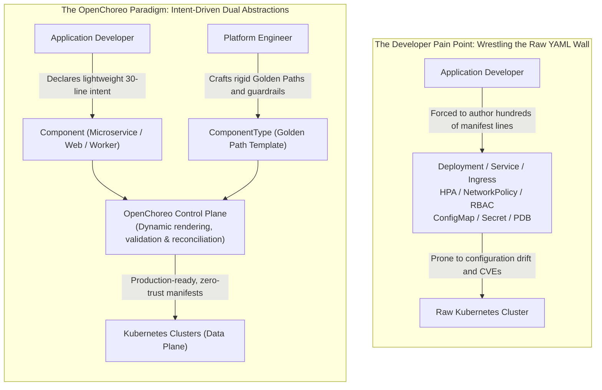
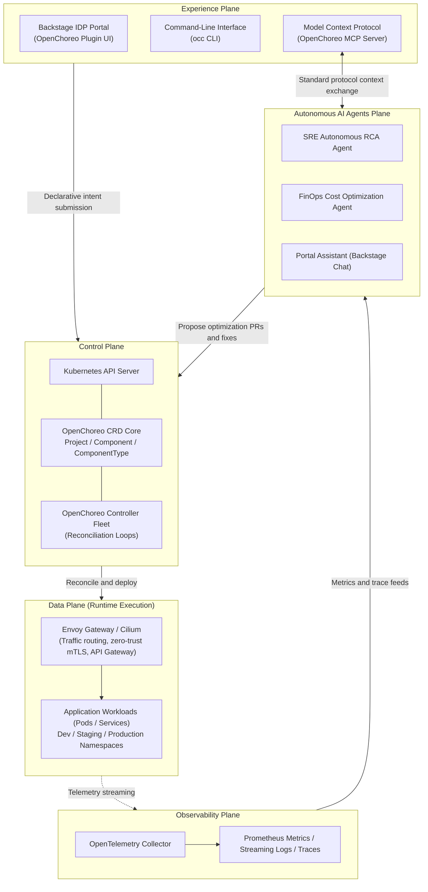
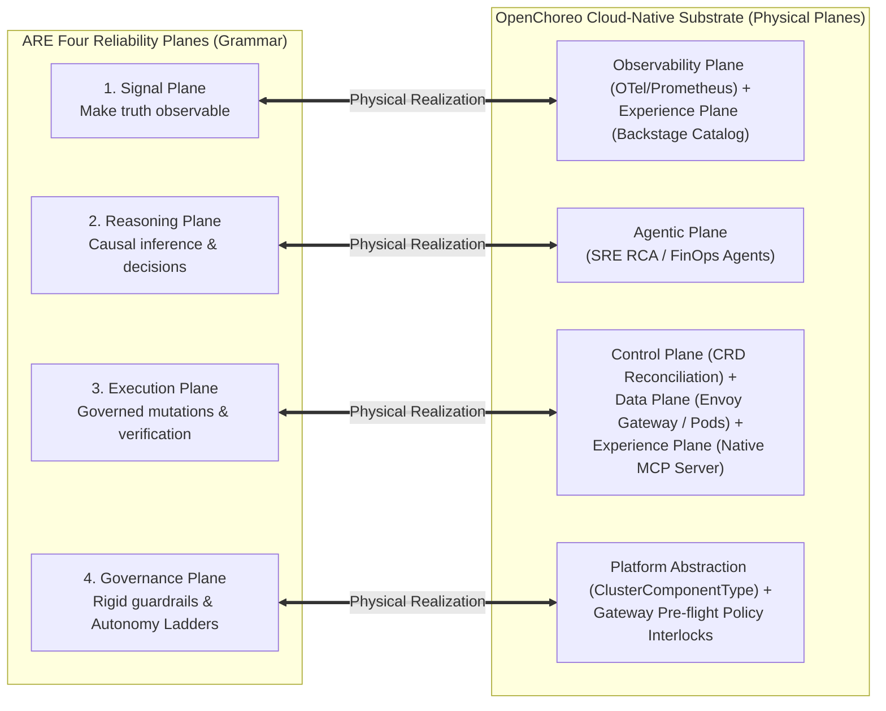
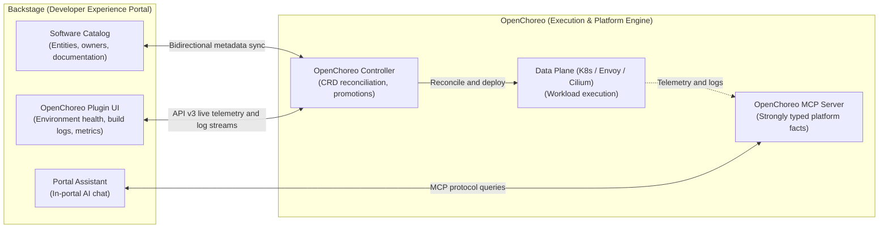
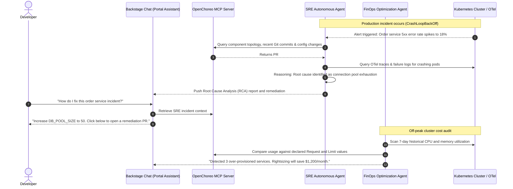

# 12

# OpenChoreo: CNCF Cloud-Native Internal Developer Platform and Agentic AI Practice

In Chapter 11, we conducted an in-depth examination of **Backstage**, the de facto open-source standard for Internal Developer Portals (IDPs). Through its Software Catalog, Software Templates (Scaffolder), TechDocs, and rich plugin ecosystem, Backstage elegantly resolves the service discovery and cognitive overload bottlenecks that plague organizations scaling microservices.

Yet, after platform teams enthusiastically introduce Backstage into their organizations, they frequently collide with a deeper architectural reality:

> **"Backstage is an exceptional developer portal, but it is not an execution platform engine."**

Backstage illuminates what services exist, visualizes ownership topologies, and scaffolds code via pull requests; however, it does not manage the runtime lifecycle of Kubernetes resources, dynamic environment isolation, traffic splitting, service mesh security policies, or automated telemetry pipelines. To bridge this vast chasm between the "portal" and the "underlying infrastructure," platform engineering teams often write tens of thousands of lines of fragile "glue code," stitching together Backstage, ArgoCD, Crossplane, Terraform, Prometheus, and Envoy. This homemade patchwork is brittle, agonizing to upgrade, and frequently turns the platform team into an operational bottleneck.

Furthermore, with the dramatic ascent of **Agentic AI** and the **Model Context Protocol (MCP)**, organizations urgently require a **modern control plane that empowers autonomous AI agents to safely perceive cluster state, reason with precise telemetry, and execute governed remediation loops within cloud-native environments**.

Enter **OpenChoreo**. Accepted into the **Cloud Native Computing Foundation (CNCF)** as an open-source Sandbox project in 2024 (originated from WSO2's enterprise cloud-native experience; documentation: [https://openchoreo.dev/docs/](https://openchoreo.dev/docs/)), OpenChoreo was designed from the ground up to solve this exact platform engineering disconnect.

This chapter explores OpenChoreo in detail: its **Multi-Plane Architecture**, the **declarative division of responsibilities** between developers and platform engineers, its seamless synergy with **Backstage**, and its pioneering **native integration of MCP and autonomous operational agents (SRE and FinOps Agents)**.

---

# Why OpenChoreo? Tearing Down the Kubernetes "YAML Wall"

Kubernetes has become the undisputed distributed operating system of modern cloud infrastructure. However, for application engineers, its steep learning curve often feels like an operational nightmare.



## Pain Point 1: Cognitive Overload from Business Logic to Infrastructure Plumbing
A typical Python FastAPI or Go microservice might only require a few hundred lines of business code. But to deploy it reliably onto a production Kubernetes cluster, developers are forced to write and maintain:

* `Deployment` (probes, resource requests/limits, lifecycle hooks)
* `Service` and `HTTPRoute` / `Ingress` (load balancing, TLS certificates)
* `HorizontalPodAutoscaler` (HPA autoscaling metrics)
* `NetworkPolicy` (zero-trust pod-to-pod isolation)
* `PodDisruptionBudget` (high-availability maintenance protection)

This is commonly known as **"The YAML Wall."** Developers burn valuable engineering cycles copy-pasting esoteric Kubernetes manifests. If a single security parameter is omitted (such as `runAsNonRoot` or proper memory constraints), cluster stability is jeopardized.

## Pain Point 2: The Dilemma Between Black-Box PaaS and Raw Kubernetes
To shield developers, teams historically adopted PaaS solutions (like Heroku or custom internal wrappers). However, black-box PaaS architectures obscure underlying mechanics; as workloads mature and demand canary deployments, advanced mesh tuning, or hybrid cloud migrations, the PaaS quickly becomes a restrictive dead end.

**OpenChoreo's guiding philosophy: "Augment, not hide, Kubernetes."**

* It is **Kubernetes-native**: All platform abstractions are implemented as Custom Resource Definitions (CRDs), utilizing the Kubernetes API as the authoritative System of Record.
* It enforces **GitOps**: Developers express high-level application intent (`Component`), while platform teams enforce organizational standards (`ComponentType`). OpenChoreo reconciles these inputs into fully compliant, secure underlying manifests.

---

# OpenChoreo Multi-Plane Architecture

OpenChoreo adopts a modular, domain-driven multi-plane architecture, cleanly separating organizational responsibilities:



## 1. Control Plane
The Control Plane is the brain of OpenChoreo, operating inside the Kubernetes cluster as a suite of lightweight controllers and CRDs. Its responsibilities include:

* Watching developer `Component` definitions and platform `ClusterComponentType` templates;
* Validating parameter inputs against security guardrails and schemas;
* Generating downstream Kubernetes objects (`Deployment`, `Service`, Envoy `HTTPRoute`, `NetworkPolicy`);
* Orchestrating release promotions across environments (`DeploymentPipeline`).

## 2. Data Plane
The Data Plane is where application containers run, spanning single or multiple target clusters:

* **Networking & Gateways**: Built on **Envoy Gateway** (adhering to the Kubernetes Gateway API standard) and **Cilium**, enabling canary releases, mTLS encryption, and fine-grained network policies.
* **Cell-Based Architecture**: Workloads, caches, and endpoints are organized into cohesive, bounded "Cells," radically restricting blast radiuses during incidents.

## 3. Experience Plane
Provides unified interfaces for engineers:

* **Backstage IDP Portal**: Comprehensive graphical dashboards via the official OpenChoreo Backstage Plugin.
* **`occ` CLI**: High-velocity terminal tooling for developers.
* **Model Context Protocol (MCP) Server**: Standardized protocol endpoints allowing autonomous AI agents to query topology and runtime health.

## 4. Observability Plane
Built natively on OpenTelemetry (OTel), aggregating metrics, logs, and distributed traces into unified query APIs for human operators and AI agents alike.

## 5. Agentic Plane
Hosts autonomous operational AI agents (such as SRE Root Cause Analysis agents, FinOps cost optimization agents, and developer portal assistants). The Agentic Plane consumes normalized telemetry from the Observability Plane, exchanges contextual graph data via MCP servers, and submits declarative proposals and PRs to the Control Plane.

---

## Deep Dive: Mapping OpenChoreo's Architecture to the ARE Four Reliability Planes

In Chapter 6 of *Agentic Reliability Engineering* (ARE) and Chapter 6 Extension of this book (Ch 06-EX), we established the foundational structural syntax of autonomous systems: **the Signal Plane, Reasoning Plane, Execution Plane, and Governance Plane**.

Engineering teams frequently ask: *"How do these theoretical four planes translate into tangible Kubernetes components in production?"* OpenChoreo's multi-plane architecture provides the concrete realization:



| ARE Four Reliability Planes | OpenChoreo Cloud-Native Plane | Operational Boundary & Physical Mechanism |
| :--- | :--- | :--- |
| **Signal Plane** | **Observability Plane** + **Backstage Catalog** | OpenTelemetry Collector aggregates traces and metrics, correlated against the Backstage Software Catalog (`catalog-info.yaml`) to output objective, decision-grade telemetry. |
| **Reasoning Plane** | **Agentic Plane** | Houses specialized RCA and FinOps agents. Utilizing GraphRAG and TechDocs, agents perform causal diagnosis and emit structured mitigation/remediation proposals without touching cluster credentials. |
| **Execution Plane** | **Control Plane** + **Data Plane** + **MCP Server** | Agents invoke strongly-typed MCP tools. The OpenChoreo Control Plane reconciles declarative CRDs, programming Envoy Gateway with TTL-bounded rate limits and dispatching GitOps releases. |
| **Governance Plane** | **Platform Abstraction (`ClusterComponentType`)** | Enforces platform security baselines, resource quotas, and deterministic API gateway filters ($\le 15\%$ blast radius limits, dual-key authorizations, and dynamic L0-L4 autonomy ladders). |

This mapping demonstrates that OpenChoreo is not just another deployment orchestrator; it is the **first cloud-native industrial platform built to realize the ARE four-plane reliability architecture**.

---

# Core Abstraction Model: Developer vs. Platform Engineer Separation

OpenChoreo cleanly bifurcates developer velocity and platform governance:

| Dimension | Developer Abstractions | Platform Abstractions |
| :--- | :--- | :--- |
| **Primary Focus** | Business logic, code repositories, environment variables, endpoints | Compliance baselines, security guardrails, network topology, resource quotas |
| **Core CRDs** | `Project`, `Component`, `DeploymentTrack` | `ClusterComponentType`, `Environment`, `DataPlane`, `DeploymentPipeline` |
| **YAML Footprint** | Extremely compact (~20 to 40 lines) | Parameterized templates (defining JSON Schemas and resource manifests) |
| **Interaction Mode** | Frictionless self-service | Golden Path authoring and global governance |

## 1. Developer View: Declarative `Component`

Developers maintain a clean `component.yaml` in their repository root:

```yaml
apiVersion: openchoreo.dev/v1alpha1
kind: Component
metadata:
  name: payment-service
  namespace: ecommerce-project
spec:
  # Reference the platform-curated Golden Path template
  type: microservice-rest
  
  source:
    git:
      url: https://github.com/acme-corp/payment-service.git
      branch: main
    build:
      dockerfile: ./Dockerfile
      
  endpoints:
    - name: api
      port: 8080
      type: REST
      schema: ./openapi.yaml     # Linked OpenAPI specification
      visibility: internal
      
  env:
    - name: LOG_LEVEL
      value: "INFO"
    - name: DB_CONNECTION_SECRET
      valueFrom:
        secretKeyRef:
          name: payment-db-credentials
          key: connection-string
```

> **Note & Synergy with Chapter 11 API Catalog**:
> 1. Developers never specify Kubernetes Selectors, Pod Specs, Affinities, or Envoy routing manifests! Everything is synthesized based on `type: microservice-rest`.
> 2. The `schema: ./openapi.yaml` field under `endpoints`: OpenChoreo utilizes this not only for Envoy Gateway routing validation, but also as the single source of truth for **contract-driven platform engineering**. The control plane automatically synchronizes this specification into the Backstage API Catalog explored in Chapter 11.

## 2. Platform Engineer View: `ClusterComponentType`

Platform engineers maintain reusable `ClusterComponentType` templates:

```yaml
apiVersion: openchoreo.dev/v1alpha1
kind: ClusterComponentType
metadata:
  name: microservice-rest
spec:
  description: "Standard REST microservice Golden Path with Cilium isolation and Envoy Gateway"
  
  parametersSchema:
    openAPIV3Schema:
      type: object
      properties:
        cpuRequest:
          type: string
          default: "250m"
        memoryRequest:
          type: string
          default: "512Mi"
          
  resources:
    - template:
        apiVersion: apps/v1
        kind: Deployment
        metadata:
          name: "{{ .component.metadata.name }}"
        spec:
          replicas: 2
          template:
            spec:
              containers:
                - name: app
                  image: "{{ .component.status.latestImage }}"
                  resources:
                    requests:
                      cpu: "{{ .parameters.cpuRequest }}"
                      memory: "{{ .parameters.memoryRequest }}"
                    limits:
                      cpu: "1000m"
                      memory: "1Gi"
                  securityContext:
                    runAsNonRoot: true
                    allowPrivilegeEscalation: false
```

Benefits of this clean boundary:

* When platform engineers update enterprise security standards in `ClusterComponentType`, all consuming microservices automatically inherit the new compliance posture upon reconciliation—without forcing developers to rewrite YAML.
* Developers gain intuitive self-service without risk of misconfiguring critical Kubernetes primitives.

---

# Deep Integration: Backstage and OpenChoreo

In modern platform architectures, **Backstage and OpenChoreo are natural symbiotic partners**:



## Key Architectural Synergies

1. **Transforming Static Catalogs into Live Operational Dashboards**:
   Traditional Backstage catalogs present static metadata. With the OpenChoreo plugin, opening a component entity provides live runtime status across Dev, Stage, and Prod environments, active replica counts, live streaming logs, and traffic graphs.

2. **Connecting Scaffolder to Automated Runtimes**:
   Backstage Scaffolder templates generate project boilerplate along with a standardized `component.yaml`. Once committed, OpenChoreo detects the definition and spins up the environment immediately.

3. **Interactive Traffic Management**:
   Leveraging Envoy Gateway under the hood, developers slide traffic allocation percentages on the Backstage UI to route 10% of live traffic to a canary track while observing error rates in real time.

4. **Eliminating Custom Glue Code**:
   Rather than manually wiring disparate ArgoCD, Prometheus, and Kubernetes plugins, platform teams deploy OpenChoreo's unified Backstage plugin, drastically shrinking maintenance overhead.

5. **Zero-Touch API Cataloging & Portal Publishing**:
   When developers deploy a microservice with `endpoints[].schema: ./openapi.yaml`, the OpenChoreo control plane automatically registers or updates the corresponding `kind: API` entity inside the Chapter 11 Backstage Catalog, injecting the active internal/external Base URLs provisioned by Envoy Gateway. The moment a workload becomes healthy, engineers across the organization can discover and interact with its Swagger UI without manual metadata glue.

---

# Native Agentic AI and Model Context Protocol (MCP) Integration

OpenChoreo's most revolutionary dimension is its **first-class adoption of the Model Context Protocol (MCP) and autonomous AI agents** directly inside the platform engine:



## 1. SRE Autonomous Agent
When services fail (OOMKilled, CrashLoopBackOff, HTTP 504s), on-call engineers often burn hours searching disjointed tools. As demonstrated in Chapter 11 Figure 11.2, when ArgoCD and OpenChoreo detect a failing canary pod, the SRE Agent proactively pushes structured diagnosis cards directly into the Backstage developer portal.

* **Automated Awakening**: Triggered automatically upon telemetry alert anomalies.
* **Context Assembly**: Queries the OpenChoreo MCP Server to retrieve recent Git commits, configuration changes, and dependency graphs.
* **Trace Analysis**: Follows failing OpenTelemetry trace IDs to isolate exceptions.
* **Instant RCA Delivery**: Synthesizes a structured Root Cause Analysis report within seconds, identifying the offending commit and proposing concrete fixes.

## 2. FinOps Autonomous Agent
Workload owners frequently over-provision resources out of caution.

* Continuously benchmarks actual CPU and memory usage against requested values.
* Cross-references utilization against platform SLOs.
* Generates **Rightsizing** recommendations and opens automated Pull Requests against `component.yaml` to optimize infrastructure costs safely.

## 3. Portal Assistant & Native MCP Server
OpenChoreo ships with an out-of-the-box **Model Context Protocol (MCP) server**:

* Exposes all platform entities (Projects, Components, Builds, Environments) as standard **MCP Resources**.
* Packages telemetry queries and log retrieval into governed **MCP Tools**.
* **Elevating OpenAPI Specs into Dynamic AI Tools (OpenAPI-to-MCP Tooling)**: The MCP server dynamically ingests the OpenAPI schemas declared across components and converts them into governed tool definitions. When an engineer instructs the assistant, "*Issue a test authorization to payment-service to verify the new gateway route*", the agent inspects the OpenAPI schema, constructs a valid payload, and executes the call against the sandbox environment safely.
* Developers converse naturally with the Backstage Portal Assistant ("*Show me error logs for payment-service in Prod over the last 30 minutes*"), grounded in verified, real-time platform data without hallucination.

---

# Hands-On Walkthrough: Running OpenChoreo Locally

## 1. Prerequisites
* **Docker**: Installed and running.
* **Kubectl**: Configured.
* **Kind**: Kubernetes in Docker.

## 2. Install the `occ` CLI
```bash
curl -fsSL https://openchoreo.dev/install.sh | bash
occ version
```

## 3. Create a Local Cluster
```bash
occ cluster create --wait
```
This deploys the OpenChoreo Control Plane, Envoy Gateway, and core CRDs onto a local Kind cluster.

## 4. Deploy Your First Service
```bash
# Create a project namespace
occ project create demo-project

# Deploy a component using the sample repository
occ component create hello-service \
  --project demo-project \
  --type microservice-rest \
  --git-repo https://github.com/openchoreo/sample-apps \
  --git-branch main \
  --context-dir ./hello-world \
  --port 8080
```

## 5. Verify Reconciliation and Test Endpoints
```bash
occ component status hello-service --project demo-project
```
In seconds, OpenChoreo builds the image, creates Envoy HTTPRoutes, and brings the service live.

Test the endpoint:
```bash
curl http://localhost:8080/hello
```
Response:
```json
{
  "message": "Hello from OpenChoreo Cloud-Native IDP!",
  "status": "healthy"
}
```

---

# Reader Notes: A Practitioner's Perspective on Chapter 12

> **"The future of internal developer platforms lies in the convergence of declarative intent and autonomous AI reconciliation loops."**

### 💡 Practitioner Mindset: Platform Engineering is About Defining Boundaries
Organizations often swing between forcing all developers to write verbose Kubernetes YAML or locking them into restrictive proprietary PaaS silos. Chapter 12 reveals the power of **dual declarative abstractions**:

1. Developers declare business intent in under 30 lines;
2. Platform engineers enforce organizational standards through `ComponentType` Golden Paths.
This division liberates developers while preserving platform governance.

### 🎯 Key Takeaways
1. **Backstage + OpenChoreo Form a Unified Powerhouse**:
   - Backstage is the ideal Developer Portal frontend (Single Pane of Glass);
   - OpenChoreo is the ideal cloud-native execution engine (Control & Data Plane).
2. **Kubernetes-Native Architecture**:
   - Adopts CRDs and GitOps as the authoritative System of Record without black boxes.
3. **Pioneering MCP & Autonomous AI Integration**:
   - Exposes platform state via native MCP servers, providing SRE and FinOps agents with the grounded context needed for safe, end-to-end operational automation.

### ⚠️ Production Pitfalls
* **Monolithic `ComponentTypes`**: Avoid creating "one-size-fits-all" templates; design focused Golden Paths tailored to specific workload profiles (REST services, event workers, static frontends).
* **Data Plane Network Planning**: OpenChoreo leverages Envoy Gateway and Cilium; ensure proper routing topologies when deploying in on-premises or private VPC environments.

### 🛠️ Action Checklist
* [ ] Spin up a local test cluster using `occ cluster create` to experience the automated manifest generation workflow.
* [ ] Audit your team's existing Kubernetes manifests: identify repeated boilerplate that can be generalized into a standardized `ComponentType`.
* [ ] Review OpenChoreo's Backstage plugin and MCP server implementations to assess architectural integration with your existing internal developer portal.

---

# Further Reading

* **OpenChoreo Documentation Hub**: [https://openchoreo.dev/docs/](https://openchoreo.dev/docs/)
* **OpenChoreo GitHub Repository**: [https://github.com/openchoreo/openchoreo](https://github.com/openchoreo/openchoreo)
* **CNCF Landscape - OpenChoreo**: [https://landscape.cncf.io/?item=app-definition-and-development--application-definition-image-build--openchoreo](https://landscape.cncf.io/)
* **Model Context Protocol Specification**: [https://modelcontextprotocol.io](https://modelcontextprotocol.io/)
