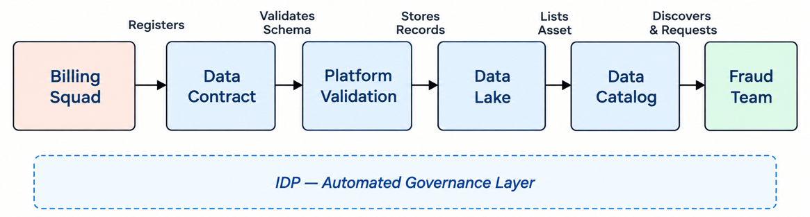
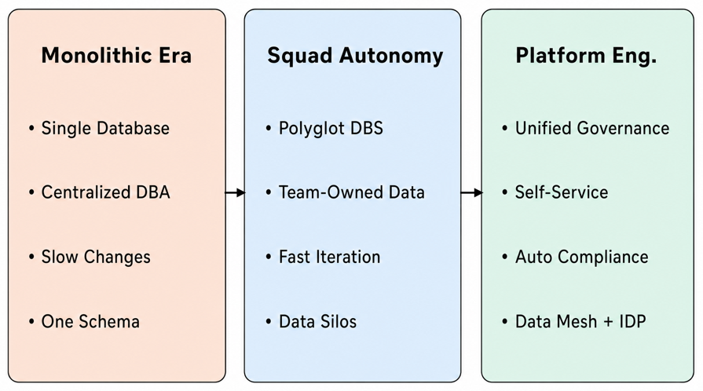
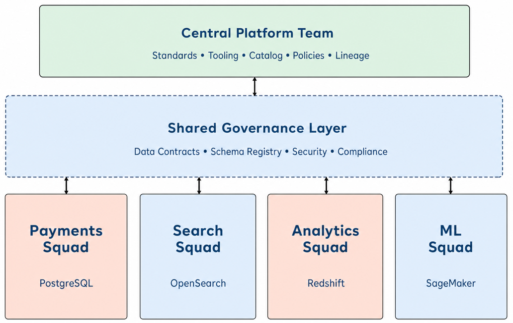
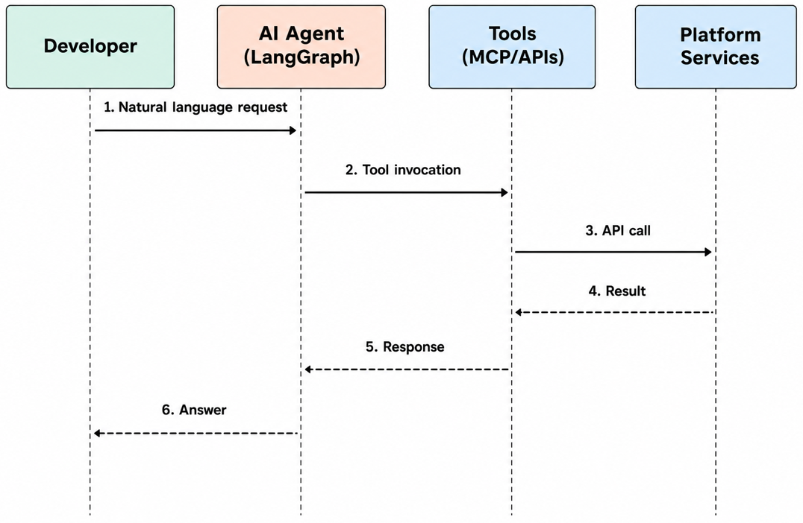
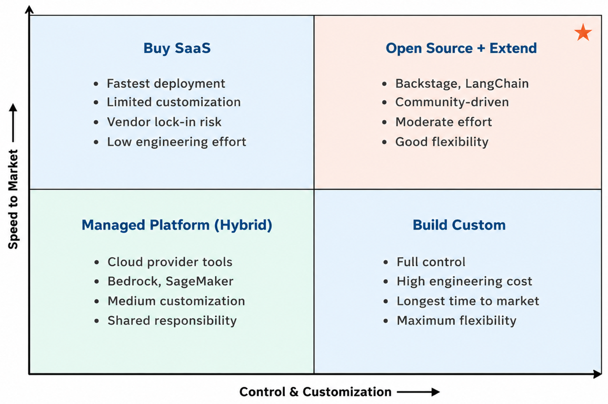

# 2

# AIOps: A Pre- and Post-Platform Engineering Perspective

In the previous chapter, we explored the evolution of platform engineering, facing the constant struggle to improve our developers' lives. As a platform engineer, have you ever felt like you've solved one problem only for a bigger, more complex one to appear? We certainly have. Just as we started mastering the art of building internal platforms, we found ourselves drowning in an ocean of operational data. The tools we built for simplicity were becoming a new source of complexity, demanding smarter and more intuitive ways to be managed.

This is where a new character enters our story: artificial intelligence.

Before diving deeper, it's worth remembering that AIOps isn't a new idea. Coined by Gartner in the mid-2010s, Artificial Intelligence for IT Operations described the first attempts to apply machine learning to monitoring and incident management. At the time, it was a response to the overwhelming volume of alerts and telemetry in complex systems, a way to correlate events and detect anomalies faster than human operators could.

While the term has aged, its core purpose remains foundational. What began as AIOps, with AI helping operations teams make sense of chaos, has since evolved into AI-driven platform engineering, where intelligence is embedded across the entire software lifecycle.

Think of AI not as a distant concept, but as a key tool and layer of abstraction in our toolkit that will help us tame this complexity. In this chapter, we explore how AI is becoming the new engine for platform teams. We will see how it can dig through that mountain of data to find actionable insights and how it allows us to simply talk to our platforms through conversational interfaces. Our goal is to show how we can transform our platforms from static, reactive tools into dynamic, intelligent ecosystems that learn and adapt on their own, within defined guardrails.

Together, we will explore these key areas:

* **AIOps: The Foundation for Intelligence:** Was AIOps just a buzzword, or was it the critical first step toward the intelligent platforms we are building today? We'll look at how it lays the groundwork for managing the operational chaos.
* **Conversational AI: Talking to Your Tools:** What if your developers could just ask the platform for what they need, in plain English? We'll explore how conversational AI is breaking down the final barriers, making self-service truly seamless.
* **Build vs. Buy: A Strategic Crossroads:** Every platform team faces this dilemma. Should we build our own AI capabilities from scratch or stand on the shoulders of giants? We'll dive deep into the trade-offs of this crucial decision.
* **Making AI Real in Your Developer Portal:** How do we go from theory to practice? We will provide a hands-on guide to integrating these AI features directly into the developer portals our teams use every day.

By the end of this chapter, we will have a clear map of the AI-driven landscape. We've seen the *what* and the  *why* . Now, are you ready to get into the  *how* ? Our journey continues in the next chapter as we dive into and explore the core technologies of Generative AI, giving you the essential knowledge to start building these intelligent systems yourself.

# An internal AI-driven data governance platform for organizational use

Have we ever felt that our teams build great microservices, but we still struggle to find a single source of truth for our organizational data? We often find ourselves trapped in a sprawling ecosystem where every squad operates as an isolated island, leaving us with fragmented insights and major governance headaches. Before we look at how to engineer governed data structures, we need to look closely at the core problem that hits growing engineering organizations. When a business expands, it naturally splits into different groups to move faster. However, without a unified platform to guide them, these groups create hidden silos. Developers end up spending hours chasing data across multiple internal systems instead of writing features, driving up our operational complexity and slowing down our development cycles.

This lack of coordination creates a dangerous trap for platform teams. We see teams waste massive amounts of time building custom data scripts for individual development groups, which completely ruins our ability to scale. If Group A uses one formatting style and Group B uses another, we cannot enforce global security or compliance rules effectively. This organizational confusion is exactly why we need a clear data governance strategy embedded directly into our internal platform. We must build an infrastructure layer that abstracts away data complexity, giving developers an easy path to share data while keeping our entire platform secure, compliant, and standard by default.

To fix this organizational chaos, we must use platform engineering to create economies of scale. Instead of letting fifty different squads solve data access, security, and schema management in fifty distinct ways, the central platform team builds these capabilities once into a shared infrastructure layer. By automating data lifecycle tasks through our developer portal, we eliminate the need for manual context-switching and complex data tickets. This shift allows our engineering organization to lower its collective overhead, transforming data governance from a manual policing exercise into an automated, self-service platform feature.

Let us look at a clear example of how an end-to-end data workflow operates on a modern internal developer platform. Imagine a billing group that needs to publish transaction data for other teams to consume. Instead of writing custom APIs or building fragile point-to-point integrations, the billing team uses our developer portal to register a data contract. The platform automatically validates the schema, sets up a secure pipeline to stream sanitized records into our shared data lake, and lists the asset in our central data catalog. When a separate fraud detection team wants to use this information, they simply look up the asset in the catalog, click a button to request access, and the platform instantly grants token-based access following our global rules.

*Figure 2.1* illustrates the end-to-end data governance flow on an internal developer platform, showing how a billing squad publishes data through automated validation and how a downstream fraud team discovers and consumes it through the shared catalog.



Figure 2.1: End-to-end data governance flow on an internal developer platform

## Evolving from monoliths to squad autonomy

As we navigated the challenges and evolution of AIOps, a parallel transformation was occurring within organizational structures, heavily influenced by pioneering models like the one famously implemented by Spotify. This model was a direct response to the slow, monolithic development cycles of the past. We saw firsthand how organizations, inspired by this approach, began to break down their large, centralized teams into smaller, autonomous units known as squads. Each squad was structured like a mini-startup, with a long-term mission focused on a specific aspect of the customer journey, such as user onboarding, search, or payments.

This shift from monoliths to microservices, owned and operated by these independent squads, was revolutionary. The core principle was to minimize dependencies between teams to maximize velocity. For this to work, squads needed end-to-end ownership of their features, which included not just the application code but also the underlying data stores. This marked a significant departure from the era of centralized teams of **database administrators** ( **DBAs** ) that held the keys to a single, massive corporate database.

The newfound freedom acted as a catalyst for innovation. Squads now felt empowered to choose the right tool for every specific job. A squad managing a social feed might choose a NoSQL database like DynamoDB or Cassandra for its scalability and flexible schema. In contrast, a squad managing financial transactions would likely choose a robust relational database like PostgreSQL or MySQL for its ACID guarantees, which cover atomicity, consistency, isolation, and durability, helping ensure that committed transactions remain reliable and consistent even during failures. We witnessed an explosion of creativity as teams stopped being constrained by a rigid, one-size-fits-all data strategy.

This autonomy extended deep into the team's composition. Squads began managing their own database schemas, performance tuning, and operational health. The line between developer and operator blurred even further, truly embodying the *you build it, you run it* principle. The need for a ticketing system to request a new table or index, a process that could previously take weeks, was greatly reduced. A change could be conceived, coded, and deployed within a single team, dramatically reducing lead times for changes.

To leverage this direct data ownership, the composition of squads evolved to become truly cross-functional. They were no longer just collections of software engineers. We saw the rise of squads that included embedded data analysts, business analysts, data scientists, data engineers, and even AI engineers. This co-location of diverse skill sets created a powerful, self-sufficient unit capable of rapidly iterating on its part of the customer journey.

Imagine a fictional *Customer Engagement Squad* at an e-commerce company. With direct control over their data and an embedded data scientist, they could run A/B tests on a new feature, analyze the results in near real-time, and feed the insights directly back into the next development sprint. An AI engineer within the same squad could build and deploy a machine learning model to personalize user notifications, using live data from their own operational database. This created an incredibly tight feedback loop, accelerating innovation and delivering tangible value to customers at an unprecedented pace.

*Figure 2.2* shows how data ownership has evolved across three distinct organizational phases, from centralized monolithic control to autonomous squads, and finally to a platform engineering approach that balances governance with team autonomy.



Figure 2.2: Evolution of data ownership in engineering organizations

However, as this decentralized model matured, we began to observe its unintended consequences. While autonomy supercharged individual squads, it inadvertently created new, more complex data silos. Each squad's database became an isolated island of information. This presented a significant problem, as valuable insights often lie at the intersection of data from different domains.

For example, a *Recommendations Squad* needs access to purchase history from the *Checkout Squad* and product-viewing data from the *Discovery Squad* to build an effective recommendation engine. In the early days of this model, the solution was often direct API calls between services. While functional, this approach created tight coupling and a web of point-to-point integrations that was brittle and difficult to maintain. A change in the Checkout Squad's API could break the Recommendations Squad's entire system.

Direct access to another squad's operational database was also out of the question for mature DevOps teams. Such a practice would violate the core principles of microservice architecture and introduce a host of problems. Concerns around data protection and privacy were paramount. Moreover, running complex analytical queries against a live production database could lead to performance degradation, database throttling, and table locks, directly impacting the customer experience of the service that owned the data.

## Building a hybrid data governance strategy

These challenges led to the realization that pure decentralization, while powerful for team autonomy, was insufficient for organizational intelligence. The pendulum began to swing back, not to the old, centralized model, but toward a sophisticated hybrid approach. This new model sought to balance the autonomy of the squads with the need for centralized data sharing and governance, giving rise to what we now recognize as a precursor to the modern data mesh.

Under this hybrid strategy, squads retained full ownership and freedom over their operational databases, their source of truth. They continued to manage their own data, build their own services, and drive their customer journey. However, they were now also designated as *data producers* with a new responsibility: to share their data with the rest of the organization in a clean, reliable, and accessible manner.

The centerpiece of this strategy was a central data lake or data platform. This was not a replacement for the squads' operational databases but a dedicated, shared space for analytical data. Each squad was responsible for implementing a process, often an **ETL** ( **Extract, Transform, Load** ) pipeline, to periodically push a sanitized, well-structured version of their data to the data lake. The cadence of these updates varied based on the data's volatility and the needs of its consumers: some pushed data nightly, others every few days, or even weekly.

This created a powerful, decoupled system for data sharing. A  *data consumer* , such as our Recommendations Squad, no longer needed to make direct API calls to other services. Instead, they could access pre-packaged, analysis-ready datasets from the central data lake. This approach preserved the autonomy and stability of the source systems while democratizing access to data across the organization.

This hybrid model was the perfect breeding ground for squad-level AI initiatives. With access to a rich, cross-domain dataset from the data lake, the AI engineer in the Customer Engagement Squad could now build far more sophisticated models. They could, for instance, create a regression model to predict customer churn by correlating a user's notification interaction data (from their own database) with their support ticket history (from the  *Customer Support Squad*  *'* *s* data in the lake) and their recent payment failures (from the  *Billing Squad*  *'* *s* data).

Let's illustrate with a more concrete fictional example. Consider  *VelocityBank* , a digital bank that adopted this hybrid data governance model. Before adopting the model, the *Loan Origination Squad* struggled to make accurate, real-time credit decisions. They had access to the applicant's data from their own systems, but getting a holistic view of the customer, including their transaction history (owned by the  *Current Accounts Squad* ) and their investment portfolio (owned by the  *Wealth Management Squad* ), was a slow, manual process involving data exports and fragile inter-service calls. Their predictive models were often trained on stale, incomplete data.

With the implementation of the new data platform, both the Current Accounts and Wealth Management squads began publishing clean, anonymized, daily snapshots of their data to the central data lake. The Loan Origination Squad could now access this data on demand. Their data scientists built a powerful logistic regression model that used hundreds of features from across the bank to generate a more complete credit risk score during loan evaluation. This not only accelerated the loan approval process from days to minutes but it also significantly improved the accuracy of their risk assessment, directly improving a critical customer journey.

*Figure 2.3* presents the hybrid data governance architecture that combines central platform standards with decentralized domain ownership, connected through a shared governance layer of contracts, schemas, and policies.



Figure 2.3: Hybrid data governance model combining central standards with domain ownership

Of course, this model was not a silver bullet. Its success was predicated on a strong foundation of data governance. We quickly learned that simply creating a data lake was not enough; it required a cultural shift toward treating " *data as a product* ." Each squad, as a data producer, had to become a responsible data steward.

This meant establishing clear " *data contracts* " that defined the schema, quality, and update frequency of the data they provided. It also required robust tooling within the central platform for a data catalog, allowing consumers to easily discover what datasets were available, and data lineage to track the origin and transformation of data from source to consumption.

Access control also became a critical function of the central platform. While data was more accessible, it was not a free-for-all. The platform had to enforce granular permissions, ensuring that squads could only access the data they were authorized to see, in compliance with regulations like GDPR and CCPA. This principle is often referred to as " *federated computational governance* ."

The governance framework had to define clear roles and responsibilities. Each data domain had a designated owner, typically within the producing squad, who was accountable for the quality and reliability of their data product. This federated ownership model ensured that expertise remained with the teams who understood the data best.

The technical challenges of implementing such a system were significant. Building reliable, scalable data pipelines, ensuring data quality, and managing a complex web of permissions required a dedicated platform team with specialized skills in data engineering and governance.

This team was responsible for providing the "paved road" for data sharing: the tools and infrastructure that made it easy for squads to be good data producers and consumers. They managed the central data lake technology, the data catalog, and the access control systems, reducing the cognitive load on the individual squads.

Ultimately, the journey from isolated, autonomous squads to a connected ecosystem of data producers and consumers was a critical step in the evolution of data-driven organizations. The initial push for decentralization unlocked speed and innovation at the team level, but it was the subsequent introduction of a governed, centralized data-sharing platform that unlocked intelligence at the organizational level. The largest challenge in this journey, as we consistently observed, was not the technology, but the cultural shift required to establish a robust governance model and foster a true sense of data stewardship across the entire organization.

This evolution toward a model of squad autonomy combined with centralized data governance through a managed data lake ultimately addresses one of AI-driven platform engineering's broader challenges: establishing a single source of truth that balances the need for data accuracy, accessibility, and consistency while maintaining the agility and innovation potential of autonomous teams.

The following YAML example defines a data contract for sanitized billing transactions:

```
apiVersion: platform.packt.internal/v1alpha1
kind: DataContract
metadata:
  name: billing-sanitized-tx
  namespace: billing
spec:
  owner: group-billing
  schema:
    type: object
    properties:
      tx_id: { type: string }
      amount: { type: number }
  governance:
    classification: highly-confidential
    retention: 7y
```

The YAML block above demonstrates how our internal platform control plane allows squads to declare their data assets using standard version-controlled manifests. By codifying data assets this way, we bridge the gap between application infrastructure and data governance. Platform engineering ensures that these data paths are fully automated, monitored, and scalable. In the next section, we will explore how we surface these unified data assets directly within our developer portal interfaces to make them actionable for the entire organization.

# Conversational AI for internal platform self-service

The most successful platforms are treated as products, not just a collection of tools. This product-centric view requires a focus on the user experience and the developer's journey. Yet, even with a strong " *product* " foundation, platforms can still feel like they're built for machines, not people.

The next frontier in this evolution is to make platforms conversational. Imagine a developer platform that you can simply talk to, asking it to perform complex tasks or provide instant information. This shift from a command-and-control model to a **conversational interface** not only streamlines workflows but also makes the platform more accessible to a wider range of users, from seasoned engineers to new hires.

Can we imagine ourselves talking or writing about a specific resource we want to spin up in AWS, and having an intelligent assistant immediately reply to us: " *Please wait a moment. We are provisioning your EKS cluster, ALB, and RDS PostgreSQL database over the next 5 minutes.* " This scenario directly showcases the real operational efficiency that an abstract conversational interface brings to our daily platform workflows. More importantly, it ensures that our underlying cloud infrastructure is built completely inside the security boundaries and architectural blueprints we established in our system by leveraging Crossplane, kro, or similar controllers. To be clear, this conversational approach does not replace standard **Infrastructure as Code** ( **IaC** ) engines. The conversational interface acts as an intelligent wrapper on top of our existing setups, executing the exact same declarative IaC templates under the hood. It translates human intent into structured tool inputs, lowering developer friction while keeping our hard-coded guardrails fully intact.

The true power of a conversational AI lies in its ability to transform complex, multi-step operations into simple, natural language requests. Instead of navigating a labyrinth of dashboards and CLIs, we've seen developers save hours by simply asking the platform a question. For instance, a developer could ask, " *What*  *'* *s the status of my *`user‑auth‑service` * deployment?* " and receive an instant, synthesized summary of its health, recent changes, and any active alerts. This shifts the interaction from a laborious search to a proactive conversation, fundamentally changing the way developers manage their applications.

We can configure these intelligent agents to execute complex, multi-step automated tasks directly on behalf of our engineering teams, eliminating the usual friction found in legacy workflows. Let us look at a real scenario where a new engineer needs to bootstrap their local development workspace on their first day. Instead of forcing them to waste hours reading a long, outdated wiki document or copying broken setup scripts, they can interact with the platform catalog and type a simple natural language statement: "*Provision a complete staging environment for our new *`search‑api` * service.* " Our platform-native conversational agent, backed by underlying large language models, handles the orchestration layer for the entire backend workflow: it instantly triggers the creation of an isolated Kubernetes namespace, configures the necessary GitOps repository files, wires up the CI/CD deployment pipelines, spins up a secure relational database instance, and presents the developer with the final access details, secret references, and API endpoints inside a single unified chat response.

*Figure 2.4* shows the interaction flow of a conversational AI agent within a developer portal, tracing a request from the developer through the LangGraph agent, tool invocation, and platform action back to a human-readable response.



Figure 2.4: Conversational AI agent interaction flow in a developer portal

This final layer of intelligence is what makes a platform a truly user-centric product. It's no longer just a collection of tools; it's an active partner that anticipates needs and reduces cognitive load. We've seen firsthand how a well-designed conversational interface can turn a developer's biggest pain points into their most productive moments, unlocking a new level of efficiency that traditional interfaces simply cannot match.

# Build vs. buy: evaluating AI platform options

As we have seen, the integration of conversational AI is a game-changer for enhancing developer experience and supercharging a platform's capabilities. The question is no longer whether these intelligent interfaces are beneficial, but how an organization can successfully implement them. The journey from a static platform to a proactive, conversational one is not a simple one.

The path forward leads to a critical strategic decision: should a company build its own AI-driven platform from the ground up, or should it leverage the power of existing commercial solutions? This is the fundamental  **"**  *build versus buy* **"** dilemma that platform teams and business leaders must confront. It's a choice that weighs resource investment and time-to-market against the level of customization and control required to achieve a strategic advantage.

The decision to build a custom AI platform versus purchasing an existing off-the-shelf solution is a strategic choice for any organization. This is not a simple technical problem; it's a business decision that weighs core trade-offs between speed, cost, control, and long-term strategic advantage. For platform teams, this evaluation is critical as it determines the agility and future trajectory of their developer-facing products. We have personally seen this debate play out in countless boardrooms, where the allure of a custom-built, " *perfect* " solution clashes with the pragmatism of a faster, commercial alternative.

Choosing the right path requires a deep understanding of your organization's unique needs, resources, and risk tolerance. While a custom-built platform offers unparalleled flexibility, a commercial solution can provide a faster, less resource-intensive path to value. There is no one-size-fits-all answer, and many organizations are finding success with a hybrid approach that blends the best of both worlds. The landscape of available tools and platforms is vast and constantly evolving, from major cloud providers like **Amazon Web Services** ( **AWS** ) and Google Cloud to specialized startups. To navigate this complexity, we'll examine the primary considerations and use data from public reports to ground our analysis in real-world insights.

## Pros and cons of building custom solutions

When we talk to engineering leaders, the main argument for building a custom platform is always the same:  **control** . Building in-house offers the highest degree of customization. It allows an organization to create a system that is perfectly tailored to its unique workflows, data models, and specific business challenges. In our own experience, we've worked with financial services companies that needed to build a proprietary fraud detection engine. A generic, off-the-shelf solution simply couldn't handle their specific data schemas and compliance requirements.

By owning the full stack, companies maintain complete intellectual property and can integrate the platform seamlessly with their existing legacy systems. This is particularly crucial when the AI capability is a core part of a company's competitive advantage, such as a unique dynamic pricing system for an e-commerce company. We have observed that this level of deep, strategic integration is virtually impossible with a commercial black-box solution.

However, the " *build* " approach comes with significant cons, primarily centered around cost and time. The initial investment is substantial, encompassing not only infrastructure but also the talent required to design, build, and maintain the system. We have found that the total cost for enterprise-level AI implementations can easily reach into the millions of dollars, representing a significant capital expenditure that many companies are simply not prepared to undertake.

The time-to-market is another major drawback. A custom solution takes months, or even years, rather than weeks. I recall a client who spent over a year building a custom **machine learning operations** ( **MLOps** ) platform, only to find that commercial solutions had evolved and surpassed their in-house capabilities by the time they went to production. This risk of obsolescence is a constant shadow hanging over a custom build.

The maintenance and governance overhead of a custom solution are also major considerations. Unlike a commercial product that receives vendor-managed updates, an in-house platform requires a dedicated team for continuous model retraining, performance monitoring, infrastructure scaling, and security patching. This ongoing operational burden can become a significant long-term expense and a source of technical debt if not properly managed.

For industries with strict regulatory and compliance requirements, such as healthcare, building a custom solution offers a distinct advantage. It allows the organization to embed specific security and governance protocols directly into the platform's architecture, ensuring full control over sensitive data and adherence to regulations like HIPAA. This level of transparency and control is often difficult to achieve with a black-box, third-party solution.

## Benefits and limitations of existing AI platforms

The " *buy* " option, which involves licensing an existing AI platform, offers the significant benefit of  **speed** . We have seen this repeatedly with our customers. These platforms come pre-packaged with a range of features, allowing for rapid deployment and a much faster time-to-value. A company can stand up a basic AI solution, like a conversational chatbot for internal support, in a matter of weeks rather than months or years.

A significant benefit we've observed is the ability to tap into collective intelligence. A commercial platform is used by thousands of customers, which means the vendor is continuously improving it, fixing bugs, and adding new features based on a vast user base. This is a level of ongoing research and development that most single organizations simply cannot match. For example, using a cloud provider's managed AI service means you automatically get access to the latest model updates and performance optimizations without lifting a finger.

However, off-the-shelf platforms are not without their limitations. The most significant drawback is a lack of  **customization** . These platforms are designed to solve common, generalized problems, and they may not align perfectly with a company's specific or complex needs. This often forces an organization to adapt its internal processes to the platform, rather than the other way around. A great example is a platform that uses its own predefined data schema; if your company's data doesn't fit, you're stuck doing expensive and clunky data transformations just to use the tool.

Vendor lock-in is a serious risk with a commercial platform. Once a company has integrated its data and workflows with a specific vendor's ecosystem, switching to a different provider can be a complex, costly, and time-consuming process. The platform's roadmap is also controlled by the vendor, meaning you may have to wait for new features or fixes that are not prioritized by them. This lack of control over your own destiny can be a major strategic disadvantage.

A March 2025 McKinsey Global Survey on AI found that 21 percent of respondents reporting generative AI use said their organizations had fundamentally redesigned at least some workflows. The report also found that more than 80 percent of respondents said their organizations were not seeing a tangible enterprise-level EBIT impact from generative AI. These findings suggest that adoption alone does not guarantee transformation; workflow redesign and supporting organizational changes are also important. We have seen this firsthand with companies that rush to buy a tool only to discover that it does not solve their core problem.

## Factors to consider: customization, control, and time-to-market

The decision-making process for *build vs. buy* should not be seen as a binary choice but rather a strategic framework built around three core factors: customization, control, and time-to-market. We always encourage our clients to weigh these factors against their specific business goals.

The first factor,  **customization** , is a question of strategic importance. Is the AI solution a strategic differentiator that provides a unique competitive advantage? For a fintech startup building an autonomous trading bot, the algorithm is the business, and building it in-house is the only viable option. We've found that for these critical, differentiated capabilities, a custom build provides a competitive moat. However, for a non-core task, like an internal knowledge management bot, buying a platform is the fastest and most sensible option.

Second, **control** is decisive for companies in regulated industries or those handling highly sensitive data. A custom solution ensures full ownership and control over the data pipeline, model security, and compliance with strict regulations. For non-sensitive data, or when a vendor has robust security certifications (like SOC 2 or ISO 27001), a commercial platform can be an acceptable and efficient option.

Finally, **time-to-market** is arguably the most critical factor for many startups and organizations under pressure to innovate. Off-the-shelf solutions can be deployed in weeks, delivering immediate value and allowing for agile, iterative development. A custom solution, in contrast, requires significant time for development, testing, and deployment, which can delay the realization of benefits for months or even years. In our experience, the ideal solution is often a  **hybrid approach** . This strategy combines the speed and convenience of existing platforms with the flexibility of custom development. An organization might use a commercial conversational AI platform for a quick-to-market internal chatbot but then build custom integrations and proprietary fine-tuned models on top of it. This allows for rapid scaling of core functionality while retaining the ability to differentiate in strategic areas.

To put this into perspective, consider two hypothetical companies:

* **The **  **"**  **Buy** **"**** Scenario:** Imagine a mid-sized e-commerce company that wants to improve its internal IT support. Employees frequently ask for help with password resets, software installations, and VPN configurations. This is a common, non-strategic problem. The company could use a commercial platform from a major vendor to deploy a conversational AI chatbot in a matter of weeks. The pre-built models understand common IT queries, and the platform handles the infrastructure, security, and maintenance. Because speed and ease of use are more important than deep customization for a non-core business function, the company buys this solution.
* **The **  **"**  **Build** **"**** Scenario:** Now, consider a high-frequency trading firm. Their core business is an autonomous trading platform whose entire profitability depends on a unique, complex algorithm that analyzes market data in real-time. This algorithm is their secret sauce and a core piece of their intellectual property. The AI platform that runs this system must be custom-built to ensure maximum performance, proprietary data security, and full control over every parameter. In this case, the company will probably *build* this solution because customization and control are central to their survival and competitive edge.

*Figure 2.5* presents a decision matrix to help platform teams evaluate their options across two key dimensions: the level of control and customization needed, and the speed at which they need to deliver value.




Figure 2.5: Build vs. buy decision matrix for AI platform capabilities

Ultimately, the right choice is the one that best aligns with the company's business goals, risk profile, and long-term strategic vision. It's about asking whether the AI capability is a core product that gives you a strategic advantage or a tool to improve an internal process. The decision to build or buy becomes clear once you answer that fundamental question.

# Surfacing AI features in developer portals

As we have explored, AI in platform engineering can shift operations from reactive problem-solving to proactive, intelligent automation. The next step is to make these capabilities accessible and intuitive for every developer. The developer portal, or **internal developer platform** ( **IDP** ), is the natural place to surface them because it provides a centralized interface and a single source of truth. Without built-in intelligence, the portal remains a fragmented collection of interfaces and static scripts. By embedding context-aware AI capabilities into the developer workspace, platform teams can turn the portal into a dynamic product and a strategic partner for the engineering organization.

The question of whether platform teams have proven this real-world value in production is a valid concern, and we must move past high-level theories to look at concrete metrics. The evidence emerges in three layers: platform foundation, AI-enabled workflows, and governance.

## Layer 1: The cloud-native platform as a proven foundation

Modern internal developer platforms already generate quantified ROI in speed and cost before any AI layer enters the picture. Prezzee, a global digital gifting platform, modernized its application environment on AWS using serverless services including AWS Lambda, AWS Fargate, and Amazon Aurora. The company reported a 67 percent reduction in time to market, over 90 percent fewer technical incidents, and 40 times more system scalability (Amazon Web Services, publication date not stated). Yahoo Taiwan EC began a container-first migration to Amazon EKS and had migrated about 2,000 of the planned 10,000 vCPUs by August 2025. While the migration was still underway, the company reported 30 to 40 percent operational savings and a 30 percent improvement in time to market (Amazon Web Services, publication date not stated). At Mercado Libre, more than 15,000 engineers use Fury, the company's internal developer platform, to create and operate more than 30,000 microservices. Developers can create a new application in just three clicks, after which the platform automatically creates a GitHub repository, sets up the CI/CD pipeline, and provides containerized scaffolding (Martins, 2024). These examples show that a well-built internal developer platform can provide a foundation for faster delivery, lower costs, and higher reliability.

## Layer 2: AI embedded in the portal as a productivity multiplier

When organizations layer intelligent capabilities directly into the developer portal, the productivity gains can compound. Spotify measured developer behavior across its Backstage portal users and found that frequent users produced 2.3 times more activity on GitHub over six months, created over two times more code changes with 17 percent less cycle time, and deployed to production two times more often, with software staying deployed three times longer. This was an observational study comparing frequent and infrequent users, without a control group. The combined effect was equivalent to three full-time employees for every ten developers (Watson, 2023). In a randomized controlled trial with Accenture, GitHub reported that developers using Copilot produced 8.69 percent more pull requests, achieved a 15 percent higher pull request merge rate, and drove an 84 percent increase in successful builds. Fifty-four percent also reported spending less time searching for information and examples, 90 percent reported feeling more fulfilled with their jobs, and 70 percent reported expending less mental effort on repetitive tasks (Gao and GitHub Customer Research, 2024). Together, these examples show how platform foundations and AI-assisted workflows can contribute to measurable developer productivity and delivery outcomes.

## Layer 3: Governance for safe AI-enabled delivery

Cortex's Engineering in the Age of AI: 2026 Benchmark Report found that pull requests per author increased by 20 percent year over year, while incidents per pull request increased by 23.5 percent and change failure rates rose by approximately 30 percent (Datta, 2025). The report also found that only 45 percent of the surveyed organizations had formal AI usage policies. These findings reinforce the need for an internal developer platform that provides guardrails, scorecards, and golden paths to help channel AI-generated velocity into safer production outcomes.

Taken together, the numbers across these three layers show that developer portals can improve delivery speed and developer productivity when they are built on a strong platform foundation and governed as AI-generated velocity grows.

## Enhancing existing tools and workflows

The integration of AI features should not feel like an add-on but a natural enhancement of existing workflows. We believe the most impactful AI capabilities are those that seamlessly augment what developers already do in their portals. A prime example we have seen in our work is the  **Generative AI plugin for Backstage** , which allows us to embed AI assistants that can use the broader Backstage plugin ecosystem. This is not just a chat window; it is a powerful tool that leverages " *tool use* " to give **large language models** ( **LLMs** ) access to data from the Catalog, TechDocs, CI/CD, and Kubernetes resources.

In one of our projects, we leveraged this experimental plugin to streamline the creation of new services. Instead of a developer manually filling out a form in Backstage, they could simply type a prompt, such as, " *create a new Python service for my user authentication API* ." The AI agent, orchestrating its actions through frameworks like LangGraph, would then interpret the request, call the necessary Backstage tools to generate the boilerplate code, create the repository, and set up the CI/CD pipeline. This approach drastically reduces the time spent on manual configuration and context switching for developers. Since LangGraph represents a newer approach to stateful, multi-agent orchestration that many readers may not yet know, it is worth defining it briefly. LangGraph is an open-source runtime designed to structure LLM workflows as graphs with nodes and edges, allowing us to build stateful, cyclic workflows with retry and recovery paths instead of simple linear pipelines. Because this technology is fundamental for our intelligent platform operations, we put it to work in  *[Chapter 5](https://learning.oreilly.com/library/view/agentic-ai-for/9781806386659/Chapter_5.xhtml#h1_106)* , where a LangGraph-based agent is wired into Backstage, and return to agent orchestration more broadly in *C**hapter 6* and *Chapter * *7* . We can think of LangGraph as a deterministic state machine wrapped around the probabilistic decisions of a large language model. This design lets platform teams build cognitive wrappers that can loop back to a previous state, such as retrying a failed Terraform plan using a Terraform tool exposed via the **Model Context Protocol** ( **MCP** ), without crashing or losing user context.

The magic happens when these agents are provided with the right tools. The plugin comes with several built-in tools that connect to core Backstage functionality, such as `backstageCatalogSearch`, `backstageEntity`, and `backstageTechDocsSearch`. We can configure our AI agent to use these. For example, a developer could ask, "*Summarize the *`api‑gateway` * from the Backstage catalog* ," and the agent would call the `backstageEntity` tool to retrieve and summarize information about that specific component. This is how the AI moves from being a generic chatbot to a context-aware platform assistant.

Another area where we have seen significant gains is in documentation and knowledge management, particularly with TechDocs. Developer portals contain a vast amount of information, but a simple keyword search can be insufficient. By enabling the `backstageTechDocsSearch` and `backstageTechDocsRead` tools for our AI agents, we could provide a more intelligent search. A developer could ask, " *How do I configure logging for my service in the production environment?* " and the AI could provide a direct, concise answer by summarizing relevant information from internal documentation, including code examples and best practices.

AI can also act as an assistant for troubleshooting. We have worked with a team that faced constant issues correlating metrics and logs during incidents. By integrating an AI layer into their portal, developers could simply ask a question like, "*Why is the *`cart‑service` * showing high latency since last night*  *'*  *s deployment?* " The AI agent would then automatically analyze recent logs, check for configuration drifts, and cross-reference with previous incidents to provide a probable root cause, reducing **mean time to recovery (MTTR)** dramatically. The use of the **Model Context Protocol** ( **MCP** ), for example, can standardize how agents interact with external data sources like  **GitHub** , ensuring a secure and consistent approach to tool integration.

Finally, we consider that a key benefit of surfacing AI features within a developer portal is the opportunity to  **enforce best practices and governance** . The AI can act as a guardrail, ensuring that new services adhere to organizational standards for security, performance, and compliance from the very beginning. For example, when a developer requests a new database, the AI can automatically apply security policies and data encryption configurations, preventing human error and ensuring a secure-by-default environment. This level of automation is a critical piece of the puzzle for large organizations.

## Best practices for prompt engineering and user guidance

For developers to get the most out of an AI-enhanced platform, the design of the user interface and the underlying prompt engineering are critical. We have found that developers, being logical and specific by nature, are excellent prompt engineers, but they still need guidance. The conversational chat interface in the Backstage plugin allows for this. We can configure a specific system prompt for an agent, for example: " *You are an expert in platform engineering and answer questions in a succinct and easy-to-understand manner* ." This sets the tone and purpose for the agent's responses. However, forcing developers to become expert prompt engineers just to handle routine operations creates an unnecessary tax on their time. We noticed that our engineering teams faced constant frustration trying to figure out the exact string of text needed to fix an environment or check a status.

To scale our platforms, we focus on avoiding the need for users to perform prompt engineering at all. In certain situations, it is not necessary for the user to write out a text prompt. Instead, we can have specific AI workflows triggered by something like a simple button push. A common example would be a **Troubleshoot** button that displays directly next to a broken CI/CD pipeline inside the developer portal. In this case, our platform team has done the prompt engineering upfront, requiring absolutely nothing from the user except the click of a mouse. Behind the scenes, the platform gathers the exact context, including the unique execution ID, the specific error log snippet, and the active branch. It then feeds this information to the AI. This instantly cuts down on the friction that makes work slow and ensures that engineers spend their time fixing bugs rather than arguing with a text field.

```
{
  "workflow_trigger": "button_click",
  "action": "pipeline_troubleshooting",
  "context": {
    "pipeline_id": "gha-build-8841",
    "status": "failed",
    "error_code": "OOMKilled"
  }
}
```

The JSON block above illustrates how the portal packages system metadata silently when a developer clicks our automated action buttons.

Best practices for prompt engineering in this context should focus on clarity, specificity, and a well-defined scope. A poorly engineered prompt like "*fix* *my*  *service* " is too vague for an AI to act upon. A much better prompt would be: "*troubleshoot* *the* `api‑gateway` *in* *the* *production* *environment,* *analyze* *recent* *traffic* *spikes,* *and* *check* *for* *any* *failed* *database*  *connections.* " To help users when they actually need to interact with our text interfaces, we have implemented a "prompting tips" section within the developer portal, explaining how to use Markdown for better output and how to properly teach the agent about the Backstage catalog's entity kinds, such as `Component`, `Resource`, and `Group`. We want to give developers clear rules so they don't get stuck in loops with the system.

    We strongly suggest building a robust guidance system into the portal itself. This includes providing examples of effective prompts for different tasks, such as provisioning, troubleshooting, and CI/CD management. For instance, in the service catalog, we can have a pre-filled prompt template that says, "*create* *a* *new* *service* *named* `[service‑name]` *in* `[language]` *with* `[framework]` *and* `[database‑type]`" that the user can simply fill in. This reduces the cognitive burden of crafting the perfect prompt and ensures consistent results. By embedding these predefined options right inside our UI, we clear out the guesswork entirely. Developers can simply load a template, fill in the blanks, and run the job without worrying about model syntax.

    Conversational AI should be designed to ask clarifying questions. If a user provides an ambiguous prompt, the AI should not guess but rather respond with a question. For example, if a developer asks, "*Fix* *my*  *code,* " the AI could respond, "*What* *is* *the* *name* *of* *the* *repository* *and* *the* *branch* *you* *are* *working* *on?* *Please* *also* *describe* *the* *issue* *you* *are*  *facing.* " This interactive approach ensures that the AI receives the precise information it needs to deliver an accurate and helpful response, preventing frustration and enhancing trust in the system. By forcing the assistant to pause and ask for specifics, we stop the system from generating dangerous, unverified infrastructure scripts or bad code patches that could degrade our environments.

User education remains a core priority for us. We believe platform teams should treat prompt communication as a key technical capability and provide targeted training or workshops for their developers. By teaching developers how to effectively communicate with the AI, they can unlock its full potential. This includes educating them about the AI's limitations, data privacy concerns, and the importance of providing specific, factual context. This ensures that the AI becomes a true partner in their daily work, not just another tool. A valuable tip is to teach agents about the structure of the Backstage catalog and its entity "kinds," as seen in our experience. For example:

* `Component`: A microservice or application.
* `Resource`: Infrastructure, such as a database, that a system needs to operate.
* `User`: A user in the organization.
* `Group`: A team that usually has one or more `User` entities.

It is also beneficial to teach the agent how to format its output to be most useful. The chat assistant UI in the Backstage plugin renders Markdown, so we have found it helpful to instruct the agents to "*use* *well-formed*  *Markdown* " to enable code snippets, tables, and links. A powerful feature is teaching the agent how to link directly to catalog entities. This makes the AI's responses actionable and highly integrated into the portal. This allows an engineer to click a generated catalog link and immediately inspect a newly provisioned resource or team view, turning static text conversations into live, interactive system workflows.

## Challenges and considerations for production deployment

Deploying an AI-enhanced developer portal in a production environment presents several significant challenges. The first, and often most critical, is  **cost** . Many AI features rely on commercial LLMs from providers like **Anthropic **or  **OpenAI** , which charge on a per-token basis. In a large enterprise with thousands of developers, a simple "chat with the platform" feature could generate a surprisingly high monthly bill. We encountered a case where a pilot project with just 50 developers generated API costs that significantly exceeded expectations, prompting immediate management intervention. We had to implement strict usage policies and cost-monitoring dashboards to manage this. The **LangGraph** agent configuration allows us to set a `messagesMaxTokens` limit, which helps manage costs by pruning message history.

Another major challenge is  **latency** . While a few milliseconds of latency might be acceptable for a conversation, it becomes a major issue when a developer is waiting for a critical task, such as a deployment or code generation. The platform must be designed to handle these requests asynchronously, providing immediate feedback to the developer while the AI processes the request in the background. The **LangGraph** implementation in the Backstage plugin, with its ability to manage state and workflows, helps address this by providing a robust orchestration layer that can handle complex, multi-step tasks reliably.

Data security and compliance are paramount. A developer portal handles sensitive data, including access keys, production configurations, and proprietary code. Using external AI APIs means this data could be sent to a third-party service for processing. This raises significant compliance concerns, especially in regulated industries. The Generative AI plugin for Backstage documentation warns that the experimental plugin does not provide built-in protections against prompt injection or sensitive information leakage; implementers are responsible for adding these safeguards (AWS Labs, publication date not stated). We have seen companies use models through Amazon Bedrock or self-hosted open-weight models such as Llama to reduce third-party data exposure and meet organizational data governance requirements.

Ensuring the reliability and accuracy of our AI features stands out as a top operational priority for us. What happens if our AI backend spits out an incorrect manifest or a destructive configuration payload? The downstream damage can hit our environments hard, swinging from a completely broken deployment pipeline to a massive security loophole. This major risk forces us to establish robust operational safeguards, including human-in-the-loop validation gates for high-impact infrastructure tasks, clear disclaimers, and a production-grade evaluation and testing suite designed to catch and block non-deterministic failures. To complement these automated evals, we also wired up a native feedback loop right inside the chat window so our internal developers can immediately flag hallucinated responses, which helps us continuously improve prompts, evaluations, routing, and fine-tuning where appropriate.

Finally, we believe that **governance** is crucial. The platform team must establish clear policies on how AI is used, who has access to certain features, and what data can be sent to external models. This is not just a technical challenge but an organizational one. We have found that management buy-in and a clear framework for responsible AI use are essential for a successful production deployment. The use of the **Model Context Protocol** ( **MCP** ), for example, can standardize how agents interact with external data sources such as  **GitHub** , supporting a consistent approach to tool integration, while security still depends on authentication, authorization, and policy enforcement in the MCP server and connected tools.

We have found that one of the most significant security threats is  **prompt injection** . Because an AI agent relies on the user's input to perform actions, a malicious or poorly formed prompt could potentially cause the agent to reveal sensitive information or perform unintended actions. The responsibility for preventing this rests on the implementer. We must validate and sanitize all user input before it is sent to the LLM, and we must implement strict permission controls to ensure the AI can only access data and perform actions that the user is authorized for, while also enforcing tool-level controls and approval workflows for sensitive actions.

In addition to security, another operational concern is  **model choice** . The Backstage plugin supports models from  **Anthropic** ,  **OpenAI** , and  **Amazon Bedrock** . The choice of model impacts not only cost but also performance and capability. For example, using a smaller, faster model like **Haiku** from Anthropic might be sufficient for a simple chat assistant, while a more powerful model like **Opus** might be needed for complex troubleshooting tasks. We have to make a careful trade-off between the model's cost and its ability to handle the required complexity, and in our experience, a layered approach with different agents for different tasks works best.

A further consideration when using **LangGraph** is the `recursionLimit`. This parameter limits the number of graph "supersteps" the agent can take, preventing an agent from getting into an infinite loop and incurring massive costs. We found that setting a reasonable limit (e.g., 25) is a good practice to ensure controlled execution, especially during the initial phases of production deployment.

## Evaluation and continuous improvement strategies

For an AI-enhanced developer portal to be a truly successful product, it must be continuously evaluated and improved. We must move beyond just tracking adoption rates and start measuring the true business impact. One key metric we track is  **developer satisfaction** . This can be measured through simple surveys or a feedback button next to the AI's responses. A high satisfaction score indicates that the AI is genuinely helping developers and not causing more frustration.

We also focus on measuring **key performance indicators** ( **KPIs** ) related to developer productivity, such as **time-to-market** and  **mean time to recovery (MTTR)** . By analyzing the data, we can see if the AI-powered features are truly reducing the time it takes for a developer to go from an idea to a running service in production. For example, we might track the time it takes for a developer to provision a new service and see if this time decreases after the AI provisioning feature is launched.

Another important metric is  **AI API usage cost** . We must monitor the monthly API bills closely and correlate them with the value delivered. The **LangGraph** agent configuration allows us to set a `messagesMaxTokens` limit to help manage costs by pruning message history. If the cost is high but the developer satisfaction and productivity metrics are also high, it may be a worthwhile investment. If the cost is high with low usage, it indicates that the AI is not providing enough value and needs to be either re-engineered or de-prioritized.

Continuous improvement is essential. We have established a regular feedback loop where the platform team, alongside a group of pilot developers, reviews the AI's performance. This process involves analyzing logs of AI interactions, identifying common failure points, and using this information to fine-tune the underlying models or improve the prompt engineering guidance. This iterative approach ensures that the AI agent becomes smarter and more helpful over time.

For a comprehensive evaluation, we rely on observability tools. The LangGraph agent implementation, for example, has an optional integration with **Lang****f** **use** , which provides detailed traces of every agent's thought process and tool invocation. This allows us to debug why an agent made a certain decision or failed to find an answer. This level of insight is crucial for a production-grade system and helps us move beyond simple trial and error.

The LangGraph agent can also be designed with nodes that operate on shared graph state and return state updates. Each node performs a specific task, takes the current state as input, and returns an updated state. This modularity makes the entire workflow predictable, testable, and straightforward to debug. We have found that this architectural pattern, which is at the heart of the provided example, is superior to a monolithic, single-prompt approach for complex tasks like the automated GitHub workflow we discussed.

The choice of memory store is also a key factor in continuous improvement. The LangGraph agent can use an `in‑memory` store or a **Backstage database** (either SQLite or PostgreSQL) as a checkpoint store. We prefer the database option in production, as it persists the agent's checkpointed graph state and conversation history, if that history is included in the stored state, allowing for more robust and long-running conversations. This persistence enables the agent to pick up where a conversation left off, which is a major enhancement to the developer experience.

In conclusion, surfacing AI features in a developer portal is a complex but highly rewarding endeavor. It requires a thoughtful approach to integration, a focus on user experience through effective prompt engineering, and a clear strategy for managing the challenges of production deployment. By continuously evaluating the platform's impact and refining its capabilities, we can ensure that AI becomes a powerful catalyst for developer productivity, transforming the platform into a strategic asset for the entire organization.

# Summary

As we conclude this chapter, we have established a comprehensive view of the AI-driven platform engineering landscape. We've seen how the principles of **AIOps** laid the groundwork for intelligent operations and explored the transformative potential of surfacing AI features within developer portals. The critical  **"**  **build versus buy** **"** decision and the practical considerations for implementation have also been addressed.

This chapter has provided the *what* and the  *why* . Now, it's time to get into the how. Our journey continues with a closer look at the core technology that powers this revolution. In the next chapter, we will explore the fundamental concepts, models, and architectures of Generative AI, providing you with the essential knowledge needed to build these intelligent platforms yourself.

# Further reading

* Singla, Alex; Sukharevsky, Alexander; Yee, Lareina; Chui, Michael; and Hall, Bryce (March 2025), The state of AI: How organizations are rewiring to capture value: [https://www.mckinsey.com/~/media/mckinsey/business%20functions/quantumblack/our%20insights/the%20state%20of%20ai/march%202025/the-state-of-ai-how-organizations-are-rewiring-to-capture-value_final.pdf](<https://www.mckinsey.com/~/media/mckinsey/business%20functions/quantumblack/our%20insights/the%20state%20of%20ai/march%202025/the-state-of-ai-how-organizations-are-rewiring-to-capture-value_final.pdf>)
* Amazon Web Services (publication date not stated), Prezzee Drives Business Transformation and Scales 40x Faster by Modernizing Its Digital Gifting Platform on AWS: [https://aws.amazon.com/solutions/case-studies/prezzee-case-study/](https://aws.amazon.com/solutions/case-studies/prezzee-case-study/)
* Amazon Web Services (publication date not stated), Yahoo Taiwan EC Modernizes Its E-Commerce Platform, Accelerating Launches by 30%: [https://aws.amazon.com/solutions/case-studies/yahoo-ec/](https://aws.amazon.com/solutions/case-studies/yahoo-ec/)
* Martins, Juliano Marcos (February 22, 2024), The technological evolution at Mercado Libre: from the monolith to the multicloud platform: [https://medium.com/mercadolibre-tech/the-technological-evolution-at-mercado-libre-fb269776a4e8](https://medium.com/mercadolibre-tech/the-technological-evolution-at-mercado-libre-fb269776a4e8)
* Watson, Meg (March 30, 2023; updated April 20, 2023), How Spotify measures the value of Backstage: [https://backstage.spotify.com/discover/blog/how-spotify-measures-the-value-of-backstage](https://backstage.spotify.com/discover/blog/how-spotify-measures-the-value-of-backstage)
* Gao, Ya, and GitHub Customer Research (May 13, 2024), Research: Quantifying GitHub Copilot's impact in the enterprise with Accenture: [https://github.blog/news-insights/research/research-quantifying-github-copilots-impact-in-the-enterprise-with-accenture/](https://github.blog/news-insights/research/research-quantifying-github-copilots-impact-in-the-enterprise-with-accenture/)
* Datta, Ganesh (November 12, 2025), Our Engineering in the Age of AI: 2026 Benchmark Report finds AI is making engineering faster, but not necessarily better: [https://www.cortex.io/post/ai-is-making-engineering-faster-but-not-better-state-of-ai-benchmark-2026](https://www.cortex.io/post/ai-is-making-engineering-faster-but-not-better-state-of-ai-benchmark-2026)
* Google (publication date not stated), Mobile Site Speed Playbook: [https://www.thinkwithgoogle.com/_qs/documents/7353/Mobile_Site_Speed_Playbook.pdf](https://www.thinkwithgoogle.com/_qs/documents/7353/Mobile_Site_Speed_Playbook.pdf)
* AWS Labs (publication date not stated), Generative AI plugin for Backstage (Experimental): [https://github.com/awslabs/backstage-plugins-for-aws/blob/main/plugins/genai/README.md](https://github.com/awslabs/backstage-plugins-for-aws/blob/main/plugins/genai/README.md)
* Backstage Project (publication date not stated), Backstage: an open source framework for building developer portals: [https://backstage.io/](https://backstage.io/)
* LangChain (publication date not stated), LangGraph documentation: [https://docs.langchain.com/oss/javascript/langgraph/overview](https://docs.langchain.com/oss/javascript/langgraph/overview)
* Amazon Web Services (publication date not stated), Amazon Bedrock documentation: [https://docs.aws.amazon.com/bedrock/](https://docs.aws.amazon.com/bedrock/)
* Model Context Protocol (July 28, 2026), Model Context Protocol specification: [https://modelcontextprotocol.io/specification/2026-07-28](https://modelcontextprotocol.io/specification/2026-07-28)
* Walton, Philip (May 4, 2020; updated October 31, 2024), Web Vitals: [https://web.dev/articles/vitals](https://web.dev/articles/vitals)
