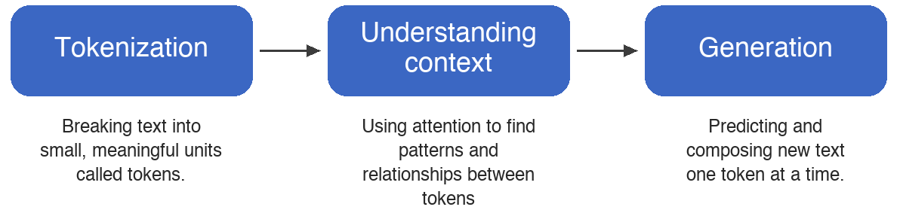
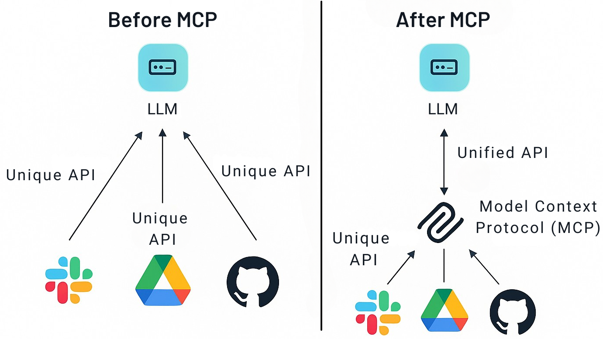
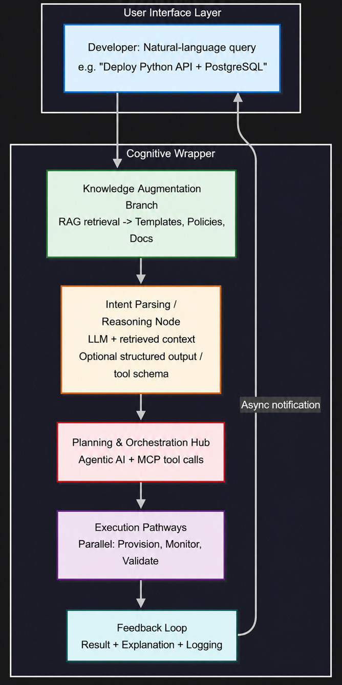
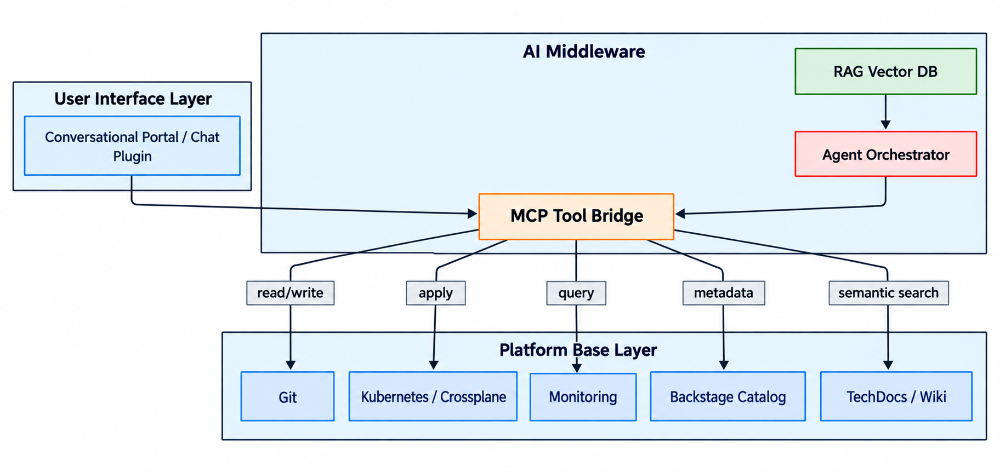
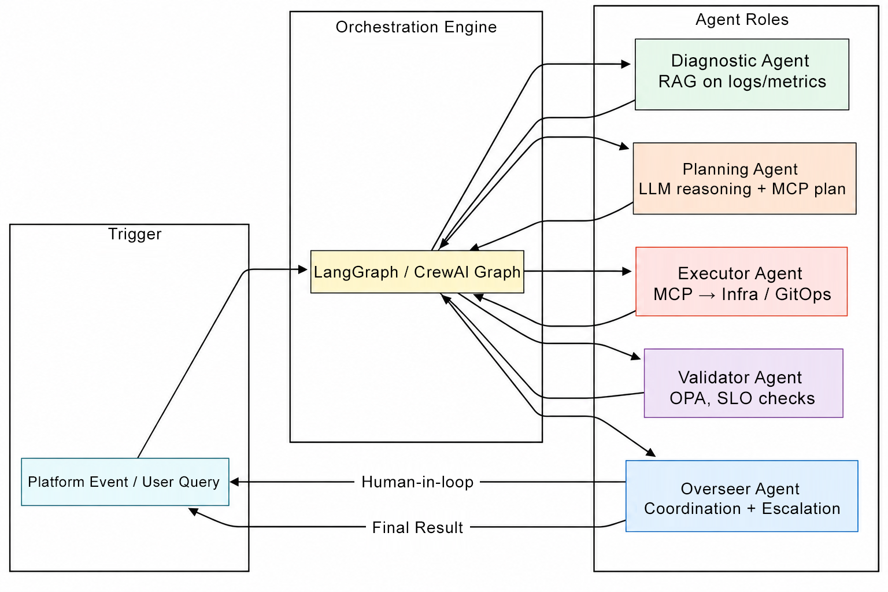

# 3

# Foundation of Generative AI for Platform Teams

Have we ever felt that we understand why AI is necessary but are still not sure how to actually build it? In the first two chapters of the journey, we examined the basic ideas of platform engineering and the big changes coming with AIOps. The chapters covered how we all struggle with mountains of data and the *alert fatigue* that keeps us up at night. Now, the aim is to show the engine under the hood. This chapter is our *how-to* guide for everything discussed before.

We guide our readers through the actual tools that make internal platforms smart, active, and tailored for developers. We believe the ultimate value comes when engineering teams watch AI act directly on infrastructure. We use AI to perform actions beyond simple chat queries; we use it to generate complex configuration templates for technologies like Crossplane, kro, or Terraform through conversational prompts. Imagine a scenario where a developer states, *We** need a new database in AWS,* and our platform can generate a candidate declarative YAML configuration for that specific Crossplane composite resource.

We can also use AI to query observability systems and surface DORA metrics on demand. Instead of looking at ten different dashboards, we can ask, *What** is the deployment frequency this month?* The AI then shows the answer. This shifts us from searching for data to receiving it.

In this chapter, we will cover the following topics:

* **Key AI technologies powering generative AI platforms** **:** We need to understand what technologies the AI platforms rely on, and we will explain the concepts of LLMs, RAG, MCP, agentic AI, and copilots.
* **Customization options** **:** What are the differences among the customization options? When and how should we implement these key AI technologies?
* **AI for platform engineers** **:** How can we implement solutions in the real world? We explain practical ways in which AI works as a *force multiplier* for platform engineers.
* **AI on platforms** **:** Use cases for applying AI to platform engineering using agentic AI, LLMs, and related technologies.

# Key AI technologies powering generative AI platforms

Integrating AI into platform engineering requires more than a single tool. For us, a unified group of frameworks, methods, and systems must work together to make our environments smart and adaptive. Generative AI drives this transformation at its core, letting platforms reason and handle complex data where old automation scripts fail. These components, including LLMs, RAG, MCP, agentic systems, and assistant interaction patterns, build the architecture of our modern portals. Each component reduces cognitive load, boosts developer velocity, and shifts our infrastructure toward context-aware engineering ecosystems. In this section, we explain each mechanism clearly so we can deploy their combined capabilities effectively.

## LLMs and their capabilities

**Large language models** ( **LLMs** ) are the foundation of generative AI. They change how platforms process and create human-like text. This makes them essential for building conversational interfaces and smart automation. Today, LLMs are used throughout operations. They help interpret natural language and generate outputs that follow company standards.

For platform engineers, SREs, and DevOps professionals, LLMs help reduce our daily operational workload. We can shift our focus toward architecture, such as building cognitive platforms, instead of writing static configurations. As we write this book in 2026, we track the leading foundational options and industry-standard model providers available:

* **OpenAI ** **architectures** **:** Deploying advanced reasoning setups through their latest GPT and reasoning-optimized model series.
* **Anthropic systems** **:** Utilizing deep contextual software engineering with their Claude model family.
* **Google environments** **:** Driving automated diagnostics and massive token pipelines using the Gemini model family.
* **Open-weight alternatives** **:** Implementing localized control and low-cost scale with models like DeepSeek, Llama, and Mistral.

Because this landscape is a fast-moving target, newer and more capable models will certainly exist by the time you read these pages. Regardless of the version, these systems learn from trillions of tokens (words, code fragments, and symbols) to translate chaotic requests into declarative configurations.

At their core, LLMs predict which *token* comes next in a sequence. They learn patterns from data like code and documentation. The Transformer architecture makes them powerful because it lets the model look at all parts of a sentence at once. It uses *attention* to link words like *database* and *query* even if they are far apart.

We can think of this process in three steps:

1. **Tokenization** **:** Breaking text into small units.
2. **Understanding context** **:** Finding relationships between tokens.
3. **Generation** **:** Composing new text one token at a time.

*Figure 3.1* illustrates this basic three-step LLM flow.

Figure 3.1: Basic LLM flow

When we use these models (this is called  *inference* ), they balance creativity with precision. This helps automate documentation and make complex decisions. LLMs can help with:

* **Code completion** **:** Tools like GitHub Copilot help write Terraform configurations faster.
* **Log analysis** **:** We can parse data from Datadog or Splunk to find failures.
* **Natural language understanding** **:** We can say, *Provision a scalable **EKS** cluster,* and the LLM can infer which API calls may be needed to fulfill our request.
* **Multimodal tasks** **:** Some LLMs can even look at architectural diagrams, dashboard screenshots, or video recordings of system behavior.
* **Tool-augmented workflows** **:** When combined with tool-calling capabilities, LLMs can handle multi-step workflows, like analyzing logs to find a bug and then proposing a code fix.

Of course, we have challenges. We need good prompts, and sometimes there are *gaps* in specialized knowledge. That is why we use other techniques to help.

## Retrieval-augmented generation (RAG)

**Retrieval-augmented generation** ( **RAG** ) is a great upgrade for our large language models because we combine their generative capabilities with relevant information from external sources. This capability is critical for platform engineering because we need access to the latest company information and want to limit AI errors. The prompts we write can stay the same, but RAG changes what information the model has access to when generating a response. RAG can reduce stale-context and hallucination risks by retrieving relevant source material before generation. This makes the work much more reliable for things like AIOps or checking rules in the developer portals. For us, this means we change a messy question, like *What does our runbook say about handling database connection * *timeouts?* , into a real answer by retrieving relevant runbooks, post-incident reports, and internal troubleshooting notes to support a smarter diagnosis. RAG can help developers solve problems independently by grounding responses in relevant organizational information.

We use a two-step pipeline: first, we retrieve information; then, we generate the response. We encode a query as an embedding vector using models such as Sentence-BERT or Voyage AI, then search the knowledge base using **approximate nearest neighbor** ( **ANN** ) algorithms. We usually keep chunked documents (like Git repos, wikis, or runbooks) in a vector database. The system pulls the best pieces of information and puts them together with the original prompt before sending them to the LLM, which reduces the risk of inaccurate or unsupported responses by grounding the model in retrieved context. We can use advanced tricks like reranking with cross-encoders or hybrid search (mixing keywords and vectors) to be more precise. Such an approach helps with messy platform data like unstructured logs or code snippets that are difficult to read.

RAG is particularly useful in platform engineering because we can use organizational data without the cost of retraining the model. For example, if we need to understand a recurring latency pattern, RAG can search our post-incident reports and runbooks to show us that similar symptoms were previously caused by connection pool exhaustion, giving us a faster path to diagnosis. New team members may find it difficult to locate relevant information. In portals like Backstage, RAG helps with smart search through TechDocs to give new hires code examples and summaries. For auditing, RAG can retrieve relevant policy documents from data lakes to help assess whether Terraform configurations align with applicable requirements. Overall, RAG enables us to build trusted systems that grow with the data and help us innovate with accuracy. We will look at the technical details, such as vector embeddings and reranking in more depth in  *[Chapter 4](https://learning.oreilly.com/library/view/agentic-ai-for/9781806386659/Chapter_4.xhtml#h1_79)* .

## Model Context Protocol

The **Model Context Protocol** ( **MCP** ) is a key technology for connecting large language models with tools in platform engineering systems. It works with things like Git repos, CI/CD systems, cloud systems, and Kubernetes APIs by providing a standard way to structure interactions. As part of the move to agentic AI, MCP reduces the need for bespoke point-to-point tool integrations. How can we stop writing new code for every tool? MCP lets applications expose tools to models through a consistent interface, allowing natural-language requests to drive controlled infrastructure actions.

This builds smart platforms where a developer says, *Show** me the error logs from the *`payment‑service`* in the last hour,* and the LLM uses MCP to query our observability stack and present a structured summary. The same integration can also support logging and policy checks around tool use. By standardizing structured protocol messages and tool schemas, MCP provides consistency and scalability. Because integrations follow a common protocol, platforms can add or replace tools without retraining the model. It represents a cornerstone for changing static tools into smart, aware systems that help developers with self-service while preserving explicit governance controls.

### Understanding the middleware layer

At its core, MCP provides a protocol layer that gives LLMs a shared language for interacting with tools. It lists tool metadata like names, descriptions, or parameters in a JSON schema that the model reads to decide when to call them. When we ask a question, the LLM makes a function call if it detects a need for data. For example, it could query GitHub for the repository commit history through MCP.

For supported HTTP transports, MCP defines an optional OAuth-based authorization flow and standardizes structured request and response formats. There are also useful patterns like tool chaining for multi-step tasks and *human-in-the-loop* approvals to support safer production use.

*Figure 3.2* contrasts direct tool integrations with an MCP server-based approach.

Figure 3.2: Tool integrations before and after MCP

MCP enables strong engineering workflows by connecting different systems. This makes developers more productive and supports operations. Overall, MCP helps create intelligent ecosystems that grow with what we need. It brings us innovation and trust. Should we look at this in more detail? We will look at this much more in Chapter 4.

Agentic AI
Agentic AI is a big jump in the way AI grows, moving from answering questions to being active and smart. We now have agents that think, plan, and do many steps alone in the platform work, helping handle hard jobs with minimal human help. We build this on top of the other tools like LLMs, RAG, and MCP to make the platforms act like smart managers. For example, with a deployment failure, the agent can inspect logs through tools, retrieve relevant runbooks with RAG, analyze patterns with the LLM, and propose a fix through tools exposed via MCP, all while it keeps trying to reach the goal of zero downtime.

How can we stop the constant manual scaling and boring toil? For us in platform teams, this enables us to create systems that heal themselves. Our agent can watch metrics in real-time and use Crossplane to add more resources before we even see a problem, which helps developers stay productive. We use reasoning loops like ReAct, which interleaves reasoning and acting, so the agent breaks a big query into small subtasks.

It can help in messy environments where traditional automation scripts may struggle to handle dynamic, context-dependent scenarios. This autonomy lets teams focus on innovation while the system handles routine and predictive work with human oversight.

We are already seeing this work in real life to make operations much smoother. AI agents can respond to pipeline events and propose fixes for configuration drift or rollback actions, with automation or human approval depending on the risk level. There are even frameworks like kagent to put these agents right inside the Kubernetes clusters. They handle tasks like correlating alerts across multiple services, diagnosing cascading failures, or fixing crashes by linking log analysis with a remediation script. These workflows should still follow team-approved runbooks, policy checks, and human approval paths where needed. These agents do more than execute isolated tasks. They can adapt their actions to changing context and platform state, helping teams build more resilient workflows.

AI coding assistants
A note on terminology: the industry uses several overlapping names for this category. GitHub brands its product Copilot, but tools like Cursor, Claude Code, Kiro, and Windsurf do the same job without calling themselves copilots. We use AI coding assistants as the umbrella term for any AI tool that works alongside us in our IDE or terminal, suggests code, answers questions about our codebase, and helps us debug, while keeping humans in control. In this chapter, we use the term for interactive, human-supervised use, even though some coding assistants also support agentic modes.

Copilots serve as special AI helpers that live inside the dev tools to provide fast help and automation, growing what we can do in the platform work. Using LLMs and agentic AI, coding assistants such as GitHub Copilot and custom internal tools provide code suggestions, consult documentation, and assist with testing using relevant context.

For us in platform teams, these copilots make writing Terraform or fixing configs easier by suggesting approaches grounded in company rules and additional context retrieved via RAG. They are designed for interactive use, providing ideas we can accept, change, or reject, helping us work faster while retaining human control and oversight.

How do we ensure these assistants do not simply take over? The copilot pattern works well when we need AI to follow rules, similar to the chat interfaces discussed in Chapter 2. Copilot capabilities integrate into interactive applications that fit the workflow, helping teams manage systems and ship faster than before.

When we need Kubernetes YAML or CI/CD pipelines, copilots or Backstage plugins provide suitable manifests using templates retrieved through RAG, helping shorten development cycles.

Build vs. buy: evaluating AI platform options
Chapter 2 framed this decision from the business side. Before we dive into the specifics of implementation, we revisit it briefly from the technical side, because it shapes every choice that follows: should we build our own AI capabilities from scratch, or should we use existing managed services? This decision shapes our entire approach to AI-enabled platforms and has long-term consequences for our teams.

Pros and cons of building custom solutions
Building our own AI platform gives us full control over the architecture, data flow, and model behavior. We can tailor every component to our specific needs, integrate deeply with our existing internal systems, and maintain complete data sovereignty. For organizations with strict compliance requirements or truly unique workflows, this control is valuable.

However, the cost is real. Building from scratch means we need specialized ML engineering talent (which is expensive and scarce), we assume the full maintenance burden (model updates, infrastructure scaling, security patching), and our time-to-value is measured in months rather than weeks. It is common for teams to spend months building what a managed service provides out of the box.

Benefits and limitations of existing AI platforms
Managed AI platforms (like Amazon Bedrock, Azure OpenAI Service, or Google Vertex AI) give us speed and reliability. We get access to state-of-the-art models without managing GPU clusters, automatic scaling without capacity planning, and regular model updates without retraining. For most platform teams, this is the fastest path to production.

The trade-offs include less customization flexibility, potential vendor lock-in, data residency concerns if our data leaves our environment, and per-token costs that can become significant at scale. We also depend on the provider's roadmap for new capabilities.

Factors to consider: customization, control, and time to market
Our decision framework should consider these dimensions:

Team capability: Do we have ML engineers, or are we a platform team learning AI? If the latter, managed services reduce our learning curve.
Data sensitivity: Can our data leave our VPC? If not, we need providers with private deployment options, or we need to build internally.
Uniqueness of use case: If our workflows are standard (code generation, log analysis, documentation), managed services cover most of what we need. If we have truly proprietary processes, custom may be worth it.
Time pressure: Need results in weeks? Use managed. Can invest for months? Consider building.
Scale: At very high token volumes, self-hosted open-weight models (Llama, Mistral) can be more cost-effective than per-token APIs.
For most platform teams starting their AI journey, we recommend a hybrid approach: use managed services for the model layer (LLM inference, embeddings, vector search) and build custom for the integration layer (MCP servers, agent orchestration, RAG pipelines specific to our data). This gives us speed without sacrificing control where it matters.

What are the differences among customization options?
How do we decide which customization approach best fits the organization? Having reviewed the main technologies inside the generative AI platforms, it is essential to understand how to tailor these tools for what we specifically need. Customization options range from prompt engineering to fine-tuning or even training a model from scratch. Each approach offers a different balance of control, complexity, and performance. In this section, we will compare prompt engineering, RAG, agents, fine-tuning, and full training to see their strengths and where they fail. This section also discusses when to use multi-agent systems and orchestration to help SREs and DevOps leaders pick the best path for internal platforms to help developers work better.

Choosing our path: prompts, RAG, agents, or training
When the aim is to customize AI for platform engineering, it is essential to understand the whole spectrum of choices to find the right balance among cost, speed, and performance. It is not mere theory. It is based on what platform teams really need every day to avoid wasting resources or making things too complex. Like we said in Chapter 1, the goal is to reduce cognitive load for developers by giving them self-service tools, and AI customization helps do this for tasks like fixing infrastructure or troubleshooting. Each method uses the basics covered before, like LLMs and MCP, but they change how the tools fit the company. For example, a small team might start with prompts to build a simple chat, while a big company might use fine-tuning for strict rules. We have to think about the data, budget, and how much accuracy we need before choosing. We will look at each option now to see how they help work better. We will start with prompt engineering, which is the easiest entry point, and move up to the hardest. This path follows how a team grows in its AI maturity.

Starting small: prompt engineering
Prompt engineering is the practice of designing and refining the natural language instructions we give to an LLM to get the output we need. It includes writing system prompts that define the model's role and constraints, structuring our requests with clear context and examples (few-shot prompting), and iterating on wording until the outputs are consistent and accurate. It does not require modifying model weights or preparing training data; the main work is designing, testing, and refining instructions.

Prompt engineering is the easiest way to start since there is no need to change the model itself and we do not need many technical resources. We need to be meticulous with how we write the inputs for the LLM so we get back the right answers. For instance, instead of saying deploy a service, we could write a thorough prompt:

As a platform engineer following the company's Kubernetes standards, create a YAML file for a new service called 'user‑auth' with PostgreSQL, 500m CPU and 1Gi of memory, and readiness probes.

This detail helps the model follow specific needs without any extra training. It is also possible to use this for AIOps, like asking the AI to look at the last 24 hours of CPU spikes and suggest fixes based on SRE rules. It is great because it is rapid, cheap, and we can keep testing new prompts in real-time. However, the model only knows what it was trained on and may still produce inaccurate outputs. There is no such thing as a perfect prompt, and LLMs can make mistakes even with well-crafted instructions. It is our starting point for any AI integration, and it remains necessary regardless of what other techniques we layer on top.

Adding context: retrieval-augmented generation (RAG)
When prompts are not enough, RAG adds a dynamic layer by connecting the LLM to custom data. This works in three parts: first, we chunk and embed our documents and index the resulting vectors in a vector store; second, we retrieve the right documents or code from internal wikis or data lakes using semantic search; and third, we add that context into the prompt so the AI has the relevant information before generating a response.

For example, when asked, What is our team's recommended approach for blue-green deployments?, RAG can pull our internal best-practice documents and architecture decision records to give a tailored answer. This reduces the chance of inaccurate AI outputs and is useful for AIOps scenarios where high accuracy is needed. RAG is more suitable than prompts alone when the model needs current or proprietary context, but it is harder to set up because it requires indexed, vectorized data. If the source data is poorly organized, RAG may struggle, so we need a well-designed indexing strategy. It is useful when the AI needs to know proprietary rules or IaC templates.

Adding action: agents
Building on RAG, agents are a significant step because they can take actions and execute multi-step workflows. We cover agents in detail in the Agentic AI section above. If we ask an agent to Provision a secure Kubernetes cluster for staging, it might think about the steps, find the policies with RAG, use MCP to talk to Terraform, and then check if it worked.

In AIOps work, agents can be useful for incident response because they can be triggered by alerts from Datadog, inspect the relevant metrics and logs, find the cause, and then scale the resources or roll back a deployment. They help handle multi-step jobs without writing a script for every scenario. But they are more complex to build, can be slower because they make multiple LLM calls, and require careful security controls. Guardrails can constrain their actions. They are best for workflows that need action, tool use, and validation inside the portal.

Specializing the model: fine-tuning
Fine-tuning is when we take a model and train it a bit more on custom datasets, like thousands of custom IaC examples. This can make the model better at reproducing patterns present in the fine-tuning data, such as company-specific IaC conventions, without needing long prompts every time. It is different from agents because it focuses on the model's knowledge, not the workflow. It can be useful for high-volume tasks like generating Terraform modules that follow our rules, though RAG and agents may also serve this need. Self-hosted fine-tuning can be difficult because we need to prepare data, manage GPU infrastructure, and maintain model versions. Managed fine-tuning reduces the infrastructure burden, although data preparation and model lifecycle management remain necessary. We should consider this when prompting and RAG do not adequately capture domain-specific output patterns, after optimizing the retrieval pipeline.

Training from scratch
Training from scratch is the most resource-intensive option, in which we build a new model using a very large custom dataset. This provides total control but demands enormous compute budgets and long timelines. For most platform engineering teams, it is impractical. Prompting, retrieval, or fine-tuning is usually more practical for these use cases.

Comparison of customization options
Table 3.1 compares the customization options by complexity, cost, data needs, use case fit, and platform example.

| Option             | **Complexity** | **Cost** | **Data needs** | **Use case fit** | **Platform example** |
| ------------------ | -------------------- | -------------- | -------------------- | ---------------------- | -------------------------- |
| Prompt engineering | Low                  | Low            | None                 | Quick prototypes       | Portal queries             |
| RAG                | Medium               | Medium         | Indexed docs         | Knowledge-heavy        | Wiki-based agent           |
| Agents             | High                 | High           | Tools + data         | Autonomous work        | Auto-troubleshooting       |
| Fine-tuning        | High                 | High           | Labeled data         | Specialized generation | IaC stack model            |
| Scratch training   | Very high            | Very high      | Massive data         | Unique IP              | -                          |

Table 3.1: Comparison of customization options

We should always look at the ROI. For most of us, a practical approach is combining prompts, RAG, and AI agents for flexibility. Start with prompts in a Backstage plugin to see if it works. If it misses context, add RAG with a vector store of the wikis. If the workflow needs to take action, add an agent with tools such as the Kubernetes API through MCP. Only fine-tune if you see patterns failing often in your RAG logs. Consider training from scratch only when there is a compelling legal or competitive reason.

When do we use multi-agent architectures?
Important caveat: with modern LLMs offering context windows of 200K tokens or more, many scenarios that previously required multi-agent architectures can now be handled by a single well-configured agent with good RAG and tool access. Multi-agent architectures add coordination overhead, latency from hand-offs, and debugging complexity. We should only reach for multi-agent when we genuinely need: (1) parallel execution across different security boundaries, (2) specialized models for different sub-tasks (e.g., one model for code, another for natural language), or (3) workloads that exceed even large context windows. Start with one agent and add more only when we encounter clear limitations.

Sometimes a single agent is not sufficient for our complex workflows that touch many different systems like cloud providers and CI/CD repos. For example, in a big incident, one agent might struggle to scale pods, notify the team in Slack, and update audit records at the same time. Multi-agent systems may be useful here because they break the problem into pieces: a Diagnostic agent for logs, a Remediation Agent to call Crossplane, and a Compliance Agent to check the rules. This is much like having different squads for different jobs, and it can make AIOps much faster and safer.

One reason to consider multi-agent architectures is context management. Every LLM has a finite context window, and as conversations grow longer, models can suffer from context degradation, including lost-in-the-middle effects, where information in the middle of a long context is recalled less accurately than content at the beginning or end (Liu et al., 2024, Lost in the Middle: How Language Models Use Long Contexts). When a single agent accumulates tool outputs, RAG results, and conversation history across a complex multi-step task, its context fills up and quality degrades. Multi-agent architectures can help manage this by giving each agent a fresh, focused context window scoped to its specific subtask. The orchestrator passes only the relevant summary between agents, keeping each one operating within its effective context range. This can make multi-agent architectures useful for tasks spanning multiple domains, such as infrastructure, security, and observability, where a single agent would need to hold too much specialized knowledge simultaneously.

Orchestration is the glue that makes these agents work together without failing. Tools like LangGraph help make workflows where we can define transitions and maintain workflow state. This prevents the agents from operating in silos and adds retries and limits to control spending and prevent them from becoming stuck in loops. Without this orchestration, the agents might act chaotically, but with it, we can support a proactive, self-healing system.

We should use multi-agent setups when our simple agents hit their limits, like when a job has many sequential steps or needs to happen across multiple cloud regions at once. But for straightforward things like making one YAML file, we should stay with a single agent to save money. Using a multi-agent architecture when a single agent suffices adds unnecessary cost and latency.

The benefits are not about speed; multi-agent systems are often slower due to hand-offs between agents. Their value is in separating complex work across specialized roles, such as diagnosis, planning, execution, validation, and escalation. In large platforms with many services, this can make complex workflows easier to reason about and operate, especially when different tasks need different tools, permissions, or review steps. In short, we use multi-agent orchestration when the work is complex enough to benefit from clear task separation and coordinated hand-offs.

AI for platform engineers
The field now stands at a pivotal moment in our careers. The way we work as platform engineers, SREs, and DevOps professionals is changing forever because of generative AI. The shift is from traditional automation toward intelligent augmentation. It is not a mere buzzword. It is a real solution to the heavy operational toil and the cognitive load discussed in Chapter 1. By using LLMs to write code, RAG to retrieve relevant context, and agentic AI to operate systems, we can make daily routines much faster. We can now predict problems before they make the phones ring and focus our energy on big architectural designs instead of small, boring tasks.

In this section, the aim is to explore the real, practical ways in which AI works as a force multiplier. We are building this on the AIOps ideas from Chapter 2 and the self-service goals from Chapter 1. We see efficiency gains everywhere, from making compliant Infrastructure as Code (IaC) to fixing incidents before they even happen. For those of us building internal developer platforms, AI is not here to take our jobs. Instead, it is a tool that makes the expertise stronger. It allows a small group of us to manage large, complex clouds while maintaining strong mean time to recovery (MTTR) and DORA metrics.

How DevOps and platform engineers use AI to improve efficiency
One of the most impactful and often overlooked use cases is diagnosing CI/CD pipeline failures. Every platform team knows the pain: a deployment fails at 2 a.m., the error message is cryptic, and we spend 30 minutes digging through logs before finding the root cause. With AI, we change this entirely.

Here is how we implement pipeline failure diagnosis: when a GitHub Actions or Jenkins pipeline fails, our AI agent receives the failure event. It pulls the last 50 lines of logs, the recent git diff, and our team's known-issues runbook via RAG. The LLM then correlates the error with past incidents and suggests both the diagnosis and the fix. In practice, this pattern can reduce mean time to recovery for common failures.

The key insight is that this use case does not require complex multi-agent orchestration or fine-tuning. A well-crafted prompt, RAG over our runbooks and past incident reports, and a single tool exposed through MCP to query our CI/CD API can be enough for a focused implementation. We start simple and iterate. This is a useful place to start because it is specific, repeatable, and easy to validate before expanding AI support to broader platform workflows.

Has the team ever wondered why we still spend so much time writing the same boilerplate scripts over and over? Many of us are now using LLMs to generate code and automate those repetitive parts of our jobs, turning hours of manual work into a few minutes of interaction with AI. This really helps with the heavy burden of setting up infrastructure. We use tools such as GitHub Copilot and custom LLMs inside our IDEs to get code suggestions that understand context. When given access to repository context and company rules, they can use that information to suggest changes that better align with established practices.

For example, imagine one of us needs to set up a new microservice. We type: Create a Kubernetes deployment with Prometheus scraping, and the LLM provides a candidate YAML manifest. It includes our resource limits, the liveness probes we always use, and the right annotations for our golden configs. This can reduce copy-and-paste mistakes that sometimes break our clusters.

Can we make CI/CD pipelines smarter? Yes, we can use AI to analyze legacy build logs and use RAG to retrieve related runbooks or incident context when diagnosing bottlenecks. It can suggest better ways to run tasks in parallel or how to use caching more effectively. AI-assisted workflows can help teams optimize otherwise static pipeline definitions. We can ask an AI assistant: Why is the integration test stage failing intermittently? The system then looks at the Git commits, our dependency maps, and past failures in Jenkins or Argo CD. It might suggest we quarantine a flaky test or try a matrix build to find the issue. Agentic AI can even go one step further. It can create a pull request with an improved workflow file in .github/workflows and invoke a dry-run tool exposed through MCP in a safe sandbox to make sure it works before we see it.

How do we deal with very large volumes of logs? Processing this volume of data forms a core part of the efficiency gains. AI can help analyze logs, metrics, and traces to provide proactive insights. This builds on the shift from reacting to alerts to actually doing predictive maintenance. We use tool-augmented LLMs to ask questions about messy, unstructured data. We can say, Correlate CPU spikes in the api‑gateway with recent deployments, and the AI pulls data from Datadog, Prometheus, and Git. It might identify that a specific unoptimized query was added in the last release.

We use multi-agent systems to manage the response. A diagnostic agent finds the anomaly, a correlation agent links it to other services, and a remediation agent drafts a plan to roll back or auto-scale using the Kubernetes Horizontal Pod Autoscaler (HPA).

AI is also useful for reducing cloud waste. It helps with forecasting and rightsizing resources. We can tell the AI, Recommend cost savings for non-production clusters, and the assistant uses tools exposed through MCP to query billing APIs and usage data. It might suggest we downgrade some instance types, move to Spot Instances, or use Karpenter to consolidate our nodes. It even generates the Terraform code to apply those changes. We can complement this with traditional ML models (time-series forecasting, not LLMs) trained on our FinOps data to predict recurring demand patterns and inform capacity commitments such as Reserved Instances.

What happens when a pod dies in the middle of the night? AI coding assistants can simplify debugging by turning stack traces and complex configurations into a clearer explanation. When an SRE asks, Debug OOMKilled in the payment‑service pod, the system uses tools to inspect kubectl logs and heap dumps and RAG to retrieve relevant runbooks or incident context. It can identify a likely memory leak, suggest new JVM flags, and simulate a fix in a local kind cluster using its agent tools. This stops us from switching between ten different windows and helps find the root cause much faster. By integrating with tools like Sentry or ELK via MCP, the agents can even propose new PRs to add observability probes before a problem happens again.

AI can also strengthen security. It scans our IaC for vulnerabilities before we even merge the code. It can combine LLM analysis with OWASP guidance, custom internal rules, and security-scanning tools to identify exposed secrets or misconfigured IAM roles. In our GitOps workflows, an agent can review a PR and say: Scan this Terraform for S3 bucket public access. It can retrieve relevant CIS guidance and run tools such as Checkov to evaluate the change. If it finds a problem, the workflow can block the merge and explain why. For those in highly regulated industries, AI can also help draft compliance evidence and reports tied to relevant controls. This can support secure-by-default self-service while automated controls handle routine gates and humans focus on higher-risk decisions.

How do we help a new engineer start working without bothering the whole team? AI can create personalized guides and tutorials. A new hire can ask, Set up my local dev environment for service X, and they get a step-by-step script. The AI can retrieve relevant guidance from Backstage TechDocs using RAG and, when authorized tools are available, help set up a local cluster and configure VS Code extensions. Multi-agent systems can simulate the whole setup to make sure it actually works. This helps people start contributing much faster and makes the squads more autonomous.

Our collaboration is also getting better. LLMs can summarize large pull requests and tell us about the risks. In a large team, the AI can condense the changes, flag potential breaking API changes, and check the dependency graph for downstream impacts. There are even agents that debate each other in the comments about trade-offs between performance and security, which helps make better decisions.

We are also changing how we plan for the future. We use AI models to look at Prometheus metrics and our commit frequency and PR throughput to predict what resources we will need in the next sprint. If we say: Scale for Black Friday traffic, the agent looks at historical traffic surges and can provision the required resources via Crossplane. This proactive approach can reduce the risk of outages.

AI can also help keep documentation current. AI can draft TechDocs updates from code comments, runbooks, and other approved sources. If we ask, Explain the auth flow changes, the AI can draft a new diagram and a diff for review. This can help keep the knowledge current without requiring every update to be written manually. After an incident, AI helps write the postmortem. It gathers timelines from PagerDuty, Slack, and our metrics into a blameless story with clear action items. This helps the organization learn and reduces the risk of similar issues recurring.

Finally, we use agentic loops to optimize performance in production. The system monitors latency and might hypothesize that a DB connection pool is too small. Within an approved workflow, it can test this hypothesis with a controlled chaos experiment and then propose or apply a guarded remediation while we oversee the work. It even helps align with other teams by translating product requirements into technical tasks.

All of these small wins add up to a major improvement in efficiency. They allow us to innovate on higher-value features instead of focusing only on routine operations. For us, AI is the next big layer in how we manage the whole software lifecycle.

AI on platforms
We now reach the most exciting part of the story: how we actually put the brain inside the platform. Putting generative AI directly into internal developer platforms is like the final prize of the long trip we described in the previous chapters. In the past, we built rigid systems that only knew how to follow one tool at a time, making workflows inflexible. Now, this change transforms these systems into smart ecosystems that can learn and help developers before they even have to ask for anything. The shift is beyond helping platform engineers with their own scripts. We are now talking about putting AI into the platform itself. This creates a new layer on top of everything that allows for things like fixing problems automatically, guessing how many resources we will need next week, and giving developers a self-service chat they can actually use.

We are building this on the strong AIOps rules from Chapter 2 and our deep focus on making developers happy from Chapter 1. Our main goal is to provide a blueprint or a map to use big tools like LLMs, RAG, MCP, agentic AI, and AI coding assistants. The goal is to stop the friction that makes work slow, make sure everyone follows the best rules, and help the company innovate faster. For us, AI is not merely a feature we bolt on at the end like a shiny sticker. Instead, we treat it as a deep part of the platform that grows as the platform grows. This turns legacy, static infrastructure into a dynamic partner that can see what the company needs and change itself to help.

How can we embed AI in our platform to run a workflow?
We start this process by picking the right jobs, or use cases, where AI can help the most. We look for those places where developers always get stuck or frustrated, like when they need to create a new service or figure out why a system crashed. In these high-friction areas, we can put a layer of AI intelligence to make everything smoother without having to throw away legacy systems and start over.

Doesn't it feel better when the system understands what we mean without having to write 500 lines of YAML code? In theory, we see AI as a cognitive wrapper. It acts as a layer that listens to what we say in plain English, goes and finds the right data, thinks through the steps, and then talks to the tools to get the work done. For example, let's think about a developer who needs to deploy a new microservice that must follow all our security rules. Instead of filling out ten forms, they go to the portal chat and say, I need a new Python API with a PostgreSQL database that follows our current security standards. The AI then reads that, understands the goal, finds the company templates, makes the right configurations, and starts the provisioning. It automates parts of the workflow while applying relevant policy and compliance controls. We like this model because it is modular. We break it into components such as intent recognition, data retrieval, planning, and result validation. This modular design can improve reliability and make the system easier to scale.

Figure 3.3 shows the call flow through these modular platform components.

Figure 3.3: Platform engineering AI call flow

## The technical flow of a smart platform

To help see how this really works, consider the six-step flow shown in  *Figure 3.3* . The sequence follows a linear path from user request through context retrieval, LLM reasoning, action generation, execution, and feedback:

* **User input layer** **:** It serves as the entry point for the developer's natural-language request, perhaps through a chat box in Backstage or a simple form.
* **Context retrieval layer (RAG)** **:** This is where RAG comes in first. Before the LLM does any reasoning, the system retrieves relevant templates from internal sources, the latest policies, and the best golden path documents. This retrieved context shapes everything that happens next.
* **LLM reasoning and planning node** **:** With the full context now available, the LLM processes the message and decides what to do. It parses the intent, extracts parameters, and plans the order of tasks. When it needs to call external tools, it produces structured output (such as JSON) through a tool schema or structured output configuration, not as a default behavior.
* **Action generation through tool schemas** **:** The agentic logic uses tools exposed through MCP to invoke Terraform workflows, create a repository in GitHub, or trigger a security scan. Each tool call follows a defined schema that tells the LLM exactly what parameters to provide.
* **Execution pathways** **:** We can then run independent tasks in parallel, such as setting up the server, starting the monitoring tools, and running a security scan.
* **Feedback loop** **:** Finally, the system indicates the result with a clear explanation. It also logs relevant activity to support evaluation and continuous improvement.

Consider an illustrative example from an e-commerce company. Their developers had a hard time making secure databases that followed the GDPR requirements. By putting AI into the platform, they could ask, *Set** up a PostgreSQL instance for user data with encryption.* The AI used RAG to find the compliance rules, planned the steps, and used its tools to build it. This approach can reduce errors and shorten the provisioning workflow.

Here is what this illustrative workflow could look like: the platform team could build a Backstage plugin with an embedded chat interface. Behind it, an MCP server could connect to their Crossplane control plane. If a developer typed Set up a PostgreSQL instance for user data with encryption and GDPR compliance, the RAG pipeline could retrieve three documents: their internal database provisioning runbook, the GDPR data residency policy (requiring `eu‑west‑1` region), and the encryption-at-rest standard (AES-256 with KMS). The LLM could generate a Crossplane Composition with the required parameters filled in. In this scenario, the workflow can avoid a Jira ticket and manual back-and-forth about which encryption key to use while incorporating the organization's stated compliance requirements.

Has the team ever wondered why we always have to wake up an SRE for the same latency problems? Another illustrative scenario is a finance company using AI to handle *predictive troubleshooting.* When someone asks  *why latency is high in the payment gateway* , the AI uses tools to inspect logs, RAG to retrieve relevant runbooks, an LLM to analyze the pattern, and tools exposed through MCP to propose a remediation. This stops the problem from becoming a big emergency for our SRE teams.

For example, a fintech platform team might see recurring night pages caused by three patterns: connection pool exhaustion on their payment service, memory leaks in their notification worker, and cold-start latency spikes after deployments. The team could build an agent that (1) receives the PagerDuty alert via webhook, (2) queries Datadog for the last 15 minutes of metrics on the affected service, (3) searches their runbook via RAG for matching symptoms, and (4) either automatically remediates the issue (restart pod, scale HPA) or escalates it with a pre-written diagnosis. This pattern illustrates how teams can automate low-risk remediation while escalating higher-risk cases with useful diagnostic context.

To be successful, we need a phased plan to avoid making things too complicated. This *scaffold* helps make sure the AI actually helps instead of adding unnecessary latency or complexity to the systems. Teams can struggle when they try to do everything at once, but we prefer to focus on the jobs that provide the most value first.

*Table 3.2* summarizes this phased rollout plan.

| **Phase**        | **Focus**         | **Key activities**                                                | **Expected outcomes**                                                                                                                                                                     |
| ---------------------- | ----------------------- | ----------------------------------------------------------------------- | ----------------------------------------------------------------------------------------------------------------------------------------------------------------------------------------------- |
| **Discovery**    | Use case identification | Map our pain points, like deployment friction, to what the AI can do.   | A prioritized list of three to five high-value use cases.                                                                                                                                       |
| **Prototyping**  | Minimal integration     | Test how well the AI understands intent and uses RAG in a safe sandbox. | A proof-of-concept that meets a predefined end-to-end task completion target against a test set of representative queries, with unsuccessful requests routed to fallback paths or human review. |
| **Augmentation** | Add intelligence        | Put in the agentic planning so the AI can do tasks with many steps.     | Automated flows that work from start to finish.                                                                                                                                                 |
| **Validation**   | Ensure reliability      | Add guardrails and policy checks.                                       | A system that meets defined production-readiness criteria.                                                                                                                                      |
| **Iteration**    | Feedback-driven         | Watch how people use it and use the logs to make it better.             | Continuous improvements and efficiency gains every quarter.                                                                                                                                     |

Table 3.2: Phased rollout plan

By following this path, we make sure that the AI is a true enhancer for the platform. We avoid overly broad implementations that can introduce unnecessary latency and complexity. For us, the goal is always to make the platform a better partner for developers, turning static infrastructure into something that feels alive and helpful.

## Integration with existing platform components

How do we add AI to the platforms without breaking the tools we already use every day? We need to focus on *loose coupling* and use abstraction layers to avoid causing disruptions in the workflows. We use protocols like MCP to build an ecosystem that is unified and easy to grow. We should see AI as a  *middleware intelligence layer* . It sits on top of the core parts (like service catalogs, docs, and monitoring tools), intercepting requests and making them better with generative power.

For example, if we use a developer portal like Backstage, the AI integrates by asking the entity catalog for metadata or checking TechDocs for rules. Then, it provides smart summaries or recommendations. This keeps everything consistent because the AI does not merely copy the data. It makes the data easier to access. This helps developers feel less overwhelmed by so many different sources.

*Table 3.3* compares common integration patterns, benefits, and challenges.

| **Component type**                                                      | **Integration pattern**      | **Theoretical benefits**                                                         | **Potential challenges**                                |
| ----------------------------------------------------------------------------- | ---------------------------------- | -------------------------------------------------------------------------------------- | ------------------------------------------------------------- |
| **Service catalog (e.g., Backstage entities)**                          | Metadata retrieval and enrichment  | Enables context-aware responses (e.g.,  *suggest upgrades for outdated components* ) | Data staleness; mitigate with real-time syncing               |
| **Documentation (e.g., ** **TechDocs** **, wikis)**             | Semantic search augmentation       | Grounds AI in organizational knowledge, reducing hallucinations                        | Index maintenance; use hybrid keyword-semantic search         |
| **Version control (e.g., Git)**                                         | Change analysis and PR automation  | Facilitates GitOps by suggesting diffs based on intent                                 | Merge conflicts; enforce review gates                         |
| **Orchestration (e.g., Kubernetes,**  **Crossplane** **)** | Tool invocation via MCP            | Abstracts API complexity for provisioning                                              | Latency in multi-call sequences; optimize with caching        |
| **Monitoring**                                                          | Anomaly correlation and prediction | Proactive insights from metrics and logs                                               | Privacy concerns; apply data minimization and access controls |

Table 3.3: Comparison of integration patterns

Imagine a telecommunications company using Kubernetes operators. They can scale resources by saying, *Optimize for the traffic surge.* The AI looks at the metrics, thinks about the patterns, and calls the scaling policies, eliminating the need to edit YAML files manually.

This layered integration might include:

* **Platform base layer** **:** Core tools (Git, Kubernetes, and monitoring).
* **AI middleware** **:** MCP as the bridge, RAG for data, and agents for logic.
* **User interface layer** **:** Conversational portals with feedback channels.

*Figure 3.4* shows how these layers connect in a typical AI-enabled platform architecture, from the base infrastructure through the AI middleware to the developer-facing interface.

Figure 3.4: AI platform engineering high-level architecture

In theory, security and governance are the most important parts. It is essential to use role-based access so the AI can act only within authorized permissions. Federated retrieval and data-access patterns can also help keep sensitive information within controlled boundaries. This layered setup includes our platform base layer with tools like Git and Kubernetes, our AI middleware with MCP and RAG, and our user interface layer for the chat. This helps us add new tools while preserving modularity and governance.

## Implementing agentic AI capabilities

Theoretically, it is all about designing systems that are autonomous but have specific roles. These systems do multi-step tasks while we keep an eye on them. Orchestration serves to manage the hard parts and make sure the AI follows the company goals. Conceptually, this changes the platforms from being *reactive* (where we wait for things to break) to being  *proactive* . Our agents watch the system state, plan what to do, and then act. They can diagnose a failure, suggest a fix, and apply the change while keeping humans involved so they can review the results.

To make this work, we need three key things:

* **Role decomposition** **:** We break the work into different jobs, like an agent that finds the problem versus one that fixes it.
* **State management** **:** The system needs to preserve relevant context as it moves between tasks.
* **Conditional logic** **:** The system needs to make decisions and take different paths based on what happens.

*Table 3.4* outlines the agent roles and interactions used in this blueprint.

| **Agent role**       | **Primary function**    | **Integration points**              | **Example use case**              |
| -------------------------- | ----------------------------- | ----------------------------------------- | --------------------------------------- |
| **Diagnostic agent** | Analyze data for issues       | Tools for logs/metrics + RAG for runbooks | Identify root cause in latency spikes   |
| **Planning agent**   | Sequence tasks and decisions  | LLM reasoning with MCP tools              | Outline remediation steps for outages   |
| **Executor agent**   | Perform actions               | API calls to orchestration tools          | Autoscale pods or update configurations |
| **Validator agent**  | Check compliance and outcomes | Policy engines and simulations            | Verify changes against SLOs             |
| **Overseer agent**   | Coordinate and escalate       | Orchestration frameworks                  | Route tasks and trigger approvals       |

Table 3.4: Agent roles

*Figure 3.5* illustrates how multiple agents coordinate in an orchestrated workflow, from initial diagnosis through planning and execution to final validation.

Figure 3.5: Agentic AI workflow (multi-agent orchestration)

To connect these specialized agents, our orchestration frameworks manage how these agents interact. We define our workflows like a graph, where the agents are *nodes* and the transitions between them are  *edges* . We also set limits on how many times they can loop (recursion limits) and how many tokens they can consume (token budgets) to keep costs under control.

Should the platform not feel like a cycle that never stops improving? The flow usually goes from user input to diagnosis, then planning, execution, and finally validation and feedback. If something goes wrong, the workflow includes branches for human escalation. This helps the platform remain automated while respecting defined controls.

# Summary

In this chapter, we explored the foundation of generative AI for platform teams. We started with the core technologies that power modern AI-enabled platforms, moved through strategic decisions about build versus buy, examined customization options from simple prompts to full model training, and concluded with practical approaches for embedding AI directly into our platforms and developer workflows.

The core takeaway is that LLMs, RAG, and MCP form a complementary trio: LLMs handle reasoning and generation, RAG grounds them in our organizational knowledge without retraining costs, and MCP provides standardized tool access for real-world actions. Agentic AI layers on top to move us from reactive troubleshooting to proactive operations, though we must scale incrementally from single-agent workflows to multi-agent systems. For most platform teams today, combining well-crafted prompts with domain-specific RAG and tool-augmented agents can offer a strong balance of capability and implementation effort.

In the next chapter, we will build on these foundations. We will explore vector embeddings and chunking strategies for production-ready RAG pipelines, then walk through the implementation of an MCP server that connects an LLM to a live cluster. The theory ends here, and the hands-on work begins: clone the companion repository at [https://github.com/PacktPublishing/AI-Driven-Platform-Engineering](https://github.com/PacktPublishing/AI-Driven-Platform-Engineering) now, because from *[Chapter 4](https://learning.oreilly.com/library/view/agentic-ai-for/9781806386659/Chapter_4.xhtml#h1_79)* onward, every lab in this book includes runnable code that you can execute on your own machine.

# Further reading

* Lewis, P. et al. (2020), Retrieval-Augmented Generation for Knowledge-Intensive NLP Tasks, NeurIPS: [https://arxiv.org/abs/2005.11401](https://arxiv.org/abs/2005.11401)
* Anthropic (2024), Introducing the Model Context Protocol: [https://www.anthropic.com/news/model-context-protocol](https://www.anthropic.com/news/model-context-protocol)
* Model Context Protocol, Specification and Documentation: [https://modelcontextprotocol.io](https://modelcontextprotocol.io/)
* Amazon Web Services, Amazon Bedrock Documentation: [https://docs.aws.amazon.com/bedrock/](https://docs.aws.amazon.com/bedrock/)
* LangChain, LangGraph Documentation: [https://langchain-ai.github.io/langgraph/](https://langchain-ai.github.io/langgraph/)
* Book companion repository: [https://github.com/PacktPublishing/AI-Driven-Platform-Engineering](https://github.com/PacktPublishing/AI-Driven-Platform-Engineering)
