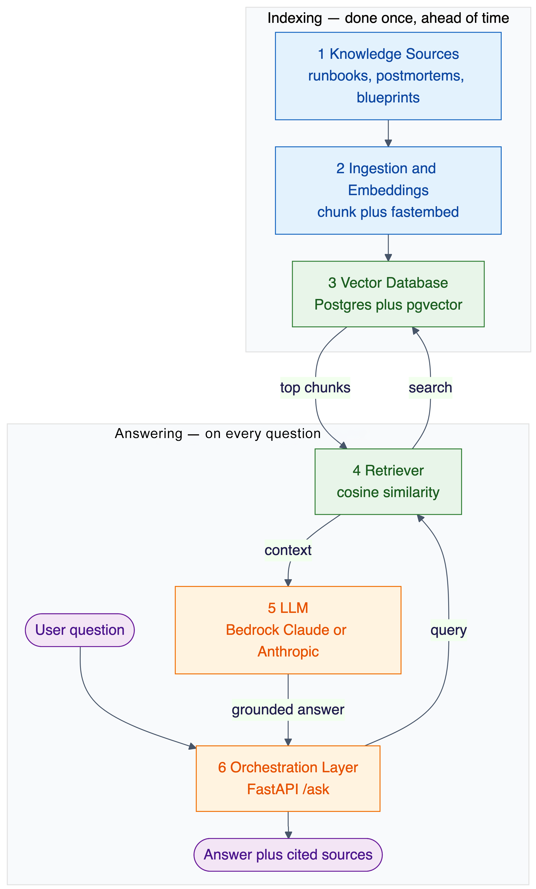
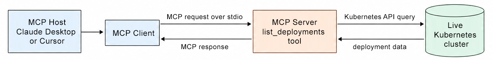

# 4

# Driving Platform Intelligence with Organizational Knowledge

Platform engineering increasingly leans on AI models to troubleshoot incidents, generate configuration, and guide engineers through complex systems. But a model is only as useful as the context it is given. A general-purpose foundation model knows little about your clusters, your runbooks, or the standards your organization enforces, so without that knowledge it produces answers that sound plausible but do not fit your environment.

Broadly speaking, AI systems consume three categories of context. The first is  **prompt context** , which includes the instructions, examples, and constraints provided directly in the prompt through techniques such as zero-shot, one-shot, and few-shot prompting. The second is  **organizational knowledge** , which encompasses documentation, runbooks, postmortems, and platform standards that can be retrieved at inference time, often through  **Retrieval** -**Augmented** **Generation** ( **RAG** ). The third is  **live platform context** , which consists of dynamic information obtained directly from operational systems through tools, including deployment status, Kubernetes resources, metrics, logs, CI/CD pipelines, and service catalogs.

This chapter is about closing that gap. It shows how to turn an organization's scattered operational signals and tribal knowledge into structured context that AI systems can consume reliably, so that even a smaller, cheaper model can reason accurately about your platform. We begin with the fundamentals of context and prompting, move through organizational knowledge systems, and then dig into the two techniques that deliver that knowledge to models at scale: **Retrieval-Augmented Generation** ( **RAG** ) and the **Model Context Protocol** ( **MCP** ).

In this chapter, we will cover the following main topics:

* Understanding context in AI models for platform engineering
* Zero-shot, one-shot, and few-shot prompting in platform scenarios
* Context strategies in platform operations
* Organizational knowledge systems and context architecture
* Standardizing and reusing organizational knowledge across teams
* Implementing RAG systems for platform knowledge
* Managing dynamic and tacit knowledge, and going beyond RAG with MCP

# Technical requirements

The hands-on chapters in this book use a Kubernetes environment for deploying and operating the examples. To keep the setup accessible and reproducible, the book uses a local `kind` cluster, which runs Kubernetes in Docker. The cluster is named `agentic‑platform`.

Create this cluster once and reuse it throughout the following chapters. The setup includes Kubernetes Metrics Server for the autoscaling examples and Argo CD for the GitOps workflows introduced later in the book. It also configures the local network ports used by the chapter for demonstrations.

Before you begin, install Docker, `kind`, and `kubectl`. Docker must be running before you create the cluster.

If you already have access to a Kubernetes cluster, such as Amazon EKS, you may use it instead. Your cluster must be able to pull container images and accept deployments through `kubectl apply`. Skip the kind-specific creation step but install Metrics Server and Argo CD as described in the accompanying materials.

Kubernetes tooling, container images, and configuration requirements evolve over time. For that reason, the GitHub repository accompanying this book is the authoritative source for current prerequisites, supported versions, setup commands, and troubleshooting guidance. Follow the instructions in *Lab 0: Local Cluster Setup* ([https://github.com/PacktPublishing/Agentic-AI-for-Platform-Engineering/blob/main/00-cluster-setup/README.md](https://github.com/PacktPublishing/Agentic-AI-for-Platform-Engineering/blob/main/00-cluster-setup/README.md)) to create and verify your environment.

# Understanding context in AI models for platform engineering

Choosing an AI model is now a necessary business decision. Organizations can use proprietary models from providers such as OpenAI, Anthropic, and Amazon through managed API services, where costs are typically based on token usage. Alternatively, they can use models available for self-deployment, subject to the applicable license. For these models, organizations can either use a hosted API or run the model in their own infrastructure.

The right choice balances model capability with cost, latency, data requirements, and operational complexity. Larger models, such as Llama 70B, can deliver stronger reasoning and handle more complex tasks, but they require substantially more compute capacity when self-hosted and can incur higher per-token costs when accessed through an API. Smaller models, such as Mistral 7B, are generally faster, less expensive, and easier to deploy, but may be less capable on nuanced or demanding tasks.

It's worth emphasizing that the difference isn't simply a matter of scale. A model with 70 billion parameters isn't just *ten times* a 7B model; it represents a leap in how deeply it can capture patterns and relationships. The analogy that comes to mind is talking with a casual reader versus a seasoned scholar. The first may have enough knowledge to contribute to a discussion, while the second has accumulated wisdom from years of experience, and the distinction between them is clear. Of course, access to such expertise, whether in people or in machines, comes with steep costs.

However, there is one consistent factor in this equation, irrespective of how large the model might be, and that is context. Both small and large models experience difficulties when this component is missing. Just as background knowledge establishes a foundation for a person, context serves the same purpose for AI, ensuring that responses are not merely accurate but also meaningful.

Picture trying to find your way through an unfamiliar city. A small model is like having a basic street map; it will guide you along the main avenues and get you to well-known spots, but that's about it. A larger model feels more like carrying a live GPS system, full of traffic alerts and detailed points of interest. Still, unless you supply key details, such as your destination, a time constraint, or whether you prefer scenic routes or highways, neither tool will be able to guide you effectively.

Platform engineering is where this particular issue becomes especially pronounced. Models, no matter how big, are probabilistic and bound by their training data. If you want to achieve reliable performance, you must provide carefully structured context. When it comes to operations that demand both precision and consistency, the quality of the framing can positively or negatively affect the final outcome.

In fact, the right context can sometimes level the field between model sizes. A smaller model, armed with precise, relevant details about your infrastructure and processes, may rival or even surpass the output of a larger model for certain tasks. The comparison here is between a local guide and an encyclopedic database: the guide might not know everything about the world, but when it comes to their own neighborhood, their expertise can prove far more useful.

To bring it down to a practical level, even though a 7B model may have more limited reasoning capacity or precision than its 70B counterpart, detailed context about your deployment patterns and system architecture can help it solve troubleshooting issues or generate configuration files effectively within the organization's specific environment. Results still depend on task complexity, context and retrieval quality, and evaluation against representative cases. In settings constrained by budgets or compute resources, this context advantage can be especially valuable.

Consider this practical example:

```
Poor Context: "Fix the deployment error."

Good Context: "Given that we're using Kubernetes v1.3x in AWS EKS, with Istio as our service mesh, and experiencing 'CrashLoopBackOff' errors in the payment-processor pod in the production namespace, suggest troubleshooting steps based on our environment specifics."
```

With this second approach, even a smaller model can often deliver surprisingly accurate and relevant responses because it's been given the right frame of reference. The strength of the output isn't just about the raw horsepower of the model but about how well the problem is presented to it. This is why context design isn't a minor technical detail; it's a core skill in platform engineering.

That said, framing context is really just the entry point. Out-of-the-box, foundation models can already do a lot, but their general-purpose nature means they rarely fit perfectly into the day-to-day realities of platform engineering. To get there, they need to be shaped and tailored. Sometimes that tailoring is light, such as careful prompt or context engineering. Other times, it grows into more involved solutions, such as **retrieval-augmented generation** ( **RAG** ), the **Model Context Protocol** ( **MCP** ), or even specialized agents. Most teams begin this journey with the basics: figuring out how to structure and deliver context effectively before layering on more advanced techniques.


# Zero-shot, one-shot, and few-shot prompting in platform scenarios

Three closely related approaches have become prominent when supplying context to AI models for operational tasks: zero-shot, one-shot, and few-shot prompting. As we explore them in the context of platform engineering, it is worth remembering that they are fundamental to working effectively with AI models in any industry or use case.

Zero-shot prompting gives the model nothing but an instruction: you describe the task and let the model respond, with no worked example. One-shot prompting adds a single example of the input-and-output pattern you expect, which helps when the desired format or reasoning style isn't obvious from the instruction alone. Both are well suited to platform scenarios where responses are needed quickly and the context is already well defined. For example:

```
Zero-shot example:
Given the Kubernetes logs below, identify the root cause of the service failure:
[logs content]
```

Few-shot prompting, on the other hand, provides multiple examples to help the model understand patterns and expected outputs. This approach is especially powerful for complex platform tasks that benefit from pattern recognition. Consider this example:

```
Input: Container crash in auth-service
Analysis: Memory limit exceeded (OOMKilled); increase memory limit to 512Mi
---
Input: Failed liveness probe in cache-service
Analysis: Redis connection timeout; check network policies
---
Input: Current issue: API gateway 503 errors
Analysis: [model should provide analysis based on pattern]
```


The choice between these approaches often depends on several factors in platform engineering:

1. **Task complexity** : Simple, well-defined tasks often work well with zero-shot or one-shot prompting, while complex troubleshooting scenarios benefit from few-shot examples.
2. **Response time requirements** : Zero-shot and one-shot prompting typically require fewer tokens and can be processed faster, making them ideal for real-time platform operations.
3. **Context specificity** : Few-shot prompting excels when dealing with organization-specific patterns or unique platform configurations that require multiple examples to establish context.
4. **Resource constraints** : While few-shot prompting often yields better results, it requires more tokens and computational resources, which must be balanced against operational requirements.


# Context strategies in platform operations

The degree to which AI benefits platform engineering is significantly influenced by the strategy chosen for each situation. While we've explored the fundamentals of context and prompting approaches, understanding how to apply these concepts in real-world platform operations requires a more nuanced approach.

Platform engineers face diverse challenges daily, from infrastructure management to incident response, each requiring different context strategies. Consider a common scenario: troubleshooting a production deployment issue. The traditional approach might involve checking logs, metrics, and recent changes. However, when working with AI models, the context strategy needs to be more comprehensive and structured.

A well-designed context strategy for deployment troubleshooting would include not just the immediate system state but also historical patterns, environmental factors, and related incidents. This multi-layered context allows the AI model to provide more accurate and actionable insights.

For example:

> Poor Context:
> "Fix the failed deployment in production."
> Effective Context:
> "Analyzing deployment failure in production environment:
>
> - Deployment attempted: 2025-03-16 15:30 UTC
> - Service: payment-processor
> - Environment: Production/AWS us-east-1
> - Recent changes: Network policy update (15:00 UTC)
> - Current symptoms: Container crash loop
> - Resource metrics: Memory usage spike before failure
>   Similar incidents: None in last 30 days"


The effectiveness of such context strategies can be measured through multiple lenses. Immediate metrics like resolution time and accuracy are important, but platform engineers should also consider longer-term indicators such as improvements in pattern recognition and knowledge base enrichment. Context should be detailed, but it must also be handled responsibly. Before providing operational data to an AI model, teams should identify and redact sensitive information such as credentials, personal data, customer identifiers, secrets, and internal security details. This holistic approach helps ensure that context strategies evolve over time while maintaining appropriate security, privacy, and compliance standards.

In incident response scenarios, context becomes even more critical. The AI model needs not just the current alert data but also an understanding of service dependencies, historical incident patterns, and previous resolution strategies. This comprehensive context enables the model to suggest more effective solutions while helping prevent similar incidents in the future.

The power of context in platform engineering becomes particularly evident when we consider standardized blueprints as boundaries for AI model behavior. When platform teams create these blueprints, whether as Terraform modules, Helm charts, or other infrastructure templates, they are defining a context framework that guides AI models on organizational standards and constraints.

For example, when an AI model is provided with the context of platform-approved blueprints, the context tells it that:

```
Context from Platform Blueprints:

Terraform Modules:
- All AWS services must use encrypted storage
- Resources must have mandatory tags for cost allocation
- VPC configurations must follow specific CIDR patterns

Helm Charts:
- Container images must come from approved registries
- Resource requests/limits are mandatory
- Standard monitoring and logging sidecars required
- Service mesh integration patterns

Common Requirements:
- Security controls and compliance measures
- Backup and disaster recovery configurations
- Organizational naming conventions
- Standard label/tag structures
```

This context becomes a guardrail for the AI model. When asked to assist with infrastructure tasks, the model now understands that:

1. Solutions should leverage existing platform blueprints rather than suggesting raw resource creation
2. Recommendations must align with the guardrails embedded in these blueprints
3. Any suggested modifications should preserve the security and compliance controls

For instance, if a developer asks *How do I deploy a new * *microservice?* , the AI model, understanding the platform blueprint context, would respond:

```
"I notice your organization has standardized blueprints for microservice deployments. Depending on your infrastructure target, you should use:

For Kubernetes:
helm install my-service platform-charts/standard-service
  --set service.name=my-service
  --set environment=production 
  # The chart will automatically apply:
  # - Required resource policies
  # - Monitoring configurations
  # - Service mesh integration
  
For AWS/IaC:
module "my_service" {
  source = "platform-modules/service-blueprint"
  service_name = "my-service"
  environment  = "production"
  # The module will handle:
  # - Security group configurations
  # - IAM roles and policies
  # - Compliance requirements
}"
```

By adopting this method, the AI model essentially transforms into a proponent of platform standards, leveraging blueprints as a foundational reference for all guidance pertaining to infrastructure. The context provided by these standardized blueprints helps ensure that AI-generated solutions are not just technically correct but also organizationally compliant.


# Organizational knowledge systems and context architecture

In the last section, we looked at context strategies, such as embedding operational patterns, runbooks, or platform blueprints, to give AI models a set of guardrails. These methods work well for shaping behavior in specific situations, but on their own they only go so far.

If the goal is to scale platform intelligence across an organization, context can't stay local. It has to grow into something more structured: a system that captures, standardizes, and shares knowledge widely. This is where organizational knowledge systems enter the picture. When knowledge is treated as part of the architecture itself, codified into reusable modules, linked together through shared blueprints, or woven into knowledge graphs, it stops being scattered tribal memory and becomes a backbone that both people and AI can lean on.

The focus of this section is to trace that flow: how knowledge moves through an organization, how it can be standardized and repurposed, and how platform teams can design systems where context isn't just patched in here and there, but captured, organized, and consumed in a deliberate way.


## From operational context to organizational knowledge

As we explored in previous sections, AI in platform engineering depends on context. At the system level, context comes from real-time operational signals: logs, metrics, deployment events, and traces. This operational context, sometimes called system knowledge, is ephemeral by nature. It reflects what is happening right now and is indispensable for troubleshooting, enabling an AI model to suggest a rollback, highlight a failing probe, or correlate a spike in CPU usage with a recent deployment.

But operational context has limits. It is transient, focused on the present state, and quickly loses value once the incident has passed. Without a way to connect these momentary insights to the broader organizational memory, teams end up solving the same problems repeatedly. An incident may be resolved within one squad but never inform another team facing a similar issue. A carefully designed blueprint may enforce standards in one domain but remain invisible elsewhere in the organization.

This is where organizational knowledge comes in. Unlike operational context, *o* *rganizational knowledge is durable* , cumulative, and structured. It includes postmortems, incident reviews, runbooks, infrastructure modules, and platform blueprints that encode organizational standards. Together, these artifacts form a knowledge fabric that extends context across time and teams. When captured and standardized, this knowledge allows AI to move from answering  *What*  *'* *s happening right now?* to  *What usually happens in this situation, and how was it solved before* *?*

The distinction matters:  *operational context powers reactive intelligence, while organizational knowledge can enable proactive intelligence* . The former lets AI respond quickly to current conditions; the latter allows it to recognize recurring patterns, recommend preventive actions, and apply platform standards consistently across the organization.

By making this shift, AI evolves from a short-term assistant to a long-term partner. Instead of simply analyzing the present, it draws on accumulated knowledge to reduce repeated outages, accelerate onboarding for new engineers, and ensure that platform decisions align with the organization's collective experience.


# Standardizing knowledge types and flows

Organizational knowledge only becomes truly useful when it is standardized. In most engineering organizations, knowledge exists in many forms, including incident reports, runbooks, postmortems, infrastructure-as-code modules, Helm charts, monitoring dashboards, and informal team notes. Left unmanaged, this diversity quickly leads to fragmentation: each squad documents in its own way, with different levels of detail and varying formats, making it difficult for both humans and AI systems to extract value.

When every team invents its own approach, AI can still provide value locally; for example, copilots that help developers within a squad by learning their specific conventions. But this doesn't scale. Without standardization, AI remains a local assistant rather than a source of organizational intelligence. It cannot reliably connect incidents across squads, enforce compliance uniformly, or reuse solutions learned in one context to solve problems elsewhere.

Standardization addresses this challenge by defining clear expectations for how knowledge should be captured, structured, and shared. A postmortem, for example, is not just a free-form narrative but a structured artifact that always includes incident metadata, root cause, resolution steps, and links to relevant runbooks or commits. Infrastructure modules, similarly, are expected to include mandatory tags, compliance annotations, and usage examples that other teams can consume directly.

Flows of knowledge also need to be standardized. The path from an incident in production to an updated blueprint or module should be predictable and repeatable. A resolved outage feeds into a postmortem, which links to updated runbooks, which in turn refine the platform's standard modules. This flow ensures that lessons learned are not trapped in static documents but actively reshape the reusable building blocks of the platform.

For AI-driven platforms, these standards are not just operational hygiene; they are essential context data. Consistent formats make it easier for AI systems to retrieve relevant knowledge through RAG/MCP pipelines, enforce organizational guardrails, and provide accurate context to developers. By standardizing both the **types** of knowledge artifacts and the **flows** that connect them, organizations create a foundation where intelligence can scale reliably across teams and systems.


## Reusable knowledge structures aligned with teams

Even with standardized formats, knowledge can still splinter if it isn't organized for discovery and reuse. A pile of documents, no matter how polished, won't turn into something actionable on its own. For knowledge to carry real weight in platform engineering, teams have to treat it as a system that is structured, maintained, and designed for circulation rather than as a loose binder of notes.

The first principle is alignment and ownership. Every artifact, whether it's a postmortem, a runbook, or an infrastructure module, needs a clear owner. That doesn't just mean  *who wrote it* , but *who stands behind it* when updates are needed or accuracy is in question. Without this kind of accountability, artifacts age quickly, errors creep in, and before long the entire body of knowledge starts to lose credibility.

The second principle is contribution patterns. Knowledge should be open for contribution across the organization, but openness doesn't mean chaos. Contributions need consistency, whether through enforced templates, required metadata, or tagging standards. Imagine a postmortem template that always asks for root cause, customer impact, preventive measures, and links to relevant modules or runbooks. Over time, these consistent patterns make the knowledge predictable enough that both people and AI systems can navigate it effectively.

Once these foundations of ownership and contribution are in place, something interesting happens: knowledge becomes reusable. The billing team, investigating a service outage, can quickly find and apply a networking runbook owned by the infrastructure team. An AI troubleshooting agent can tie a new incident back to a similar one logged months earlier and surface tested mitigation steps. What used to live as scattered tribal memory now forms part of a shared backbone.

The payoff is tangible: less duplicated effort, smoother onboarding for new engineers, and greater trust that AI-powered recommendations reflect not just isolated expertise but the collective wisdom of the entire organization. In this way, documentation stops being a static archive and instead becomes a living system, one that grows stronger with each contribution.

By contrast, skipping structure leads to predictable failure modes. When ownership is missing, artifacts drift out of date or flatly contradict each other. When contribution patterns don't exist, every team invents its own way of documenting, and AI systems hit a wall trying to reason across the mess. In that environment, AI can only offer piecemeal, local assistance; it never scales into something like organizational intelligence.

Reusable, team-aligned structures are the bridge. They connect the act of writing things down with the larger goal of building a system of record that's accessible, trustworthy, and ready to power the next wave of AI-driven platforms.


## Context providers and consumers in cognitive platforms

Every piece of organizational knowledge really has two faces: the provider and the consumer. On one side are the teams or squads that generate and take responsibility for artifacts such as postmortems, infrastructure modules, and runbooks. On the other side are the people (and systems) who depend on that knowledge to get work done: developers, neighboring squads, platform services, and, increasingly, AI agents.

The strength of the system comes down to how smoothly knowledge flows between providers and consumers. For it to work, providers can't just toss artifacts into a repo; they need to publish them in a way that's consistent, discoverable, and actually reusable. Meanwhile, consumers need quick access and the assurance that what they're using is up to date and aligned with current standards. Without that trust, the whole loop breaks down.

Different organizations solve this flow in different ways. Some stick to Git repositories, treating artifacts as code, with updates flowing in through pull requests. Others wire knowledge directly into CD pipelines so that modules and standards are delivered as part of everyday deployment. Tools like Backstage add yet another layer, providing developers with a catalog where they can browse services, runbooks, and modules through a more human-friendly interface. The mechanics vary, but the underlying principle is constant: knowledge is only valuable if it's both published and consumable.

Things get trickier when AI enters the picture. Unlike a developer, a model can't just click through a portal or poke around in a repo. Knowledge has to be reshaped into formats the model can actually process and reason over. That challenge of making organizational knowledge consumable for AI sets the stage for what comes next.

In the following section, we'll look at **retrieval-augmented generation** ( **RAG** ) as the first major technique for bridging that gap between knowledge providers and AI consumers.


# Implementing RAG systems for platform knowledge

Building on our introduction to RAG in  *[Chapter 3](https://learning.oreilly.com/library/view/agentic-ai-for/9781806386659/Chapter_3.xhtml#h1_48)* , where we established its role in making organizational knowledge AI-consumable, let's examine the technical components that make this possible. The real hurdle in building cognitive platforms isn't just capturing or structuring organizational knowledge; it's making that knowledge consumable by AI systems. We've already seen that artifacts can be owned, standardized, and stored, but if they remain locked inside human-facing formats like wikis, dashboards, or Git repositories, they're of little use to a model. The AI can't skim a wiki page or *browse* a repo the way an engineer can.

This is where Retrieval-Augmented Generation, or RAG, comes in. Over the past few years it has become one of the dominant patterns for bridging this gap. RAG gives large language models the ability to reason over enterprise knowledge dynamically, without retraining them from scratch. Instead of relying only on what's baked into their frozen parameters, the model can pull in relevant knowledge at query time, grounding its answers in the specific context of the organization.


## Core concepts of RAG

Regardless of domain, a RAG system is typically built around six core components:

1. **Knowledge sources** : the raw material of the organization's collective memory: runbooks, postmortems, infrastructure-as-code modules, observability logs, or service catalogs.
2. **Ingestion and embeddings** : transforming knowledge into numerical vector representations using embedding models.
3. **Vector database** : a store optimized for semantic search, allowing the system to find knowledge by meaning rather than keyword.
4. **Retriever** : the component that queries the vector database and selects the most relevant information for a user's request.
5. **LLM** : the reasoning engine that consumes the retrieved context alongside the user query, generating grounded and contextually accurate responses.
6. **Orchestration layer** : the glue that connects the query to retrieval, augmentation, and generation, ensuring the flow is seamless and reliable.

*Figure 4.1* shows how these six components fit together, both when the knowledge base is indexed offline and when a question is answered online:



Figure 4.1: The six components of a RAG pipeline, shown as an offline indexing path and an online answering path

## Why RAG matters for platform engineering

Platform teams are uniquely positioned to benefit from RAG because their environments generate both operational knowledge (for example, logs, metrics, deployment events) and organizational knowledge (for example, modules, standards, runbooks). Traditionally, this knowledge is fragmented; each team stores it in its own repo, wiki, or dashboard.

By implementing RAG, platform engineers can unify these knowledge sources into a consumable layer for AI tools. This transforms troubleshooting, incident response, and even day-to-day development into a conversation with an AI system that understands the platform's unique context.

One requirement deserves special attention in platform settings: retrieval must be authorization-aware. Organizational knowledge often includes sensitive operational data, and not every engineer or team should see every runbook, incident, or credential reference. A production-grade RAG layer therefore has to respect user and team identity, enforce document-level access controls, apply metadata filters at query time so the retriever only returns content the requester is allowed to see, log access for auditing, and keep clear boundaries around sensitive operational data.

Separately, teams should establish a regular evaluation loop for RAG quality. This should measure retrieval hit rate, check that retrieved sources are current and relevant, assess whether answers remain faithful to those sources, verify that access controls prevent unauthorized content from being retrieved, and evaluate whether the context selected for each user request is appropriate and leads to the expected outcome.

## Implementation pattern example: a local RAG pipeline you can build

To see how this works in practice, you will build a small RAG pipeline that runs on a local Kubernetes cluster, with no managed cloud services required. A corpus of runbooks, postmortems, and blueprints is embedded into a vector store and queried through a single `/ask` endpoint. The same six components also map onto a production-scale AWS architecture built from Fluent Bit, Amazon Kinesis, AWS Lambda, Amazon OpenSearch, and Amazon Bedrock, which remains the reference for running this at scale ([https://github.com/aws-samples/sample-eks-troubleshooting-rag-chatbot/tree/main?tab=readme-ov-file](https://github.com/aws-samples/sample-eks-troubleshooting-rag-chatbot/tree/main?tab=readme-ov-file)). The local version is small enough to build and study in full.

Each of the six RAG components plays a role:

* **Knowledge sources** : a structured corpus of organizational knowledge made up of runbooks, a postmortem, and platform blueprints. Each file is Markdown with a consistent metadata header.
* **Ingestion and ** **embeddings** : an ingestion step walks the corpus, splits each document into overlapping chunks, and turns them into vectors using a small embedding model that runs locally on CPU, so no cloud credentials are needed. Amazon Titan embeddings can be substituted, but changing embedding models may change the vector dimension. The local lab rebuilds the pgvector table during ingestion, so after switching models you must reingest the corpus and use the same model to embed each question at query time.
* **Vector database** : Postgres with the `pgvector` extension, running in the local `kind` cluster, stores the embeddings and serves semantic (cosine-similarity) search.
* **Retriever** : when a developer asks a question, it is embedded with the same model and the nearest chunks are fetched from `pgvector` with a single cosine-distance query.
* **LLM** : Amazon Bedrock with Claude turns the retrieved chunks into a grounded answer. The Anthropic API works as a direct alternative for readers without AWS access.
* **Orchestration layer** : a small FastAPI service exposes one `/ask` endpoint. It embeds the question, retrieves the nearest chunks, calls the model, and returns the answer together with the source documents it used.

You can build and run this pipeline from the book's companion repository at [https://github.com/PacktPublishing/Agentic-AI-for-Platform-Engineering/tree/main/chapter-04](https://github.com/PacktPublishing/Agentic-AI-for-Platform-Engineering/tree/main/chapter-04).

> From the user's point of view, the result is simple. Instead of scanning dashboards or reading log files, they ask a question such as "Why is my pod in `CrashLoopBackOff`?" and get an answer drawn from the organization's own runbooks, with citations to the source files it used so the answer can be checked.

## Caveats and limitations

RAG is powerful, but it's not a silver bullet. Platform teams need to go in with a clear view of the trade-offs.

The first is  **embedding overhead** . In a vector-based RAG system, every artifact has to be vectorized before it becomes searchable, and that process consumes compute and storage. For small experiments this may not matter, but at organizational scale the costs add up quickly. Not every RAG system relies purely on embeddings. Keyword search, metadata filters, structured queries, or live retrieval can reduce this cost, but vector search remains the common case.

Then there's  **freshness** . Knowledge doesn't sit still; runbooks evolve, standards change, modules get patched. Unless embeddings are regularly regenerated, the model risks serving outdated or misleading context.

A third challenge is  **coverage** . Not every type of knowledge translates neatly into vector form. Some formats resist clean embedding, which means blind spots inevitably creep into the system.

Finally, there's  **operational complexity** . Standing up and maintaining a vector database, retrievers, and ingestion pipelines isn't free. It adds moving parts to the platform stack, and with them comes the burden of scaling, monitoring, and keeping everything reliable.

## Beyond RAG

These limitations leave platform teams with a bigger question:

How can we make organizational knowledge consumable for AI systems in a more direct way, without piling on the complexity of embeddings and vector stores? That question opens the door to the next section. There, we'll take a closer look at the **Model Context Protocol** ( **MCP** ), which aims to make platform knowledge easier, lighter, and more natural for AI systems to work with.

# Managing dynamic and tacit knowledge in platform engineering

Up to this point, we've been dealing mostly with explicit knowledge: artifacts you can capture, structure, and slot neatly into a system. The collection includes runbooks, postmortems, architectural blueprints, and logs, all of which are vital components. We've also looked at how RAG pipelines make this material consumable for AI systems.

But platform engineering is rarely that tidy. A huge part of what keeps systems reliable day to day comes from two messier categories. The first is dynamic knowledge, information that shifts constantly in real time, like fluctuating metrics or deployment events. The second is tacit knowledge, the unwritten know-how that lives inside engineers' heads: judgment calls, gut checks, experience earned over years.

Both types are critical and, in different ways, stretch beyond what RAG alone can handle.

## Real-time context update mechanisms

When dealing with rapidly evolving systems, it is essential for knowledge to adapt and change at the same pace as the platform. A deployment happens, a feature flag flips, a cluster autoscaler makes a decision; all of these events change the system's state in ways that matter for troubleshooting and decision-making. Vector-based RAG pipelines often rely on periodic ingestion and embedding. Unless those embeddings are refreshed frequently, the AI may be reasoning over stale context.

Real-time context delivery mechanisms, such as streaming logs into retrievers or wiring CD pipelines to push updates directly into knowledge systems, help close that gap, but they add operational complexity and cost.

## Tacit knowledge capture systems

The other blind spot is tacit knowledge: the heuristics, shortcuts, and *unwritten rules* that experienced engineers know but never formally document. For example, "*T* *his alert usually flaps after a scaling event* *;* * ignore it unless it persists for five minutes* ." Capturing this kind of know-how requires cultural and technical shifts. Lightweight annotation systems, conversational postmortem capture, or AI copilots that prompt engineers during incident response can all help transform tacit expertise into structured organizational memory.

## Knowledge synchronization patterns

As knowledge becomes more distributed across repos, dashboards, portals, and vector stores, the risk of drift grows. Developers may see one version of reality in Git, another in the service catalog, and the AI yet another in its vector database. Synchronization patterns are crucial: continuous pipelines that ensure every update to a runbook, module, or artifact is reflected in both human- and AI-facing stores.

## Why MCP matters

While RAG has quickly emerged as a common pattern for extending LLMs with organizational knowledge, it comes with inherent trade-offs: embeddings need to be regenerated as knowledge changes, vector stores must be maintained and scaled, and coverage is usually limited to unstructured or semi-structured text. For platform engineering, where knowledge lives not only in wikis but also in APIs, Git histories, CI/CD metadata, service catalogs, and observability tools, this creates a gap.

The **Model Context Protocol** ( **MCP** ) addresses that gap. Instead of transforming every knowledge source into text chunks and vectors, MCP defines a protocol through which models can directly query systems and retrieve structured responses. Think of it as shifting from *AI as a reader of documents* (RAG) to  *AI as a first-class client of your platform APIs* .

To understand how MCP works, it helps to distinguish three key participants:

* **H** **ost** : the AI application that coordinates the interaction, such as ChatGPT, Claude, or Cursor. The host manages the user experience and creates and manages one or more MCP clients.
* **Cl** **ient** : a component that runs inside the host and maintains a connection to a particular MCP server. It communicates with the server using the MCP protocol and obtains context and capabilities for the host to use.
* **S** **erver** : a program that provides context and capabilities to MCP clients. A server can expose tools, resources, and prompts. It is often a wrapper around an existing API, database, or file system, although it can also provide capabilities directly. A tool is a single capability, such as listing deployments, and one server can expose several of them.

The flow looks like this:

1. The host creates an MCP client and connects to an MCP server.
2. The client discovers the server's available tools, resources, and prompts.
3. The host makes the relevant tool definitions available to the model.
4. The model selects a tool and produces a tool call.
5. The host routes the call through the MCP client to the server.
6. The server performs the requested action and returns the result.
7. The host provides the result to the model, which produces a response for the user.

*Figure 4.2* shows these three participants and the flow of a request between them. You can build a working version of this setup in the companion repository ( *[Chapter 4](https://learning.oreilly.com/library/view/agentic-ai-for/9781806386659/Chapter_4.xhtml#h1_79)* ,  *Lab 3* ).



Figure 4.2: How an MCP host, an MCP client, an MCP server, and a live cluster exchange requests and responses

This makes a critical difference compared with a typical vector-based RAG setup. Where RAG usually grounds the model in indexed snapshots of knowledge, MCP is especially useful for structured, live system access: it exposes tools that act as live interfaces, allowing the model to query or act on your platform directly rather than relying only on what was previously indexed.

Example: wrapping a "list deployments" API with MCP
Imagine you already have a REST API endpoint:

`GET /api/deployments`
It returns JSON like:

```
[
  {"service": "checkout", "version": "1.2.4", "status": "Healthy"},
  {"service": "inventory", "version": "3.1.0", "status": "Degraded"}
]
```

To make this consumable by a model via MCP, you'd build an MCP server that exposes a tool wrapping this API. In Python, it might look like:

```
server.pyfrom typing import Optional
import httpx
from mcp.server.mcpserver import MCPServer  #  MCPServer from MCP SDK v2mcp = MCPServer("deployment-tool")@mcp.tool()
async def list_deployments(service: Optional[str] = None) -> list[dict]:
    """
    Return current deployments. Optionally filter by service name.
    """
    async with httpx.AsyncClient(timeout=30.0) as client:
        resp = await client.get("https://platform.internal/api/deployments")
        resp.raise_for_status()
        data = resp.json()  # e.g. [{"service":"checkout","version":"1.2.4","status":"Healthy"}, ...]
    if service:
        data = [d for d in data if d.get("service") == service]
    return dataif name == "main":
    # Run with STDIO transport so an MCP host (e.g., Claude Desktop) can launch it
    mcp.run(transport="stdio")
```

Once registered, an MCP host turns the model's request into a tool call. The exact wire format is defined by the MCP protocol; conceptually, the call selects the list_deployments tool, for example:

```
{
  "tool": "list_deployments"
}
```

It will then receive structured, live deployment data:

```
{
  "deployments": [
    {"service": "checkout", "version": "1.2.4", "status": "Healthy"},
    {"service": "inventory", "version": "3.1.0", "status": "Degraded"}
  ]
}
```


This example brings the key difference between RAG and MCP into sharp focus.

With RAG, the model works from an indexed and potentially stale view of deployment information, reflecting whatever was captured the last time the embeddings were generated. For instance, it might retrieve something like:  *Inventory v3.1.0 was degraded at 14:32 UTC* . That works well for artifacts that don't change often, such as postmortems, runbooks, and standards, where the value lies in semantic retrieval and the index can be refreshed on a schedule.

MCP, on the other hand, changes the game. Instead of relying on a static snapshot, the model can query the platform directly and pull back structured, live data, such as the JSON response in our example. That capability matters most in fast-moving contexts: deployments in progress, cluster health checks, or live observability signals where *freshness* isn't optional; it's essential.

It's not about one replacing the other. RAG excels at grounding models in organizational memory, such as past incidents, best practices, and design standards. MCP shines when models need fresh, structured knowledge delivered on demand. In practice, effective platforms will combine both: RAG for accumulated knowledge and MCP for live system state.

One caveat applies to both: giving a model live access through MCP does not remove the security requirements that apply to any platform integration. Each tool still needs authentication and authorization, explicit tool permissioning so the model can only call what it is allowed to, audit logging of every call, and safe failure handling for when a downstream system is slow, unavailable, or returns an error. Live access is powerful precisely because it acts on real systems, which is why it must be governed.


## Seeing it work: RAG and MCP side by side

The companion repository turns this chapter into runnable code on a local Kubernetes (`kind`) cluster, with no managed cloud services required. It is organized into three labs that align with the sections you have just read: *Lab 1* assembles the small, structured knowledge corpus described in sections *Organizational knowledge systems and context architecture* and *Standardizing knowledge types and flows* (runbooks, a postmortem, and platform blueprints); *Lab 2* builds the local RAG pipeline from Implementing RAG systems for platform knowledge (Postgres with the `pgvector` extension as the vector store, a small embedding model running on CPU, and a retrieval-and-generation API); and *Lab 3* implements the `list_deployments` MCP server from Example: wrapping a "list deployments" API with MCP against the live cluster.

The easiest way to feel the difference between the two techniques is to ask each one the kind of question it is built for. Ask the RAG pipeline why a pod keeps restarting, and it answers from your own runbooks rather than from the model's training data. After starting the API by following *Lab 2* in the *[Chapter 4](https://learning.oreilly.com/library/view/agentic-ai-for/9781806386659/Chapter_4.xhtml#h1_79)* companion repository, run:

```
$ curl -s -X POST localhost:8000/ask
    -H 'content-type: application/json'
    -d '{"question": "Why is my pod in CrashLoopBackOff?"}'A CrashLoopBackOff means the container starts, exits, and is restarted
repeatedly. Per the crashloopbackoff runbook: inspect the previous
container's logs (kubectl logs --previous), confirm the command and
entrypoint are valid, check that liveness and readiness probes are not
failing on startup, and make sure required config and secrets are mounted.sources: runbooks/crashloopbackoff.md
relevance_score: 0.93
last_updated: 08/10/2026
```


RAG answers should cite the retrieved documents they rely on and, where useful, display each source's retrieval relevance score and last updated date so users can assess its relevance and freshness.

That answer is grounded in durable, accumulated knowledge; it would read the same whether or not anything is broken right now. Ask the MCP server which deployments are unhealthy, and it answers from the live cluster instead:

```
> list_deployments()
[
{"service": "checkout",  "version": "1.2.4", "status": "Healthy"},
{"service": "inventory", "version": "3.1.0", "status": "Unhealthy",
"reason": "CrashLoopBackOff"}
]
```


The same incident illustrates two different jobs: RAG explains how this class of problem is usually solved, while MCP reports the current state of the system. That is the chapter's central point made concrete: RAG for accumulated knowledge, MCP for live system truth.

Practical reference: step-by-step instructions for building all three labs, including the knowledge corpus, the local RAG pipeline, and the MCP server, are in the book's companion repository at [https://github.com/PacktPublishing/Agentic-AI-for-Platform-Engineering/tree/main/chapter-04](https://github.com/PacktPublishing/Agentic-AI-for-Platform-Engineering/tree/main/chapter-04).

> 💡 **Reader's Hands-on Lab Note: Comprehensive File Breakdown & "Online Incident Investigation" Walkthrough**
> 
> The companion repository may appear to contain an arbitrary collection of Markdown and Python files, but **they actually form a carefully scripted production incident investigation!**
> 
> Here is a complete breakdown of what each file does, what is inside it, and how they connect into a cohesive feedback loop:
> 
> ---
> 
> ### 🎭 Cast of Files (The Investigation Scenario)
> 
> ```
> 💥 1. Inject Incident (broken-app.yaml)
>        Simulates a payment-processor failing DB connection on boot and crashing (exit 1)
>                         ↓
> 🔍 2. Live Inspection via MCP (k8s.py → server.py → client_demo.py)
>        Queries the cluster live: "What is failing?" → Detects CrashLoopBackOff (owner: payments-team)
>                         ↓
> 📚 3. Consult Wisdom via RAG (ingest.py → pgvector → store.py → api.py)
>        Searches vector store for CrashLoopBackOff → Retrieves SOP runbooks & past postmortems
>                         ↓
> 💡 4. Root Cause & Remediation (crashloopbackoff.md + 2026-03 postmortem)
>        Recommends `kubectl logs --previous` and identifies past NetworkPolicy blocker
> ```
> 
> ---
> 
> ### 📁 1. The Knowledge Corpus (`chapter-04/1-knowledge-corpus/corpus/`)
> Rather than arbitrary docs, each file plays an intentional operational role:
> 
> 1. **`runbooks/crashloopbackoff.md` (Operational Runbook — Standard SOP):**
>    * **Purpose:** The platform team's standard operating procedure for pod restarts.
>    * **Key contents:** Highlights that *"`CrashLoopBackOff` is not a root cause—it's Kubernetes telling you the container keeps exiting."* Recommends the golden command: `kubectl logs <pod> --previous` (reading logs of the crashed container), and lists the top 5 causes (config errors, DB connection failures, OOMKilled, probe failures, missing dependencies).
> 2. **`postmortems/2026-03-payment-processor-outage.md` (Incident Postmortem — Institutional Memory):**
>    * **Purpose:** Documents a real SEV2 production outage on March 16, 2026.
>    * **The story:** `payment-processor` crashed for 42 minutes because a NetworkPolicy change accidentally blocked egress to the database. The app exited on boot when the DB timed out.
>    * **Key takeaway:** Action item specifies: "When CrashLoopBackOff occurs, verify recent NetworkPolicy rollouts."
> 3. **`blueprints/standard-service.md` & `tagging-and-labels.md` (Architecture Standards):**
>    * **Purpose:** Mandates deployment templates and required metadata labels (e.g. `owner: payments-team`).
>    * **Why it matters:** Because labels are standardized, the MCP server can automatically identify the team responsible for an unhealthy pod.
> 
> ---
> 
> ### ⚙️ 2. The RAG Pipeline (`files/rag/`)
> 
> 1. **`files/pgvector/pgvector.yaml`:** Deploys PostgreSQL 16 with the `pgvector` extension to K8s, exposed on NodePort `localhost:30900`.
> 2. **`app/ingest.py` (Ingestion Pipeline):**
>    * Parses frontmatter metadata (`type`, `title`, `owner`) from the 6 Markdown files.
>    * Splits text into 18 overlapping chunks (~900 characters with 150-char overlap).
>    * Generates 384-dimensional vector embeddings locally using CPU model `BAAI/bge-small-en-v1.5` and stores them in pgvector.
> 3. **`app/store.py` (Vector Search):** Implements cosine similarity search (`<=>`) over vector columns.
> 4. **`app/api.py` (FastAPI Service):** Exposes `/ask`. Embeds user questions and retrieves top-k matching chunks with similarity scores.
> 
> ---
> 
> ### 🛰️ 3. Live Cluster MCP Server (`files/mcp/`)
> 
> 1. **`files/broken-app.yaml` (Deliberate Incident Trigger):**
>    * Uses container command: `["sh", "-c", "echo 'connecting to database...'; sleep 2; echo 'connection timed out'; exit 1"]`.
>    * **Directly mimics the March 2026 outage!** Exiting with status 1 causes Kubernetes to put it into `CrashLoopBackOff`.
> 2. **`app/k8s.py` (Cluster Observer):** Queries live Kubernetes API via the Python SDK, reading container waiting reasons (`CrashLoopBackOff`) from pod statuses.
> 3. **`app/server.py` (FastMCP Server):** Exposes `list_deployments` as an MCP tool over stdio transport.
> 4. **`client_demo.py` (Simulated AI Client):** Connects to `server.py` over stdio, performs tool discovery (`ListToolsRequest`), and invokes `list_deployments(only_unhealthy=False)`.
> 
> ---
> 
> ### 🔬 4. Real Experimental Results: The Combined Power
> 
> When executed on the local `kind` cluster:
> 
> #### A. MCP captures live ground truth:
> Running `.venv/bin/python client_demo.py --unhealthy` returns:
> ```json
> {
>   "namespace": "broken-demo",
>   "name": "payment-processor",
>   "desired": 1,
>   "ready": 0,
>   "available": 0,
>   "healthy": false,
>   "owner": "payments-team",
>   "pod_reasons": ["CrashLoopBackOff", "Error"]
> }
> ```
> * **Finding:** MCP identifies *in real time* that `payment-processor` owned by `payments-team` is currently crash-looping.
> 
> #### B. RAG consults institutional knowledge:
> Querying `/ask` with `"Why does a pod end up in CrashLoopBackOff and how do I fix it?"`:
> ```bash
> curl -s -X POST http://127.0.0.1:8088/ask -H 'Content-Type: application/json' \
>   -d '{"question": "Why does a pod end up in CrashLoopBackOff and how do I fix it?"}' | jq .
> ```
> **Retrieved Sources:**
> 1. Match 1 (score 0.827): `runbooks/crashloopbackoff.md` (recommends checking `kubectl logs --previous`).
> 2. Match 2 (score 0.759): `postmortems/2026-03-payment-processor-outage.md` (reveals past outage was caused by NetworkPolicy blocking DB egress).
> 
> ---
> 
> ### 💡 Summary: Why MCP + RAG is Essential for Platform Engineering
> Without **MCP**, AI has no visibility into what is failing right now in production.
> Without **RAG**, AI cannot connect live symptoms to team runbooks, past incident postmortems, or architecture standards.
> 
> **MCP provides the real-time eyes; RAG provides the organizational brain.** Together, they enable the autonomous operational agents built in Chapter 7.


## Beyond MCP: the emerging agent-protocol landscape

MCP is one of several open protocols that emerged as AI systems moved from single models to networks of cooperating agents, and it helps to know where it sits. MCP solves the agent-to-tool problem: how a model reaches a capability, a data source, or a system. This is exactly the problem this chapter has been concerned with. By 2026, MCP had become a widely adopted standard for connecting models to tools, data sources, and platform capabilities.

A second layer is being standardized alongside it: agent-to-agent communication, which is how independent agents discover one another and hand off work, rather than just calling tools. The leading effort is Google's **Agent2Agent** ( **A2A** ) protocol, contributed to the Linux Foundation in 2025, which lets agents built by different teams or vendors advertise their capabilities and delegate tasks to one another. A related effort, IBM's **Agent Communication Protocol** ( **ACP** ), a REST-native protocol that preserved context across an agent exchange, has since merged into A2A under the Linux Foundation's neutral governance, consolidating this layer into a single emerging standard.

For platform engineering, the point is layering rather than competition: MCP gives an agent reliable access to your platform's tools and context, which is what we built in this chapter, while A2A coordinates multiple agents once you have them. We return to that agent-to-agent layer, and the orchestration, identity, and trust questions it raises, in the chapters ahead on agentic AI and autonomous behavior.


# Summary

This chapter looked at how organizational knowledge becomes usable context for AI systems in platform engineering. We started with why context often matters more than raw model size, and how zero-shot, one-shot, and few-shot prompting shape a model's response. We then moved from short-lived operational context to durable organizational knowledge, and saw how standardizing knowledge types, flows, ownership, and the provider-and-consumer relationship turns scattered tribal memory into a shared backbone.

On the technical side, we implemented RAG to make that knowledge AI-consumable, walking through its six core components, a local pipeline you can build end to end, its production-scale AWS counterpart, authorization-aware retrieval, and its limitations. We then turned to the **Model Context Protocol** ( **MCP** ) for the cases RAG handles poorly: structured, live access to platform systems through tools, together with the security controls that live access demands. The practical takeaway is that the two are complementary: RAG for accumulated knowledge, MCP for live system state.

In the next chapter, we move from the knowledge and integration foundations of RAG and MCP to the conversational interfaces that make them accessible to developers. We will explore how conversational AI can be embedded in platform workflows, connected to organizational knowledge and live platform state, and used to support intent-driven tasks while preserving established governance, review, and delivery practices.

# Further reading

* Lewis, P. et al.,  *Retrieval-Augmented Generation for Knowledge-Intensive NLP Tasks* , NeurIPS: [https://arxiv.org/abs/2005.11401](https://arxiv.org/abs/2005.11401)
* Anthropic,  *Introducing the Model Context Protocol* : [https://www.anthropic.com/news/model-context-protocol](https://www.anthropic.com/news/model-context-protocol)
* Model Context Protocol,  *Specification and Documentation* : [https://modelcontextprotocol.io](https://modelcontextprotocol.io/)
* pgvector,  *Open-source vector similarity search for Postgres* : [https://github.com/pgvector/pgvector](https://github.com/pgvector/pgvector)
* Qdrant,  *FastEmbed*  *: lightweight, fast, local embeddings* : [https://github.com/qdrant/fastembed](https://github.com/qdrant/fastembed)
* Amazon Web Services,  *Amazon Bedrock Documentation* : [https://docs.aws.amazon.com/bedrock/](https://docs.aws.amazon.com/bedrock/)
* Google / Linux Foundation,  *Agent2Agent (A2A) Protocol* : [https://a2a-protocol.org](https://a2a-protocol.org/)
* IBM,  *Agent Communication Protocol (ACP)* : [https://agentcommunicationprotocol.dev](https://agentcommunicationprotocol.dev/)
* Surapaneni, R. et al.,  *A Survey of Agent Interoperability Protocols: MCP, ACP, A2A, and ANP* : [https://arxiv.org/abs/2505.02279](https://arxiv.org/abs/2505.02279)
* Book companion repository,  *[Chapter 4](https://learning.oreilly.com/library/view/agentic-ai-for/9781806386659/Chapter_4.xhtml#h1_79)* : [https://github.com/PacktPublishing/Agentic-AI-for-Platform-Engineering/tree/main/chapter-04](https://github.com/PacktPublishing/Agentic-AI-for-Platform-Engineering/tree/main/chapter-04)
