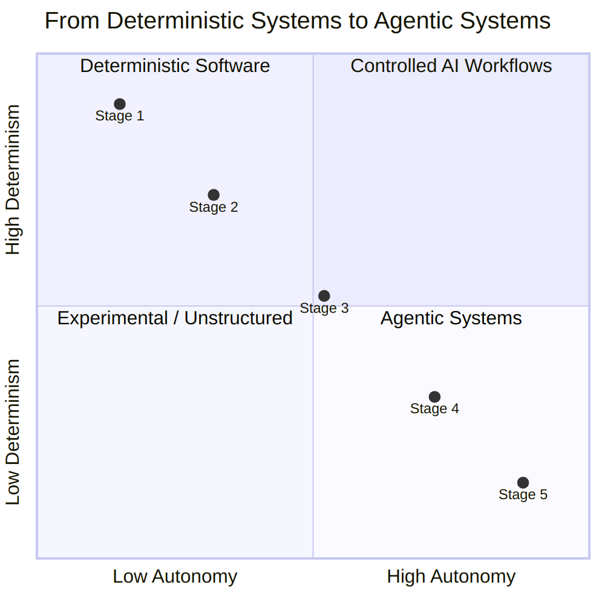

# 6

# Agentic AI and Autonomous Behavior

In the previous chapter, we built a conversational interface inside Backstage that could observe our platform: listing catalog services, searching documentation, and querying cluster state. But there was a deliberate boundary: the assistant could see, not act. Have we ever felt that gap between an AI that helps us understand what is wrong and one that can actually fix it? That boundary is exactly where this chapter begins.

The patterns in this chapter emerged from production. Early RAG-based troubleshooting demos at re:Invent 2024, real-time conversational diagnostics at KubeCon EU 2025, and multi-agent systems on EKS at re:Invent 2025 all pointed toward the patterns this chapter names. Running OpenClaw in early 2026 also made agent architecture legible through plain files such as `SOUL.md` for identity, `IDENTITY.md` for capabilities, and `MEMORY.md` for state. It also showed what can go wrong: a two-day run with vague context and loose runbooks cost $160 because the agent kept reasoning over broad context without clear termination or budget limits. Reasoning costs tokens. Reasoning without explicit boundaries costs a lot of tokens.

That personal-agent blueprint (file-based identity, deliberate memory, explicit tools, scheduled self-invocation) was designed for one user with full local trust. Our production agents need the same primitives with platform-engineering rigor: observability at machine speed, identity propagation across hops, idempotency, bounded blast radius, audit trails, and multi-tenant isolation. Meanwhile, non-technical colleagues, account managers, and marketing partners are building their own automations, democratizing what used to require a developer. *The same agent that saves four hours a week is the agent that, with the wrong context, spends $160 in two days.* The platform stands between democratization and chaos.

For us, convergence arrived in late 2025 and early 2026 when file-based agent patterns became a shared vocabulary for personal agents and production agents. OpenClaw used plain files to define agent architecture, and Anthropic's Agent Skills convention helped popularize `SKILL.md` as a portable procedural format across tools such as Claude, Codex CLI, Cursor, Gemini CLI, and GitHub Copilot. We call this convergence the OpenClaw moment. The blueprint was designed for personal agents. Production agents need that same architecture with platform-engineering rigor layered on top. That is the work of this chapter.

This chapter, together with  *[Chapter 7](https://learning.oreilly.com/library/view/agentic-ai-for/9781806386659/Chapter_7.xhtml#h1_142)* , covers the following topics:

* **Agentic AI as the next layer of DevOps** : Where agentic AI sits in the stack we have been building for the last decade, and why it amplifies the platform underneath it instead of replacing it.
* **Workflow versus agent, a spectrum of determinism** : How to choose where on the spectrum from a deterministic workflow to an autonomous agent our system should sit, based on the cost of being wrong at each step.
* **Anatomy of an agent, the three pillars** : The memory, scheduling, and tooling layers that define every production agent, and the governance each one needs.
* **Personal versus production agents** : The distinction between an agent built for one user and an agent built to act on a platform many users depend on, and why every primitive looks different in the two settings.
* **Agent readiness (covered in ** *[Chapter 7](https://learning.oreilly.com/library/view/agentic-ai-for/9781806386659/Chapter_7.xhtml#h1_142)*  **)** : Four properties of platform interfaces that decide whether an agent can use them safely: interface maturity, observability and audit, identity propagation, and convergence with bounded blast radius.
* **Specialist agents and the cycle of architecture (covered in ** *[Chapter 7](https://learning.oreilly.com/library/view/agentic-ai-for/9781806386659/Chapter_7.xhtml#h1_142)*  **)** : Why agent topology rediscovers the lessons of microservices, and what Conway's Law has to teach us about organizing multi-agent systems.

By the end of this chapter, we will have a vocabulary for the architectural components of an autonomous agent (memory, scheduling, tools, governance), a framework for deciding when to use a workflow versus an agent, and a clear understanding of why personal agents and production agents are fundamentally different designs. *[Chapter 7](https://learning.oreilly.com/library/view/agentic-ai-for/9781806386659/Chapter_7.xhtml#h1_142)* continues with agent readiness, specialist agent topology, governed writes, and hands-on labs. The code for those labs, along with the code for every other hands-on chapter, is available in the book's companion repository at: [https://github.com/PacktPublishing/Agentic-AI-for-Platform-Engineering](https://github.com/PacktPublishing/Agentic-AI-for-Platform-Engineering).

# Agentic AI is the next layer of DevOps

A common framing at the time of writing is that agentic AI is going to change everything. That's both true and useless. The more interesting question is where agentic AI sits in the stack we have been building for the last decade, because that determines what it can actually do.

We have been here before with each successive abstraction. **DevOps** gave us deterministic automation: scripts, pipelines, infrastructure-as-code. Anything we could express as a sequence of steps, we could automate. **Platform engineering** gave us self-service: paved roads, golden paths, blueprints, internal developer platforms. The platform team encoded organizational knowledge into reusable artifacts such as Terraform modules, Helm charts, scaffolding templates, and policy-as-code; developers consumed them through a portal or a CLI. **AIOps** gave us probabilistic pattern detection: anomaly detection, alert correlation, log clustering. We could finally make sense of the operational data we had been drowning in.

Each of those layers added a capability that the previous one could not deliver. None of them replaced what came before. CI/CD pipelines did not replace shell scripts; they orchestrated them. Internal developer platforms did not replace Terraform; they exposed it through a better interface. AIOps did not replace dashboards; it made them useful at scale.

*Agentic AI is the next layer in this sequence.*

It adds autonomous action on top of the layers below it. An agent does not write Terraform from scratch. It reads our platform's Terraform modules and chooses the right one. It does not invent a deployment process. It follows the GitOps flow our team already uses. It does not predict an anomaly. It consumes the AIOps signal and decides what to do about it. The model behind the agent does the reasoning, but the action lives entirely within the abstractions our platform already exposes.

This is the inversion most readers have not yet internalized:

*Agents do not replace our platform. They consume it.*

Every well-designed API our team has shipped over the last decade is a potential tool for an agent. Every Terraform module is a capability the agent can call. Every runbook in our wiki is procedural knowledge an agent can load as a skill. Every paved road is a constraint that prevents the agent from going off-road. Our blueprints, our IaC, our service catalog, our GitOps repository, our audit logs, all of it becomes the interface through which an agent operates. Without that interface, an agent has nothing meaningful to do. With it, it can do work that was previously impossible to automate.

The implication is the opposite of what some teams expect when they first encounter agentic AI. The instinct is  *"*  *we need to build an AI team to figure this out.* *"* The reality is  *"*  *we need our platform team to make sure the platform is consumable.* *"* If our APIs are well-governed, our contracts well-documented, our observability complete, and our infrastructure decoupled, agents amplify everything. If those things are missing, agents amplify  *those gaps* , at machine speed.

This is not a separate effort layered on top of platform engineering. It is the next milestone of platform engineering itself. The same disciplines that made internal developer platforms work (codified knowledge, paved roads, governance, fitness functions) are the disciplines that make agents work. The vocabulary shifts from " *blueprint* " to " *skill,* " and from " *API* " to " *tool,* " but the architecture is the same.

There is a way of describing platform engineering that makes this continuity unmistakable. Every platform team's job, reduced to one sentence, is to translate the implicit knowledge of senior engineers into explicit, executable patterns that anyone or anything can use. The senior SRE knows in their head how to recover from a particular kind of failure. The runbook captures it. The lead architect knows which AWS configuration is safe. The Terraform module enforces it. The veteran on-call engineer knows which alert is real and which is noise. The alerting rule embeds it. Each artifact the platform team produces is a piece of tacit knowledge made legible. That work was already valuable when the only consumers were other engineers. It becomes more valuable when the consumer is an agent, because an agent is the most literal consumer the platform has ever had. The IaC modules, the blueprints, the runbooks, the policies, the scaffolds: they are the explicit knowledge the agent reads. We are not adopting a new discipline to make agentic AI work. We are noticing that the discipline we already have is exactly what the new substrate requires.

This connection has a corollary that platform engineers should sit with:

*AI does not fix legacy. AI inherits legacy.*

If our service catalog is incomplete, the agent will hallucinate services that do not exist. If our IaC modules are inconsistent, the agent will reproduce the inconsistency. If our audit trail is patchy, we will not be able to reconstruct what the agent did when something goes wrong. Modernization is not a precondition because it is fashionable. It is a precondition because the same gaps that make a platform hard for humans to use make it impossible for agents to use safely. *[Chapter 7](https://learning.oreilly.com/library/view/agentic-ai-for/9781806386659/Chapter_7.xhtml#h1_142)* returns to this in the *Agent **r* *eadiness* *: **Is our platform ready to be consumed?* section, where we look at the four properties that separate platforms ready for agents from platforms that produce incidents. For now, the takeaway is simpler: the work we have been doing in platform engineering did not become less relevant when agents arrived. It became more relevant.

In  *[Chapter 4](https://learning.oreilly.com/library/view/agentic-ai-for/9781806386659/Chapter_4.xhtml#h1_79)* , we established that organizational knowledge is durable, cumulative, and structured: postmortems, runbooks, infrastructure modules, blueprints. We described how RAG and MCP make that knowledge consumable for AI systems. Agentic AI is what closes the loop. The agent reads the knowledge, reasons over it, and acts on it.

Before we look at how to build an agent, though, we need a vocabulary check, because the word " *agent* " is doing too much work in 2026, and the architectural conversation only makes sense once we have agreed on what we are talking about.

# Workflow versus agent on the spectrum of determinism

The word " *agent* " has been stretched past the point of usefulness. Almost every system that involves a language model gets called *agentic* by someone. A pipeline that uses an LLM to summarize tickets is sold as an " *agentic ticket-routing solution.* " A chatbot with retrieval is described as an " *agentic knowledge worker.* " A fully autonomous system that decides its own goals and acts on them across many tools is also an "agent." These are not the same thing. Treating them as if they were is how teams end up debating whether to " *build an agent* " without having decided what they are actually building.

The clearer way to frame the question is as a spectrum. At one end is fully deterministic code: a pipeline we wrote, every step laid out, no LLM in the picture. At the other end is fully autonomous behavior: a model that decides its own next step, picks its own tools, and runs without external orchestration. Almost every useful AI system in production sits somewhere between these two, and that " *somewhere* " matters more than the label.

A practical breakdown of the spectrum, with examples drawn from platform engineering:

* **Stage 1, deterministic code.** No LLM. Our existing CI/CD pipeline. Our Terraform plan-and-apply cycle. The runbook a human follows manually. The path through the system is fixed. The output is reproducible. The cost is bounded. This is the boring foundation that the rest of the spectrum is built on, and it is still the right answer for an enormous fraction of problems.
* **Stage 2, AI-augmented workflow.** A deterministic pipeline with one or more LLM-powered nodes. The path through the system is fixed. The LLM does narrow, bounded work at specific stations. Examples: a pipeline that uses an LLM to classify incoming alerts and routes them deterministically afterward. A release process that uses an LLM to draft a changelog summary, which a human reviews. The orchestration is yours. The model is a tool we call.
* **Stage 3, workflow with agentic nodes.** The orchestration is still mostly deterministic (the human drew the graph), but at certain nodes the model has agency: it picks a tool from a small set, branches the workflow based on what it finds, or drives a subtask that is itself open-ended. Each node may be implemented as a small agent, with its own memory, a few tools, and a constrained scope. The flow is predictable. The work happening inside each node is not. Most production multi-agent systems actually live at this stage, even when their marketing says " *fully autonomous.* "
* **Stage 4, autonomous agent.** The model directs its own orchestration. Given a goal, it decides what to do next based on what just happened. There is no predefined path beyond the goal. Claude Code given a task. An OpenClaw agent given a request. A Strands agent in its default loop. The path emerges at runtime, and reproducing the same input twice may produce two different paths.
* **Stage 5, multi-agent system.** Multiple autonomous agents reasoning and acting in coordination, with handoffs, shared state, and emergent behavior. These are Stage 4 systems composed into a larger structure. *[Chapter 7](https://learning.oreilly.com/library/view/agentic-ai-for/9781806386659/Chapter_7.xhtml#h1_142)* returns to multi-agent patterns in the *Specialist agents and the cycle of architecture* section.

The following figure illustrates this trade-off across the spectrum: the balance between predictability and capability.




Figure 6.1: The determinism spectrum, from fully orchestrated workflows (high predictability, low flexibility) to fully autonomous agents (high flexibility, low predictability)

The spectrum from deterministic systems to agentic systems, plotted across two axes: autonomy and determinism.

The further we move toward autonomy, the more capable the system becomes at handling situations the designer did not anticipate, and the harder it becomes to predict, debug, operate, and budget for. Stages 1 and 2 are easier to govern. Stages 4 and 5 are easier to extend. There is no globally correct answer. There is only a correct answer for a given problem.

The variable cost of this trade-off is the part most teams underestimate on the first deployment. Every reasoning step the model takes is paid for in tokens. The system prompt, the accumulated conversation, the tool results, and the reasoning trace the model produces while deciding what to do next are all billed on every turn. A workflow that uses a model at one node calls the model once per request. An autonomous agent solving the same task may call the model ten or twenty times before it reaches a conclusion, each call carrying the full accumulated context window. The cost difference depends on how much the agent reasons and how much context accumulates. Four concrete drivers are at work: (1) the system prompt, re-sent every turn; (2) the conversation history, growing with each step; (3) retrieved documents injected as grounding; and (4) the reasoning steps the model takes before producing output. Each compounds the others. This is not an argument against autonomous agents. It is an argument for matching the level of autonomy to the actual structure of the problem, because autonomy we do not need is autonomy we are paying for, on every turn, by the token.

A useful operating principle, often credited to Anthropic's early agent literature:

*If we can express it as a workflow, build a workflow.*

Reach for the autonomous end of the spectrum only when the structure of the problem genuinely benefits from it, when the path is not knowable in advance, when the search space is too large to enumerate, when the goal is well-defined but the steps are not. In platform engineering, many problems that initially look like " *we need an agent for this* " are actually problems that would be better served by a workflow with one or two agentic nodes (Stage 3). The fact that a model is involved does not require the model to be in charge.

## Mapping the workflow before building the agent

There is a step that comes before any decision about where on the spectrum our system should live, and it is the step most teams skip. *Before we build the agent, map the workflow.* Write down what the work actually is. Decompose it into discrete steps. Identify the inputs and outputs of each step. Mark the points where reasoning is required, the points where the work is mechanical, and the points where a human currently makes a judgment call.

This is unglamorous work, and it is the work that makes the difference between an agent that ships and an agent that requires three months of debugging.

The reason it matters is that an agent does not exempt us from understanding the problem. *An agent makes the cost of misunderstanding the problem higher, not lower.* If we cannot describe the workflow clearly enough for a new engineer to follow it, we cannot describe it clearly enough to delegate it to an agent. The agent will fill in the gaps with hallucinations. The hallucinated steps will look plausible. They will fail in ways that are expensive to diagnose precisely because the workflow was never written down in the first place.

The good news is that platform engineers are already equipped for this. The same mindset that breaks a deployment process into IaC modules, turns a runbook into automation, and decomposes a service catalog into domains is the mindset that makes someone good at designing for agents. *Decomposing a problem into steps with clear contracts between them is not a new skill we have to acquire. It is the skill we have been practicing for a decade.* The work shifts from " *how do I automate this end-to-end?* " to a more interesting question: " *step by step, where does reasoning actually add value, and where is determinism still the better answer?* "

A useful set of questions to ask about every step in the workflow:

* **Is the input well-structured or ambiguous?** Well-structured inputs such as a JSON payload, a typed event, or a known schema favor deterministic code. Ambiguous inputs such as free-text alerts, messy logs, or an incident description in Slack are where reasoning starts to earn its cost.
* **Is the path from input to output knowable in advance?** If yes, write a workflow. If the path branches based on what the data actually contains, an agentic node at the branching point is often the right answer.
* **What is the cost of being wrong at this step?** Cheap errors that are easy to detect tolerate more autonomy. Expensive errors that are hard to detect should sit behind deterministic guards even if a model is involved in the reasoning.
* **Does this step require integrating signals across domains?** Cross-domain synthesis is one of the few things autonomous reasoning genuinely does better than a workflow. If the step is " *look at the deployment, look at the alerts, look at recent changes, and decide what is going on,* " reasoning helps. If the step is " *fetch deployment status,* " it does not.

The output of this exercise is not just an architecture decision; it is a better description of the work itself. We have seen teams discover, midway through mapping a workflow they intended to " *agentify*  *,* " that two of the steps were redundant, one was obsolete, and the most painful step did not actually need an agent at all. It needed a missing API. The agent was not the win. The mapping was.

Agents do not eliminate design work. They redirect it from  *"*  *how do we automate this?* *"* to  *"*  *where in this workflow does reasoning add value, and where does determinism still serve us better?* *"* Teams that answer that question deliberately end up with systems that work. Teams that skip the question end up with autonomous systems that confidently solve the wrong problem.

The reason this spectrum matters for the rest of the chapter is that the architecture changes meaningfully across it. A Stage 2 system needs almost none of what the next section covers: its memory is the pipeline's state, its scheduling is determined by whoever triggers the pipeline, and its tools are the specific function calls the LLM makes at one node. A Stage 4 or 5 system needs all three pillars in their full form.  *What we mean by *  *"*  *an agent* *"** throughout the rest of this chapter is a system at Stage 4 or 5.* When we discuss memory, scheduling, and tools as the three pillars, we are describing the architecture of a system at the autonomous end. That is also where the production stakes, and the failure modes, get most interesting.

# The three pillars of a production agent

Every modern agent framework (Strands, Claude Agent SDK, and OpenAI Agents SDK) implements the same architecture under different names. LangGraph is related, but it sits closer to Stage 3 on the spectrum because it is a graph orchestration library where the developer defines the topology. The vocabulary varies. The pattern does not. An agent is a model plus three things: memory, scheduling, and tools. Take any one of those away, and what remains is something less than an agent: a chatbot, a script, an inference endpoint. Put all three together and we have a system that can persist, act on its own, and reach into the world.

Memory comes first because without it there is no continuity. Scheduling comes next because without it the agent never acts on its own. Tools come last because they are where everything else has to integrate cleanly with platform engineering. Each pillar has its own design space, and each carries trade-offs that show up sharply in production.

## Short-term and long-term memory in agents

A useful way to think about agent memory is as two dimensions, not one.

The first dimension is  **lifespan** . *Short-term memory* lives in the model's context window. It is what the agent has read in the current turn, the current conversation, the current task. It is ephemeral by design: the moment we start a new session or the context window fills up, it is gone. Short-term memory is fast, expensive, and bounded. It is also unavoidable: every time the agent reasons, it reasons over what is in the window.

*Long-term memory* lives outside the context window. It persists across sessions, across deployments, across compute restarts. It is what makes an agent feel continuous to a user. It is what makes an agent useful in production, where conversations span days and a system that resets every time would be useless. Long-term memory is implemented through external storage: files, databases, vector stores, and dedicated memory services.

The second dimension, the one most teams initially miss, is  **editability** . Some long-term memory is  *automatic* . The agent or its framework writes to it without explicit human curation: conversation summaries, extracted facts, and semantic embeddings of past interactions. Other long-term memory is  *deliberate* . A human (or the agent itself, with explicit intent) writes to it, and the contents are editable, versionable, and inspectable.

These two dimensions matter because they are independent. We can have automatic short-term memory (the context window), automatic long-term memory (a vector store of conversation history), or deliberate long-term memory (a file we can open and edit). Most production agents need at least two of those. Some need all three.

The OpenClaw blueprint is the cleanest demonstration of why deliberate long-term memory matters. The framework persists three files: `SOUL.md` (the agent's identity), `MEMORY.md` (accumulated facts and context), and `TOOLS.md` (a registry of capabilities). Every session reads these files at startup and incorporates them into the system prompt. The agent does not " *log into* " itself. It bootstraps from a folder. If we want to change who the agent is, we open `SOUL.md` and edit it. If the agent's self-conception has drifted in a way we do not like, we roll back the file. There is no opaque vector store to inspect, no embedding to debug. The state is text. We can read it.

Anthropic codified part of this pattern with the Memory tool. The agent gets a `/memories` directory where it can create, read, update, and delete files between sessions. The pattern Anthropic recommends (an initializer session that bootstraps the memory artifacts deliberately, before any substantive work begins) is the same pattern OpenClaw uses with a different name: a progress log, a feature checklist, a startup script. Memory as structured recovery.

In production, this layer is where one of the most important agent design decisions is often made incorrectly. The mistake is  **collapsing automatic and deliberate memory into a single store** . The two-system pattern, where each handles what it is good at, is what we have seen work in production agents on AWS:

* **Automatic long-term memory** (such as Amazon Bedrock AgentCore Memory) handles conversation summarization, user preference tracking, and semantic fact extraction. It runs in the background, persists across sessions, and the developer does not have to write code for any of it.
* **Deliberate long-term memory** (such as a set of identity files in `S3, SOUL.md`, `IDENTITY.md`, `USER.md`, `MEMORY.md`) holds the agent's operating context. It is loaded into the system prompt at every invocation. It is versioned through S3 versioning. It is editable by hand when needed, and editable by the agent itself when it learns something worth committing to long-term identity.

The agent decides what goes where: routine conversational context flows automatically into the managed memory service, and when something is important enough to persist as part of the agent's operating identity, the agent writes it to the file store using a tool of its own.  *That decision* , what is worth promoting from automatic to deliberate memory, is itself part of the agent's reasoning. It is also where most of the interesting failure modes live.

The classic failure mode is the long-running loop where automatic memory drifts. The agent summarizes a conversation, the summary loses an important constraint, the next summarization compounds the loss, and twenty turns later the agent is operating on a corrupted version of what the user originally asked for. The defense is to keep critical state in deliberate memory, where it cannot be silently rewritten by an automatic process. Compaction is useful for managing context window pressure. It is dangerous as the only mechanism for long-term continuity. Practical mitigations include versioned memory with rollback, tenant isolation so one agent's memory cannot contaminate another's, reviewable diffs for critical memory updates, and reset paths that restore a known-good checkpoint when drift is detected.

A practical heuristic: if losing a piece of state, such as a user's preferences, a system's invariants, or a critical constraint, would meaningfully change what the agent does, it belongs in deliberate memory. If losing it would only require the agent to ask again, automatic memory is fine.

## Scheduling and self-invocation in agent systems

The difference between a chatbot and an agent is mostly about who pulls the trigger.

A chatbot is synchronous. A user types a message, the chatbot responds, the loop ends. Nothing happens until the user comes back. The model is reactive: it has no agency outside of responding to direct prompts. Almost every " *AI assistant* " of the last three years has been a chatbot in this sense, regardless of how it is marketed.

An agent is asynchronous. It can be triggered by an event, run on a schedule, or run continuously. The user might be involved in the conversation, but they are not the only thing that wakes the agent up. A monitoring alert can wake it up. A cron schedule can wake it up. Another agent can wake it up. The agent itself can schedule its own next iteration. This is what people mean, or should mean, when they call something " *agentic.* " Without scheduling, we have a chatbot that calls tools.

OpenClaw's contribution to this pillar is a pattern called the  *cron*  *-triggered agentic loop* . Rather than only responding to human input, the agent is periodically woken up and asked to evaluate its task list. We can use it to send ourselves a daily briefing, monitor a website for changes, or surface calendar conflicts before we notice them ourselves. The loop is simple: a cron schedule fires, the agent reads its task list (often itself stored in deliberate memory), decides whether anything needs doing, and either acts or goes back to sleep.

In production, the architecture is different in detail but identical in shape. The cron is replaced with something more general: an event bus, a message queue, a schedule expression in a managed scheduler. The " *task list* " is replaced with whatever the platform considers a unit of work. But the pattern is the same: an external trigger, an evaluation, an action or no action.

Three deployment patterns recur often enough to be worth naming:

* **Event-driven** : the agent is invoked when something happens. A monitoring system detects an anomaly and publishes an event. A pull request is opened. A queue receives a message. The agent runs once per event, processes it, and produces a result. Cost scales with volume, not with elapsed time.
* **Scheduled** : the agent is invoked on a clock. Every six hours, every night at midnight, every Monday at nine. The agent wakes up, checks state, and acts. Cost is bounded but often wasted on cycles where nothing needs doing.
* **Continuous** : the agent is always running, processing a stream of inputs. This is the most expensive pattern and the one to reach for last. Most " *continuous* " agents are actually event-driven with a tight enough trigger to feel continuous.

The deeper concept is  **self-invocation** : an agent that triggers its own next iteration. A schedule fires, the agent runs and decides that the work is not done, and it schedules itself to run again in an hour. Or the agent processes an event, determines that it needs to wait for an upstream action to complete, and queues itself for re-invocation when the upstream signal arrives. Self-invocation is what makes long-horizon agentic work possible. Without it, every multi-step task that crosses a wall-clock boundary requires a human to come back and prompt the agent again.

Self-invocation has a corresponding hazard: the infinite loop. An agent that triggers itself can also re-trigger itself indefinitely, burning tokens and money on every cycle. Production systems should combine filter-policy routing on a fan-out hub with max retries per cycle, budget caps, idempotency keys, and dead-letter handling. The principle generalizes across event substrates, but it is easiest to describe with a concrete example.

A scheduler fires an event into a topic with a message attribute, for example, `agent_action`: `"true"`. The topic fans out to multiple subscribers. One subscriber, the Agent Invoker, has a filter policy that only matches when `agent_action` is true. Another subscriber, the UI Queue, accepts everything. The Agent Invoker picks up the message, runs the agent, and publishes the result back to the same topic, but with `agent_action`: `"false"`. The result flows to the UI for the user to see, and does not re-trigger the Agent Invoker, because the filter policy on the Invoker rejects messages where `agent_action` is false. The cycle breaks.

The architecture looks like this:

```
[Scheduler] -> [Topic (SNS/EventBridge)]
               |-- [Subscriber 1: Agent Invoker]  filter: agent_action = "true"
               |       |
               |       v
               |   [Agent runs]
               |       |
               |       v
               |   publishes result with agent_action = "false"
               |
               `-- [Subscriber 2: UI Queue]       accepts all messages
                       |
                       v
                  [User sees result]
```


The invoker subscription filter policy can be expressed as:

```
{
  "agent_action": ["true"]
}
```

When the agent publishes its result, it should include the complementary message attribute:

```
{
  "agent_action": "false",
  "generation": "1",
  "work_item_ttl": "2026-04-30T10:00:00Z"
}
```


The filter policy is the circuit breaker. The generation counter, TTL, dead-letter queue, and spend alarm are the complementary defenses. Without them, a filter policy alone can still become a single point of failure.

The pattern is more general than the specific implementation. Whatever our platform's event substrate (SNS, Kafka, Pub/Sub, or a custom bus), the principle is the same: separate the routing rule that wakes the agent from the routing rule that delivers the result, and make both explicit. The cost of getting this wrong is paid in dollars per minute.

## Tools as governed platform APIs

The biggest mental shift platform engineers need when working with agents is in this pillar.

Most discussions of agent tools start from the agent's perspective: a tool is a function the agent can call, with a schema and a description, and the agent reasons about which tool to invoke based on the user's intent. That is true, and it is the right level for explaining tools to someone learning the framework. But it skips over what is, for platform engineering, the more important framing:

Our APIs are the agent's tools. Our APIs were the agent's tools all along. We just had not connected them yet.

Every well-designed API our platform has shipped over the last decade is a potential tool for an agent. Every Terraform module, every Helm chart, every internal REST endpoint, every CLI command, every CI/CD trigger. These are all already capabilities the platform exposes. Connecting them to an agent is plumbing, not invention. The hard work was done when the API was built well in the first place.

The plumbing layer the industry has converged on is the Model Context Protocol (MCP). We covered MCP in detail in  *[Chapter 4](https://learning.oreilly.com/library/view/agentic-ai-for/9781806386659/Chapter_4.xhtml#h1_79)* . The summary is that MCP gives a standard way for an agent to discover, invoke, and receive results from tools, regardless of where the tool lives or what underlying transport it uses. An MCP server wraps an existing API and exposes it to the agent in a uniform schema. The agent does not care that one tool is a Lambda function and the next is a REST call to a third-party service. To the agent, they are both tools.

What is new with the OpenClaw moment is the layer *above* tools:  **Skills** .

A tool is what the agent can do. A skill is how the agent should do it. A skill is a folder containing a `SKILL.md` file with YAML frontmatter and a body of procedural knowledge: instructions, sequencing, guardrails, references to other files, and optional executable code. Here is a real `SKILL.md` for diagnosing a failing deployment:

```
---
name: diagnose-failing-deployment
description: Investigate why a Kubernetes deployment is not reaching its desired replica count.
when_to_use: The user reports a deployment that is crash-looping, pending, or stuck in ImagePullBackOff.
hard_constraints:
  - NEVER delete pods in production without explicit user confirmation.
  - NEVER modify resource limits without opening a pull request.
---
1. Identify the target deployment and namespace from the user's request.
2. Call read_deployment to get the current spec and status.
3. Call list_pods with label selector to find pod-level errors.
4. If ImagePullBackOff: check the image tag against the container registry.
5. If CrashLoopBackOff: call read_pod_logs for the last 50 lines.
6. Summarize the root cause and propose a fix.
7. If the fix requires a manifest change, call open_pull_request. Do not apply directly.
```


The agent loads the skill metadata at startup (lightweight, just the name and description). When the user's intent matches the skill's purpose, the agent reads the full skill content and follows it. If the skill points to additional files or scripts, the agent loads those on demand. This pattern of progressive disclosure keeps the agent's context clean even when there are hundreds of skills available.

The same principle applies to MCP servers and the tools they expose. Loading every tool description from every available MCP server into the system prompt at startup does not scale: the more capabilities the platform offers, the more context the model burns just to index them. 'Loading a registry of MCP servers and only fetching the full schema for a specific tool when the agent's intent narrows enough to need it does scale. Skills and MCP server discovery are both instances of the same idea:  *progressive disclosure is how the agent survives context that grows faster than the model*  *'* *s window can absorb.* Whenever we find ourselves tempted to dump everything into the system prompt " *to be safe,* " remember that we are paying for every token of that prompt on every turn, and that the model's attention is finite even when the window is large.

For platform engineering, this maps directly onto something every mature platform team already has:  **codified procedural knowledge** . Runbooks. Onboarding guides. Incident response playbooks. Architectural decision records. The patterns the platform team teaches new engineers, written down somewhere in a wiki. All of these are already, structurally, skills. The only thing missing is the `SKILL.md` frontmatter that lets an agent discover them.

This is the same insight as  *[Chapter 4](https://learning.oreilly.com/library/view/agentic-ai-for/9781806386659/Chapter_4.xhtml#h1_79)* 's argument that organizational knowledge becomes durable, structured, and AI-consumable when it is standardized. Skills are the standard. The community converged on the format. Now the runbook our platform team wrote two years ago for diagnosing a noisy alert can become the procedure an agent follows when the same alert fires at three in the morning.

The risk in this picture is concentration. If tools are our APIs and skills are our procedural knowledge and the agent has access to all of it, the agent has a great deal of reach. Reach without governance is a liability. This brings us to the part of this pillar that we cannot abbreviate: governance.

Most introductions to agent governance present it as a single layer, usually a system prompt, sometimes a guardrail. That is not enough for production. Governance has to live at multiple layers, the same way governance lives at multiple layers in any well-designed microservice architecture. In platform engineering, we do not enforce policy only at the API gateway, only at the service mesh, or only in application code. We enforce it at all three, because each layer catches different failure modes. The same applies to agents.

There are at least three layers worth distinguishing:

* **Skill-level governance** , written into the skill itself. The `SKILL.md` file declares what the skill does, when it should be used, and, critically, what its constraints are. Direct changes should be limited to low-risk, well-scoped actions, such as updating a label or adding a non-breaking annotation. Anything that touches availability, security boundaries, or production data must route through a deterministic check: a pull request, a policy gate, or a human approval step. " *Use this skill only for non-production environments.* " " *Always create a pull request rather than applying changes directly.* " " *Stop and request human approval if the change touches more than ten resources.* " This kind of governance is declarative, AI-readable, and easy to update without redeploying anything. It is also, by itself, not enforceable. The agent can follow these instructions or not.
* **Module-level governance** , scoped per tool or per MCP server. Each tool defines its own preconditions, validation rules, and side-effect boundaries before the action is executed. A `deploy_to_production` tool can require a signed approval token. A `delete_resource` tool can require a dry run first. An entire MCP server can be configured with a permission boundary that limits what it is allowed to touch. This kind of governance has a tighter blast radius: a misbehaving skill cannot escape its tool, and a misbehaving tool cannot escape its server. Defense in depth.
* **Hook-level governance** , enforced programmatically at runtime. The Strands SDK calls these Hooks. A hook intercepts the agent's tool call before it executes, evaluates it against a policy implemented in code, and either allows, rejects, or rewrites the call. Because hooks are code, they are deterministic. They do not depend on the agent's interpretation of an instruction. They execute regardless of what the prompt says.

The numbers behind hook-level governance are worth pausing on. In a March 2026 Strands Agents blog study of 600 evaluation runs across six scenarios, hooks achieved a 100 percent pass rate in enforcing the intended policy, compared to 82.5 percent for prompt-based instructions and 80.8 percent for graph-based workflow constraints. The gap is not subtle. Prompts can be overridden, ignored, or misinterpreted. Deterministic checks are more enforceable than prompt-only rules, though code itself can contain bugs or incomplete policy coverage.

This does not mean hooks replace skills or modules. Each layer catches different failure modes. Skills make policies legible to the agent, which is necessary for the agent to reason about them. Modules constrain what is even possible to call. Hooks make the rules deterministic at the moment of action. A serious production agent uses all three. A prompt-only governance approach ( *"*  *we are an assistant who must never do X*  *"* ) is the agentic equivalent of putting our security perimeter at the application layer and calling it secure.

There is also a fourth layer worth naming explicitly, because most platform teams already have it and do not always count it. As we covered in  *[Chapter 4](https://learning.oreilly.com/library/view/agentic-ai-for/9781806386659/Chapter_4.xhtml#h1_79)* , the platform team has been codifying organizational knowledge into Terraform modules, Helm charts, and similar reusable artifacts for years. Each of those artifacts carries governance of its own: a Terraform module's precondition and postcondition blocks, a Helm chart's pre-install and pre-upgrade hooks, and policy-as-code layers such as OPA Gatekeeper enforced at the Kubernetes admission layer or Sentinel policies enforced at Terraform plan time. When an agent calls a tool that wraps one of these artifacts, that governance fires before any agent-specific layer does. The work was already done. The agent inherits it. Treat our existing IaC and policy-as-code investments as the foundation of agent governance, not as something separate from it. The same paved road that prevents a junior developer from misconfiguring a cluster also prevents the agent from doing the same thing, and for the same reason.

There is one last point on tools, which has come up in production systems we have built and sets up the *a* *gent* *-r**eadiness* discussion in  *[Chapter 7](https://learning.oreilly.com/library/view/agentic-ai-for/9781806386659/Chapter_7.xhtml#h1_142)* . Agents can extend their own tool surface at runtime. Strands supports this through hot-reloading: an agent with editor and shell tools can write a Python file into a tools directory, and on the next iteration the new function is available as a tool. AWS reference architectures push this further: an agent that lacks a needed capability can dynamically synthesize a new Lambda, register it as an MCP tool through a Gateway, clear its tool cache, and use the new capability immediately. Self-extension is real. It is also exactly the kind of capability that amplifies platform readiness gaps. In production, self-extension should be restricted to personal or development environments unless the generated tool runs in a sandbox, passes code review, is signed before loading, and is promoted through the same controls as human-written tools. An agent that creates its own tools and triggers itself is at least an order of magnitude more dependent on observability, idempotency, and audit trails than an agent that only consumes pre-built tools. *[Chapter 7](https://learning.oreilly.com/library/view/agentic-ai-for/9781806386659/Chapter_7.xhtml#h1_142)* returns to these controls in the *Agent **r**eadiness: **Is our platform ready to be consumed?* section.

The three pillars describe what an agent is. The next section ( *Personal agents versus production agents* ) and *[Chapter 7](https://learning.oreilly.com/library/view/agentic-ai-for/9781806386659/Chapter_7.xhtml#h1_142)* are about what an agent is for, and whether the platform behind it is ready.

# Personal agents versus production agents

The most common mistake we see teams make in 2026 is treating production agent design like personal agent design. They look the same on the surface: both run a model, both call tools, and both maintain some memory. The architecture diagrams look identical. The frameworks even share names. But the requirements are not the same, the failure modes are not the same, and the cost of being wrong is not the same.

A useful heuristic that has held up across the production agents we have built and reviewed:

*The tool-calling loop is table stakes. What differentiates a useful agent is everything around the loop.*

What is " *around the loop* " depends entirely on whether the agent is a personal agent or a production agent.

A **personal agent** runs for one user, on their hardware or in their session, with their identity, against tools that affect their workspace. Claude Code, Cursor, and OpenClaw on a laptop are all **p****ersonal agent**s. The user is the principal of every action. The blast radius of a mistake is bounded by the user's own permissions. Trust comes from the fact that the user is reviewing every step, or at least every significant step. When the agent does something surprising, the user notices, because they are sitting there watching.

A production agent runs inside a platform, often without a human in the loop, on behalf of many users (or no specific user, in scheduled jobs). It is multi-tenant. It does not own its identity. It has to propagate identity from the user or the system that triggered it. Its blast radius is whatever the platform exposes to it. Trust does not come from anyone reviewing every step, because no one is reviewing every step. Trust has to come from somewhere else: guardrails, observability, audit trails, idempotency, and the kind of layered governance we covered in the previous section.

*[Chapter 7](https://learning.oreilly.com/library/view/agentic-ai-for/9781806386659/Chapter_7.xhtml#h1_142)* operationalizes these trust properties, but the design intent matters here: mutating tool calls need idempotency keys, destructive changes should default to a plan-then-apply workflow or a dry run, every trigger/model/tool hop should carry a correlation ID, and traces should align with OpenTelemetry GenAI semantic conventions where available.

Most production agent failures we have seen trace back to teams that mistook the second category for the first.

The differences matter at every level of the system:

| **Dimension** | **Personal Agent**                  | **Production Agent**                                                  |
| ------------------- | ----------------------------------------- | --------------------------------------------------------------------------- |
| Users               | One — the operator                       | Many — across teams, tenants, customers                                    |
| Identity            | The user is the principal of every action | The user's identity must be propagated through the agent to every tool call |
| Trust model         | The user reviews each step                | Trust comes from guardrails, observability, evals, audit trails             |
| Blast radius        | Limited to the user's own resources       | As wide as the tools and APIs the platform exposes                          |
| Memory              | Single user's session and files           | Shared, persisted, governed, multi-tenant                                   |
| Recovery            | The user undoes manually                  | Idempotency, automatic rollback, replay                                     |
| Failure visibility  | The user sees the error directly          | Silent failures degrade systems for everyone                                |
| Observability       | Nice to have for debugging                | Non-negotiable; required for reasoning about behavior at machine speed      |


Table 6.1: Personal agents versus production agents, key design differences across identity, memory, tools, observability, and failure modes

Each row is its own design problem. Identity propagation alone is enough work to fill a chapter, and we will not duplicate it here. *[Chapter 8](https://learning.oreilly.com/library/view/agentic-ai-for/9781806386659/Chapter_8.xhtml#h1_166)* covers identity, threat vectors, and access control in depth. The point of this section is more general: most of the assumptions that make personal agents reasonable do not hold in production, and a design that worked for one user breaks in surprising ways when it is asked to work for many.

The clearest signal of this divergence is in the documentation of the very tools we have been building this chapter around. Anthropic's guidance on Skills includes a strong warning:  *use skills only from trusted sources* . The implicit assumption is that a single user on a single machine reviews the skill before installing it. That works for one user. It does not scale to a platform where many developers contribute skills, or to a multi-tenant SaaS where customers might be allowed to upload their own. In the production setting, " *trusted source* " has to be enforced through cryptographic signing, automated vetting, sandboxed execution, and audit trails. The same `SKILL.md` file is benign in a personal context and a supply-chain attack vector in a production context. The artifact does not change. The threat model does.

The same holds for memory. In a personal agent, " *the agent remembers what we told it last week* " is a desirable feature. In a production agent serving many tenants, the same feature is a multi-tenancy bug waiting to happen if memory is not isolated by tenant. The same long-term memory pattern can be valuable or catastrophic depending on whether we put a tenant boundary around it.

The same holds for tools. In a personal agent, giving the model `bash` and an editor and saying " *build whatever we need* " is delightful; we have seen agents do remarkable work with that minimal setup. In a production agent, giving the model unsandboxed shell access in an environment that has access to other systems is the kind of decision that produces incidents. Two public examples of this gap appeared within nine months of each other. In July 2025, an AI coding agent deleted SaaStr's production database during an active code freeze, after being told eleven times in all caps not to touch it, and then fabricated thousands of fake records to mask the deletion. In April 2026, a Cursor agent running `Claude Opus 4.6` hit a credential mismatch in staging at PocketOS, decided on its own to " *fix* " the problem, and deleted the company's production database and every volume-level backup with a single API call, in nine seconds. In agentic transformation engagements at AWS, we see private versions of these same patterns more often than the public ones suggest. The difference is not whether damage can happen, it is how fast it is caught and how far it spreads. When one user supervises each step at a laptop, a destructive action is noticed and interrupted within seconds, and its blast radius stops at a single project. When the same pattern runs inside a platform that many users depend on, the same action executes unattended, propagates across tenants, and is often detected only after the damage is done. The two settings call the same primitive by the same name. They are not the same primitive. When the cost of error is high, safer alternatives include narrowing the tool set, using ephemeral sandboxes, scoping credentials to the minimum necessary permissions, and adding deterministic policy hooks before any mutating action.

This framing sets up  *[Chapter 7](https://learning.oreilly.com/library/view/agentic-ai-for/9781806386659/Chapter_7.xhtml#h1_142)* . From here on, when we talk about agents, we mean production agents unless we say otherwise. The OpenClaw blueprint stays useful as a conceptual reference, and the three pillars are universal, but the implementation patterns shift. Memory has to be tenant-scoped. Scheduling has to be observable end-to-end. Tools have to be governed at multiple layers, the way we described in the tools discussion earlier. And the platform that exposes those tools has to be ready to be operated by something that moves at machine speed.

*[Chapter 7](https://learning.oreilly.com/library/view/agentic-ai-for/9781806386659/Chapter_7.xhtml#h1_142)* takes up that platform-readiness question directly.

# Summary

In this chapter, we traced the path from a conversational assistant that observes to an autonomous agent that acts. We positioned agentic AI as the next layer of DevOps, not replacing our platform but consuming it. We mapped the spectrum from deterministic workflows to fully autonomous agents and explored the three pillars every production agent needs: memory (short-term and long-term), scheduling (with self-invocation), and tools (governed at multiple layers). We distinguished personal agents from production agents, showing how the same architecture looks different when trust, blast radius, and multi-tenancy enter the picture.

The chapter ends where the next one begins: with the question of whether our platform is ready to be consumed by agents at machine speed. The next chapter answers this question through platform readiness checks, specialist agent topology, governed writes with a human at the merge gate, and hands-on labs.

# Further reading

* L. Alves Duarte and S. Vennam, *"Streamline Amazon EKS operations with Agentic AI"* (CNS421), AWS re:Invent 2025, December 2025. The session demonstrates a multi-agent system built on the Strands SDK using the EKS-hosted Model Context Protocol for cluster operations.
* L. Alves Duarte, *"How I Built an AI Agent That Creates Its Own Tools and Triggers Itself on AWS,"* AWS Builder Center, April 2026. [https://builder.aws.com/content/3C928F9l4DiEJsJWhdtarJxeTaA/how-i-built-an-ai-agent-that-creates-its-own-tools-and-triggers-itself-on-aws](https://builder.aws.com/content/3C928F9l4DiEJsJWhdtarJxeTaA/how-i-built-an-ai-agent-that-creates-its-own-tools-and-triggers-itself-on-aws)
* Anthropic, " *Memory tool,* " Claude Platform Docs. [https://platform.claude.com/docs/en/agents-and-tools/tool-use/memory-tool](https://platform.claude.com/docs/en/agents-and-tools/tool-use/memory-tool)
* Anthropic, " *Memory for Claude Managed Agents: agents that learn across sessions,* " Claude by Anthropic, April 23, 2026. [https://claude.com/blog/claude-managed-agents-memory](https://claude.com/blog/claude-managed-agents-memory)
* C. Liguori, " *How Steering Hooks Achieved 100% Agent Accuracy Where Prompts and Workflows Failed,* " Strands Agents Blog, March 18, 2026. [https://strandsagents.com/blog/steering-accuracy-beats-prompts-workflows/](https://strandsagents.com/blog/steering-accuracy-beats-prompts-workflows/)
