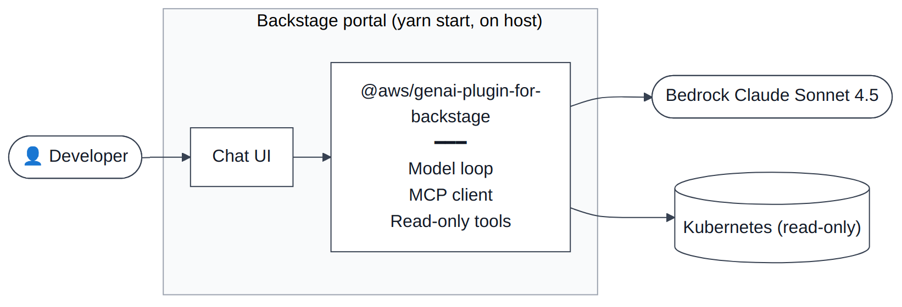
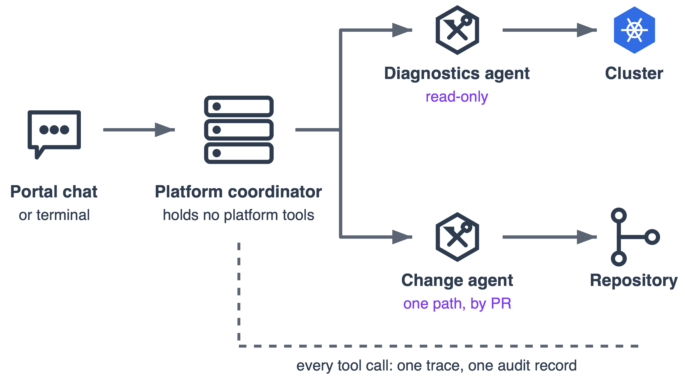
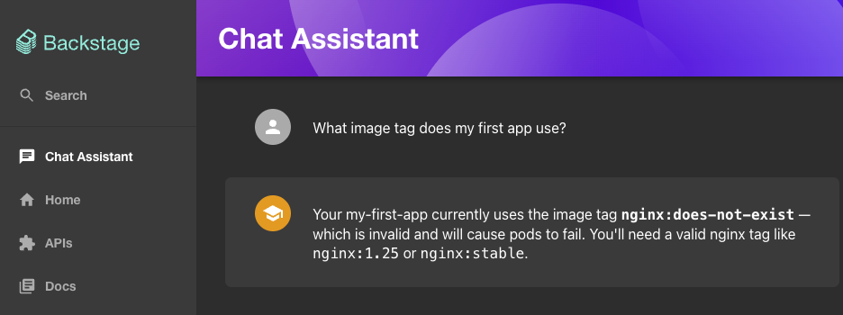
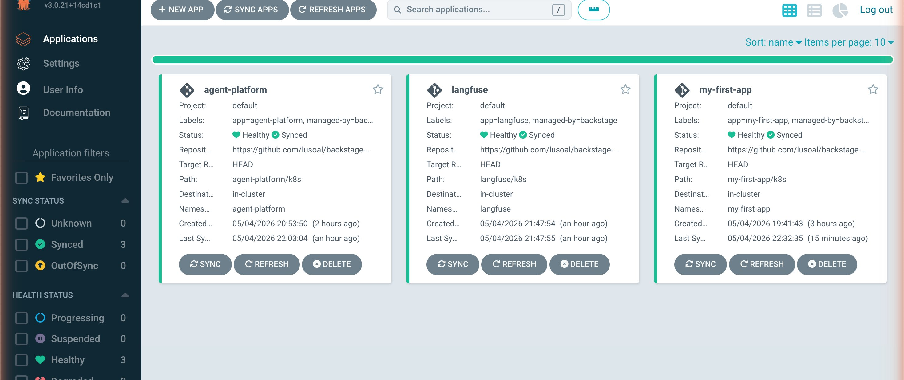
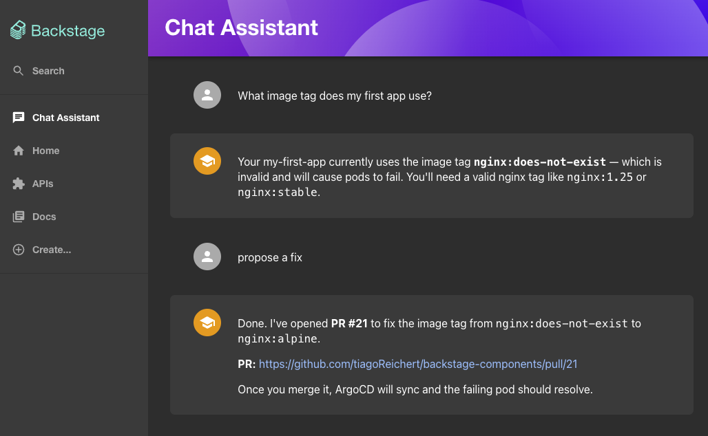
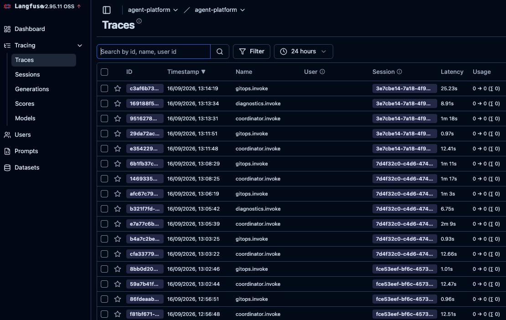
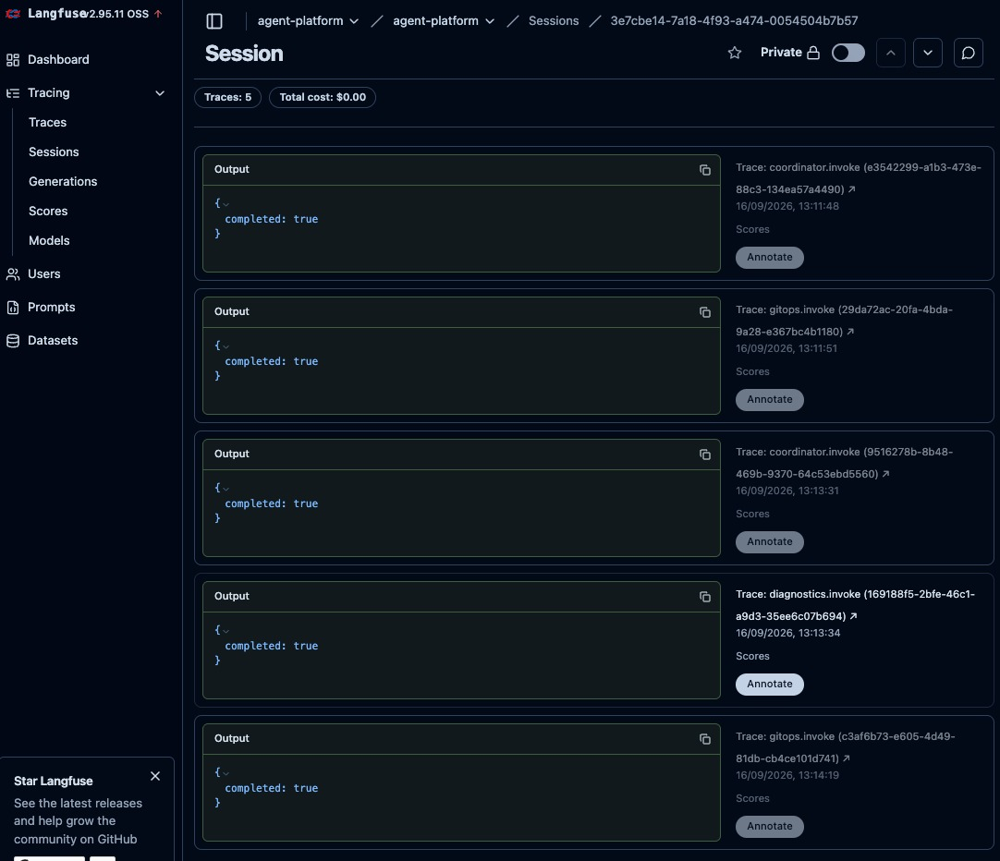
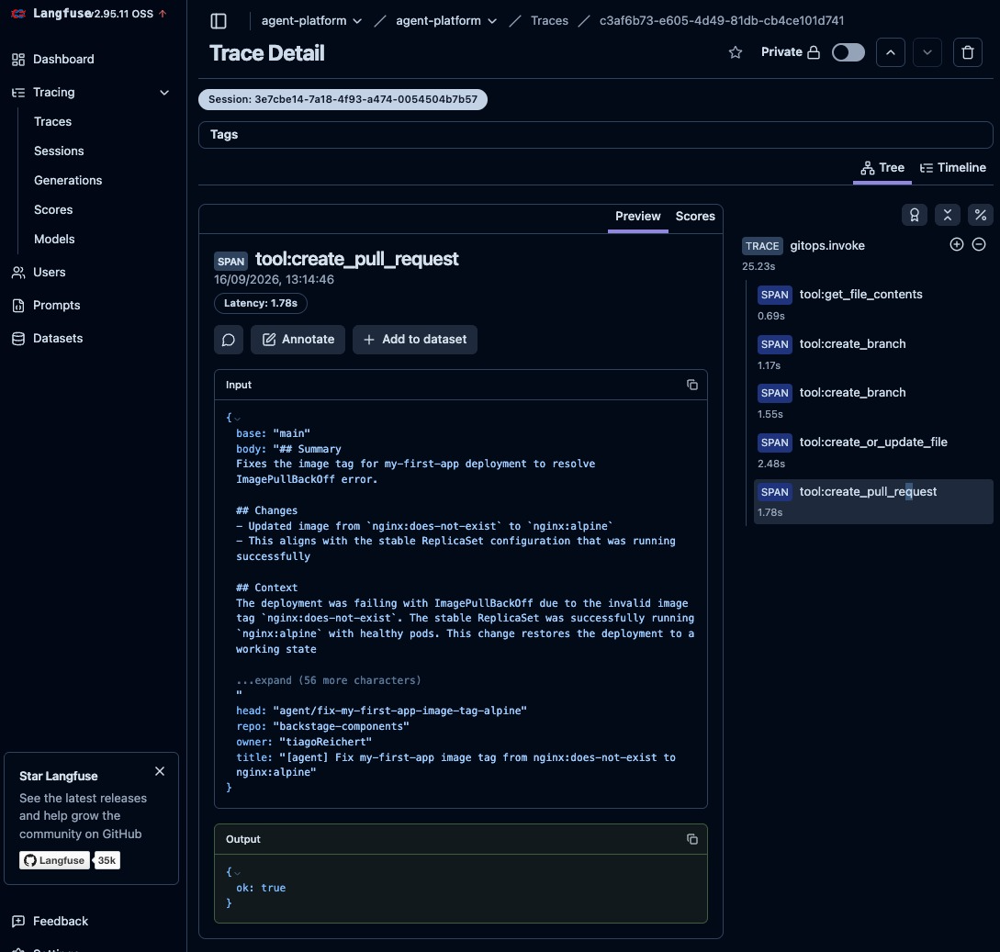
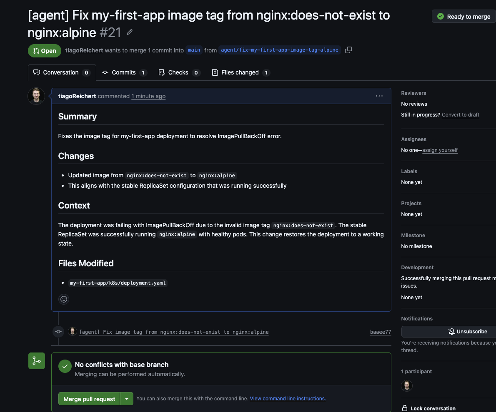

# 7

# Operational Agents in Production

In the previous chapter, we established the architecture of a production agent from the ground up, including memory in two layers, scheduled self-invocation, and governed tools. This chapter puts that architecture into practice. But have we ever deployed something that worked perfectly in a demo and then broke in a completely new way under real traffic? We certainly have.

Most teams who build production agents discover the same uncomfortable truth somewhere in the middle of the project: our agent is ready before our platform is. Our model reasons well. The tools respond. And then the first real workload hits, and something goes wrong in a way nobody anticipated, such as a trace that drops out under volume, a retry that doubles a deployment, or a log line that says nothing useful about what the agent actually decided. Is the gap in the agent? No, the gap is in our platform underneath it.

This chapter is about closing that gap. We move from building our agent to preparing our platform for what the agent does to it, at machine speed, without a human reviewer in every loop, across every tenant that depends on our infrastructure.

In this chapter, we will cover the following topics:

* **Assessing agent readiness** : Four properties that separate platforms ready for autonomous consumers from platforms that produce incidents, interface maturity, observability, identity propagation, and idempotency with bounded blast radius.
* **Specialist agents and the cycle of architecture** : Why agent topology rediscovers the lessons of microservices, what Conway's Law teaches us about organizing multi-agent systems, and when not to decompose.
* **Building production-grade agents** : Decoupling the agent from the portal, adding persistent memory, skills, governed tools, and a domain MCP server, and wiring Backstage to the agent runtime.
* **Observability, auditing, and operational controls** : Tracing agent activity with Langfuse, recording a tamper-evident audit trail, and mapping local lab components to production-grade substitutes.

By the end of this chapter, you will be able to assess whether a platform is ready for agent consumption, decide when to decompose a generalist agent into specialists, deploy a Strands agent as a service with governed MCP writes, and instrument it with tracing and a tamper-evident audit log. Everything in the *Building it: From insight to action with Strands* section runs on the same local kind cluster you created for  *[Chapter 5](https://learning.oreilly.com/library/view/agentic-ai-for/9781806386659/Chapter_5.xhtml#h1_106)* , and every lab is in the companion repository at `[https://github.com/PacktPublishing/Agentic-AI-for-Platform-Engineering/tree/main/chapter-07](https://github.com/PacktPublishing/Agentic-AI-for-Platform-Engineering/tree/main/chapter-07)`, where *Lab 0* checks that your *[Chapter 5](https://learning.oreilly.com/library/view/agentic-ai-for/9781806386659/Chapter_5.xhtml#h1_106)* setup is in place before you start.

# Agent readiness: Is our platform ready to be consumed?

The four properties below emerged from a pattern we saw repeatedly: the agent was ready before the platform was.

Our answer to  *"*  *is our platform ready?* *"* is not a maturity model and not a checklist. It is a way of looking at our platform from a new angle:

*Developer experience is not the same as agent experience.*

Our platform can be cloud-native, containerized, on Kubernetes, with a complete CI/CD pipeline and a polished developer portal, and still not be ready to be operated by agents. The interfaces that worked beautifully for human developers do not automatically work for autonomous consumers. Agent readiness adds a different axis: whether our platform's *interface* is ready for a consumer that operates at machine speed and may not have a human reviewer in the loop.

The platform engineering community has spent a decade building interfaces for human developers. Self-service portals. CLIs. Templated workflows. Documentation pages that get read once and then forgotten because the human who read them now knows what to do. Agents are a new kind of consumer, and most of the assumptions baked into  *"*  *developer experience* *"* do not transfer directly.

We did not set out to write a rubric or a checklist. What we found, across the production agents we built and reviewed, is a set of four properties that separate platforms that work well with agents from platforms that produce incidents. Some are platform-engineering hygiene that has always mattered and now matters more. Others are genuinely new requirements that show up only when an autonomous consumer is in the picture. The point is not to score ourselves. It is to look at our own platform with these properties in mind and notice which ones are missing.

The recurring theme: *agents amplify whatever our platform already is.* A platform with mature, well-instrumented, well-governed interfaces becomes more powerful when consumed by agents. A platform with hidden gaps becomes more dangerous. The amplification factor is not subtle: event volume can increase dramatically because the gap scales with invocation frequency, and at that scale every small flaw is loud.

## Property 1: Interface maturity

In platform engineering,  *"*  *interface* *"* means more than an API. It is every surface a developer, or an agent, uses to consume our platform: self-service portal endpoints, CLI commands, CI/CD triggers, Backstage software templates, Terraform modules, Helm charts, and the MCP servers that wrap those capabilities. Each is an interface. Each needs to be ready for an agent to use it the way an agent does: literally, repeatedly, without improvisation.

A developer who hits a poorly documented interface reads the source, asks a colleague, or guesses. An agent reads the schema, takes it literally, and either succeeds or fails. There is no Slack message to our team that owns the service. Either the contract is documented machine-readably or our agent guesses, and guessing produces hallucinated parameters, made-up enum values, fabricated resource IDs, and tool calls that look plausible and fail in ways that are expensive to diagnose.

A mature platform interface for agent consumption has a few non-negotiable properties. Stable contracts and versioning that does not silently break consumers. Complete schemas (OpenAPI for REST surfaces, JSON Schema for structured tools, Terraform variable types for IaC modules), every parameter typed, every enum field enumerated, every error mode returning a code our agent can branch on rather than a free-form string. Examples in the documentation that run as written. And tool descriptions written for an LLM rather than a developer, which is the point most teams miss. A description that reads  *"*  *creates a deployment* *"* is fine for a human. For an agent, it is difficult to distinguish from ten other tools that also  *"*  *create* *"* something. Tool descriptions need to disambiguate scope, side effects, preconditions, and idempotency in a sentence or two. *Write tool descriptions like **documentation for someone who has never met our platform and has thirty seconds to choose the right one.*

For platform teams, much of this maturity already exists in places our team has been investing in for years. A Backstage software catalog with complete Component, API, and Resource entities is, structurally, exactly the contract surface an agent needs. A Helm chart with a complete `values.schema.json` is a typed interface. A Terraform module with variable declarations that include type, description, and validation blocks is too. Our work, in those cases, is not to invent new contracts but to expose the existing ones through MCP and to make sure they are kept honest as our platform evolves.

The harder case, and one that comes up repeatedly in agentic transformation engagements, is when there is no interface at all. The system is legacy, the business logic is valuable, and an agent could in principle drive it, except nothing about our system was ever designed to be called by software it did not know about. The first step, before any agent deployment is plausible, is to expose an interface. *And the cost of doing this badly is not abstract: a vague tool description or an under-specified schema is exactly what causes our agent to reason from scratch on every call, accumulate context, and burn tokens deciding what should have been declared up front.* A motivational-message agent costing $6 a day in tokens was the personal-scale version of this. Our platform-scale version is the same dynamic, multiplied across every tenant, every day, in production.

## Property 2: Observability that survives machine speed

This is the property that comes up most often in our work, because it is where the gap between human-scale and machine-scale platforms shows up first. A useful working version:

*If we cannot reliably trace a request from one user, we cannot trace one from an agent that operates at machine speed.*

A human developer hits our platform a few times an hour. The agent that replaces some part of that developer's workflow can hit it a few times a second on a sustained basis. Sampling-based tracing that worked fine for human traffic produces unusable gaps under agent load. Logs without structured context become unreadable at the volume an agent generates. Dashboards designed for a single tenant collapse when an agent is making cross-tenant queries on a schedule.

The closest analogy from earlier in our careers is the move from monoliths to microservices. Distributed tracing became necessary because a single user request could fan out into a dozen service calls, and we could no longer reason about latency or failure modes by tailing one log file. Agents recreate that problem one layer up: an agent decides what to do, calls a tool, the tool calls a microservice, the microservice fans out further.  *We now need observability at two distinct layers: our agent*  *'* *s **invocation** and tool-call trace, and the underlying microservice trace. We need them correlated.* If microservice observability without proper trace propagation was painful, agentic observability without it is worse, because the agent-level context that led to the call does not show up in the microservice trace at all.

The minimum is end-to-end tracing across every hop our agent's request touches, with the agent's identity and the originating user's identity both attached as trace attributes. We also need structured logs with correlation IDs that survive the trip through the MCP server, our platform API, and any downstream service. We also need dashboards that distinguish agent traffic from human traffic so we can reason about them separately.  *Without this, the first time something goes wrong with an agent in production, the postmortem starts with *  *"*  *we have no idea what it actually did.* *"*

Concretely: OpenTelemetry traces with `gen_ai.agent.id`, `gen_ai.conversation.id`, and `enduser.id` set as span attributes. Structured JSON logs in CloudWatch, Loki, or whatever our team already runs, with the same identifiers carried through every hop. A Grafana dashboard or equivalent that filters by `agent.id` and shows error rates, retry rates, and tool-call distributions side by side with the same metrics for human traffic. Our platform team probably already has most of this for human users. Our work is making sure it survives the volume and the new identity attributes.

Once that observability foundation exists, the audit trail can reuse much of the same telemetry, but it has different integrity and retention requirements. A complete audit trail captures every tool call our agent made (with timestamps and parameters), the request and policy context that led to each call, the identity context (agent, user, tenant), the result of each call including failures, and the downstream effects that propagated. Much of this can be correlated with the trace, but the audit record should be persisted with explicit integrity and retention controls.

A key property that separates a debug log from a trustworthy audit record is tamper resistance. *A** record** that can be **silently **rewritten after the fact **cannot provide a trustworthy **audit **trail.* When something goes wrong with an agent in production, whether during a cost incident, a security review, or a regulatory question, the value of the audit log depends on its tamper-evident properties. Append-only storage. Write-once retention policies. Hash-chained or signed entries when the threat model includes anyone with access to the storage layer itself. In AWS, this might mean S3 with Object Lock in compliance mode and a separate account that owns the bucket. On Kubernetes, it might mean shipping the audit stream to an external sink the cluster operators cannot themselves edit. Does the exact mechanism vary? The property does not. The agent that wrote the entry should not be able to go back and edit it. Neither should the operator. Neither should our platform team. Once an action is recorded, it is recorded.

This is the bar autonomous systems set. Humans can be asked to remember what they did and explain. We should not rely on an agent's own recollection to reconstruct what it did; a trustworthy audit record lets us reconstruct the sequence independently.

## Property 3: Identity propagation

A production agent rarely acts on its own behalf. It acts on behalf of a user, a team, a tenant, or a triggering system. *The most important question an audit log answers **is** under whose authority an action was taken.* If our platform cannot tell the difference between  *"*  *our agent did X for user A* *"* and  *"*  *the agent did X for user B*  *"* , because the agent calls in with its own service identity for both, we have lost accountability.

Identity propagation through our agent and into our platform's tools is non-trivial. The agent has its own identity (the service principal it runs under). The user has their own identity. The platform call needs to know about both: the agent for trust and rate-limiting purposes, the user for authorization and audit. Most agent frameworks do not handle this for us. It has to be designed into our platform's interface and enforced at every hop.

 The mechanisms that work in practice are those that platform teams already use for service-to-service identity. OAuth 2.0 Token Exchange (RFC 8693), where the platform can obtain a delegated token that can represent the requesting user as the subject and the acting service as the actor. AWS `sts:AssumeRoleWithWebIdentity` driven by the user's OIDC token rather than a static service principal. Kubernetes projected ServiceAccount tokens with audience restrictions for the agent workload, with the calling user's identity propagated separately. SPIFFE/SPIRE identities with attestations carried end-to-end across the call chain. These mechanisms provide building blocks for workload identity and delegation, but the platform still needs to preserve enough context for its authorization layer to verify: *on whose behalf is this action being taken?* We say more about the threat model and the technical patterns in  *[Chapter 8](https://learning.oreilly.com/library/view/agentic-ai-for/9781806386659/Chapter_8.xhtml#h1_166)* . For the readiness question, the test is simpler: *can our platform **answer*  *"*  *on whose behalf was this done?* *"** for every action an agent took? If not, our audit trail is fiction.*

## Property 4: Convergence, idempotency, and bounded blast radius

Agents retry. They retry on transient errors, on ambiguous responses they cannot parse, on their own confused reasoning. Sometimes they retry the same call three times in three hundred milliseconds because of a loop in their planning. None of this behavior is unusual. All of it is expected. A platform interface that does not assume retries produces duplicate state.

The first half of the answer is  **convergence** . The good news is that platform engineers have been designing convergent interfaces for years without always calling them that. Reapplying the same Helm chart and values generally targets the same Kubernetes resource state, even though Helm can still record a new release revision. A `terraform apply` against an unchanged, deterministic configuration converges on the same desired state. A Kubernetes Deployment manifest, applied repeatedly, does not trigger a fresh rollout unless the spec changed. Kubernetes controllers continue reconciling the same Deployment toward its desired state; a repeated apply of an unchanged manifest does not create a second Deployment. readinessProbe and RollingUpdate settings control rollout behavior, not request deduplication. These are all **convergence** patterns. They were designed for human operators who would inevitably re-run the same command. They happen to work just as well for agents that retry on every confused signal.

The patterns that are *not* idempotent by default tend to live in REST endpoints written without retry semantics in mind: a `POST /deployments` that creates a new deployment on every call regardless of intent, a webhook that fires twice and produces two notifications, a service-catalog write that appends rather than upserts. The mitigation is well-known and underused: idempotency keys on every write operation, with our platform deduplicating server-side based on the key. The agent generates a key when it forms an intention to act, sends the key with every retry, and our platform recognizes retries carrying the same key and avoids applying the same intended action more than once. *Idempotency is not an optimization. It is the floor.*

The second half is  **bounded blast radius** . Idempotency makes our platform survive a retry loop intact. It does not, by itself, prevent our agent from doing the wrong thing a thousand times in quick succession when its reasoning is flawed. The defense against that is structural, and again most of it is platform-engineering territory our team already knows: Kubernetes `ResourceQuota` and `LimitRange` per namespace, AWS service quotas and IAM permission boundaries, rate limits on the API gateway in front of our platform's MCP servers, and, for the most destructive operations, dry-run modes where the agent can preview what would happen and the platform returns the diff without applying it. A GitOps-based change flow gives this property almost for free: the agent can only propose changes through a pull request, and the merge is gated by the same review and CI checks that gate human contributions.

Is either idempotency or bounded blast radius exotic? Both are routinely missing on the path between an agent and our platform's most powerful tools. *The cost of getting either wrong is **paid in the moment our agent is most confidently wrong.* The personal-scale version of an unbounded blast radius is the $160 OpenClaw spree from the opening of  *[Chapter 6](https://learning.oreilly.com/library/view/agentic-ai-for/9781806386659/Chapter_6.xhtml#h1_130)* , *Agent* *ic AI and Autonomous Behavior* , where the agent burned through the budget in two days because nothing was constraining how often it would re-reason from scratch. The platform-scale version is the same dynamic, except now the agent is calling a real production API a thousand times a minute, on behalf of users it does not represent correctly, and the bill is not measured in tokens.

## Looking at our own platform

Are these four properties truly independent? Identity propagation is only meaningful if observability captures it. Bounded blast radius is only recoverable if convergence holds. Immutable audit logs are only useful if the trace they record is complete to begin with. Do our properties reinforce each other? That is the good news: investing in one tends to help the others; they also fail together, which is the bad news. A platform that lacks observability is probably also missing the audit trail it needs after an incident, and is probably the same platform whose interfaces are not fully idempotent.

The exercise we recommend when a team is about to put an agent into production is to walk through these properties for the specific tools our agent will call, not for our platform as a whole. The platform may be at one level of maturity. The specific corner of our platform the agent will reach into may be at another. Knowing this before our agent is in production is much cheaper than learning it afterward.

The next section is about our agent topology itself, how to structure the agents that consume our platform. The same patterns that shaped how we organize services have a great deal to teach us about how to organize agents.

# Specialist agents and the cycle of architecture

The platform is ready. The interfaces are mature, the observability survives machine speed, identity propagates correctly, retries are idempotent, and the blast radius is bounded. The next question is on the other side of the boundary: *how do we structure the agents that consume that platform?*

Our naive answer is to build one big agent with every tool, every skill, and every MCP server we have. It feels efficient. There is one place to deploy. One place to debug. One place to upgrade the model. The agent has access to everything our platform exposes, so any developer request can be handled in a single conversation. And for the first weeks of a small project, this is genuinely fine.

Then it scales. Does it stop being fine?

## Why the generalist agent falls apart

The failure modes of a generalist agent are not exotic. They are recognizable to anyone who has watched a service-oriented system grow into a distributed monolith.

**Context bloat.** Every tool description, every skill metadata entry, every MCP server schema sits in the system prompt at startup. As capabilities grow, that prompt grows linearly. Latency grows. Cost grows. The model's attention degrades long before its context window is full. The same dynamic we covered in  *[Chapter 6](https://learning.oreilly.com/library/view/agentic-ai-for/9781806386659/Chapter_6.xhtml#h1_130)* , in the *Tools as governed platform APIs* section, applies at the agent level and helps explain why progressive disclosure exists in the first place. *The more an agent can do, the more it costs the agent to decide what to do.*

**Decision overhead.** With hundreds of tools available, the model spends more reasoning cycles deciding which one to invoke than actually invoking anything. Tool selection accuracy can drop as the available tool set grows. A focused set of well-described tools is generally easier for a model to select from than a sprawling catalog.

**Blast radius.** One agent with the keys to the entire platform is one prompt injection, one confused reasoning loop, one stale instruction away from a catastrophic action across multiple domains. The PocketOS incident we cited earlier is the canonical example: an agent with a single overly-permissioned token reaching across staging and production at once. A specialist agent scoped to one domain cannot make that mistake, because the tools to do it are not in its hands.

**Deployment coupling.** A change to one capability requires redeploying the whole agent. A new skill is added. The entire agent ships. A tool description is reworded. The entire agent ships. The cost of evolving any single capability scales with the surface area of the agent, not with the change. Sound familiar? It is the same coupling problem that drove teams away from monolithic services a decade ago.

What pattern emerges in production? The pattern is *specialist agents with bounded responsibility, coordinated through standard interfaces.* A diagnostic agent that reads observability data and reasons about what is happening. A remediation agent that proposes changes through the GitOps flow. A validator agent that reviews proposed changes against policy. A reporter agent that summarizes activity for humans. Each does one thing well. Each exposes a clear interface. Each can be replaced independently without touching the others. This is microservices, reborn at a new layer of the stack.

## Conway's Law, applied to agents

Melvin Conway observed in 1968 that the structure of a system reflects the communication structure of the organization that built it. Ruth Malan added the corollary every engineering leader should internalize:

*If the architecture of the system and the architecture of the organization are at odds, the architecture of the organization wins.*

Is this why so many of our platform modernization efforts produce distributed monoliths instead of genuine microservices? Teams attempt to decompose a backend while keeping the org chart hierarchical and centralized. The architecture reverts to what the organization can actually support.

Is the same dynamic showing up in our agent design now? A central AI team builds a  *"*  *platform agent* *"* that tries to serve every developer use case, and our agent ends up shaped exactly like that AI team's communication boundary: wide, shallow, and centralized, even when our platform underneath has been decomposed into clean, bounded domains. The agent topology mirrors our team topology, not our system topology, and the team topology wins.

The implication is concrete: *agent topology should mirror domain ownership, not central AI ownership.* If our platform has a catalog domain owned by one team, a GitOps domain owned by another, a cluster operations domain owned by a third, and an observability domain owned by a fourth, the natural agent topology is one specialist agent per domain, owned by our team that owns the domain. Our platform team owns the substrate they coordinate on: our agent runtime, the MCP gateway, the observability that makes our system reasonable. *Agent**s are services. Services are owned by the team that owns the domain.* Should there be a separate  *"*  *AI team* *"* that owns all the agents, any more than there was ever a separate  *"*  *microservices team* *"* that owned all the services?

## When not to decompose

The most important lesson from microservices history is the one most often skipped: *do not decompose prematurely.* A single well-built agent with a focused responsibility and a moderate tool set is often preferable to a network of specialists when the problem fits comfortably within one agent's responsibility and context. The cost of decomposition is real: every additional agent adds an inter-agent contract, an additional source of latency, an additional thing to observe, an additional thing that can fail. When does the benefit kick in? Once the problem has internal structure that genuinely benefits from specialization.

The heuristic is the same one platform teams already use for services: *as small as possible, no smaller.* If we can express our work as a deterministic graph with one or two agentic nodes, build that. We covered this in  *[Chapter 6](https://learning.oreilly.com/library/view/agentic-ai-for/9781806386659/Chapter_6.xhtml#h1_130)* , in the *Workflow versus agent on the spectrum of **determinism* section. If our work has clearly bounded sub-problems with different tools, different skills, and different blast radii, decompose. If the only reason to decompose is  *"*  *to follow the pattern,* *"* do not.

A useful heuristic from our own production deployments: manual debugging of multi-agent systems breaks down once the number of agents coordinating in a system reaches double digits. Below that, a careful operator can still reason about the whole system. Above that, our team needs to invest seriously in agent observability and tracing or the system becomes opaque. The exact number is less important than the shape of the curve.

Once decomposition is the right call, our contracts between agents matter more than the agents themselves. A clean handoff between a diagnostic agent and a remediation agent is worth more than either agent being individually perfect. The patterns that fail are the ones where each agent is locally well-designed and our system as a whole has no coherent contract surface. The operational substrate is starting to exist: Strands provides multi-agent primitives (Swarm, Graph, Workflow, Agents-as-Tools, Handoffs) that map directly onto patterns service architects have used for a decade.

The through-line is the same one that has run through every wave of decomposition before this one: *the hard problem is not the components; it is how they communicate.* The platform-engineering work that goes into making agents work well together is the same kind of work that made microservices work well together. There is no shortcut or AI-specific magic, only the same discipline applied to a new substrate.

The next section puts all of this into practice. We take the chat-only assistant from *[Chapter 5](https://learning.oreilly.com/library/view/agentic-ai-for/9781806386659/Chapter_5.xhtml#h1_106)* and sketch how it becomes a production-grade agent: memory, scheduling, governed tools, an interface ready for agent consumption, and a topology that decomposes only as far as the problem requires. We use Strands as the framework and the OpenClaw blueprint as the conceptual reference.

# Building it: From insight to action with Strands

*[Chapter 5](https://learning.oreilly.com/library/view/agentic-ai-for/9781806386659/Chapter_5.xhtml#h1_106)* ended with a conversational interface that could read the platform: catalog entries, technical documentation, and Kubernetes runtime state through read-only actions registered in Backstage, all of it served from the chat plugin embedded in the portal. Our boundary was deliberate. Reading is observation. Writing is action. Action has blast radius. Our interesting work begins where *[Chapter 5](https://learning.oreilly.com/library/view/agentic-ai-for/9781806386659/Chapter_5.xhtml#h1_106)* stopped.

Our next step is not to add write capabilities to the existing chat plugin (which would keep the agent embedded inside Backstage as a feature of the portal) but to  *decouple* . Our agent becomes a first-class citizen: a separate runtime in its own namespace, memory it owns and writes to, an MCP server that speaks GitHub directly, and a tamper-evident audit log it cannot rewrite. Every concept from our chapter shows up in the architecture, not because we are forcing it, but because each one earns its place the moment the assistant tries to do something.

The walkthrough we follow is grounded. Our reference implementation runs end-to-end on a local kind cluster: built and deployed through the same Argo CD ApplicationSet from  *[Chapter 5](https://learning.oreilly.com/library/view/agentic-ai-for/9781806386659/Chapter_5.xhtml#h1_106)* , exercised through a real demo where a developer's typo on my-first-app is fixed by the agent through a real pull request. Every lab artifact, every manifest, and every screenshot in this section comes from that running system. The code lives in the book's companion repository at [https://github.com/PacktPublishing/Agentic-AI-for-Platform-Engineering/tree/main/chapter-07](https://github.com/PacktPublishing/Agentic-AI-for-Platform-Engineering/tree/main/chapter-07), where the labs are kept current as the tools evolve.

## What we build, and what we don't

A clarifying note before the architecture. Our chapter argues that production agents need domain MCP servers rather than one tool pile, self-invocation through an event bus, identity propagation across hops, and a multi-agent topology aligned to domain ownership. Our demo builds the first and the last of those, because they are the two this chapter focuses on most. The domains arrive as separate servers with separate credentials: one with read-only access to the cluster, one able to propose changes against exactly one repository path. Neither can do the other's job, and no single credential spans both.

Two things we defer on purpose:

* **No self-invocation** : Our agent runs synchronously from a request. The cron-triggered loop with `agent_action` filtering is documented in  *[Chapter 6](https://learning.oreilly.com/library/view/agentic-ai-for/9781806386659/Chapter_6.xhtml#h1_130)* , in the  *Scheduling and self*  *-* *invocation in agent systems* section but left as an extension exercise.
* **Shared agent** ** identity** : The agent runs under one ServiceAccount with one GitHub PAT. Per-user and multi-tenant identity propagation are deferred to  *[Chapter 8](https://learning.oreilly.com/library/view/agentic-ai-for/9781806386659/Chapter_8.xhtml#h1_166)* .

Everything else lands in our design: memory in two layers, skills as procedural knowledge, governed writes via hooks, observability and audit, and (the reason a book demo can credibly stop here) a recursive moment that pays for the rest of the chapter. The agent itself is deployed by the same ApplicationSet it later consumes. The platform that ships `my‑first‑app` is the platform that ships the agent that fixes `my‑first‑app`. That is our chapter's argument made literal in code.

## Where we start

Our *[Chapter 5](https://learning.oreilly.com/library/view/agentic-ai-for/9781806386659/Chapter_5.xhtml#h1_106)* architecture, simplified, looks like this. The chat lives inside Backstage. The LLM call, the MCP client, and the tool execution all happen inside the portal's plugin runtime:

Figure 7.1: Current architecture

This is a fine starting point and a problematic ending point. Three things are wrong with it as a production agent. First, the plugin *is* the agent: if we want to run the same agent from a Slack message, an alert, or a scheduled job, we have to rebuild it. Second, the plugin's identity is the user's session: if we want the agent to act on its own, there is no identity under which to act. Third, the MCP integration is one tool collection in one process, with no way to scope domains independently or to have specialist agents talk to specialist tool sets. We hit every issue we discussed in *Specialist agents and the cycle of architecture* the moment we try to scale beyond one user in one browser tab.

## Where we are going

The decoupled architecture moves the agent out of the portal and treats Backstage as one of several interfaces into a service that lives on its own. It is deployed through Argo CD from the same components repository we set up in  *[Chapter 5](https://learning.oreilly.com/library/view/agentic-ai-for/9781806386659/Chapter_5.xhtml#h1_106)* , and it is not one agent but a small team of them:

Figure 7.2: Target architecture

A coordinator agent receives the request and delegates it to specialists, each responsible for a specific domain. Three architectural choices make this work. First, the agent runtime is a service that the portal calls, not a plugin it loads. Second, no agent has access to the entire platform: the coordinator has no platform tools at all, the diagnostics specialist can only read cluster state, and the change specialist can only propose a pull request against a specific path. Third, memory and audit live outside the agent process: memory is stored in a ConfigMap (deliberately GitOps-versioned) and a PVC (the agent's own writable file), while audit records are stored in a hash-chained file on a separate PVC. Each of these choices directly applies concepts from an earlier section, so the rest of the walkthrough follows them in order.

## The runtime: an agent as a service

Our first move is to take the loop out of the plugin. Strands makes this short. The Agent constructor takes a configurable model (this lab uses Bedrock Claude Sonnet 4.5; the Anthropic API is supported as a fallback), a system prompt, a list of tools, and a `FileSessionManager` pointing at a directory on disk. A FastAPI process exposes `POST /invoke` that takes an intent from a developer in Backstage, Slack, curl, or a job and returns the agent's response. Our portal is now a *client* of the agent, not its host.

Two things matter for what follows:

* **The system prompt is built, not a static string.** It is composed at every invocation from our agent's identity files (`SOUL.md`, `IDENTITY.md`, `USER.md`) and the live contents of `MEMORY.md`. The model reasons over a prompt that reflects the platform's current self-conception of the agent, not a snapshot from when the container was built.
* **The deliberate memory uses two persistence layers** . `SOUL.md`, `IDENTITY.md`, and `USER.md` mount from a ConfigMap that lives in the GitOps repo: read-only to the running pod, edited through pull requests. `MEMORY.md` mounts from a PersistentVolumeClaim: writable to the running pod, persistent across pod restarts, never edited from outside.

The two-persistence-layer split makes the *deliberate versus* *automatic* memory distinction described in the chapter literal. To soften the agent's tone, we open `SOUL.md` in our components repo, edit a sentence, open a PR, and merge it. Argo CD updates the ConfigMap and the next invocation reflects the change. To record a fact the agent learned, the model calls a `save_to_memory(fact)` tool that appends a line to `/state/memory/MEMORY.md` on the PVC. *Memory the platform owns* is in Git. *Memory the agent owns* is on a volume the agent writes to with explicit intent. The chapter calls this a two-layer pattern. Here, it is implemented as two Kubernetes objects.

A third persistence layer (`emptyDir` for the `FileSessionManager`) is the conversational scratch, ephemeral by design. Strands handles compaction. Its lifetime is bound to the pod.

We verified the loop end-to-end on our running cluster:

`POST /invoke` with intent  *"*  *Tell me in one sentence who we are and the single hardest constraint we must follow.* *"* The agent answered:  *"*  *I am the platform agent for a Backstage* */ArgoCD* * developer platform, and my hardest constraint is that I never apply changes to the cluster directly, every change must go through a pull request on the GitOps repository.* *"* The constraint comes from `SOUL.md`. The role comes from `IDENTITY.md`. The system prompt assembled them.

`POST /invoke` with intent  *"* *Remember for future sessions that the preferred default container image tag for nginx * *is :alpine*  *.* *"* The agent called `save_to_memory`. `kubectl exec ‑‑ cat /state/memory/MEMORY.md` showed the line on the PVC.

In a new session with a fresh `session_id`, we asked,  *"*  *What is the preferred default tag for nginx?* *"* The agent quoted `:alpine` directly from `MEMORY.md`. Our system prompt re-loaded the file at the start of the new invocation.

> kubectl delete pod -l app=agent-runtime

A new pod was scheduled, but `MEMORY.md` was still there because of the PVC. Memory survived the pod, exactly as the chapter argued deliberate long-term memory should do.

Figure 7.3: The assistant reporting my-first-app's current image tag

The agent reasons over the skill's procedure, calls the tool, and replies with the answer, exercising the chapter's progressive disclosure and bounded action properties in a single chat turn.

The recursive moment this buys us: this entire deployment ships through the same `backstage‑app‑discovery `ApplicationSet from  *[Chapter 5](https://learning.oreilly.com/library/view/agentic-ai-for/9781806386659/Chapter_5.xhtml#h1_106)* , by adding an `agent‑platform/` folder to the components repo. The agent's manifests sit alongside `my‑first‑app/` in the same Git tree.  *The platform deploys the agent through the platform*  *'* *s own paved road.* That is the property production-grade agents need. That is the property a book demo on a kind cluster can show.

Figure 7.4: Argo CD showing agent-platform, langfuse, and my-first-app

## Eyes and hands: specialists with narrow domains

Our runtime has a body, but no eyes and no hands. Two specialists change that, and what each one is allowed to see is the whole point.

 **The eyes come first** . A diagnostics specialist reaches the cluster through a domain server that is read-only by construction. It can list what is running, read a pod's state, and pull recent events and logs. It cannot create, update, delete, scale, or read a Secret, and that is enforced twice: once by the server, which is started in a read-only mode, and once by the cluster itself, through a role granting only the verbs the agent needs. Two independent mechanisms have to fail before this specialist can change anything. That is the bounded blast radius property from earlier in this chapter, written as configuration rather than as intent.

 **Notice what we did not build** . There is no bespoke Kubernetes integration here. We adopted a published domain server and spent our effort on the boundary instead: which verbs, which namespace, which identity. That is the shape we want, and it is the pattern our chapter promised. One server per platform domain, each with an independent image, ServiceAccount, and domain-scoped credential. A platform team's advantage is rarely the tool. It is the governance around it.

The `fix‑image‑tag/SKILL.md` uses YAML front matter (name, description,  *when to use* , hard constraints) followed by a numbered procedure: identify the target component and namespace, read the manifest, decide the fix (with explicit guidance to fall back on remembered defaults and to *stop and ask the user* when it cannot identify a safe replacement), and propose the change as a pull request with an `[agent]`-prefixed title and a body containing Symptom, Root cause, Before and After, and Rationale sections. The skill mounts into the specialist's pod from a ConfigMap. At startup, the agent indexes the metadata of every skill (name, description,  *when to use* ) into the system prompt. The full body is loaded only when the model decides this skill matches the intent and calls `consult_skill("fix‑image‑tag")`. The chapter's progressive disclosure discussion lands as a tool call.

 **Now the hands, and their surface is narrower still** . The change specialist can read one file and propose a change to it through a pull request on a branch. It cannot merge, it cannot touch the cluster, and it cannot write to any path but the one its scope allows. What holds that line is not the prompt. Strands hooks intercept tool calls in code: our AlwaysPRHook in the repository runs before any change is proposed and validates it. (Source: Clare Liguori, "How Steering Hooks Achieved 100% Agent Accuracy Where Prompts and Workflows Failed," Strands Agents, March 18, 2026. Six scenarios were run 100 times per agent version, for 600 runs per agent and 3,000 runs total.) The hook validates the title (must start with `[agent]`) and the body (must be at least 20 characters of rationale). When validation fails, the hook sets `event.cancel_tool` to a message; the call never executes, and the agent receives the rejection as a tool result it can reason about and retry. A system prompt that asks for a convention is a request. Code that inspects the call and cancels it is a rule, and it runs whether or not the model paid attention. *Does the data point (100% pass rate vs 82.5% for simple prompt-based instructions) change because we wrote the hook in eight lines? It does not.*

Now the coordinator earns its place. It holds no platform tools of its own. Its job is to read the request, decide which specialist owns it, hand off, and explain the result in one voice. Each specialist sees only its own domain, so the tool list that any single model reasons over stays short. This solves the decision-overhead problem from *Why the generalist agent falls apart* by construction rather than by discipline, and it is why the demo now looks like the architecture this chapter has been arguing for.

We exercised the loop end-to-end on the running cluster: a `sed` command injected a typo into `my‑first‑app/k8s/deployment.yaml` (`nginx:alpine` → `nginx:does‑not‑exist`), the operator merged the bad PR, Argo CD applied it, and the workload went `ImagePullBackOff` in about three minutes. The operator then asked the agents to fix it. The coordinator handed the question to the diagnostics specialist, which found the failing pod and the pull event that explained it, then handed the repair to the change specialist, which read the manifest and proposed the corrected tag. Our hook validated the call before it left the process, and the pull request opened. The response included the PR URL. Title: `[agent] fix my‑first‑app image tag in default`. Body: Symptom / Root cause / Before / After / Rationale. Diff: a single line, `nginx:does‑not‑exist` to `nginx:alpine`. After the merge, Argo CD reconciled and our workload healed.  *The agent*  *'* *s direct **write boundary stops at the pull request; deployment still requires human approval to merge. The agent does not directly mutate application resources in the * *cluster* *; its own writes** are limited to *`MEMORY.md`* on its *PVC* and session scratch on *`emptyDir`*.*

## The portal as one trigger among several

Our agents work. Their only client is a terminal. The portal is the obvious next trigger, and the point of the decoupling is that connecting it changes nothing about the agents themselves.

Our *[Chapter 5](https://learning.oreilly.com/library/view/agentic-ai-for/9781806386659/Chapter_5.xhtml#h1_106)* GenAI plugin has an extension point, `agentTypeExtensionPoint`, through which any backend module can register a new agent type. The `langgraph‑react` agent type from the *[Chapter 5](https://learning.oreilly.com/library/view/agentic-ai-for/9781806386659/Chapter_5.xhtml#h1_106)* chat is itself a separate module (`@aws/genai‑plugin‑langgraph‑agent‑for‑backstage`) that registers through this extension point. Anyone can write a parallel module that registers another agent type. This lab is exactly that.

A small adapter, around a hundred lines of TypeScript, registers a new agent type. When the GenAI plugin asks an agent of this type to handle a chat turn, the module makes an HTTP `POST` request to the configured URL (our agent runtime's port-forward in dev, the in-cluster Service DNS in production) and adapts the single-shot JSON response back into the `ChunkEvent` + `ResponseEvent` stream our chat UI expects. Real per-token streaming is left as an exercise. The single-chunk adapter is enough for the chat to feel right.

The assistant the reader built in *[Chapter 5](https://learning.oreilly.com/library/view/agentic-ai-for/9781806386659/Chapter_5.xhtml#h1_106)* stays exactly where it is: same chat, same route, same place in the sidebar. What changes is what sits behind it. That is worth pausing on, because it is the payoff of treating the agent as a service. The portal did not learn anything new. It gained no dependency on Strands, on Bedrock, or on any of the domain servers. It makes an HTTP call, and the entire topology behind that call, one coordinator and two specialists today and more tomorrow, is invisible to it.

The reader does notice one thing. The assistant that answered questions in *[Chapter 5](https://learning.oreilly.com/library/view/agentic-ai-for/9781806386659/Chapter_5.xhtml#h1_106)* can now change something. Same box, same conversation, and a pull request at the end of it. That is the *Workflow versus agent on the spectrum of determinism* framework from *[Chapter 6](https://learning.oreilly.com/library/view/agentic-ai-for/9781806386659/Chapter_6.xhtml#h1_130)* made concrete: the same portal can serve a workflow with one agentic node or an autonomous agent reasoning over its own tools, and the platform team chooses which workload belongs on which stage.

Figure 7.5: The chat assistant created a pull request

We re-ran the repair through the chat: a typo pull request broke my‑first‑app, and our user opened the assistant and asked it to fix it. The chat replied with the pull request URL. The user clicked, reviewed, merged. Argo CD reconciled. The workload was green again within five minutes of the breakage. The full loop was driven from a Backstage chat that a non-engineer could use. That is the democratization argument from the opening of Chapter 6, exercised against a real cluster.

Making it visible: traces and an audit record
Our agent works through the chat. From the outside, is the chat the only window into what it did? The last move adds the two layers our chapter's Observability and Audit discussion argued for: an LLM-aware tracing backend the operator can read like a debugger, and a hash-chained file the operator can verify like a flight recorder.

Langfuse. Two pods in their own langfuse namespace, deployed through our same ApplicationSet pattern: a langfuse‑postgres Deployment plus PVC, and the langfuse/langfuse:2 image as a single-container Deployment reading DATABASE_URL from the same Postgres. The Langfuse and Postgres credentials are out-of-band Secrets the operator creates with kubectl. Nothing sensitive lives in Git. First-run bootstrap is interactive: the operator opens the UI on the port-forward, creates an org and a project, and copies a pk‑lf‑... and sk‑lf‑... pair into a Secret named agent‑langfuse‑keys in the agent‑platform namespace. The agent reads those keys from envFrom at the next pod restart.

This lab was tested with Langfuse v2 in August 2026. Langfuse v4 is current at the time of publication; readers using current releases should follow the current self-hosting guidance and use the OTLP integration rather than reproduce the v2-specific SDK hook.

Our Strands integration. The obvious design is to rely on Strands' first-class OpenTelemetry support and point the OTel exporter at Langfuse's OTLP endpoint. The reality at the time of writing is more nuanced. Langfuse v2 does not expose the OTLP endpoint. That landed in v3. Self-hosted v3 ships with a heavier stack: Postgres, ClickHouse, Redis, and MinIO, plus a langfuse‑web and a langfuse‑worker (six pods total compared with v2's two). We chose v2 to keep the cluster footprint reasonable and used the official Langfuse Python SDK directly through a Strands hook. The result is the same Langfuse UI experience, the same per-trace-per-span model, and the same per-session and per-user filtering. The hook is fifty lines: it subscribes to BeforeInvocationEvent, BeforeToolCallEvent, AfterToolCallEvent, and AfterInvocationEvent, and emits client.trace(...) and trace.span(...) calls accordingly. Is switching to v4 plus OTLP later hard? It is mechanical: drop the SDK, set OTEL_EXPORTER_OTLP_ENDPOINT and headers, delete the hook. Strands does the rest.

The trace structure our operator sees in Langfuse includes one trace named <agentid></agentid>.invoke per /invoke call, tagged with the session_id and user_id that came in on the request body (we carry both through the FastAPI handler into the hook through a Python ContextVar, since Strands' BeforeInvocationEvent does not surface the request directly). Inside the trace, one span named tool:<toolname></toolname> per tool call, with the input arguments and the duration. Per-token cost shows up as the model emits usage. Per-session cost aggregates in our Langfuse UI.

Figure 7.6: Langfuse showing the traces

Open the Langfuse sessions to see the complete request flow in one place. The session groups all traces generated while processing the request, including the coordinator, diagnostics specialist, and GitOps tool invocations.

Figure 7.7: Langfuse session with multiple traces (specialist agents)

Click a trace and the right-hand panel shows the trace tree: the root invocation and one nested span per tool call, including the prompt the model received and the response it generated.

Figure 7.8: A single trace expanded (GitOps specialist agent)

Tracing tells us what happened during execution; auditing preserves a durable record of those actions. **The distinction is useful:** Langfuse is the operator's debugger. The audit log is the platform's flight recorder. In the local demo, the hash chain provides tamper evidence rather than true immutability. The writer itself runs inside the agent process, as a hook alongside the ones that enforce governance, which keeps the moving parts down. In production it belongs somewhere the agent cannot reach, as reflected in the Going to production table. Our audit hook subscribes to the same `BeforeToolCallEvent` and `AfterToolCallEvent` and appends one JSON line per event to `/state/audit/AUDIT.log` on a separate PVC. Each record carries `prev_hash` (the SHA-256 of the previous record's body) and its own hash, computed deterministically from the record's other fields. Tampering with any record invalidates the chain from that record onward. Integrity is verified by a twenty-line Python script that re-hashes each record, compares against the stored digest, and fails loudly on the first mismatch.

We tamper-tested it by editing one character in a record and re-running the verifier; the output flipped to `BAD CHAIN`. A debug log is a draft. A hash-chained log makes naive tampering detectable, but a writer with file access could recompute the chain. The production design requires an append-only sink, such as the Object Lock substitute described below, for the stronger immutability property.

Two layers, two threat models. Langfuse records what the model said and how much it cost. The audit log records exactly which tool ran with which arguments, at what time, in what order, and whether anyone has touched the file since. In production, the Going to production table substitutes Langfuse Cloud (or self-hosted v4 at scale) for the v2 deployment, and S3 with Object Lock in a separate AWS account for the local audit file. Both substitutions provide the stronger production properties described earlier.

## Everything in one room

Across the chapter's labs, the platform evolves from a single agent into a coordinated workflow. The diagnostics agent inspects the live Kubernetes state, the GitOps agent proposes changes through GitHub, and the coordination agent connects those capabilities. Backstage provides the user interface, while Langfuse traces agent invocations and tool calls and the hash-chained audit log records the actions taken.

The resulting pull request captures the operating model developed throughout the chapter: the agent proposes a focused change, the repository records the evidence and intent, and a human reviewer remains responsible for merging it.

Figure 7.9: GitHub pull request opened by the agent

Argo CD then reconciles the approved change and restores the workload. Each component has a distinct role, and the transition between diagnosis, proposal, approval, and reconciliation remains visible. Two things are worth trying once it runs, each exercising a different piece:

* **The hook in the act** : Edit the `SKILL.md` procedure to drop the `[agent]` prefix from the suggested title, redeploy, rerun our demo. The chat replies with the hook's rejection, telling the agent the title must start with `[agent]`, instead of a pull request URL. Prompt-level guidance versus code-level enforcement, made visible.
* **A skill that does not match** : Break the workload by setting `replicas: 0` instead of breaking the image. Ask the agent to scale it back. There is no scale-deployment skill installed, so the agent fails closed: it quotes the "if we cannot identify a safe replacement, stop and ask" rule from `SOUL.md`, refuses to invent an action, and reports back to the user. The chapter's fail safely property of agent readiness, exercised on demand.

## Going to production: what changes

Our architecture above is faithful to every concept in this chapter, but it makes choices that a production deployment would revisit. Our substitutions below preserve the property demonstrated by each local component while moving the operational burden to managed services: The Production substitute column uses AWS as a worked example; the What stays the same column captures the provider-neutral properties to preserve on other platforms.

| **Component (local)**                                         | **Production substitute**                                                                                                                           | **What stays the same**                                                     |
| ------------------------------------------------------------------- | --------------------------------------------------------------------------------------------------------------------------------------------------------- | --------------------------------------------------------------------------------- |
| `FileSessionManager` writing to `emptyDir`                      | Amazon Bedrock AgentCore Memory short-term memory (or another durable session store)                                                                      | Conversation/session state survives runtime restarts                              |
| `agent‑identity` ConfigMap from Git + `MEMORY.md` PVC          | S3 with versioning + Object Lock for deliberate identity files, plus AgentCore Memory long-term memory for agent-owned facts                              | Versioned deliberate identity; durable agent memory; separate governance for each |
| The change domain server as a Pod in the cluster                    | The change domain server as a Lambda target behind an AgentCore Gateway, or as a Kubernetes-hosted MCP server protected by gateway or service-mesh policy | Domain scoping; one MCP per domain; per-server scopes                             |
| (No event bus in the demo)                                          | SNS topic with filter policies and SQS subscribers, or Kafka with consumer groups                                                                         | The `agent_action` flag pattern; loop prevention via filter                     |
| Local Langfuse v2 + Python SDK                                      | Langfuse Cloud (or self-hosted v4 with OTel)                                                                                                              | LLM-aware tracing; per-session and per-user views                                 |
| `AUDIT.log` on a PVC                                              | S3 with Object Lock in compliance mode, in a separate account                                                                                             | Tamper-evident; hash-chained; append-only in production                           |
| Strands proxy module pointing at `localhost:18080` (port-forward) | Strands proxy module pointing at the in-cluster Service DNS, with mTLS                                                                                    | The proxy adapter pattern itself                                                  |

Table 7.1: Local lab components and their production-grade substitutes

Three additional concerns become first-class in production. *Identity propagation* moves from  *"*  *whoever started the local process* *"* to OAuth 2.0 Token Exchange, `AssumeRoleWithWebIdentity`, or SPIFFE: the patterns from the *Identity propagation* property of agent readiness, treated in depth in  *[Chapter 8](https://learning.oreilly.com/library/view/agentic-ai-for/9781806386659/Chapter_8.xhtml#h1_166): Security, Compliance, and Governance* . Bounded blast radius moves from  *"*  *the agent has the credentials this developer*  *'*  *s PAT carries* *"* to per-tenant rate limits, IAM permission boundaries on the Lambdas behind each MCP server, and explicit dry-run modes on every destructive operation. And the topology grows beyond the coordinator and two specialists built here, adding further specialists per domain (a validator agent, an observability agent), exactly as described in the *Specialist agents and the cycle of architecture* section. Each specialist is owned by the team that owns the domain rather than by a central AI team.

Does any of this change what the agent  *does* ? No, it changes the operational substrate the agent runs on. The point of building the demo this way is that we can see and modify each part of the architecture as a file we can read. The point of the production substitutes is that we do not want to operate any of those parts ourselves once the agent is real.

# Summary

In this chapter, we moved the conversational assistant from *[Chapter 5](https://learning.oreilly.com/library/view/agentic-ai-for/9781806386659/Chapter_5.xhtml#h1_106)* into a production-oriented agent architecture. We examined four readiness properties: interface maturity, observability, identity propagation, and convergence with a bounded blast radius. We also saw when specialist agents are preferable to a generalist and why their boundaries should align with domain ownership.

The Strands labs put these ideas into practice with two-layer memory, skills, governed MCP writes, Backstage integration, Langfuse tracing, and a tamper-evident local audit log. The same GitOps platform deploys the agent and governs the changes it proposes. *[Chapter 8](https://learning.oreilly.com/library/view/agentic-ai-for/9781806386659/Chapter_8.xhtml#h1_166)* continues with security, compliance, identity, and governance.

# Further reading

* Melvin E. Conway, *"How Do Committees Invent?"* (Datamation, April 1968). The original paper on organizational mirroring in system design.
* For the July 2025 Replit / SaaStr incident, see Sharon Goldman, *"AI-powered coding tool wiped out a software company's database in 'catastrophic failure',"* Fortune, July 23, 2025, [https://fortune.com/2025/07/23/ai-coding-tool-replit-wiped-database-called-it-a-catastrophic-failure/](https://fortune.com/2025/07/23/ai-coding-tool-replit-wiped-database-called-it-a-catastrophic-failure/), and Simon Sharwood, *"Vibe coding service **Replit** deleted production database,"* The Register, July 21, 2025, [https://www.theregister.com/2025/07/21/replitsaastrvibecodingincident/](https://www.theregister.com/2025/07/21/replitsaastrvibecodingincident/). For the April 2026 PocketOS / Cursor / Railway incident, including the agent's own postmortem of the deletion, see Thomas Claburn, *"Cursor-Opus agent snuffs out startup's production database,"* The Register, April 27, 2026, [https://www.theregister.com/2026/04/27/cursoropusagentsnuffsoutpocketos/](https://www.theregister.com/2026/04/27/cursoropusagentsnuffsoutpocketos/), and AI Incident Database Incident 1469, [https://incidentdatabase.ai/cite/1469/](https://incidentdatabase.ai/cite/1469/).
* L. Alves Duarte and S. Vennam, *"Streamline Amazon EKS operations with **Agent**ic AI"* (CNS421), AWS re:Invent 2025, December 2025. The session demonstrates a multi-agent system built on the Strands SDK using the EKS-hosted Model Context Protocol for cluster operations.
