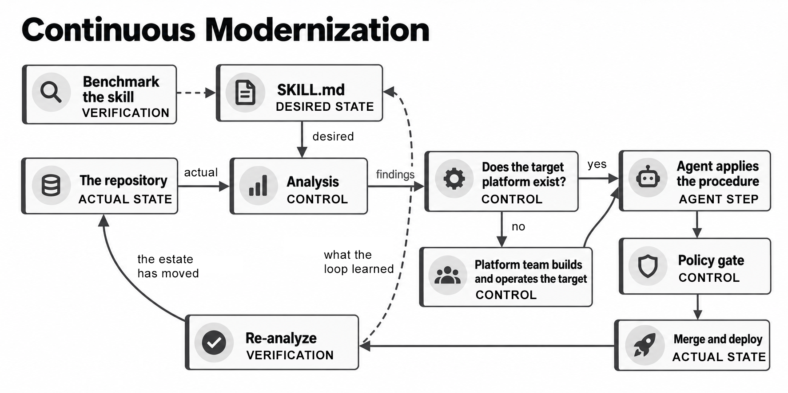
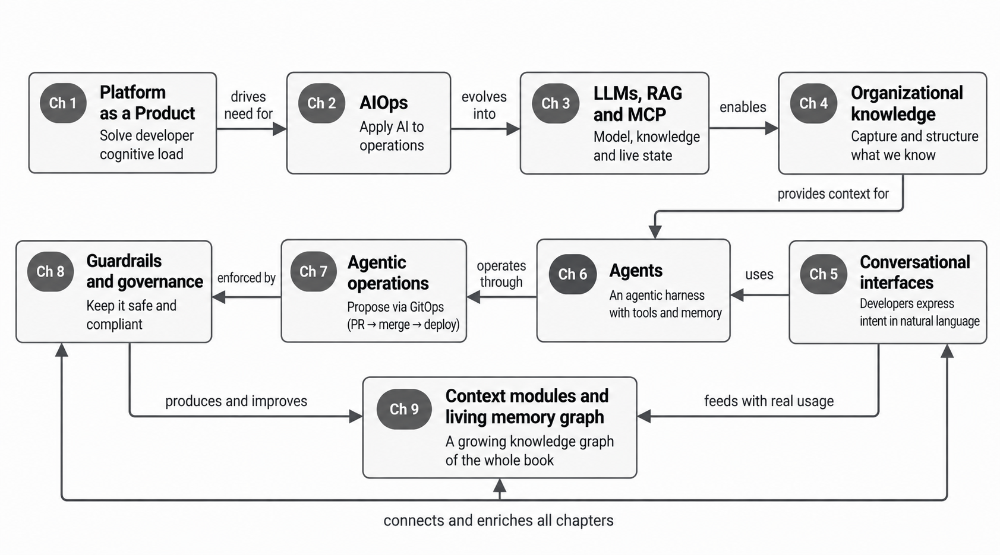
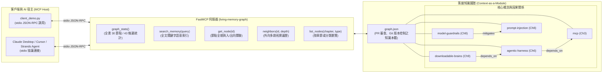

# 9

# Future Directions

Have you ever shipped something that worked perfectly in the demo, then watched it fall apart the moment a real team tried to use it at scale? Not because the code was wrong, but because nobody had ever written down how the team made its decisions? We've been there more times than we'd like to admit. We remember one rollout in particular: a deployment pipeline that ran flawlessly for the small team that built it, and then quietly seized up the first week a larger group touched it, because half of what made it work lived in our heads and had never been said out loud. And here, at the close of this book, is the conclusion we keep arriving at. In AI-driven platform engineering, the thing that fails is almost never the technology. It's the undocumented, undecided process hiding underneath it.

In  *[Chapter 8](https://learning.oreilly.com/library/view/agentic-ai-for/9781806386659/Chapter_8.xhtml#h1_166)* , we finished building the brakes. We made our platforms secure, compliant, and well-governed. We kept humans in the loop where it mattered. And we left you with a promise: we have the confidence to push the boundaries of what's possible. This is that chapter. This is where we explore the future landscape of platform engineering, the advanced automation strategies taking shape right now, and what the next generation of AI tools will mean for our teams.

This isn't a set of predictions dressed up as certainties; what we can offer instead is a vocabulary and a set of bets. Vocabulary, because in our experience the teams who thrive over the next few years will be the ones who can name what's happening while everyone else is still squinting at it. Bets, because the direction of travel is already visible in the systems we built together across the previous eight chapters, even if the destination isn't.

There's one idea we want you to carry through every section. As platforms make the implicit explicit, and as agents execute what we make explicit, ambiguity runs out of places to hide. That means the good organizations get dramatically more leverage, and it means the gaps, the hand-waving, and the "we'll figure it out later" that every org carries all get exposed. Platform engineering is turning into the place where business and technology finally mix. Let us walk you through why we believe that.

In this chapter, we will cover the following topics:

* New terminology every platform team should already be using, including the agentic harness, governance as a module, and context as a module.
* Forward Engineering: why the document you used to write first is now the thing you write last.
* Vending the standard operating procedure as a skill, and why **continuous modernization** belongs in your pipeline right next to continuous delivery.
* The challenges of scaling AI-enhanced platforms across a large organization.
* How autonomous capabilities will evolve, and where they won't take us.
* What this does to organizations: the up-leveling and a capstone bet about where packaged knowledge is heading.
* How to connect your own agent to the living memory graph we keep in the book's companion repository, a working appendix that keeps teaching after the last page.

# Building a vocabulary for what's next

New practices almost always arrive before the words for them. Platform engineering itself went through this. Teams were building internal developer platforms for years before the term gave the practice a shape and a community. AI-driven platform engineering is at that same awkward stage right now. You're already doing a lot of what comes next; you just may not have the words yet. So let us hand you a few.

## The agentic harness is just an architecture

There's a lot of mystique around the phrase  *agentic AI* , and we want to deflate it right at the start. When people talk about an  **agentic harness** , they sometimes make it sound like a new kind of intelligence has been discovered. It hasn't. An agentic harness is nothing more than an architecture: a nameable design pattern wrapped around a model.

You already built one. Go back to what we assembled across *[Chapter 6](https://learning.oreilly.com/library/view/agentic-ai-for/9781806386659/Chapter_6.xhtml#h1_130)* and* Chapter * *7* . An agent, at bottom, is a loop: the model observes some state, decides on an action, calls a tool, and reads the result, over and over, until it reaches a stopping condition. Around that loop we placed the pieces that turn a clever text generator into something operationally useful. We gave it memory, so it could carry context across steps and sessions instead of starting cold every time. We gave it tools, exposed through MCP, so it could do things such as open a pull request, query logs, or provision a resource, rather than merely describe them. We wrapped it in guardrails (the identity propagation and policy checks from  *[Chapter 8](https://learning.oreilly.com/library/view/agentic-ai-for/9781806386659/Chapter_8.xhtml#h1_166)* ) so it couldn't wander outside its lane. And we added scheduling and orchestration, so single agents could become supervised fleets that run on triggers and hand work to one another.

That collection (loop, memory, tools, guardrails, and orchestration) is the harness. Naming it matters, because once you see it as an architecture, you stop treating it as magic and start treating it as engineering. You can diagram it. You can version it. You can swap the model underneath without rebuilding the whole thing. You can reason about its failure modes the way you reason about any distributed system, because that's exactly what it is. So when a colleague says "we need an agentic harness for on-call triage," what they're describing is a scoped task: stand up this specific architecture around a model, wire it to these tools, and put these guardrails around it. That's engineering work, not a leap of faith.

We keep hammering this because the mystique is expensive, and we've watched it cost teams both ways. One team treated the harness as magic and handed it privileges no sane architecture should hold. Another froze completely, unwilling to adopt something they couldn't see inside. The teams that do well internalize that it's just an architecture, and then build the good version: observable, bounded, and boring.

## Modularizing governance and context

Here's a move we've made instinctively with infrastructure for a decade but are only now learning to make with everything else.

When infrastructure was a pile of hand-run scripts, it was fragile and unshareable. Then we modularized it. A Terraform module, a Helm chart, and a reusable blueprint all let us package a chunk of infrastructure with sane defaults, version it, test it, and let other teams compose it into something larger without understanding every internal detail. Modularization is what turned infrastructure from craft into product.

The bet we want to put in front of you is that the next two things to modularize, in parallel with infrastructure, are **governance** and  **context** .

Governance-as-a-module means treating a policy the way you treat a Helm chart. Instead of governance living as prose in a wiki that nobody reads, it becomes a composable, versioned unit. The data-residency rules, the approval thresholds, and the identity constraints from *[Chapter 8](https://learning.oreilly.com/library/view/agentic-ai-for/9781806386659/Chapter_8.xhtml#h1_166)* all get packaged so a team can pull them in, pin a version, and have them enforced automatically wherever the module lands. When the rule changes, you bump the version and every consumer picks it up through the same GitOps flow they already trust. Governance stops being a meeting nobody remembers and becomes a dependency you can see in your manifest. You can already see the shape of this today in versioned OPA/Gatekeeper and Kyverno policy sets, where policy is tested and distributed as code rather than left in prose. A governance module might carry an owner, a semantic version, compatibility requirements, the policy files themselves, an eval or test suite, and a rollback procedure, so a team can see not only what the rule is but how safely it can change.

Context-as-a-module is the same idea pointed at knowledge. Everything an agent needs to act correctly in your environment becomes a packaged, versioned, retrievable unit of context: the architectural decisions, the naming conventions, the "we do it this way because of that outage in 2024," the runbooks, and the boundaries of each service. This is the natural maturation of the organizational-knowledge work from *[Chapter 4](https://learning.oreilly.com/library/view/agentic-ai-for/9781806386659/Chapter_4.xhtml#h1_79)* and the retrieval patterns we built there. Instead of context being scattered across Slack threads and people's heads, it becomes something an agent subscribes to, the same way an application depends on a library. A minimal context module might declare its sources, owner, freshness window, access level, evaluation tests, and deprecation policy, so the agent knows not only what it may retrieve but when that knowledge should stop being trusted.

Put those three together (infrastructure modules, governance modules, and context modules) and you get a platform where what runs, what's allowed, and what's known are all composed and versioned the same way. That symmetry is the mechanism that drags the unspoken into the open. You can't version a decision you've never written down, and the act of turning governance and context into modules forces the organization to decide things it had been leaving fuzzy.

A few of these primitives deserve their own names, not because the words are exotic but because, at scale, they stop being optional. **Evals-as-CI** means treating model and agent evaluations as first-class pipeline gates, so a change to a prompt or a model version has to pass a test suite the same way a code change does. It's the direct descendant of the monitoring and observability discipline we built back in  *[Chapter 2](https://learning.oreilly.com/library/view/agentic-ai-for/9781806386659/Chapter_2.xhtml#h1_28)* , the same instinct that says you don't ship a change you can't measure, now pointed at probabilistic systems. Our position is that this isn't something you get to defer; hold onto it, because it comes back later as survival infrastructure. Alongside it, the Model Context Protocol we've leaned on throughout is quietly becoming the default connective tissue between agents and tools, and **model routing** (sending different requests to different models based on cost, latency, or capability) is on its way to being non-negotiable rather than clever. You now have the words for what your teams are building, and naming a thing is the first step to engineering it. We'll put both to work in a moment when we talk about scale.

# Forward Engineering: from agreement to execution

Now for the shift that ties the loose ends of this book together. It comes, of all places, from Amazon, a company famous for doing the exact opposite.

For years, Amazon has been celebrated for  **working backwards** . Before a team builds anything, they write a narrative document: a mock press release plus an FAQ known as the PRFAQ, describing the finished product as if it already shipped. The document exists to get everyone to agree on the same idea before a line of code is written. It's a beautiful discipline, and it worked because writing the doc was cheaper than building the thing.

That economic assumption just flipped. In "A Return to Two-Pizza Culture" (June 30, 2026), Amazon's own CTO, Werner Vogels, argues that when a prototype takes days rather than months, it makes more sense to build first, use it like a customer would, and *then* write the document, grounded in a working reality instead of assumptions. AWS's VP of agentic AI, Swami Sivasubramanian, reached the same conclusion from the other side, observing that a working demo has become cheaper to produce than the classic PRFAQ. That inversion, from consensus-by-document toward execution-first, with intent encoded and carried forward by the platform and its agents, is what we're calling  **Forward Engineering** .

A quick clarification so we don't confuse you. This isn't "Forward Deployed Engineering," which is an unrelated term for customer-embedded engineers. What we mean by Forward Engineering is the prototype-first, intent-explicit shift in how work gets defined.

It would be easy to read Forward Engineering as "stop planning, just let the agents build." That reading is wrong, and the way it's wrong is the hardest lesson in this chapter. Here's the caveat that Amazon's frontier teams surfaced, as reported around AWS re:Invent 2025 and in the AWS Machine Learning Blog: teams now generate code faster than ever, and if they don't define success up front (the specs, the tests, and the edge cases), the agents fail. The teams that get value from agents make intent explicit before code gets written, through structured specifications, clear requirements, scoped task decomposition, and an unambiguous definition of what "done" looks like.

We've felt this ourselves in a small way. Early on, we pointed an agent at a task we thought was obvious: " *clean up the stale feature flags* ." We watched it confidently rip out flags that were dormant but load-bearing, because we'd never told it what "stale" meant to us. The agent didn't misbehave. It did exactly what we asked. We just hadn't decided, in any explicit way, what we were actually asking for.

Sit with that, because it's the whole book in miniature. The old world hid its ambiguity inside the long agreement document. You could get away with a fuzzy decision because a human would fill the gap with judgment during the build. Forward Engineering strips that safety net away. The agent won't fill your gap with judgment. It'll fill it with something confidently wrong, and it'll do it at machine speed. So the discipline doesn't disappear when you move to execution-first. It relocates, moving from "write a doc to align on the idea" to "make the intent, the constraints, and the success criteria explicit enough that an agent can execute them and you can verify the result."

This is the same shape as intent-as-abstraction, which you first met back in  *[Chapter 1](https://learning.oreilly.com/library/view/agentic-ai-for/9781806386659/Chapter_1.xhtml#h1_13)* . When we introduced Kubernetes Operators, Crossplane, and the Kubernetes-as-control-plane pattern, the developer declared what they wanted, such as a database, a service, or a queue, and the controller reconciled the world to match. In  *[Chapter 5](https://learning.oreilly.com/library/view/agentic-ai-for/9781806386659/Chapter_5.xhtml#h1_106)* , we developed that abstraction further, showing how an Operator continuously compares the desired state you declared with the actual state running in the cluster and takes corrective action when the two drift apart. The declaration was the intent, the controller was the executor, and the gap between them was closed automatically and continuously. Forward Engineering generalizes that pattern from infrastructure to the whole way work gets defined. You state intent, agents execute it, and the platform reconciles reality toward the stated intent while surfacing the gaps it can't close on its own.

And that's exactly why Forward Engineering closes the gaps this book has been circling. The moment you try to run execution-first on top of vague intent, the whole thing collapses immediately and visibly. You can now spot Forward Engineering on your teams, and you know its price: intent explicit enough for an agent to execute and for you to verify. That collapse is the good news. But first, why is an estate an agent could fix in an afternoon still standing still?

# Vending the standard operating procedure

There's a version of this chapter that only works if you get to start from a clean sheet, and almost nobody does. Most of us are standing in front of an estate: a few hundred services, a decade of accumulated decisions, and a handful of systems nobody wants to touch. In  *[Chapter 6](https://learning.oreilly.com/library/view/agentic-ai-for/9781806386659/Chapter_6.xhtml#h1_130)* , we put it bluntly: AI does not fix legacy, AI inherits legacy. So here's the question we get asked most. If an agent can modernize one repository in an afternoon, why is the estate still stuck?

The answer isn't capacity, and it isn't the model. It's that nobody has written down what *modernized* means here. Not in general, but in your organization. Which runtime you've standardized on, which base image, where secrets come from, and in what order those changes are safe to apply. That knowledge exists. It lives in the heads of about four people on your platform team, and it comes out one code review at a time.

Which brings us back to the three things we just said a platform can package: infrastructure, governance, and context. There's a fourth, and it's what makes the other three move: the procedure itself. Package the **standard operating procedure** the way you package a Helm chart: with an explicit objective, the constraints it must respect, the steps to apply it, and a version number. It stops being tribal knowledge. It becomes something the platform team can  **vend** .

You've already shipped one of these. In  *[Chapter 7](https://learning.oreilly.com/library/view/agentic-ai-for/9781806386659/Chapter_7.xhtml#h1_142)* , we built an agent that fixed a broken image tag. The procedure that told it how to do that wasn't application code; it was a `SKILL.md` file: YAML frontmatter that names the skill, explains when to use it, and lists the constraints it must never violate, followed by a procedure in plain English. We mounted it through the same GitOps pipeline as everything else, so a domain team can contribute a skill through a pull request without writing a line of agent code. That file is the unit.

> **What separates a skill you keep from a skill you vend** :
>
> A private skill needs an objective and a procedure. A vended one needs four more, each because somebody got burned without it: the platform surface it assumes, so a missing prerequisite fails loudly instead of producing a clean-looking diff; entry criteria it refuses to run without; a re-entrancy guard, so a second run against an already-fixed repository does nothing at all; and an explicit list of what it does *not* do. Those additions are the closest thing a skill has to an interface contract.

Be explicit about what comes out the other end. A finding isn't a fixed list handed down by a vendor. It's whatever your organization has decided it wants to know about its own code: an unsupported runtime, a service with no machine identity, a naming convention nobody has followed since 2023. The analysis that surfaces findings is a skill you author, exactly like the procedure that remediates them. You write the question and you write the answer, and the platform runs both across every repository you own.

Now the part that makes it continuous. Point the reconciliation pattern we just traced at a codebase, and modernization stops looking like a project with an end date. The skill is the desired state. The repository is the actual state. The analysis is the diff between them, the agent is the controller, and the pull request is the corrective action. Then it runs again next month, because the estate keeps moving and so does the standard. AWS ships a version of this in AWS Transform custom, where analysis and remediation are two halves of one loop and the transformation definition is packaged around a required `SKILL.md` file. Separate client-side `SKILL.md` skills can also extend the agent during a run with supplementary instructions, scripts, and tools. Put it where it belongs in your pipeline: continuous integration, continuous delivery, and now  **continuous modernization** . CI and CD keep shipping what you already have; CM keeps it current while it ships. *Figure 9.1* shows the loop, and the one gate that decides whether any of it is real.



Figure 9.1: Continuous modernization as a reconciliation loop, which closes only when the platform the fix lands on already exists and somebody is operating it

A skill can write a cluster name into a manifest. It cannot make that cluster exist, and it cannot page anybody when it runs out of nodes. Skip that check and the loop still reports success: the analysis re-runs, the finding clears, and nothing is running anywhere. A cleared finding is evidence about your code, not about your runtime. If nobody is on call for where the fix lands, you don't have a platform. You have artifacts.

Give the destination a name and the shape gets clearer. Say you're leaving a data center and decide to migrate and modernize in one pass, rather than promising to come back later. The platform team picks the target once, for everyone: Amazon ECS for orchestration, Terraform for infrastructure as code. Every repository can now be measured against it.

1. **Analyze** : Inventory the repository against the target: language, runtime, whether it's containerized, whether its infrastructure is described anywhere, which dependencies have reached end of life. The findings are the gap.
2. **Transform the runtime** : The step people assume is science fiction, and the most mechanized of the lot. COBOL and PL/I are refactored into Java, JCL into Groovy, green-screen maps into a web front end; .NET Framework moves onto cross-platform .NET that runs on Linux.
3. **Containerize from source** : A Dockerfile the application never had, generated from what the code actually needs rather than from a wiki page describing what it needed in 2019.
4. **Emit the landing zone** : Because the target was ECS and Terraform, that's what this produces: a cluster, a service and a task definition, a load balancer, service discovery, and health checks, all as Terraform modules that a human reads before merging.
5. **Re-analyze** : Not to declare victory, but to measure. The finding either cleared or it didn't.

Only one of those steps is migration; the rest is modernization, and running them together is the point, because the estate you postpone modernizing is the estate you never modernize. The target was yours, too; nothing in the loop compels ECS, or Terraform, or Java. That choice has a bill attached, though. You could point a COBOL estate at Node, but COBOL's packed decimal is exact and base-ten, whereas a JavaScript number is a binary float, so the arithmetic that runs a payroll stops being safe. COBOL estates land on Java for that reason, not for fashion.

And there's a larger move hiding in that first step. An analysis that reads a codebase closely enough to find its defects has also mapped what the code does: the business process underneath it, written out with no language attached. COBOL into Java is one answer to that map: keep the process, change the runtime. The other answer is to read the map and ask the question transpiling never asks: should this process exist in this shape at all? Some of what a legacy system does is essential and merely trapped in an old language. Some of it is a workaround for a constraint that expired in 2004. Modernize that faithfully and you preserve it forever. The estates that get the most out of this loop treat the mapped process as something to reimagine, not something to reproduce.

Which raises the question that stalls adoption: who owns what? Running this once by hand is a demo. Running it continuously across a few hundred repositories means changes landing on teams that never asked for them, and each one needs an owner. *Table 9.1* is the split we'd argue for.

| **Concern**            | **Owner**               | **Accountable for**                                                                |
| ---------------------------- | ----------------------------- | ---------------------------------------------------------------------------------------- |
| Authoring the skill          | Platform team                 | Writing, versioning, and publishing the procedure, and retiring it when it goes stale    |
| Operating the loop           | Platform team                 | Running analysis and remediation on a cadence, and triaging the runs that fail           |
| Deciding what's worth fixing | Architects and service owners | Prioritizing findings, so the loop produces a queue rather than a firehose               |
| Reviewing and merging        | Application teams             | Judging the change against context the skill doesn't have, and owning the merge          |
| The policy gate              | Security and compliance       | The rules a generated change must pass, and whether an agent may touch production at all |
| The platform it lands on     | Platform and identity teams   | The clusters, pipelines, and identity edge the procedure assumes already exist           |
| Living with the result       | The service's on-call         | Every change the skill authored, at three in the morning                                 |

Table 9.1: Who owns what once a skill is vended across an organization

Two things in that table go wrong most often, and they're related. The first is the bottom row: on-call inherits every change a skill ever authored, which makes them a required reviewer rather than an interested party. The second is that nobody in the table is well placed to review the diff: the author doesn't know the service, and the team that does didn't write the skill. So for the first several runs of anything new, put those two people in the same review. And say the awkward part out loud: a platform team authoring changes to services it doesn't operate sits in tension with  *you build it, you run it* .

That tension is where the Helm chart comparison breaks down in two places, and both matter more than the analogy itself:

* **A module is pulled; a skill is pushed** : A team writes `module "service"` when it's ready, and until it does, nothing happens. Nobody self-serves a skill. A team's first contact with it is a pull request on their repository, for a problem they may not have prioritized, from a team they may not have met. Vending a module asks nothing of anyone. Vending a skill spends another team's attention every time it runs. The constraint isn't how fast your platform team can author skills; it's how much review capacity the rest of the organization has. Two hundred repositories means two hundred conversations, and without budgeted review capacity, the loop stalls behind pull requests nobody owns.
* **A module is deterministic; a skill is not** : Pin a module at a version and it produces the same plan every time, which is why we trust module registries and plan reviews. A skill's output is a function of the prompt, the model version, and the state of the repository it's pointed at. Pinning the file does not pin the behavior. Run the same skill across two hundred services and you don't converge on the golden path; you converge on two hundred variants of it, which means the next fleet-wide change can't be a version bump, because there's no single shape left to bump. Every rollout entrenches a little more drift.

We learned the second one the hard way. We were working on a skill for code repository analysis, the kind that surfaces the findings everything downstream acts on. We couldn't trust it on the strength of a handful of examples, because non-determinism only shows itself in volume. So we started benchmarking the skill across a large corpus of repositories and scoring the results with a second model: the **LLM-as-a-judge** pattern, which is how you get deterministic data about a non-deterministic procedure. It worked, and we kept building.

Then we got comfortable. Working through the next set of skills, we split one of them into several reference files and never opened the skill itself to see what the split had done to it. That was the one day we skipped the benchmark. The split had quietly changed what the skill did, in a way no diff review would have caught, and the findings it was supposed to surface stopped appearing. No model had misled us. We had trusted a procedure we hadn't measured.

Here's what we do now. Every pull request against a skill runs the benchmark: at least two runs across a minimum of thirty repositories, scored by an LLM judge, with the result reported straight back to whoever proposed the change. Those are floors, not universal constants, and each one does a different job. Two runs are the minimum needed to reveal non-determinism at all: one run tells you the skill worked once but never that it works repeatably, because there is nothing to compare it against, and we will admit that the two-run minimum is still a weak detector, since an intermittent fault can still pass twice. The thirty-repository threshold is about the aggregate score settling rather than about catching any single defect: below roughly that many, the score swings on the luck of which repositories you drew, and above it the average stops moving much, because precision improves only with the square root of the sample: four times the corpus buys half the error bar at the cost of four times the agent-minutes. Ten repositories is the hard floor beneath the thirty-repository target, and it is a coverage number: a regression that shows up in only one repository in five has a real chance of missing a ten-repository sample completely, and almost no chance of escaping detection in a sample of thirty. Increase both the run count and the repository count as the skill's blast radius grows and as your review capacity allows. A human reviewer sits in the middle. LLM judges have their own failure modes, including position bias, verbosity bias, and self-preference, so we treat the score as a signal rather than an oracle: use a fixed rubric, vary candidate order for pairwise comparisons, and keep the human reviewer in the loop. Green means you may publish; anything else means you may not. A few pages ago, we asked you to hold onto **evals-as-CI** because it comes back later as survival infrastructure. This is later. A skill is a prompt with a version number on it, and a prompt can regress in ways no diff review will ever catch. The only honest answer is to test it like code, against real repositories, every time, because an agent is only ever as good as the process we've been willing to write down and measure.

That's the real test of Forward Engineering. A skill is executable intent, so if a team can't write its own standard operating procedure down, the agent was never the thing blocking them. And once that procedure is a versioned artifact you hand to teams whose services you don't operate, it inherits every provenance question *[Chapter 8](https://learning.oreilly.com/library/view/agentic-ai-for/9781806386659/Chapter_8.xhtml#h1_166)* raised. You can now see the procedure as the fourth thing your platform vends, and you know the two prices on it: the attention it spends on other teams, and the benchmark that has to stand behind it. Next, what all of this costs once you try to run it across a whole organization.

# Scaling across the organization

Standing up an agentic harness for one team is easy now. Making it work across a large organization, and keeping it working as the ground shifts, is where the real difficulty lives. Once knowledge that used to live in someone's head becomes a versioned artifact someone has to maintain, four challenges recur:

* **Model routing** : The model underneath your platform isn't a fixed component. It's a moving target that changes every few months, sometimes with no warning and sometimes in ways that subtly alter behavior you'd come to rely on. A prompt that was perfectly tuned for one model version can degrade on the next, and context you carefully grounded can drift out of relevance. Non-determinism at a fixed model version was the previous section's problem; this is the other one, where the version itself moves underneath you. The eval gate we just put in front of a skill is the same gate you need in front of a model upgrade: if you can't automatically detect that a new model version broke your triage agent's judgment, you'll find out from an incident instead of a pipeline. Our specific bet is that model routing lands alongside ingress and secrets management as something every mature platform has. It's what lets you pin a critical agent to a known-good model while you evaluate a newer one against your eval suite, instead of being dragged onto every upgrade the day it lands. Teams can do a version of this today with routing layers such as OpenRouter, or with a platform-owned gateway that hides provider-specific model selection behind one policy surface. Treat the router itself as platform infrastructure: give the routing policy an owner, regression-test model changes before promotion, define a known-good fallback, cap spend per workload, and run the same eval suite after every routing or model change.
* **Cost, drift, and reproducibility** : A single agent is easy to reason about. A fleet of them, running on schedules and triggers and spawning sub-agents that each make non-deterministic calls to a model, is a different animal. Costs can balloon in ways that are hard to attribute: which agent, doing which task, on whose behalf, spent that money? Behavior drifts as the models and contexts underneath change, and reproducibility, the thing we hold sacred in infrastructure, gets hard when the core component is probabilistic. The answer isn't to abandon determinism where you can have it, but to push it to the edges: deterministic guardrails, deterministic tool interfaces, and deterministic policy checks wrapped around the probabilistic core, with thorough logging of every decision so you can reconstruct what happened even when you can't replay it exactly. What you get to reproduce is the intent and the guardrails, not the exact token stream.
* **Governance and context module maintenance** : We just told you to modularize governance and context alongside infrastructure. The catch is that infrastructure moves, and if your governance and context modules don't move with it, they rot. We've watched exactly this happen. A context module that still described a caching layer we'd decommissioned a quarter earlier cheerfully taught every agent that queried it the wrong thing. A stale context module is worse than no context, because it's confidently wrong. Once knowledge is a versioned artifact, someone owns keeping it true, and the organizations that get this right treat context and governance modules with the same lifecycle rigor as code, complete with ownership, review, and deprecation.
* **Org-level adoption** : In *[Chapter 1](https://learning.oreilly.com/library/view/agentic-ai-for/9781806386659/Chapter_1.xhtml#h1_13)* we talked about the paved road, the smooth, self-service path that makes the right thing the easy thing for developers. The scaling challenge now is that we need paved roads for agents too. An agent, like a developer, will take the path of least resistance. If the safe, governed, well-contextualized way to accomplish a task is harder than the reckless way, the agent fleet will find the reckless way at scale and at speed. So the platform team's job expands. You're no longer just designing the developer experience; you're designing the agent experience: the golden paths, the sane defaults, and the guardrails that make the correct action also the easiest one, for a workforce that's now part human and part autonomous. The road has a human half too: as we just saw with vended skills, every agent-authored change spends somebody's review time, so budget that capacity as deliberately as you budget compute.

None of these are reasons to slow down. They're reasons to build the unglamorous infrastructure, the evals, logging, ownership, and paved roads, before you scale the exciting part. The teams that skip it don't avoid the cost. They meet it later, in production. You can now name the four bills that come due at scale and budget for them in advance. Now to where the agents themselves are headed.

# How autonomous capabilities will evolve

We want to give you a realistic trajectory, not a science-fiction one, and an honest account of where it stops. Think of it as a progression along the spectrum we introduced in  *[Chapter 6](https://learning.oreilly.com/library/view/agentic-ai-for/9781806386659/Chapter_6.xhtml#h1_130)* , from workflows to agents, now extended into the future. The progression has three broad stages:

* **From single agents to supervised fleets (happening now)** : This is the stage many of us are entering today. A single agent that triages an alert becomes a coordinated set of agents: one that detects, one that diagnoses, one that drafts a remediation, and one that opens the pull request, with a human approving at the gate, the shape we started building in  *[Chapter 7](https://learning.oreilly.com/library/view/agentic-ai-for/9781806386659/Chapter_7.xhtml#h1_142)* . The unit of automation shifts from a task to a workflow, and the platform's job becomes orchestrating and supervising the fleet rather than babysitting each agent.
* **From supervised fleets to self-improving loops (the next few years)** : The next step demands the most caution: agents that learn from their own outcomes. Picture an agent that notices its remediation for a class of incidents consistently works and proposes promoting that remediation into a standard runbook, or one that spots a recurring toil pattern and drafts the automation to eliminate it. Nothing in the current tooling does this operational self-improvement out of the box; what harnesses give you is the substrate for it. Persistent memory and learning loops are exactly the primitives such systems need, and some open-source harnesses already ship them, but building outcome-driven runbook promotion on top of those primitives is work you do, deliberately and with brakes on. Here's our contrarian bet:  **self-improving loops stay human-gated for the foreseeable future** , and not because the technology can't close the loop. It's because a self-modifying system can improve its own behavior in the wrong direction, and the definition of "done" for a *governing* change is exactly the kind of contested, high-consequence judgment that can't yet be pinned down tightly enough to trust unsupervised. The loop proposes; a human, or a rigorously bounded policy, disposes. Promotion itself goes through evals-as-CI: the proposed runbook or automation is evaluated offline against a fixed test set, reviewed as a diff, approved before deployment, and tied to an explicit rollback path. Nothing becomes the new default merely because it worked once.
* **Broader use cases, and the realistic ceiling** : As this matures over the decade, the use cases widen well beyond operations into cost optimization, capacity planning, dependency upgrades, security-patch triage, and compliance evidence-gathering, anywhere there's a well-defined intent and a verifiable outcome. One rule governs where autonomy expands and where it stalls, and it names autonomy's ceiling. Autonomy expands fastest where success is checkable, where you can write the eval, the test, or the policy that says "this is correct." It stalls, permanently and by design, where outcomes depend on contested human judgment, carry irreversible consequences, or involve genuine novelty with no precedent. Autonomy won't decide what your business should value; that's a human choice about the world, not a task with a verifiable answer. It won't resolve genuine ambiguity; it'll only surface it faster and, if unguarded, act on a guess. Agents are extraordinary at executing intent you've stated clearly and terrible at inventing the intent you failed to provide. So the ceiling on autonomy isn't a technical ceiling at all. It's the ceiling of how much your organization is willing to decide out loud. You now understand the rule that governs autonomy's reach, which lets you decide where to trust an agent and where to keep a hand on the gate.

Across these stages, the pattern is clear: autonomy should expand where intent is explicit, outcomes can be verified, and high-risk decisions still have clear human or policy gates.

# The organization gets up-leveled

Here's the thesis we've been building toward, stated plainly. What actually fails is the undocumented, undecided process. AI-driven platforms, by making the implicit explicit and letting agents execute it, leave that failure with nowhere to hide. The consequence is that organizations get up-leveled, and the gaps get exposed. Let us unpack both halves, because we want to leave you with the constructive reading, not the fearful one.

Start with the exposure, because it sounds harsher than it is. For as long as most of us have worked in technology, organizations have run on a quiet layer of undocumented judgment. The senior engineer who "just knows" how deployments really work. The decision that was never actually made, just gradually assumed. The process that exists in three people's heads and nowhere else. This worked, sort of, because humans are very good at papering over ambiguity with judgment in the moment.

Agents can't paper over it. When you ask an agent to execute a process, the process has to be spelled out, or the agent fails, visibly, immediately, and at scale. This is what we mean when we say incompetence gets exposed. The exposure isn't a punishment; it's a diagnosis. The teams that had real, well-reasoned, written-down processes suddenly get enormous force multiplication, because those processes are exactly what agents amplify. The teams that were running on undocumented heroics discover that they were never as functional as they looked. The AI didn't make them worse; it simply revealed a weakness that was always there.

And the platform is where this plays out, which is why we keep insisting that platform engineering is becoming the place where business and technology mix. When governance is a module, when context is a module, and when intent is stated up front through Forward Engineering, the platform quietly becomes the **system of record for how the organization ** **actually operates** . Not how the org chart says it operates, or how the strategy deck claims it does, but how it really makes decisions and does work. That's a business-level artifact living inside a technical system. The old line between "the business decides" and "engineering executes" dissolves, because the decisions and the execution now live in the same versioned, composable place.

Now the up-leveling. If a small, disciplined team can encode its intent explicitly and hand execution to a fleet of agents, the reach available to that team is unlike anything in the history of the field. This is the context for a bet that Sam Altman has put on the record. Among his circle of tech CEO friends, he has described a betting pool on the year in which the first **one-person billion-dollar company** will appear, something unimaginable without AI, and, in his view, now on the way. We'll plant our own flag next to his: we expect to see it sooner than most people are ready for. When explicit intent plus agentic execution collapses the headcount traditionally required to run a business, the binding constraint stops being how many people you can hire and becomes how clearly you can articulate what you want. It's the same instinct behind Amazon's two-pizza teams, small groups that own a problem and deliver with autonomy, now amplified by agents that do the heavy lifting a larger group used to. Small teams with clear intent will out-execute large teams with fuzzy intent. That's the up-leveled organization. You now have a lens for reading your own: not whether it holds the smartest people, but whether it has written its decisions down clearly enough for agents to amplify.

And if clearly articulated knowledge is now the binding constraint, then the obvious next question is what happens when that knowledge itself becomes something you can package, buy, and sell.

# The capstone bet: brains you can download

We promised you a bold prediction, and here it is: the logical extreme of everything we've argued.

We said context becomes a module: packaged, versioned, retrievable knowledge that an agent subscribes to. We said the memory graph, the living store of an organization's decisions and expertise, becomes a first-class asset. We said that packaged knowledge is the thing that creates leverage. Now push each of those one step further and see where they land.

If context is a versioned module, and if a curated context module is what turns a generic agent into an expert one, then curated context becomes a tradable good. People will sell  **brains** , and a brain, in this framing, is nothing more than curated context and knowledge, expertly assembled, kept current, and packaged for download. Not a model. Not weights. Context. You'll download a brain into your agent the way you install a dependency today: a brain that knows Kubernetes operations cold, a brain that carries a specific regulatory regime's every nuance, a brain steeped in a particular industry's hard-won lessons. Your generic harness plus a downloaded brain becomes an instant specialist, because the specialist knowledge was never in the model. It was in the curated context.

And it won't stop at software agents. As embodied agents and physical robots mature, later this decade and beyond, the same brains, the same curated context modules, get downloaded into them. The knowledge of how to operate a particular kind of machine, navigate a particular warehouse, or follow a particular safety regime becomes a portable brain you load into a body.

Now, the moment you can buy a brain, you inherit every problem *[Chapter 8](https://learning.oreilly.com/library/view/agentic-ai-for/9781806386659/Chapter_8.xhtml#h1_166)* warned you about, at internet scale. A marketplace of downloadable context is also a marketplace of poisoned context. A brain assembled by someone you can't vet, dropped straight into an agent that acts on your systems, is the memory-poisoning and supply-chain threat from *[Chapter 8](https://learning.oreilly.com/library/view/agentic-ai-for/9781806386659/Chapter_8.xhtml#h1_166)* wearing a friendlier face. Left unchecked, that marketplace becomes a lemon market, where a buyer can't tell the expert brain from the subtly wrong or maliciously seeded one until an agent has already acted on it. So the same governance-as-a-module discipline we've been preaching becomes the price of admission: the playbook for every downloadable brain you'll ever consider. Brains will carry provenance and be cryptographically signed and versioned, so you know who curated this knowledge and when. You'll pin a specific version rather than blindly tracking the latest. And you'll run a downloaded brain through your own evals before you let it govern anything, the same way you'd never merge an unreviewed dependency into production. Before a third-party context module reaches an agent, treat it like an untrusted dependency: verify provenance and signatures, scan its contents, exercise it in a sandbox against your evals, maintain a reputation or trust record for the publisher, and keep a revocation path for any version that turns out to be bad.

We're aware of how this sounds. But trace it back and it's not a leap at all. It's the straight-line consequence of context-as-a-module plus the memory graph, taken to its extreme. If packaged knowledge is the asset that produces leverage, and everything in this book says it is, then of course that asset becomes something people curate, sign, sell, and buy. The organizations and individuals who win the next decade will have understood, early, that the durable value was never the model everyone had access to. It was the curated context that only they had bothered to write down. You can now see why provenance and verification, not volume, decide who wins that market. And you needn't wait for it; we've left a working miniature version you can connect to now.

# A living appendix: connect your agent to our memory graph

We closed the hands-on chapters of this book with something you could build. This chapter is concept-only by design, since you can't lab your way to the future, but we refuse to leave you with only ideas. In the book's companion repository, `[https://github.com/PacktPublishing/Agentic-AI-for-Platform-Engineering/tree/main/chapter-09/memory-graph](https://github.com/PacktPublishing/Agentic-AI-for-Platform-Engineering/tree/main/chapter-09/memory-graph)`, we keep a  **living memory graph** : a growing, curated store of the decisions, patterns, and context we accumulate as this field moves. We seed it with the book itself: the concepts, decisions, patterns, threats, and tools from all nine chapters, wired together. Its nodes are typed, and its edges carry meaning, recording that one idea `supersedes`another,`mitigates` a threat, or exists because of another (`supersedes`, `mitigates`, `depends_on`, `caused_by`, `introduced_in`). The whole graph lives as a single versioned file in the repository, so adding a node is human-reviewable in a pull request, the same GitOps discipline we've leaned on all book long. *Figure 9.2* shows the spine of that graph: the nodes and typed relationships that carry the book's argument from retrieval and context, through the agent and its guardrails, to where this chapter says it all goes next.




Figure 9.2: The spine of the living memory graph

The figure shows nine of the thirty nodes, each labelled with its type and the chapter it came from, joined by the typed relationships that carry the book's argument forward. The graph is served over the Model Context Protocol. The full graph is in the book's companion repository at `[https://github.com/PacktPublishing/Agentic-AI-for-Platform-Engineering/tree/main/chapter-09/memory-graph](https://github.com/PacktPublishing/Agentic-AI-for-Platform-Engineering/tree/main/chapter-09/memory-graph)`.


Read down the bands, and you can watch the book's argument connect: the retrieval and context work of *Chapters 3 and 4* feeds into the agentic patterns of  *[Chapter 6](https://learning.oreilly.com/library/view/agentic-ai-for/9781806386659/Chapter_6.xhtml#h1_130)* ; the threats of *[Chapter 8](https://learning.oreilly.com/library/view/agentic-ai-for/9781806386659/Chapter_8.xhtml#h1_166)* point forward to the very ideas that mitigate them; and the future concepts of this chapter, such as context-as-a-module and downloadable brains, trace their dependencies back to everything that came before. Your harness doesn't see files; it sees a graph. The repository ships a small local MCP server that exposes graph-native operations over the Model Context Protocol, not a file dump. Your agent can search the graph (`search_memory`), fetch a typed node in full with all of its connections (`get_node`), traverse outward from a node to follow relationships (`neighbors`), and browse by chapter or type (`list_nodes`), with the whole graph and each node also surfaced as MCP Resources so a harness can page through them. So when you ask your local agent "according to the book, what `mitigates` prompt injection, and where did it come from?", it lands on the prompt-injection node, follows its `mitigates` edges to model guardrails and identity propagation, and reads that all three were introduced in  *[Chapter 8](https://learning.oreilly.com/library/view/agentic-ai-for/9781806386659/Chapter_8.xhtml#h1_166)* . Your agent gets the answer and the reasoning around it, because the graph did the walking. The graph is deliberately small: the pattern, not the size, is the point, and if it ever outgrows a flat versioned file the same tool surface can sit in front of a real graph store without your agent noticing.

The most forward-looking part is the loop it closes. Point your harness at two tiers of memory: a local, private working memory (a memory engine of your choice) that holds what your own agents are learning right now, and the shared graph that acts as long-term community memory. When an agent notices something worth keeping in that local working memory, such as a convention your team just settled on or a lesson from an incident you just worked on, it can draft a typed node and open a reviewed pull request to add it to the shared graph. That's private, tacit knowledge becoming shared, explicit knowledge, in the open, through review. It's "make the implicit explicit" running as a mechanism rather than a slogan, and it's the smallest working instance of the capstone bet: fork the repository, prune it to your own domain, sign it, and you've handed your agents a brain you curated yourself.

The harness you reach for is your call. Because the server speaks plain MCP over `stdio`, any MCP-native host works. At the time of writing, that includes Claude Desktop and Cursor, along with open-source harnesses such as Goose, Hermes, and OpenClaw; the companion repository keeps the current list because this category moves too quickly for print. We keep the exact wiring, the tool-by-tool setup, and the node and edge schema in the repository's README rather than on these pages, because a living artifact should be free to evolve without contradicting a printed book.

It's two-way, which is the whole point of calling it living. We add nodes as the field moves and as our own practice teaches us something worth writing down; you can open a pull request that adds a node or an edge of your own, and once it's reviewed and merged, everyone who pulls the repo sees it. The same provenance-and-signing discipline from the capstone bet applies here in miniature: every node carries provenance and a date, contributions are reviewed before they merge, and you pin a graph version, so a stale or bad node can't silently teach every connected agent something wrong. That's the whole mechanism, and it's deliberately unglamorous: a versioned graph and a `git pull`. Treat it as a living appendix, not a build assignment. You can now wire your harness to this versioned memory graph and contribute back through review, so the book keeps teaching past its last page.

# Summary

We began this book, back in  *[Chapter 1](https://learning.oreilly.com/library/view/agentic-ai-for/9781806386659/Chapter_1.xhtml#h1_13)* , with a promise: that AI-driven platform engineering would be the next leap that finally helps us tame the beast, lifting the heavy cognitive load off developers, proving the platform is a powerhouse for business value rather than a cost center, and letting us treat the platform as a real product with real users who deserve a great experience. Across eight chapters we built toward that promise, from the foundations of platform engineering and AIOps, through generative AI, into organizational knowledge and conversational interfaces, into agentic behavior and production agents, and finally the security, compliance, and governance that let us push forward with confidence.

In this closing chapter, we handed you a vocabulary and a set of bets for what comes next. We demystified the agentic harness as just an architecture you can diagram and version. We argued for governance-as-a-module and context-as-a-module, composed in parallel with your infrastructure, because you can't version a decision you never wrote down. We introduced Forward Engineering, our name for Amazon's inversion from consensus-by-document to execution-first, and its unforgiving lesson that agents execute clearly stated intent and fail on vague intent. We made the case for the procedure as the fourth thing your platform vends, packaged as a skill and run as a continuous modernization loop that reconciles a repository against a written standard, and we were honest that a vended skill is neither pulled nor deterministic, which is exactly why it has to be benchmarked like code before it ever reaches another team. We named what breaks when you scale this across an org, and we traced how autonomy evolves toward carefully braked, human-gated self-improvement, naming its real ceiling: not a technical limit, but the limit of how much an organization is willing to decide out loud. We landed the thesis of the up-leveled organization, where undocumented process gets exposed, clear decisions win, and the platform becomes the system of record for how the org actually operates. And we closed with a bet: that curated context becomes a tradable good, that people will sell downloadable brains made of nothing but curated knowledge, governed by provenance and signing, first into agents and eventually into embodied ones.

There's one idea to carry out of this book, and it's been hiding under every chapter. The technology was rarely the thing that failed us. What fails is the decision we never made, the process we never wrote down, the intent we never made explicit. AI-driven platform engineering doesn't let us keep hiding from that, and that's why it's such good news. It turns the fuzzy, heroic, undocumented middle of our organizations into something explicit, composable, and shared. It up-levels the teams that are willing to be clear.

*[Chapter 1](https://learning.oreilly.com/library/view/agentic-ai-for/9781806386659/Chapter_1.xhtml#h1_13)* promised to lift the cognitive load and to treat the platform as a product. We hope you now see that the deeper payoff is bigger than either. The platform becomes the place where your organization finally says out loud how it actually works, and, having said it, gets to improve it. That's the future landscape we set out to explore. Go make the implicit explicit.

# Further reading

* Werner Vogels, "A Return to Two-Pizza Culture" ([https://www.allthingsdistributed.com/2026/06/return-to-two-pizza-culture.html](https://www.allthingsdistributed.com/2026/06/return-to-two-pizza-culture.html), June 30, 2026), Amazon's CTO on prototyping first and documenting afterward, and on small, autonomous teams amplified by coding agents.
* Swami Sivasubramanian, as reported by GeekWire (2026), on how agentic AI is rewiring Amazon's teams and upending its traditions, including the observation that a working prototype is now easier to produce than the classic PRFAQ.
* AWS Machine Learning Blog and AWS re:Invent 2025 sessions on agentic development and defining success up front (structured specifications, requirements, and scoped task decomposition) so agents know what "done" looks like.
* AWS Transform documentation and the Agentic Transformation Workshop (AWS, 2026), on continuous modernization, the repository analyses that drive the loop, the documented refactoring targets for mainframe and .NET estates, and the Terraform and Helm output generated for Amazon ECS and Amazon EKS.
* Sam Altman, public remarks on the coming one-person billion-dollar company and the tech CEO betting pool on the year in which the first such company appears.
* Continuous Modernization Blog [https://aws.amazon.com/blogs/migration-and-modernization/new-in-aws-transform-analyze-your-code-for-modernization-and-agentic-readiness/](https://aws.amazon.com/blogs/migration-and-modernization/new-in-aws-transform-analyze-your-code-for-modernization-and-agentic-readiness/)
* The book's companion repository, (see`<span> </span>`[https://github.com/PacktPublishing/Agentic-AI-for-Platform-Engineering/tree/main/chapter-09/memory-graph](https://github.com/PacktPublishing/Agentic-AI-for-Platform-Engineering/tree/main/chapter-09/memory-graph)), and its living memory graph, served by the repo's MCP server and connectable from any MCP-native host, including open-source harnesses such as Goose, Hermes, and OpenClaw.
* Ian Cartwright, Rob Horn, and James Lewis, "Patterns of Legacy Displacement" (martinfowler.com, 2024), on why feature-parity replacement keeps failing, and on technology being at most half of the legacy problem.
* Model Context Protocol (MCP) documentation, the connective tissue between agents and tools referenced throughout this book.
* Peiyi Wang et al., "Large Language Models are not Fair Evaluators" (ACL 2024), on positional bias and calibration in LLM-as-a-judge evaluation: [https://aclanthology.org/2024.acl-long.511/](https://aclanthology.org/2024.acl-long.511/)
* NIST AI 600-1, Artificial Intelligence Risk Management Framework: Generative Artificial Intelligence Profile (2024), on governance, evaluation, and risk management for generative AI systems: [https://doi.org/10.6028/NIST.AI.600-1](https://doi.org/10.6028/NIST.AI.600-1)
* OWASP GenAI Security Project, LLM01:2025 Prompt Injection, on prompt-injection risks and mitigations: [https://genai.owasp.org/llmrisk/llm01-prompt-injection/](https://genai.owasp.org/llmrisk/llm01-prompt-injection/)
* OWASP Top 10 for Agentic Applications 2026, on security risks and controls for autonomous and agentic systems: [https://genai.owasp.org/resource/owasp-top-10-for-agentic-applications-for-2026/](https://genai.owasp.org/resource/owasp-top-10-for-agentic-applications-for-2026/)


---

## 💡 讀者實戰筆記：活體記憶圖譜（Living Memory Graph）MCP 伺服器端到端實測

全書的最後一個實驗並非隨著章節讀完就結束，而是以一座**動態活體記憶圖譜（Living Memory Graph）MCP 伺服器**的形式，作為全書致贈給每位工程師的「可延伸數位大腦」：

* **第 3/4 章（RAG）**：回答「過去我們是如何解決類似問題的？」（歷史經驗檢索）。
* **第 5/7 章（MCP）**：回答「叢集與儲存庫當前真實狀態是什麼？」（即時環境探查）。
* **第 9 章（Living Memory Graph）**：回答「**團隊已經知道什麼？這些架構決策與概念如何相互關聯？**」（圖譜因果推論）。



---

### 步驟 1：建立 Python 虛擬環境與安裝相依套件

進入配套代碼目錄 `chapter-09/memory-graph/files/mcp`，建立虛擬環境並安裝標準 FastMCP 函式庫：
```bash
cd chapter-09/memory-graph/files/mcp
python3 -m venv .venv && source .venv/bin/activate
pip install -r requirements.txt
```
套件清單僅需 `mcp[cli]>=1.2.0`，輕量乾淨，專注於提供純粹標準的 stdio 服務。

---

### 步驟 2：圖譜統計與全景檢驗（`graph_stats`）

透過配套的 `client_demo.py` 以 stdio 啟動伺服器並查詢圖譜元數據：
```bash
$ .venv/bin/python client_demo.py
=== graph_stats() ===
{
  "version": "0.1.0",
  "nodes": 30,
  "edges": 43,
  "by_chapter": {
    "1": 3, "2": 2, "3": 4, "4": 2, "5": 2,
    "6": 3, "7": 1, "8": 6, "9": 7
  },
  "by_type": {
    "concept": 14,
    "metric": 1,
    "decision": 3,
    "pattern": 9,
    "tool": 1,
    "threat": 2
  }
}
```
* **節點（Nodes）**：精準收錄全書 30 個核心主題，橫跨概念（concept）、決策（decision）、模式（pattern）、威脅（threat）與工具（tool）。
* **關聯邊（Edges）**：定義了 43 條具備語意型別的指向關係（`depends_on`、`mitigates`、`relates_to`、`enables`、`caused_by`、`supersedes`）。

---

### 步驟 3：語意檢索與拓撲遍歷實測

#### 1. 檢索「可下載數位大腦（Downloadable brains）」
```bash
$ .venv/bin/python client_demo.py --search "downloadable brains"
```
伺服器回傳：
```json
{
  "id": "downloadable-brains",
  "title": "Downloadable brains (curated context as a tradeable good)",
  "type": "concept",
  "chapter": 9,
  "summary": "People will sell 'brains'—nothing more than curated context—that you download into an agent, and eventually a robot."
}
```

#### 2. 調取特定節點及其因果脈絡（`get_node('downloadable-brains')`）
```json
{
  "id": "downloadable-brains",
  "type": "concept",
  "title": "Downloadable brains (curated context as a tradeable good)",
  "chapter": 9,
  "summary": "People will sell 'brains'...",
  "connections": [
    { "rel": "relates_to", "direction": "in", "from": "memory-poisoning", "title": "Memory poisoning" },
    { "rel": "depends_on", "direction": "out", "to": "context-as-module", "title": "Context-as-a-module" },
    { "rel": "caused_by", "direction": "out", "to": "memory-poisoning", "title": "Memory poisoning" }
  ]
}
```
* 代理能清楚看到：可下載大腦在架構上依賴 `context-as-module`，但同時面臨第 8 章的 `memory-poisoning`（記憶投毒）威脅，因此必須配合數位簽章與來源追溯（Provenance）。

#### 3. 遍歷「提示詞注入（Prompt injection）」的緩解措施
調取 `model-guardrails` 節點：
```bash
$ .venv/bin/python client_demo.py --node model-guardrails
```
* 輸出關聯：
  * `depends_on` ➜ `agentic-harness`（第 6 章代理線束）
  * `mitigates` ➜ `prompt-injection`（第 8 章提示詞注入威脅）
  * `relates_to` ➜ `identity-propagation`（第 8 章身分透傳）
* 當工程師詢問代理排障或架構方案時，代理不需要瞎猜，而是沿著圖譜精準獲取「護欄如何緩解注入、以及它依賴何種身分機制」的完整推理路徑。

#### 4. 全圖拓撲渲染（`render_graph.py`）
執行 `render_graph.py` 可將整座圖譜編譯為 Mermaid 拓撲圖與 SVG 視覺化圖表，清晰展現全書從 Chapter 1 的「認知負擔」一路演進至 Chapter 9「組織升級」的完整思想脈絡。

---

### 步驟 4：連接至你自己的 AI 代理或 IDE

在任何支援標準 stdio MCP 協議的客戶端（如 Claude Desktop、Cursor 或自建 Strands Agent）中加入設定：
```json
{
  "mcpServers": {
    "living-memory-graph": {
      "command": "/absolute/path/to/chapter-09/memory-graph/files/mcp/.venv/bin/python",
      "args": ["-m", "app.server"],
      "cwd": "/absolute/path/to/chapter-09/memory-graph/files/mcp"
    }
  }
}
```
現在直接向代理提問：
> *「根據活體記憶圖譜，平台工程團隊應該如何防範記憶投毒？它與上下文即模組有何關聯？」*

代理即可直接透過 `search_memory` 與 `get_node` 進行多跳推理，給出兼具理論深度與實踐依據的精準解答。

---

### 💡 核心工程避坑指南

1. **共享大腦的「檸檬市場（Lemon Market）」風險**：
   * 策展後的上下文（Curated Context）未來將如同 Docker 映像檔或 npm 套件一樣成為流通資產。然而，沒有來源審查的知識就是劇毒。正如第 8 章所強調，任何引入組織代理大腦的知識模組，必須像審查程式碼一樣嚴格審查 PR、驗證作者身分並鎖定特定 Git Commit 版本，防範惡意節點注入。
2. **圖結構 vs. 純向量檢索（RAG）的互補性**：
   * 純向量檢索擅長回答模糊的「語意相似文本」，但對「因果關係（A 是由 B 緩解的）」與「嚴格架構相依（C 依賴於 D）」極易產生推理斷層或幻覺。
   * 將關鍵架構知識顯性化為**知識圖譜（Knowledge Graph）**，並透過 MCP 賦予代理圖遍歷能力，是打造確定性、高可靠企業級代理系統的終極武器。
3. **全書完結寄語：去把所有不可言說的潛規則，統統顯性化！**
   * 在 AI 驅動的平台工程中，失敗的從來不是模型能力，而是那些從未被文件化的隱性流程、從未認真做出的艱難決策、以及模糊不清的意圖。
   * **讓正確安全的動作，成為機器阻力最小的動作**——這正是所有平台工程師在智慧時代最光榮的歷史使命。
