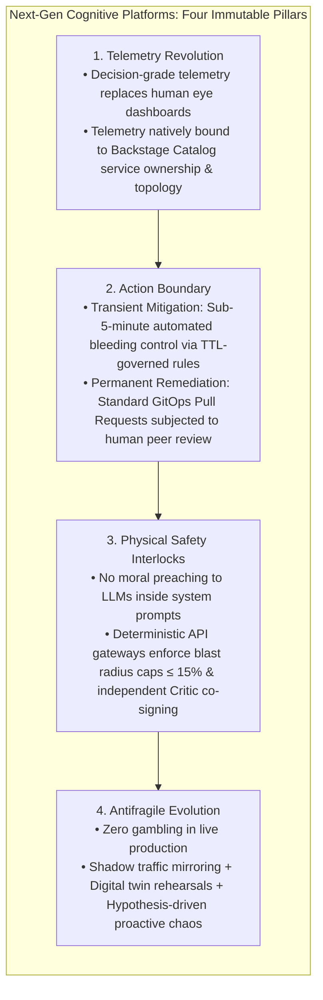
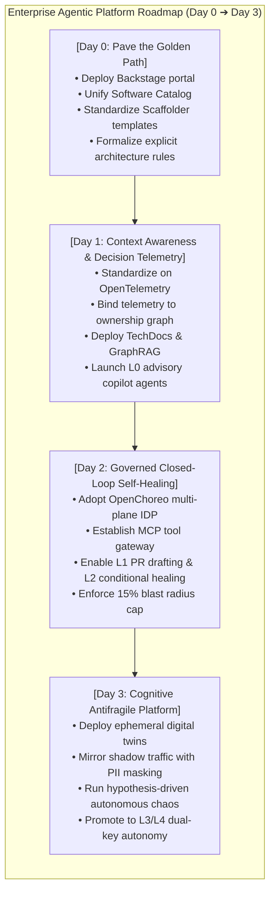

# EPILOGUE

# Epilogue: Toward Cognitive Adaptive Platforms — An Enterprise Maturity Roadmap

As you turn the final page of this work, the overarching architectural puzzle bridging Platform Engineering and Reliability Engineering (ARE) snaps into complete alignment.

Looking back across our journey:

* We began in Chapters 1 and 2 by dismantling the legacy silos of AIOps and developer friction, establishing the core doctrine of treating the platform as a product;
* In Chapters 3, 4, and 4-EX, we elevated organizational knowledge into causal, "Decision-Grade Telemetry" and the closed DRAL autonomous loop;
* In Chapters 5, 6, 7, and 7-EX, we constructed conversational interfaces, the Model Context Protocol (MCP), and production operational agents, sharply dividing machine-speed transient mitigations from human-reviewed permanent remediations;
* In Chapters 8 and 8-EX, we confronted the mortal peril of out-of-control autonomous agents, erecting L0-through-L4 autonomy ladders, hard blast radius caps, and dual-key authorization interlocks;
* In Chapters 9 and 9-EX, we propelled platforms from passive mitigation to proactive antifragility through hypothesis-driven micro-chaos experiments and digital twin shadow rehearsals;
* In Chapters 11 and 12, we grounded this theoretical edifice upon the two flagship open-source foundations of the cloud-native ecosystem—Spotify Backstage (the portal and perception layer) and CNCF OpenChoreo (the multi-plane execution substrate).

In this epilogue, we draw these foundational concepts together into an actionable **Enterprise Maturity Roadmap (Day 0 through Day 3)** for engineering leaders.

---

# 1. Synthesis of the Four Architectural Pillars

Across the history of software engineering, every massive productivity leap has been grounded in deterministic constraints placed around ambient uncertainty. Summarizing this work, four immovable pillars define the next generation of cognitive platforms:

---

# 2. Enterprise Maturity Roadmap (Day 0 through Day 3)

Any organization attempting to leap directly into full-circle production autonomy will inevitably suffer catastrophic failure. Enterprise platform adoption must adhere to a disciplined, four-phase maturity progression:

### Phase 1: Day 0 — Pave the Golden Path (Asset Inventory & Explicit Rules)

* **Core Mission**: Before unleashing AI agents, organize human workflows and inventory assets.
* **Key Actions**:
  1. Deploy Spotify Backstage; mandate `catalog-info.yaml` across all microservices to clarify service boundaries, API specs, and owning teams.
  2. Package standard deployment templates (Docker, Helm, Kubernetes) into Backstage Scaffolder, eradicating copy-paste technical debt.
  3. Extract tribal knowledge and runbooks buried in engineers' heads into version-controlled Markdown within Backstage TechDocs.

### Phase 2: Day 1 — Context Awareness & Decision Telemetry (High-Fidelity Perception)

* **Core Mission**: Equip AI agents with high signal-to-noise sensory input, ending blind troubleshooting.
* **Key Actions**:
  1. Enforce OpenTelemetry standards organization-wide, injecting Backstage Catalog metadata into every trace attribute.
  2. Deploy an internal GraphRAG knowledge agent to assist human engineers with architecture queries and triage runbooks.
  3. Roll out **L0 (Read-Only Advisory) operational agents**. Agents generate causal diagnosis reports; execution remains 100% human. Continuously measure Decision Quality (DQ-SLO) via Langfuse.

### Phase 3: Day 2 — Governed Closed-Loop Self-Healing (Machine-Speed Mitigation)

* **Core Mission**: Unlock localized autonomous mitigation bounded by rigid physical guardrails.
* **Key Actions**:
  1. Adopt CNCF OpenChoreo to physically decouple infrastructure into developer and platform control planes, shielding raw clusters from agents.
  2. Encapsulate operational runbooks into standard Model Context Protocol (MCP) servers, backed by deterministic `AutonomyPolicyEngine` middleware.
  3. Authorize **L1 (PR drafting)** and **L2 (conditional healing)** capabilities, strictly capping blast radius impact to $\le 15\%$ of running instances.

### Phase 4: Day 3 — Cognitive Antifragile Platform (Proactive Hardening & Simulation)

* **Core Mission**: Transition from reactive triage to proactive defense, embedding self-strengthening resilience into the platform.
* **Key Actions**:
  1. Stand up on-demand cloud-native digital twin environments using Envoy Request Mirroring to rehearse candidate changes under live shadow traffic with automated PII masking.
  2. Launch an Autonomous Chaos Agent during low-traffic windows to inject hypothesis-driven micro-faults against recent PR diffs, automatically opening hardening PRs.
  3. Establish an independently deployed Safety Critic Agent to unlock **L3 Dual-Key Authorization** across core production services, backed by dead man's tripwires.

---

# 3. Cultural Evolution: Architects as Curators, Not Gatekeepers

In the era of agentic platform engineering, the most profound transformation is cultural rather than technical.

Historically, architects and operations teams functioned as **gatekeepers**: designing onerous change advisory boards (CABs), restricting developer permissions, and trading delivery velocity for brittle stability.

In the cognitive, self-adaptive platform outlined in this book, the architect's identity shifts decisively to that of a **Platform Curator**:

* Your role is no longer manually reviewing mundane change tickets, but **packaging compliance and resilience into declarative Governance-as-a-module**;
* Your role is no longer ssh-ing into production servers at 3 a.m. to put out fires, but **designing precise Context-as-a-module feeds and deterministic guardrail middleware for AI agents**;
* Your role is no longer penalizing human error in postmortems, but **monitoring Trust Telemetry (ARR/Override Rates) to methodically expand the system's autonomous boundary**.

---

# 4. Executive Practice Checklist

As you close this book and step into your next architecture review or platform planning session, carry this checklist to steer your transformation:

* [ ] **Asset Visibility**: Does our organization maintain a single source of truth for microservice dependencies and ownership? (If not, pilot Backstage Catalog immediately).
* [ ] **Telemetry Semantics**: Do our alerts still emit opaque HTTP status codes? (Inject service ownership attributes into OpenTelemetry spans).
* [ ] **Controlled Tooling**: If an AI agent were asked to restart a service or throttle traffic tomorrow, must it invoke an MCP tool with bounded scopes? (Revoke unconstrained root cluster credentials).
* [ ] **Rigid Guardrails**: Does our platform middleware enforce a deterministic 15% blast radius cap on all automated interventions? (Stop relying on system prompt moralizing).
* [ ] **Continuous Probing**: When was the last time we validated dependency timeout fallbacks? (Select a stateless service and test an automated micro-latency injection equipped with an abort tripwire).

> **"The cloud-native platform of the future is not a cold, rigid machine; it is a living, cognitive organism endowed with neural reflexes and immune self-healing."**

The journey has begun, the stage is set, and the tools are in your hands. May your platform evolve boldly, securely, and resiliently in the age of agentic intelligence!
