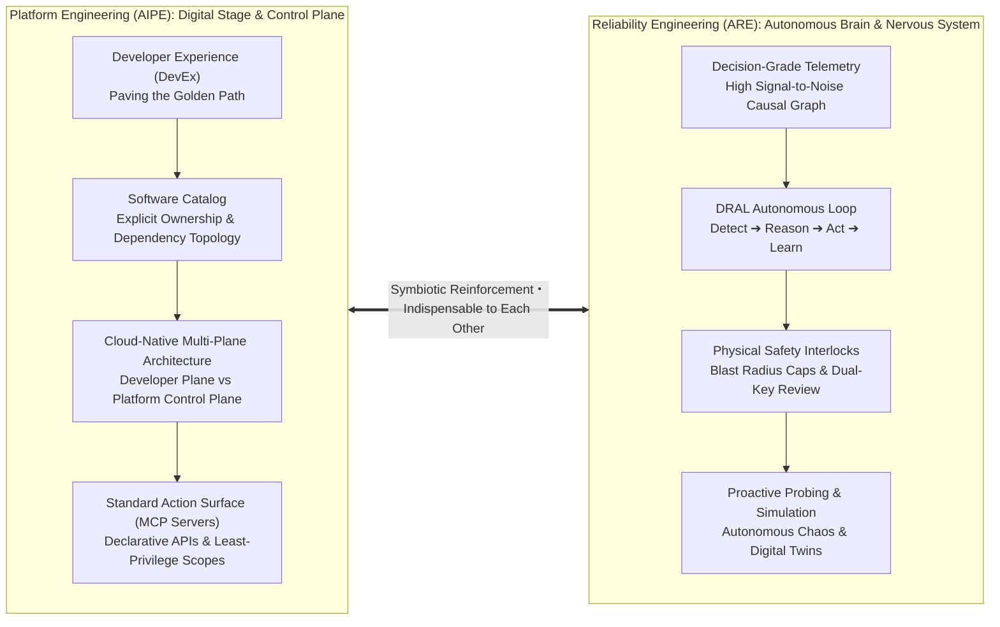
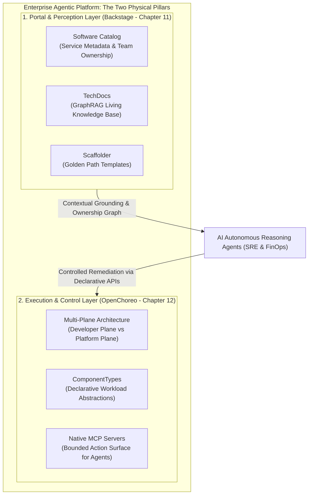
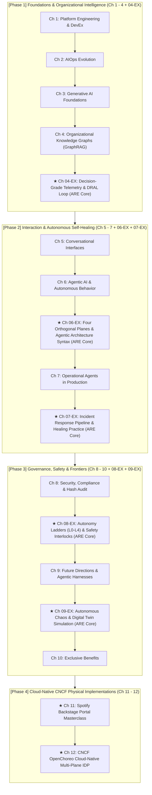

# PREFACE

# Architecture Guide: The Dual-Helix of Platform & Reliability Engineering — With the Foundations of Backstage and OpenChoreo

Welcome to this comprehensive architectural guide tailored for cloud-native architects, platform engineers, and SRE leaders in the era of artificial intelligence.

When browsing the table of contents of this work, several foundational questions may immediately arise:

1. **"Why does this book explore Platform Engineering on one hand, while extensively interweaving extension chapters from Reliability Engineering (ARE) on the other?"**
2. **"In the cloud-native open source ecosystem, what roles do Spotify Backstage and CNCF OpenChoreo play? Why are they the indispensable engineering cornerstones of these two theoretical systems?"**
3. **"Amidst the relentless hype surrounding LLMs, AI Agents, and AIOps, how can enterprise teams cut through the noise to build an autonomous platform that is secure, provably resilient against cascading outages, and delivers genuine business value?"**

This foreword deconstructs the overarching architecture of this entire work and sheds light on the most decisive paradigm shift in modern cloud-native software engineering.

---

# 1. The Stage and the Brain: The Inevitable Convergence of the Dual Helix

Over the past decade, software engineering organizations have operated across an artificial divide:

* **Platform Engineering Teams** concentrated on "Day-0 / Day-1 Developer Experience": constructing Internal Developer Portals (IDPs), providing standardized scaffolding templates, and optimizing CI/CD pipelines to pave the "Golden Path" and slash developer cognitive load.
* **Site Reliability Engineering (SRE) Teams** guarded "Day-2 Production Battlegrounds": glued to Grafana dashboards, responding to midnight PagerDuty alerts, drafting manual postmortems, and putting out fires across labyrinthine microservice meshes.

However, as systems scaled into thousands of interconnected services and large language models (LLMs) with agentic architectures entered operations, **the traditional boundary between these two domains dissolved completely**:

### Why Platform Engineering Needs Reliability Engineering
A platform that merely vends portal forms is little more than a glorified ticketing system. If the platform cannot perceive runtime health or autonomously remediate production incidents, it can never resolve the scalability crisis confronting modern operations. **Agentic Reliability Engineering (ARE)** breathes life into the platform—injecting **Decision-Grade Telemetry**, the **DRAL Autonomous Loop**, **5 Agentic SLOs**, and **Proactive Chaos Probing**, transforming a static platform into a **Cognitive Platform** capable of neural reflex and self-healing.

### Why Reliability Engineering Needs Platform Engineering
Conversely, operational agents detached from platform engineering are a disaster waiting to happen. Without a centralized software catalog, an AI agent cannot determine which engineer owns a failing service. Without sandboxed multi-plane abstractions and standard Model Context Protocol (MCP) tool surfaces, agents are forced to execute raw, dangerous `kubectl` or shell commands with unconstrained privileges. **Platform engineering equips AI agents with verified identity, clean contextual grounding, bounded action surfaces, and inviolable physical safety guardrails.**

> **"Platform engineering erects the stage; reliability engineering endows the actor with intellect. Like a dual helix, they intertwine to construct the next generation of autonomous cloud-native operations."**

---

# 2. De-Mystifying the Foundations: Why Backstage and OpenChoreo?

When engineers study architectural literature, they often encounter a stark gap between abstraction and reality: theoretical treatises use vendor-neutral terms such as "internal developer portal," "software catalog," and "platform control plane." Yet any engineering team returning to the trenches must immediately answer a concrete question:

> **"What open-source software do we actually deploy to realize this? Which API do our AI agent's MCP tools invoke?"**

This is precisely why this work features dedicated master chapters on **Spotify Backstage (Chapter 11)** and **CNCF OpenChoreo (Chapter 12)**. They represent the **two primary open-source physical pillars** that make these theoretical frameworks tangible in the real world.

### 1. Spotify Backstage (Chapter 11): The Perception & Memory Engine

* **Providing Ownership Intelligence**: ARE Chapters 3 and 4 insist that AI diagnostics must never stop at ephemeral IPs or Pod names. Backstage's `catalog-info.yaml` maps services, APIs, and dependencies to human engineering teams, enabling agents to pinpoint responsible teams and upstream blast radiuses within seconds of an incident.
* **Providing Verified Knowledge Corpora**: In Chapter 4's GraphRAG implementation, the authoritative knowledge source is Backstage TechDocs (docs-like-code). Agents no longer crawl stale wiki pages; they reason over version-controlled architectural decision records (ADRs) and runbooks.

### 2. CNCF OpenChoreo (Chapter 12): The Execution Substrate & Safety Gloves

* **Realizing Multi-Plane Decoupling**: ARE Chapter 6 defines the separation of Signals, Reasoning, Execution, and Governance planes. OpenChoreo natively implements this physical isolation in Kubernetes—developers interact exclusively with clean `Component` abstractions, while platform controllers and agents operate behind the scenes.
* **Vending Native Model Context Protocol (MCP)**: AI agents must never execute arbitrary shell scripts. OpenChoreo packages operations like canary rollback, traffic shifting, and autoscaling into standard MCP tools, strictly governed by multi-tenant RBAC and quota enforcement.

---

# 3. Book Architecture Map and Reading Pathways

To assist practitioners navigating this body of work, the book is structured across a four-stage architectural continuum:

### 🎯 Recommended Reading Pathways by Role:

* **For Platform Architects**:
  - Focus Path: `Ch 1` ➔ `Ch 4` ➔ `Ch 06-EX (Four Orthogonal Planes)` ➔ `Ch 11 (Backstage)` ➔ `Ch 12 (OpenChoreo)` ➔ `Ch 08-EX (Autonomy Ladder)`.
  - Core Goal: Establish single-pane-of-glass portals, decouple developer and platform planes, and enforce deterministic guardrails around AI tool calls.

* **For Site Reliability Engineers & Operations Leads**:
  - Focus Path: `Ch 04-EX (Decision-Grade Telemetry)` ➔ `Ch 06-EX (Plane Syntax)` ➔ `Ch 7` ➔ `Ch 07-EX (Incident Response Pipeline)` ➔ `Ch 09-EX (Autonomous Chaos & Digital Twins)`.
  - Core Goal: Master the DRAL loop, distinguish transient mitigations from permanent remediation, employ TTL-bounded MCP tools, and simulate edge cases in digital twins.

* **For Engineering Executives (VPs of Engineering / CTOs)**:
  - Focus Path: `This Foreword` ➔ `Ch 2` ➔ `Ch 8` ➔ `Ch 08-EX` ➔ `Epilogue`.
  - Core Goal: Grasp total cost of ownership, trust telemetry (Acceptance Rate ARR / Override Rate OR), immutable blast radius controls, and organizational evolution toward cognitive self-adaptation.

---

# 4. To the Engineers Shaping Tomorrow

We stand at the threshold of a historic engineering transition. For decades, systems were sharply bifurcated between cold, deterministic code and overworked human operators. Today, autonomous cognitive agents traverse our deployment pipelines, portals, and Kubernetes clusters.

Yet the timeless principle emphasized throughout these pages remains paramount:

> **"Engineering trust is never built on naive optimism; it is grounded in strictly bounded scopes, deterministic physical safety interlocks, and rigorous empirical validation."**

May this work serve as your most grounded, clear-eyed, and dependable architectural companion as you forge enterprise-grade autonomous platforms for the modern age.
