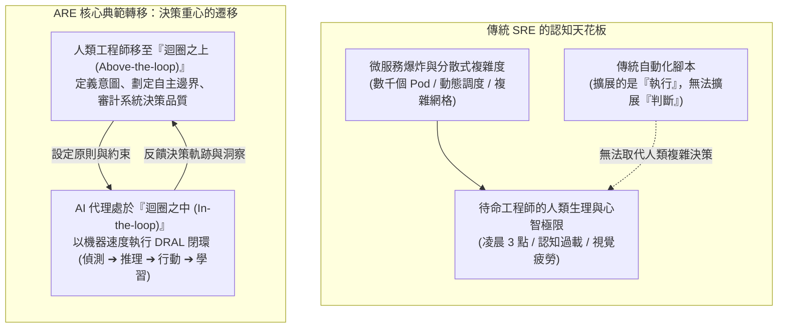
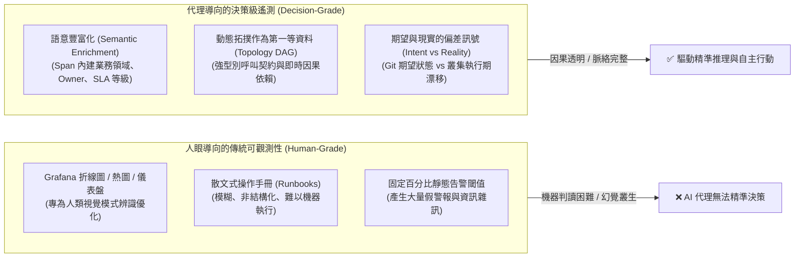
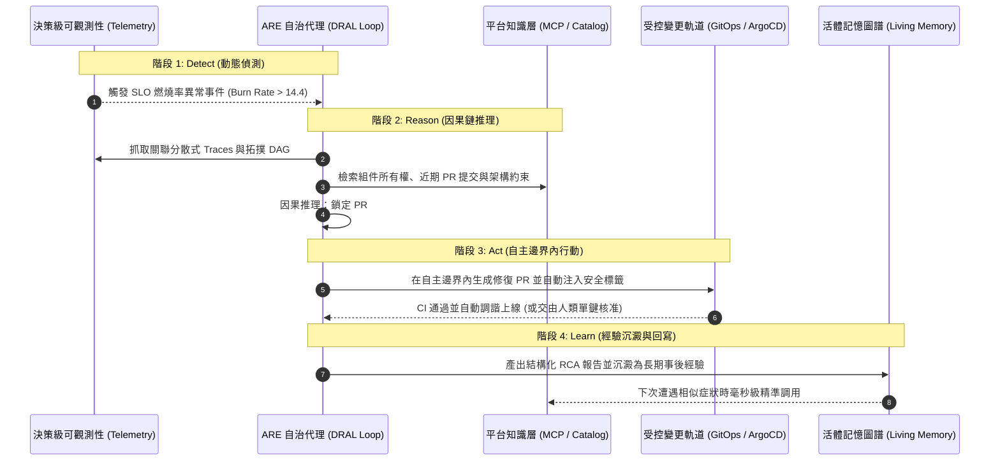

# 04-EX

# 從組織知識到決策級遙測：代理式可靠性（ARE）與 DRAL 自治閉環

在本書第 4 章中，我們深入探討了如何利用檢索增強生成（RAG）與模型上下文協議（MCP），將企業內部的技術文檔、服務目錄與程式碼範本轉化為機器的「靜態組織記憶」。我們學會了如何讓 AI 代理在回答問題或起草架構時，能夠準確引用組織現有的標準規範。

然而，當我們試圖將這種「靜態知識」直接推進到即時生產環境的排障與維運時，幾乎所有工程團隊都會立刻遭遇一道難以逾越的認知斷層：

> **「靜態知識能告訴 AI 代理『系統當初是怎麼設計的』，但它無法告訴代理『系統此時此刻在壓力下究竟發生了什麼事』。」**

想像一下這樣的場景：凌晨三點，監控告警突然響起，核心交易服務的錯誤率瞬間飆升至 25%。此時如果你呼叫一個只具備靜態 RAG 知識的 AI 助理，詢問它：「*系統出什麼事了？該怎麼修復？*」
助理可能會調取 Wiki 裡寫得極為漂亮的架構圖，洋洋灑灑地列出：「*請檢查資料庫連線池設定、檢查 Redis 叢集健康狀態、檢查微服務負載...*」——這是一份在理論上完全正確、但在真實事故現場卻毫無用處的「廢話清單」。因為在分秒必爭的故障現場，工程師真正需要的不是**教科書式的可能性枚舉**，而是**穿透龐雜雜訊、直擊唯一根因的精確判斷**。

這正是新興學科——**代理式可靠性工程（Agentic Reliability Engineering, ARE）**（源自 O'Reilly 經典著作）與平台工程產生強大交會的關鍵契機。

本章作為第 4 章的延伸實踐篇，將帶你跨越「靜態文檔檢索」的盲區，深入探索如何為 AI 代理注入**「決策級遙測（Decision-Grade Telemetry）」**，剖析驅動自主自癒的 **DRAL 認知迴圈（Detect-Reason-Act-Learn）**，並引入衡量 AI 判斷品質的**五大代理式可靠性指標（Agentic SLOs）**。

---

# 認知天花板：為什麼傳統 SRE 自動化必須演進？

要理解代理式可靠性，必須先看清傳統站點可靠性工程（Site Reliability Engineering, SRE）在現代微服務架構中所頂撞到的天花板。



## 自動化擴展的是「執行」，而非「判斷」
過去十年間，業界開發了無數的自動化運維工具：自動重開 Pod、自動擴展節點、自動觸發備援切換。然而，這些自動化工具本質上是**確定性的條件分支（If-This-Then-That）**。

當線上事故以全新的未知形態（Unknown-Unknowns）爆發時——例如跨多個服務的串聯超時、快取擊穿伴隨資料庫死鎖——傳統腳本瞬間失效。最終，所有的警報依然會匯聚成刺耳的 PagerDuty 呼叫，把人類工程師從睡夢中叫醒。

SRE 遭遇的瓶頸並非工具不足，而是一道**「認知天花板」**：

1. **警報疲勞（Alert Fatigue）**：人類的注意力預算（Attention Budget）是極其有限的。當一場雪崩引發上百個微服務同時告警時，人類眼球根本不可能在幾分鐘內消化全部資訊。
2. **診斷孤島**：每位工程師的大腦中只儲存了自己負責模組的心理模型（Mental Model）。跨團隊事故往往演變成冗長的跨小隊「會議排障拉鋸戰」。

## 典範轉移：從「人在迴圈中」到「人在迴圈上」
《代理式可靠性工程》確立了一項革命性的思維轉變：**當系統複雜度超越人類直覺時，我們必須允許 AI 代理成為迴圈核心的常態行動者。**

* **迴圈之上的人類（Human-above-the-loop）**：人類工程師不再親自去盯儀表板、手動敲指令救火；而是站在系統上方，負責**定義系統的可靠性意圖（SLO）**、**劃定嚴格的「自主邊界（Autonomy Boundary）」**，並審查代理決策的品質。
* **迴圈之中的代理（Agent-in-the-loop）**：AI 代理以毫秒級的速度實時分析百萬條遙測數據，在授權邊界內主動推理、定位根因並實施止血變更。

---

# 核心基質：從「人眼儀表板」到「決策級遙測」

如果 AI 代理要承擔起複雜的事故推理責任，它究竟該看什麼資料？

這就是本書第 4 章知識庫與真實生產現場的關鍵交匯點：**今日的可觀測性資料，90% 以上是為了「人類肉眼」而優化的，對 AI 代理而言充滿了噪音。**



## 什麼是「決策級遙測（Decision-Grade Telemetry）」？

在 ARE 學科體系中，決策級遙測指的是**「從採集的第一刻起，就是為了供『必須做出決策』的演算法或 AI 代理使用，而非僅僅為了供『用眼睛觀看』的人類使用」**的結構化訊號。

它具備三大剛性特質：

### 1. 語意豐富化（Semantic Enrichment）
傳統的 Distributed Trace 只記錄了 `HTTP GET /api/v1/orders` 與耗時 `120ms`。對 AI 代理來說，這只是無意義的數字。
決策級遙測要求在遙測產生的瞬間，透過 OpenTelemetry 屬性注入完整的組織脈絡：

* `business.domain`: `ecommerce-checkout`
* `service.tier`: `tier-1-critical`
* `service.owner`: `team-order-platform`
* `sla.latency_target_ms`: `80`
* `git.commit_sha`: `a8f3d1b`
* `deployment.environment`: `production-us-east`

當 AI 代理抓取到這條 Span 時，它不需要再去翻找第 4 章的靜態架構文檔，**遙測資料本身就自帶了完整的上下文與責任歸屬**！

### 2. 動態拓撲作為第一等資料（Topology as First-Class Data）
人類工程師依賴腦海中的記憶來拼湊服務呼叫鏈。而 AI 代理需要的是機器可讀的**即時依賴有向無環圖（Dynamic DAG）**。
決策級遙測將服務之間的呼叫關係、依賴權重、降級策略（Fallback）作為第一等公民結構化暴露。當下游資料庫變慢時，代理能沿著拓撲圖瞬間推導出全系統的影響傳播路徑。

### 3. 意圖與現實的偏差訊號（Intent vs. Reality）
最致命的線上事故往往源於「期望狀態」與「真實狀態」的脫節。決策級遙測緊密結合了本書探討的 GitOps 概念：

* **意圖（Intent）**：Git 儲存庫中宣告的副本數、CPU Limit 與逾時參數。
* **現實（Reality）**：叢集內實際運行的 Pod 資源消耗與網路延遲。
* **偏差訊號**：系統主動向 AI 代理暴露兩者之間的漂移差值，讓代理能一眼看穿是程式碼 Bug、配置漂移，還是底層基礎設施故障。

---

# 自治大腦運作架構：DRAL 認知閉環

有了決策級遙測作為基質，AI 代理究竟如何展開行動？

《代理式可靠性工程》提出了一套標準的運作原型——**DRAL 迴圈（Detect ➔ Reason ➔ Act ➔ Learn）**。它是驅動平台自主維運的神經中樞：



## 1. 偵測（Detect）：告別靜態閾值，擁抱動態 SLO 燃燒率
傳統監控依賴「CPU > 85% 就告警」，往往引發大量無效噪音。DRAL 迴圈的偵測層立足於 **SLO 錯誤預算燃燒率（Error Budget Burn Rate）**。
只有當使用者體驗真正受損、且錯誤預算正以危險速率消耗時，偵測模組才會喚醒 AI 代理，並同時打包該時刻前後 5 分鐘的高維度遙測快照，省去代理盲目摸索的時間。

## 2. 推理（Reason）：從「統計關聯」走向「因果鏈分析」
過去的 AIOps 往往只做單純的關聯分析（Correlation）：「*A 服務延遲變高的同時，B 節點的磁碟 IO 也升高了，所以兩者有關聯*」——這種推論經常被偶發雜訊所誤導。
在 DRAL 迴圈中，代理結合了第 4 章的 MCP 實體模型與第 11 章的 Backstage 目錄，沿著服務調用契約執行**因果分析（Causal Analysis）**：

* 追蹤 Trace 中的 Parent-Child 呼叫鏈；
* 排查下游相依元件的健康指標；
* 比對最近 1 小時內是否有新發布的 Git Commit 或 Feature Flag 變更；
* 最終輸出唯一的故障因果鏈路（Root Cause Chain）。

## 3. 行動（Act）：嚴守「自主邊界」與「受控變更軌道」
當代理完成診斷後，它該如何行動？

* **自主邊界（Autonomy Boundary）**：平台團隊預先為代理設定剛性權限邊界。例如：
  - *Tier-3 非核心服務*：允許代理自主重啟 Pod、回滾上一版鏡像，完全無須人類介入。
  - *Tier-1 核心支付服務*：代理僅被允許執行唯讀診斷，或產生修改配置的 Pull Request，必須由待命工程師點擊核准。
* **行動落地**：正如本書全書貫穿的原則——**變更絕不直接寫入叢集，一律透過 GitOps（ArgoCD）或標準 Scaffolder 範本開立 PR 落地**，確保每一次自癒行動皆有跡可循。

## 4. 學習（Learn）：將事後經驗自動轉化為組織資產
事故解決並非終點。傳統團隊往往在事故過後寫了一份 PDF 檢討報告，隨後將其束之高閣。
在 DRAL 迴圈中，代理會自動將本次事故的**故障特徵、遙測指紋、根因鏈條與修復補丁**，格式化為機器可讀的結構化知識條目，自動回寫至第 9 章所探討的**活體記憶圖譜（Living Memory Graph）**。
當數月後其他團隊遇到類似的故障模式時，AI 代理能在幾毫秒內匹配出歷史記憶，實現組織智慧的實質自我演進！

---

# 如何衡量 AI 的推理品質？五大代理式可靠性指標（Agentic SLOs）

引進 AI 代理後，許多工程主管最常問的問題是：**「我們該如何科學地評估這套 AI 維運系統究竟是資產還是負擔？它有沒有在線上幫倒忙？」**

傳統 SRE 的指標（如 99.9% Availability、MTTD、MTTR）衡量的是底層系統的表現，而無法衡量「代理大腦」本身的推理優劣。《代理式可靠性工程》為業界奠定了**五大旗艦級代理式 SLO（Agentic SLOs）**：

| 指標名稱 | 代號 | 核心衡量問題 | 實務目標基準線 |
| :--- | :--- | :--- | :--- |
| **自主解題率**<br>Autonomous Resolution Rate | **ARR** | 在觸發的全部線上事故中，有多少比例是**完全由代理在安全邊界內自主閉環修復成功**，無需人類工程師介入救火？ | 生產環境成熟期目標：**60% ~ 80%** |
| **決策品質目標**<br>Decision Quality SLO | **DQ-SLO** | 代理所推導出的根本原因與生成的修復提案，**經過人類複核或執行驗證後的正確率**為何？（嚴防模型幻覺引發二次災難） | 剛性防守基準：**≥ 95%** |
| **推理延遲目標**<br>Reasoning Latency SLO | **RL-SLO** | 從異常偵測事件觸發，歷經遙測檢索、因果推理到產出首個修復處方，**代理總共消耗了多少時間**？ | 高優先級事故：**< 45 秒** |
| **自主升級求助率**<br>Autonomy Escalation SLO | **AE-SLO** | 當代理面對未知情境、置信度不足或面臨越界風險時，**能否及時且優雅地主動向人類求助**，而非死撐蠻幹？ | 期望高置信升級：**100% 遵守防護欄** |
| **上下文效率**<br>Context Efficiency | **CE** | 代理在完成單次事故診斷的過程中，**以最小的 Token 與工具調用代價換取破案**的經濟性指標。 | 單次破案平均工具調用：**≤ 8 次** |

### 為什麼這五大指標能顛覆平台治理？
1. **防止「瞎忙代理（Thrashing Agent）」**：如果一個代理調用了 50 次 MCP 工具、消耗了幾十萬 Token，卻給出錯誤的診斷，它的 **CE** 與 **DQ-SLO** 會亮紅燈，促使平台工程師收斂其提示詞與工具集。
2. **漸進式信任建立**：團隊在剛導入 AI 時，可以將自主邊界設得很窄；當數據顯示該代理連續三個月的 **DQ-SLO 達到 98%** 時，平台主管就有充分的數據信心逐步擴大其 ARR 授權範圍。

---

# 實戰示範：用 OpenTelemetry 與 MCP 打造決策級遙測管線

現在，讓我們將這些深刻的理論落地為具體的技術實作。我們該如何改造 OpenTelemetry Collector 與 MCP 伺服器，讓 AI 代理能夠直接讀取「決策級遙測」？

## 1. OpenTelemetry 語意豐富化處理器配置

在 Kubernetes 的 OpenTelemetry Collector 配置中，透過 `transform` 處理器為所有經過的 Trace 自動注入第 4 章的組織維度：

```yaml
apiVersion: v1
kind: ConfigMap
metadata:
  name: otel-collector-config
  namespace: platform-system
data:
  otel-collector-config.yaml: |
    receivers:
      otlp:
        protocols:
          grpc:
          http:

    processors:
      # 關鍵：決策級遙測語意豐富化處理器
      transform:
        error_mode: ignore
        trace_statements:
          - context: span
            statements:
              # 自動從 Kubernetes 標籤中提取業務領域與服務分級
              - set(attributes["platform.tier"], "tier-1-mission-critical") where attributes["k8s.namespace.name"] == "production-checkout"
              - set(attributes["platform.owner_team"], "team-checkout") where attributes["service.name"] == "order-service"
              - set(attributes["platform.slo_budget_burn"], "active") where attributes["http.status_code"] >= 500

      batch:
        timeout: 1s
        send_batch_size: 256

    exporters:
      prometheus:
        endpoint: "0.0.0.0:8889"
      otlp/storage:
        endpoint: "tempo:4317"
        tls:
          insecure: true

    service:
      pipelines:
        traces:
          receivers: [otlp]
          processors: [transform, batch]
          exporters: [otlp/storage]
```

## 2. 宣告 MCP 決策級遙測工具

在平台團隊開發的 MCP 伺服器中，為 AI 代理暴露一組具備**因果拓撲查詢能力**的強型別工具（而非讓代理去執行低階的 SQL 或 PromQL）：

```typescript
import { McpServer } from "@modelcontextprotocol/sdk/server/mcp.js";
import { z } from "zod";

const server = new McpServer({
  name: "platform-decision-telemetry-mcp",
  version: "1.0.0"
});

// 暴露專供 AI 決策使用的根因分析工具
server.tool(
  "analyze_service_incident",
  "獲取指定服務近期之決策級遙測因果鏈，包含依賴拓撲、異常 Trace ID 與期望配置偏差",
  {
    serviceName: z.string().describe("發生異常之微服務唯一識別碼，例如 order-service"),
    timeWindowMinutes: z.number().default(15).describe("診斷時間窗口（分鐘）")
  },
  async ({ serviceName, timeWindowMinutes }) => {
    // 1. 查詢該服務在即時拓撲中的下游相依
    const topology = await fetchServiceTopology(serviceName);
    
    // 2. 檢索 OTel 中帶有 platform.slo_budget_burn 標記的典型錯誤 Span
    const criticalSpans = await fetchCriticalTraces(serviceName, timeWindowMinutes);
    
    // 3. 查詢 GitOps 倉庫比對近 1 小時內的 Commit 變更偏差
    const configDrift = await detectGitOpsDrift(serviceName);

    return {
      content: [
        {
          type: "text",
          text: JSON.stringify({
            service: serviceName,
            status: "ANALYSIS_COMPLETE",
            topologyGraph: topology,
            causalIndicators: {
              failingDownstream: "payment-gateway-proxy",
              exceptionPattern: "ConnectionTimeoutException: pool exhausted",
              recentDeploymentDiff: configDrift.latestCommit
            },
            prescribedActionBoundary: "CAN_PROPOSE_PULL_REQUEST"
          }, null, 2)
        }
      ]
    };
  }
);
```

當 AI 代理透過 MCP 調用此工具時，它在單次往返（One Round-Trip）內就同時拿到了**「拓撲依賴 + 異常因果特徵 + GitOps 變更歷史」**，以極致的 **Context Efficiency（CE）** 實現了精準破案！

---

# 讀者筆記：從從業者視角看第 4-EX 章

> **「沒有決策級遙測的 AI 代理，只是一隻在生產環境中蒙著眼睛亂撞的無頭蒼蠅；有了因果閉環，它才能成為值得信賴的副駕駛。」**

### 💡 讀者思維：在「擴展判斷」的時代重新思考平台價值
平台工程在前幾個章節給人的印象，往往偏向「為人類開發者鋪路（Golden Path）」與「搭建漂亮的 Backstage 門戶」。而第 4-EX 章帶來了震撼的思維昇華：**未來的內部平台，其第一受眾將不僅僅是人類工程師，更是自主運作的 AI 代理！**
如果你的平台只懂得產出畫給人眼看的圖表，你的團隊就永遠無法擺脫半夜被 PagerDuty 叫醒的輪迴。將組織知識（第 4 章）與即時遙測結合為「決策級資料」，才是通往自主運維的終極坦途。

### 🎯 核心精華萃取
1. **靜態與動態的陰陽合璧**：
   - 第 4 章的 RAG / MCP 提供「系統應該長怎樣（空間幾何架構）」；
   - 本章的決策級遙測提供「系統當前處於何種應力狀態（時間動力學）」；
   - 兩者結合，AI 代理才能具備真正的「情境感知能力（Situational Awareness）」。
2. **DRAL 迴圈是自癒的核心心跳**：
   - 偵測（基於 SLO 燃燒率） ➔ 推理（沿著拓撲做因果鏈分析） ➔ 行動（在自主邊界內透過 GitOps 改寫） ➔ 學習（回寫活體記憶）。
3. **用科學度量替代盲目迷信（五大 Agentic SLOs）**：
   - 導入 AI 維運時，不要只看噱頭 Demo；用 **ARR（解題率）**、**DQ-SLO（正確率）** 與 **CE（Token 效率）** 作為工程評估的硬指標。

### ⚠️ 實務踩坑警報
* **「全量日誌灌模型」的破產陷阱**：試圖直接把十幾萬行的原始日誌全部塞進 LLM 上下文，不僅推論延遲飆到 2 分鐘以上，巨額的 Token 帳單更會讓專案直接夭折；必須透過 OpenTelemetry Collector 在邊界處完成語意精煉。
* **忽略「自主邊界」的脫韁風險**：在代理未經充分驗證（DQ-SLO < 95%）前，嚴禁授予其直接寫入生產叢集的權限；一律要求透過 GitOps 發起 Pull Request 由人類複核。

### 🛠️ 明日行動清單
* [ ] 檢視自家目前的 OpenTelemetry / Prometheus 採集規則：除了常規的 CPU/記憶體之外，是否已在 Span 屬性中注入了 `team.owner`、`service.tier` 等組織語意標籤？
* [ ] 與 SRE 團隊盤點過去半年最頻繁發生的前 3 類線上故障：梳理其因果排查路徑，嘗試將其定義為標準的 DRAL 推理流程。
* [ ] 在既有的平台 MCP 伺服器中，實作一個能聚合「服務依賴拓撲 + 期望配置狀態」的高階診斷 Tool，為第 5 章與第 7 章的維運代理鋪好決策基石。

---

# 延伸閱讀

* **《代理式可靠性工程》中文譯本線上閱讀版**：深入探索 O'Reilly 經典著作中的自主混沌工程、事故管線與決策級架構：[https://tedmax100.github.io/agentic-reliability-engineering-zh-tw/](https://tedmax100.github.io/agentic-reliability-engineering-zh-tw/)
* **OpenTelemetry 語意慣例（Semantic Conventions）官方規範**：深入理解如何為分散式系統注入標準化業務脈絡：[https://opentelemetry.io/docs/specs/semconv/](https://opentelemetry.io/docs/specs/semconv/)
* **Google Cloud SRE 專著：Implementing Service Level Objectives**：深入探討錯誤預算燃燒率（Burn Rate）與多維度告警設計：[https://sre.google/workbook/implementing-slos/](https://sre.google/workbook/implementing-slos/)
