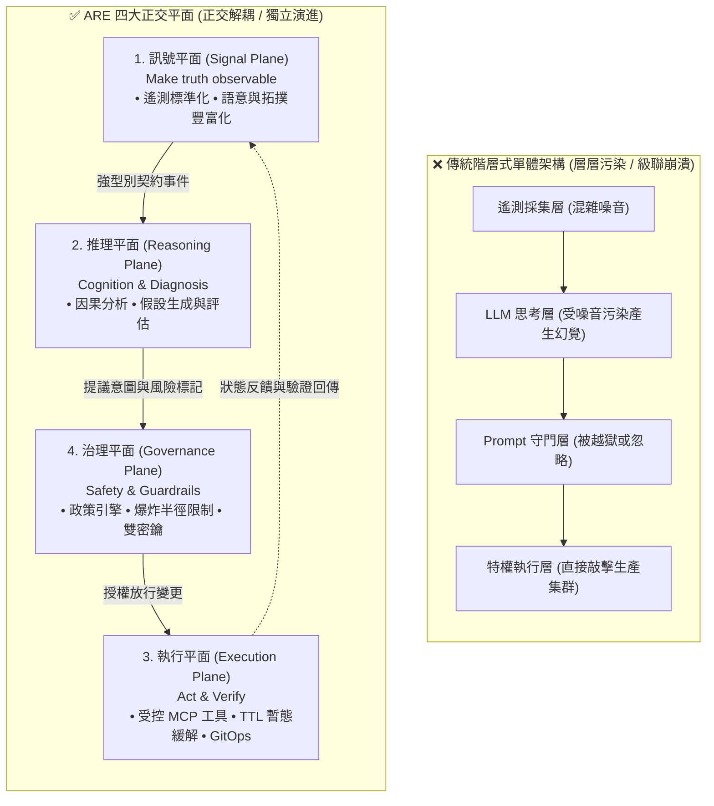
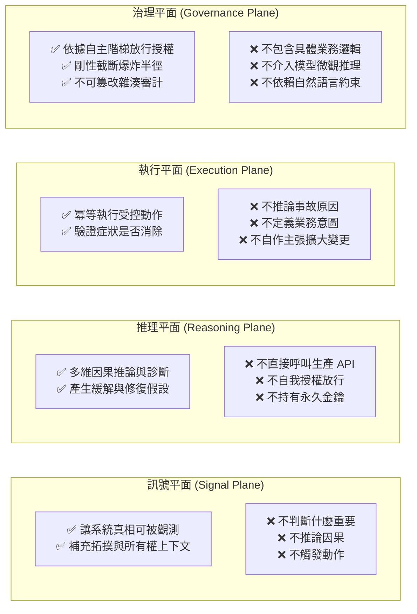
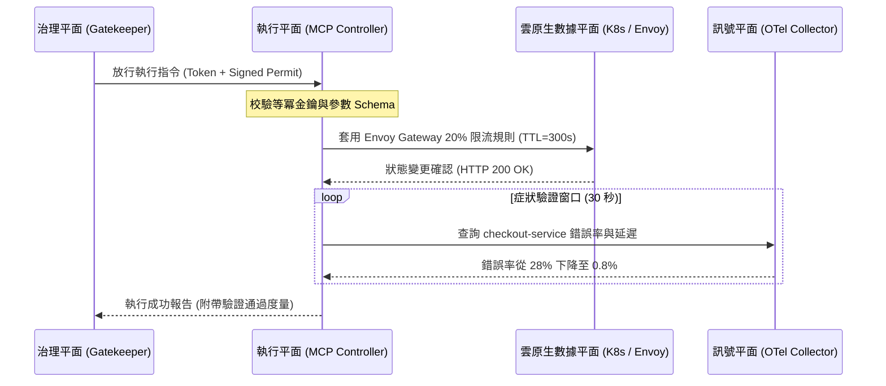
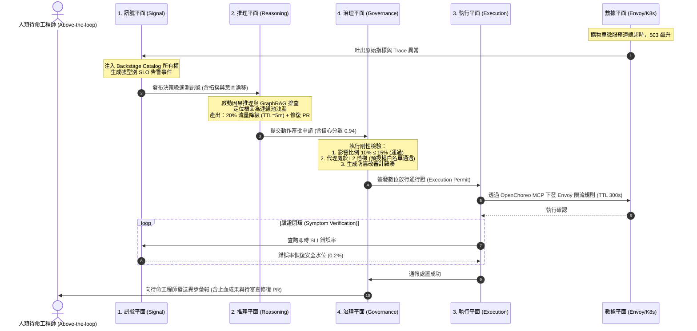

# 06-EX

# 代理式架構語法：訊號、推理、執行、治理四大正交平面的平台解耦實戰

在本書第 6 章中，我們確立了代理式 AI 作為 DevOps 演進下一階段的關鍵地位，剖析了從單一使用者的個人代理（如 OpenClaw 與 `SKILL.md`）邁向多人共享的生產級代理所需的嚴格基語：記憶、工具、排程與治理。

然而，當許多工程團隊嘗試在內部平台中落地自主代理時，最常犯下的致命架構錯誤，就是**「建構出一個全知全能的單體 AI（Monolithic Agent）」**：

```
[原始遙測/告警] ──> ( 單體大模型代理：同時看指標、推理根因、自行下 kubectl 指令、在 Prompt 裡要求自己守法 ) ──> [生產環境崩潰]
```

在這種單體代理架構下：
* 代理同時連接著未經清洗的高噪聲監控資料；
* 代理使用未受約束的自然語言在大模型內部進行發散思考；
* 代理手握最高權限的 Token 或 `kubectl` 直連生產叢集；
* 所有的安全與合規完全寄託於 Prompt 中的一句「*請務必小心操作，切勿刪除重要資料*」。

這種設計一旦進入高並發、高動態的雲原生微服務現場，必然引發災難性的連鎖反應——幻覺導致的誤刪除、驚群效應打垮資料庫、以及完全無法被審計的黑盒操作。

這正是**《代理式可靠性工程》（Agentic Reliability Engineering, ARE）**第 6 章「代理式可靠性系統的架構（Architecture of Agentic Reliability Systems）」為整個工程界確立的劃時代架構語法：**將代理式系統徹底解耦為四個「正交平面（Orthogonal Planes）」——訊號平面（Signal Plane）、推理平面（Reasoning Plane）、執行平面（Execution Plane）與治理平面（Governance Plane）**。

本章將帶你跳脫玩具級別的單體代理泥淖，深入剖析這四大平面的架構職責、正交鐵律，並展示平台工程如何作為堅實的底座，將這套高可靠性語法在雲原生生態中優雅落地。

---

# 為什麼是「平面（Planes）」而非「階層（Layers）」？

在傳統軟體工程中，我們習慣採用「階層式架構（Layered Architecture）」，如展示層、業務邏輯層、資料存取層。然而，在構建自主維運代理時，**階層架構是極度危險的**。

階層架構隱含了「上下相依」與「失效向上傳染」的致命特質：如果底層遙測壞掉，錯誤會依序向上污染推理，最終導致頂層執行失控。

ARE 刻意採用了電信網路與分散式系統中的**「平面（Plane）」**哲學：



### 平面架構的三大正交鐵律：

1. **正交性（Orthogonality）**：每個平面各司其職，只透過強型別契約（Strongly-Typed Contracts）跨界相交。一個平面的崩潰或雜訊，絕不能自動破壞其他平面的完整性。
2. **故障隔離（Fault Isolation）**：損壞的訊號絕不能直接觸發執行；發散的推理不能直接持有生產權杖；而**治理平面的政策收緊，絕不應該逼迫工程師去重寫推理模型或執行平面的 MCP 工具碼**。
3. **異步演進（Decoupled Evolution）**：你可以隨時升級推理平面的大模型（從 Claude 3.5 升級到 GPT-5 或 Gemini 2.0），而無需改動執行平面的 Kubernetes Operator 或治理平面的 OPA 規則。

---

# 四大平面的職責鐵律與架構邊界

為了讓四平面在平台工程中真正發揮約束效能，我們必須為每一個平面劃定不可逾越的「做什麼（Must-Do）」與「絕不做什麼（Never-Do）」邊界：



---

## 1. 訊號平面（Signal Plane）：還原真相的客觀鏡子

訊號平面的神聖職責是：**讓系統的客觀真相可被觀測（Make Truth Observable）**。

在傳統維運中，訊號往往是一堆未經加工的 Prometheus 時序數值、散落各處的日誌文件與無頭 Distributed Traces。這些資料充滿了人類工程師為「看儀表板」所設計的妥協。

在代理式架構中，訊號平面必須完成三大轉化（呼應本書第 4 章延伸篇的決策級遙測）：
1. **正規化（Normalization）**：統一遵循 OpenTelemetry（OTel）語意規範，抹平不同中間件的語法差異。
2. **語意豐富化（Semantic Contextualization）**：在遙測資料產生的第一時間，透過 Backstage Software Catalog 注入服務所有權（Owner Team）、生命週期階級（Tier-1 Critical）以及依賴拓撲。
3. **偏差偵測（Intent vs. Reality Drift）**：實時比對 Git 宣告的期望狀態與叢集運行時的實際狀態，將其轉化為離散的漂移事件（Drift Events）。

### 訊號平面的標準強型別輸出清單：
```json
{
  "$schema": "https://specs.choreo.dev/telemetry/v1/signal.json",
  "signal_id": "sig-prod-checkout-88392",
  "timestamp": "2026-10-26T14:32:00Z",
  "type": "SLO_BREACH_DETECTED",
  "entity": {
    "service": "checkout-service",
    "project": "core-ecommerce",
    "environment": "production",
    "owner": "team-payment",
    "catalog_ref": "component:core-ecommerce/checkout-service"
  },
  "metrics": {
    "sli_error_rate": 0.28,
    "slo_threshold": 0.005,
    "burn_rate_1h": 14.2
  },
  "correlated_symptoms": [
    "upstream_envoy_503_surge",
    "redis_connection_pool_exhausted"
  ],
  "topology_context": {
    "downstream": ["inventory-api", "payment-gateway", "redis-cluster"],
    "blast_radius_tier": "critical-revenue"
  }
}
```

> **訊號平面鐵律**：訊號平面只報告「客觀事實」，**絕對不推論「誰是罪魁禍首」**，更**絕對不包含任何「下一步該怎麼做」的指令**。

---

## 2. 推理平面（Reasoning Plane）：認知、診斷與假設評估

推理平面是系統的認知大腦。它接收來自訊號平面的客觀事實，結合平台儲存庫中的顯性架構知識（Backstage TechDocs、Git 歷史、OpenAPI 契約），執行深度的**因果推論（Causal Inference）**。

推理平面並不只是一個單純的 LLM API 呼叫，而是一個專精協同的認知迴圈：
1. **症狀反關聯（Symptom De-noising）**：在告警風暴中剔除附帶連鎖反應，鎖定第一觸發源。
2. **假設生成（Hypothesis Generation）**：調取組織記憶（GraphRAG），分析是否為近期的發布、配置漂移或下游網路擁塞引發。
3. **分流處置決策（Mitigation vs. Remediation）**：嚴格依循本書第 7-EX 章原則，優先產出可在 3 分鐘內止血的**暫態緩解提議（Mitigation Proposal）**，次之產出需經同儕審查的**永久修復 PR 提議（Remediation Proposal）**。

### 推理平面的標準決策產出契約：
```json
{
  "$schema": "https://specs.choreo.dev/agentic/v1/decision.json",
  "decision_id": "dec-20261026-091",
  "signal_ref": "sig-prod-checkout-88392",
  "agent_id": "sre-diagnostics-agent-v3",
  "root_cause_hypothesis": "Redis 連線池洩漏引發上游 Checkout Service 執行緒耗盡",
  "confidence_score": 0.94,
  "confidence_rationale": "發現 10 分鐘前發布的 v2.4.1 版本將 pool_timeout 改為 0，引發死鎖連線堆疊",
  "proposed_actions": [
    {
      "phase": "MITIGATION",
      "action_type": "TEMPORARY_TRAFFIC_SHEDDING",
      "tool_target": "openchoreo.gateway/apply_ttl_ratelimit",
      "params": {
        "service": "checkout-service",
        "shed_percentage": 20,
        "ttl_seconds": 300
      },
      "blast_radius_estimate": {
        "affected_instances_ratio": 0.10,
        "risk_tier": "LOW"
      }
    },
    {
      "phase": "REMEDIATION",
      "action_type": "GIT_PULL_REQUEST",
      "tool_target": "openchoreo.gitops/create_fix_pr",
      "params": {
        "repo": "ecommerce/checkout-manifests",
        "branch": "fix/restore-pool-timeout",
        "commit_message": "fix(config): revert pool_timeout back to 2000ms"
      }
    }
  ]
}
```

> **推理平面鐵律**：推理平面只負責**提出假設與行動清單**。無論其信心指數（Confidence Score）高達 0.99 還是 0.50，推理平面**永遠無權直接調用底層基礎設施 API**。

---

## 3. 執行平面（Execution Plane）：受控狀態變更與症狀閉環驗證

執行平面是系統的「雙手」。它將來自推理平面的抽像決策，轉譯為具體的物理狀態變更。

在平台工程視角下，執行平面絕不是允許 AI 隨意 ssh 進機器敲 bash，而是**由現代控制平面（Control Plane）與模型上下文協議（MCP）構建的受約束工具表面**：

1. **強制 MCP 標準化**：所有可用動作被封裝為標準 MCP Tools（例如 `scale_component`、`apply_envoy_filter`、`rollback_release`），具備嚴格的 JSON Schema 參數驗證。
2. **內建等冪性（Idempotency）**：任何操作連續執行兩次，產生的系統狀態完全一致，杜絕因網路逾時重試造成的二次衝擊。
3. **強制暫態 TTL**：所有暫態緩解規則（如限流、熔斷）必須帶有過期時間（TTL），過期由執行平面控制器自動拔除，杜絕隱性技術債。
4. **驗證閉環（Symptom Verification）**：執行平面在動作落地後，立即發起探針：**「驗證該動作是否讓訊號平面的異常指標回穩」**。



> **執行平面鐵律**：執行平面只驗證**「症狀有沒有消失」**，它**不推論因果、不定義意圖**，更不能因執行失敗而擅自替換另一個未經授權的動作。

---

## 4. 治理平面（Governance Plane）：不可逾越的物理安全防線

如果說推理平面是渴望自由創新的油門，治理平面就是**不可妥協的剛性煞車**。

治理平面是整個系統的安全閥與合規裁決中樞。它對推理平面產出的決策抱持徹底的**「零信任（Zero Trust）」**態度。

在本書第 8-EX 章中，我們建立了兩項核心基石，它們在治理平面中被全面落實：

### 1. 自主權階梯判定器（Autonomy Ladder Engine）
治理平面維護了組織的動態自主權矩陣。一個動作是否被允許自動放行，取決於：
$$\text{授權判定} = f(\text{代理當前等級 } L_n, \text{動作風險級別}, \text{歷史決策品質評分 } \text{DQ-SLO})$$

| 自主等級 | 動作範疇 | 治理平面放行規則 |
| :--- | :--- | :--- |
| **L0（唯讀諮詢）** | 診斷報告、分析 Log | 直接放行，純唯讀權限 |
| **L1（輔助起草）** | 建立 PR、起草緩解清單 | 產生草稿，強制等待人類在 Backstage 門戶點選核准 |
| **L2（條件自主）** | 白名單微動作（如針對無狀態 Pod 降級） | 僅在影響實例 $\le 15\%$ 且符合白名單時自動放行；事後 Slack 通報 |
| **L3（高階自主）** | 跨微服務調度、切換流量 | 強制**雙密鑰聯鎖（Dual-Key Interlock）**：必須經由獨立部署的 Safety Critic Agent 驗簽放行 |
| **L4（全自主演進）** | 自適應拓撲調優、主動混沌 | 平台全域監控，觸發全域熔斷絆線（Tripwire）立即降級回 L0 |

### 2. 爆炸半徑剛性截斷（Hard Blast Radius Caps）
治理平面以確定性程式碼（Deterministic Code）構建，絕不使用脆弱的自然語言 Prompt。

```typescript
// 治理平面：API 網關層的剛性前置過濾器
export class GovernancePlaneGuard {
  private readonly MAX_BLAST_RADIUS_RATIO = 0.15; // 嚴格限制最大影響 15%

  public async evaluatePermit(decision: AgentDecision): Promise<PermitResult> {
    // 1. 剛性檢查爆炸半徑
    if (decision.blast_radius_estimate.affected_instances_ratio > this.MAX_BLAST_RADIUS_RATIO) {
      return {
        authorized: false,
        reason: `[GOVERNANCE-REJECTED] 預估影響範圍 (${decision.blast_radius_estimate.affected_instances_ratio * 100}%) 超越法定硬上限 (15%)`
      };
    }

    // 2. 檢查雙密鑰審查核簽 (針對 L3 級別動作)
    if (decision.requires_dual_key) {
      const criticApproval = await this.verifyCriticSignature(decision.decision_id);
      if (!criticApproval.valid) {
        return {
          authorized: false,
          reason: `[GOVERNANCE-REJECTED] 缺乏獨立 Critic Agent 的防護核簽，拒絕放行`
        };
      }
    }

    // 3. 寫入不可篡改審計鏈 (Append-Only Hash Log)
    await this.auditLog.appendRecord({
      decision_id: decision.decision_id,
      action: decision.proposed_actions,
      timestamp: Date.now()
    });

    return { authorized: true };
  }
}
```

> **治理平面鐵律**：治理平面的規則改動（如調低爆炸半徑門檻、調整放行白名單），**絕對不需要重寫任何自動化程式碼或微調大模型**。它只是一組宣告式的策略（Policy-as-Code）。

---

# 實戰全流程：一場線上微服務事故中的四平面協同

讓我們透過一次真實的高並發事故，觀察四大平面如何像齒輪般精確咬合、各守邊界：



在這套端到端管線中：
1. **訊號平面**從未私自決定要重啟 Pod；
2. **推理平面**專注思考因果，沒有碰觸任何生產叢集憑證；
3. **治理平面**用確定性代碼把守最後一道關卡，杜絕越權；
4. **執行平面**僅按章程在防護手套下辦事，並以客觀指標驗證自癒成效；
5. **人類工程師**穩坐於「迴圈之上（Above-the-loop）」，審查報告與永久修復 PR。

---

# 平台工程師的四平面就緒度檢核清單（Readiness Checklist）

在將企業的維運流程交給 AI 代理之前，平台團隊應透過以下檢核清單評估自身的四平面成熟度：

| 平面 | 核心檢驗項目 | 不及格表現（玩具級） | 生產就緒表現（ARE 規範） |
| :--- | :--- | :--- | :--- |
| **訊號平面** | 遙測品質與語意注入 | 僅有裸露的 Prometheus 指標與無結構 Log | 遵循 OpenTelemetry，遙測原生綁定 Backstage 服務目錄與負責人拓撲 |
| **推理平面** | 決策結構與分流機制 | 單一 Prompt 同時處理排查與操作 | 嚴格區分「1~3 分鐘暫態緩解」與「15~30 分鐘修復」，輸出強型別 JSON 決策清單 |
| **執行平面** | 動作受控性與閉環能力 | 代理手握全權 `kubectl` 或 SSH Shell 裸奔 | 透過 Model Context Protocol（MCP）提供標準宣告式工具，動作內建等冪性、TTL 與症狀驗證 |
| **治理平面** | 安全約束實現方式 | 在 Prompt 中進行道德勸說（「請勿刪庫」） | 採用 OPA 或閘道硬體代碼，強制執行 $\le 15\%$ 爆炸半徑上限與 L0~L4 自主權動態階梯 |

---

# 本章小結

將 AI 代理引入現代內部平台，絕不是「接上大模型 API、讓它跑個指令」那麼輕率。如果忽視了架構邊界，機器的速度只會演變為災難的速度。

透過將代理式可靠性系統解耦為**訊號、推理、執行、治理**四大正交平面：
* 平台工程找到了承載自主維運的**結構語法**；
* SRE 團隊找到了防範 AI 脫軌失控的**物理煞車**；
* 企業雲原生架構真正擁有了**演進型、自適應的認知生命力**。

在接下來的*[第 7 章](ch07.html)*與*[第 7 章延伸篇](ch07_ex.html)*中，我們將把這套四平面語法投射到實戰戰場，動手組裝由多代理協同推進的生產級事故應變管線。
