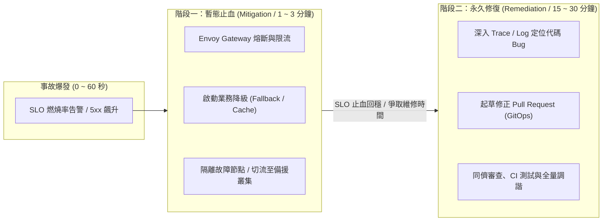
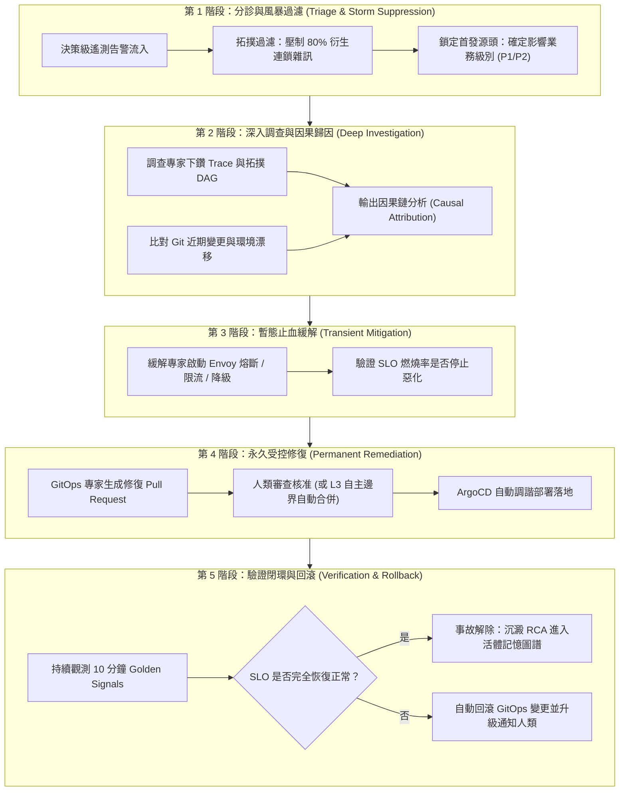
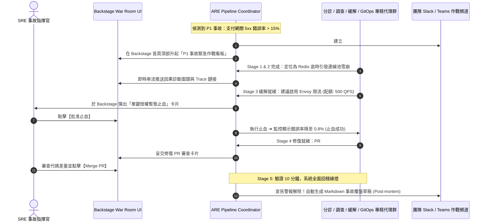

# 07-EX

# 代理驅動的事故應變管線（Incident Pipeline）與生產自癒實戰

在本書第 7 章中，我們帶領讀者完成了一項令人振奮的實戰突破：在本地 `kind` 叢集中，我們搭建了由 `DiagnosticsAgent`（叢集診斷專家）、`GitOpsAgent`（變更提議專家）與 `Coordinator`（協調調度大腦）組成的本地多代理系統。當 `my-first-app` 遭遇映像標籤筆誤（Typo）導致啟動失敗時，這套系統在 5 分鐘內完成了意圖解析、診斷排查，並透過 GitHub Pull Request 與 ArgoCD 調諧成功讓應用恢復綠燈。

這場實戰驗證了「從洞察邁向行動（From Insight to Action）」的可行性。然而，如果我們將這套雛形直接置於真實企業的生產環境（Production）中，面對複雜的多模態大型事故，團隊很快就會發現嚴峻的實戰鴻溝：

> **「在真實生產事故中，問題從來不只是『改一個標籤』那麼單純。當 10 個微服務同時尖叫、當資料庫連線即將雪崩時，SRE 的第一優先順序是『先止血』，而非慢慢花 20 分鐘跑 CI/CD 開 PR！」**

在真實世界中：

1. **告警風暴（Alert Storm）**：底層網路抖動或資料庫延遲，會瞬間引發數十個上游微服務觸發告警，哪一個才是真正肇事的起點？
2. **緩解（Mitigation）vs. 修復（Remediation）的次序倒置**：修復程式碼並合併 PR 需要時間（編譯、測試、審查、發布），但在故障發生的黃金前 3 分鐘，用戶正在大量流失。系統需要的是**毫秒級的暫態止血**（如限流、切換降級模式、分流），而非等待漫長的發布流水線。
3. **驗證防反彈（Verification Loop）**：變更套用之後，系統真的康復了嗎？還是引發了更可怕的隱蔽二次故障？

這正是**《代理式可靠性工程》（Agentic Reliability Engineering, ARE）**第 7 章「代理驅動的事故應變管線（Agent-Driven Incident Response Pipeline）」為我們帶來的架構救贖。

本章作為第 7 章的深度延伸篇，將帶你把第 7 章的「單點故障修復雛形」，全面升級為**具備「分診 ➔ 調查 ➔ 暫態止血 ➔ 永久修復 ➔ 驗證回滾」的生產級五階段事故應變管線**。

---

# 核心思維轉變：分清「緩解（Mitigation）」與「修復（Remediation）」

在傳統維運中，許多工程師容易把「緩解」和「修復」混為一談。在 ARE 學科架構中，兩者有著嚴格的時間維度與操作邊界：



* **緩解（Mitigation / 止血）**：
  - **目標**：以最快速度阻斷故障蔓延、降低爆炸半徑，將使用者體驗與 SLO 指標拉回安全基準線。
  - **手段**：通常是**暫態、可逆、非破壞性**的操作。例如透過 Envoy Gateway 啟用熔斷限流、切換資料庫至唯讀副本、開啟靜態快取降級。
  - **耗時**：必須在 **1 到 3 分鐘** 內自動完成。
* **修復（Remediation / 根治）**：
  - **目標**：徹底消除故障的根本原因（Root Cause），防止問題再度發生。
  - **手段**：通常是**永久性的代碼或組態變更**。例如修復記憶體洩漏程式碼、調整 JVM 垃圾回收參數、修改 Kubernetes 清單並發起 Pull Request。
  - **耗時**：通常需要 **15 到 30 分鐘**，歷經嚴格的同儕審查與 CI 流水線。

**「先止血，爭取時間；後治病，徹底根治。」** 這是生產級維運代理必須嚴格恪守的第一鐵律。

---

# 生產級事故應變五階段流水線全景

ARE 將一場現代雲原生事故的處置流程，解構為由專精 AI 代理協同推進的五階段標準流水線：



## 第 1 階段：分診與風暴過濾（Triage & Storm Suppression）
當事故爆發時，監控系統往往在一分鐘內產生上千條告警。

* **傳統困境**：工程師被淹沒在日誌與告警的海洋中，光是釐清「究竟是誰先壞的」就耗去 20 分鐘。
* **分診代理（Triage Specialist）的行動**：
  - 代理結合第 4-EX 章的決策級遙測拓撲圖，沿著服務呼叫鏈由底向上追溯；
  - 自動壓制因下游超時引發的上游連鎖報警（Cascade Muting）；
  - 5 秒內鎖定最初產生異常的第一現場，並將事故標記為明確的優先級（P1 阻斷性故障 vs P3 局部降級）。

## 第 2 階段：深入調查與因果歸因（Deep Investigation）
* **調查代理（Investigation Specialist）的行動**：
  - 不做無意義的全文關鍵字掃描，而是直奔故障發生點的 OTel Trace 異常調用鏈；
  - 透過 MCP 查詢 Git 儲存庫：過去 1 小時內是否有新發布的 PR、組態修改或 Feature Flag 切換？
  - 產出結構化的**因果分析（Causal Chain）**與置信度分數（Confidence Score，例如：`98% 信心判定為資料庫連線池耗盡引發的逾時雪崩`）。

## 第 3 階段：暫態止血緩解（Transient Mitigation）
* **緩解代理（Mitigation Specialist）的行動**：
  - 代理評估當前的自主邊界（Autonomy Boundary）：是否被允許採取暫態行動？
  - 如果被授權，代理調用預先註冊的 MCP 工具，向 Envoy Gateway 下發動態路由規則：
    1. 將非關鍵查詢（如歷史訂單、推薦商品）切換為靜態快取降級回應；
    2. 對核心結帳流量啟動令牌桶限流（Rate Limiting），保護底層資料庫不被壓垮；
  - 觀察 60 秒：SLO 燃燒率停止上升，系統成功「止血」！

## 第 4 階段：永久受控修復（Permanent Remediation）
在系統止血、為團隊爭取到寶貴的時間窗口後，正式修復流程啟動：

* **GitOps 代理（GitOps Specialist）的行動**（銜接本書第 7 章的實戰）：
  - 根據第 2 階段的調查結論，起草包含確切修復內容的 Pull Request；
  - 在 PR 說明中自動附帶調查日誌、Trace ID 鏈接與因果分析報告；
  - 依據本書第 8 章的安全治理原則，觸發 CI 靜態掃描與原則檢查（Policy Check）；
  - 經由工程師在 Backstage 作戰室中點擊核准，ArgoCD 自動完成漸進式部署。

## 第 5 階段：驗證閉環與自動回滾（Verification Loop & Rollback）
修復清單發布後，任務尚未結束：

* **驗證代理（Verification Specialist）的行動**：
  - 持續鎖定核心四大黃金指標（Golden Signals：延遲、流量、錯誤、飽和度）進行 10 分鐘滑動窗口觀測；
  - **自動回滾防護（Auto-Rollback Guard）**：若錯誤率未如預期下降，或意外引發了其他微服務的次生告警，代理在 30 秒內自動發起 Revert PR 執行原路回滾，並觸發 PagerDuty 將控制權安全交還給待命工程師。

---

# 戰時作戰室（War Room Cockpit）：Backstage 與 AI 協同實體

在真實事故處置中，這套五階段流水線並非躲在黑盒裡悄悄執行，而是與工程團隊的工作介面——**Backstage 開發者門戶**與協同作戰室緊密綁定：



## 實戰代碼示範：宣告一個暫態緩解 MCP 工具

在平台團隊維護的 MCP 伺服器中，除了常規的讀取與 PR 工具外，我們需要為「緩解代理」開放具備嚴格安全約束的**暫態止血工具（Mitigation Tools）**：

```typescript
import { McpServer } from "@modelcontextprotocol/sdk/server/mcp.js";
import { z } from "zod";

const server = new McpServer({
  name: "are-incident-mitigation-mcp",
  version: "1.0.0"
});

// 暫態止血專用工具：向 Envoy Gateway 下發受控的限流與降級規則
server.tool(
  "apply_transient_mitigation",
  "在線上事故緊急階段，對目標服務下發具備時效性 (TTL) 的流量降級或限流規則，以阻斷雪崩",
  {
    targetService: z.string().describe("目標微服務名稱，例如 payment-service"),
    mitigationAction: z.enum(["RATE_LIMIT_50_PERCENT", "ENABLE_STATIC_FALLBACK", "CIRCUIT_BREAK_DOWNSTREAM"])
      .describe("允許執行的標準暫態緩解動作"),
    durationMinutes: z.number().min(5).max(60).default(15)
      .describe("緩解規則有效時長 (TTL，超時自動恢復，防止人為遺忘)")
  },
  async ({ targetService, mitigationAction, durationMinutes }) => {
    // 1. 執行剛性安全防護欄校驗 (Guardrail Check)
    const allowed = await verifyMitigationBoundary(targetService, mitigationAction);
    if (!allowed) {
      throw new Error(`[ARE-GUARDRAIL-REJECTED] 服務 ${targetService} 不具備執行 ${mitigationAction} 之自主權限`);
    }

    // 2. 向 Envoy Gateway / Cilium 下發動態流量過濾清單 (附帶 TTL)
    const result = await injectGatewayFilter(targetService, mitigationAction, durationMinutes);

    // 3. 記錄防篡改審計日誌 (Cryptographic Audit Log)
    await appendAuditTrail({
      actor: "ARE-Mitigation-Specialist",
      action: mitigationAction,
      target: targetService,
      ttl: `${durationMinutes}m`,
      timestamp: new Date().toISOString()
    });

    return {
      content: [
        {
          type: "text",
          text: JSON.stringify({
            status: "MITIGATION_APPLIED",
            service: targetService,
            action: mitigationAction,
            activeUntil: new Date(Date.now() + durationMinutes * 60000).toISOString(),
            message: `已成功對 ${targetService} 啟用暫態止血。規則將在 ${durationMinutes} 分鐘後自動釋放。`
          }, null, 2)
        }
      ]
    };
  }
);
```

### 為什麼這段代碼體現了卓越的可靠性智慧？
1. **內建 TTL（Time-to-Live，時效限制）**：在傳統維運中，工程師手動下發的限流或降級規則，事故過後常常忘記拔除，導致系統幾個月都在「半殘廢」狀態下運行。ARE 代理下發的任何暫態緩解規則**必須強制附帶 TTL**，時間一到自動釋放，根絕人為疏漏。
2. **防護欄邊界阻截（Guardrail Boundary）**：代理在調用底層基礎設施前，必須先通過平台安全策略的白名單校驗，嚴禁跨越權限對未授權的核心設施下發破壞性動作。

---

# 讀者筆記：從從業者視角看第 7-EX 章

> **「在微服務深水區，完美的代碼修復是奢侈品，即時的有效止血才是救命丹。」**

### 💡 讀者思維：打造具備「戰地急救思維」的維運代理
第 7 章的 Lab 讓我們見識了 AI 代理幫我們開 PR 改代碼的優雅。但第 7-EX 章給了我們最清醒的實戰棒喝：**在真實事故現場，不要把 AI 代理當作單純的『遠端打字員』，它必須具備急診室軍醫的戰地素養！**
當心臟驟停時，急診醫師的第一件事是電擊心肺復甦（緩解），而不是現場做開胸手術（修復）。平台團隊為 AI 代理鋪路時，必須優先為其配備安全的暫態緩解工具（Envoy 限流、降級開關、快取閥門），讓它能在一分鐘內穩定生命體徵，隨後再從容展開深入的代碼修復。

### 🎯 核心精華萃取
1. **五階段閉環流水線**：
   - 分診（壓制雜訊） ➔ 調查（因果定位） ➔ 緩解（暫態止血） ➔ 修復（GitOps 落地） ➔ 驗證（回滾防護）。
2. **緩解與修復的嚴格解耦**：
   - 緩解快（1~3 分鐘）、時效短（強制帶 TTL）、可逆性強；
   - 修復穩（15~30 分鐘）、走流程（PR + Peer Review）、永久生效。
3. **戰時作戰室的人機對位**：
   - 人類負責重大決策的單鍵核准與全局協調（Human-above-the-loop）；
   - AI 代理包辦海量資料的即時因果下鑽與多專精協同。

### ⚠️ 實務踩坑警報
* **「無 TTL 緩解」引發的長期隱性降級**：代理下發的降級規則如果沒有自動過期機制，一旦後續修復流程被中斷，系統將永遠處於降級狀態。
* **忽略修復後的驗證窗口**：以「PR 已合併」作為事故結束標誌是極度危險的；必須強制要求 10 分鐘的 Golden Signals 滑動窗口驗證，確認無次生反彈才能宣佈警報解除。

### 🛠️ 明日行動清單
* [ ] 檢視自家微服務目前的降級與限流能力：核心服務是否已經具備可透過 API 或 Envoy 動態開啟的降級開關？
* [ ] 在第 7 章的本地實驗叢集中，嘗試為 `Coordinator` 代理注入一組模擬的暫態緩解工具，演練「先限流 ➔ 再開 PR」的兩段式處置流程。
* [ ] 盤點團隊最近兩次的重大事故覆盤記錄：分析從告警響起到首次實施有效止血耗時多久？其中的分診與因果排查步驟，哪些能夠交由 Triage 代理加速？

---

# 延伸閱讀

* **《代理式可靠性工程》第 7 章：代理驅動的事故應變管線**：[https://tedmax100.github.io/agentic-reliability-engineering-zh-tw/ch07.html](https://tedmax100.github.io/agentic-reliability-engineering-zh-tw/ch07.html)
* **Envoy Gateway 流量治理與限流官方指南**：[https://gateway.envoyproxy.io/](https://gateway.envoyproxy.io/)
* **Google SRE Book：Managing Incidents**：深入理解事件指揮官（Incident Commander）與作戰室協同紀律：[https://sre.google/sre-book/managing-incidents/](https://sre.google/sre-book/managing-incidents/)
