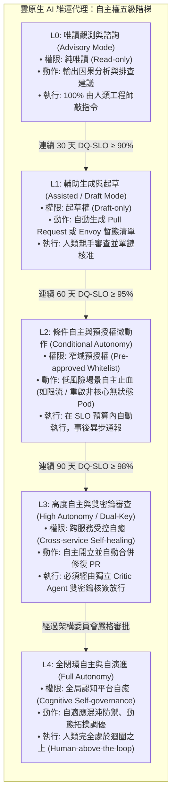
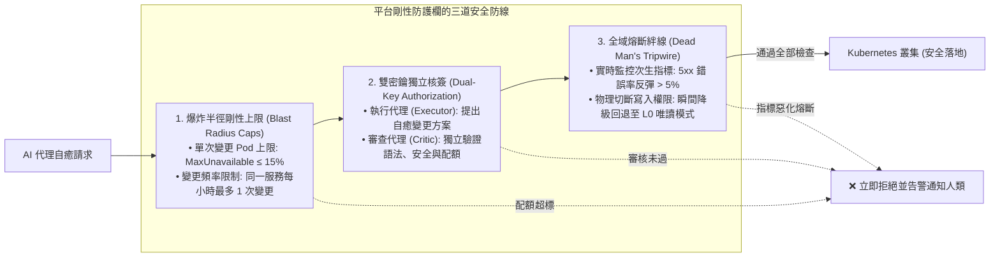

# 08-EX

# 受治理的自主性（Governed Autonomy）：自主邊界階梯與剛性安全防護欄

在本書第 8 章中，我們建立了企業級平台工程在 AI 時代的安全性、合規性與身分治理基石。我們深入探討了如何防範 Prompt Injection（提示詞注入）、Memory Poisoning（記憶污染）、Delegated Trust Abuse（委派信任濫用）以及特權提權，並構建了基於不可篡改雜湊鏈的審計日誌。

然而，當我們將目光從「抵禦外部惡意攻擊」，轉向第 7 章與第 7-EX 章所實施的「內部自主維運代理」時，許多資深架構師與 VP of Engineering 往往會提出一個更為深刻、甚至令人夜不能寐的終極擔憂：

> **「在真實生產環境中，造成最大災難的往往不是外部駭客，而是『權限過大、好心辦壞事』的內部自主 AI 代理。」**

想像以下慘劇：

* 某個負責自癒的代理偵測到底層資料庫連線逾時，為了「消除報警」，它自主做出了決策，一口氣重啟了整個叢集中的所有訂單微服務 Pod；這場瞬間引發的「驚群效應（Thundering Herd）」直接將核心資料庫瞬間打死，引發全公司級別的特大災難。
* 某個 FinOps 成本優化代理偵測到夜間離峰流量極低，為了「最佳化成本」，自主將生產資料庫的副本數縮減為 1；當凌晨突然湧入跨國大促銷流量時，資料庫直接崩潰，造成無法挽回的商業損失。

這就是**《代理式可靠性工程》（Agentic Reliability Engineering, ARE）**第 11 章「受治理的自主性（Governed Autonomy）」所要解決的生死課題。

**「自主性（Autonomy）絕非一個非黑即白的二元開關（不是 0% 就是 100%）。它是一座必須在嚴格防護欄保護下、依賴數學與歷史正確率逐步攀登的『受治理階梯』。」**

本章作為第 8 章的延伸實踐篇，將帶你建立一套生產級的**自主邊界階梯體系（Autonomy Ladders：L0 到 L4）**，實作**爆炸半徑剛性上限（Blast Radius Caps）**與**雙密鑰授權機制（Dual-Key Authorization）**，確保 AI 代理在釋放極致生產力的同時，永遠被牢牢束縛在剛性的安全軌道之中。

---

# 自主權階梯（The Autonomy Ladder）：從 L0 到 L4

在成熟的工程組織中，我們不會允許一位剛入職三天的實習生直接在生產環境執行重大變更；同樣地，我們絕不能把剛上線的 AI 代理直接賦予滿配的自主權。

ARE 借鑑自動駕駛的分級思想，為雲原生平台代理定義了五級**自主權階梯（Autonomy Ladder）**：



### 1. L0：唯讀觀測與諮詢（Advisory Mode）

* **定位**：AI 代理扮演「副駕駛（Copilot）」角色。
* **邊界**：代理只具備唯讀存取權限（如查詢 Prometheus 指標、檢索 OTel Traces、查閱 Backstage Catalog）。
* **行為**：代理可以告訴工程師：「*我發現了連線池耗盡的徵兆，建議執行如下指令...*」，但它本身沒有任何寫入或執行權限。

### 2. L1：輔助生成與起草（Assisted / Draft Mode）

* **定位**：這是本書第 5 章與第 7 章所採用的標準基準線。
* **邊界**：代理被允許產生結構化變更產物（如 GitHub Pull Request、Envoy 暫態限流設定），但**無權自行套用變更**。
* **行為**：變更必須躺在 Git 倉庫中，等待人類工程師在 Backstage 介面或 GitHub 上完成 Peer Review 並親手點擊「Merge」才能生效。

### 3. L2：條件自主（Conditional Autonomy）

* **定位**：局部低風險場景的「機器速度止血」。
* **邊界**：平台團隊設定白名單（例如：非核心服務、無狀態工作負載、暫態限流）。
* **行為**：當發生事故且完全吻合預設規則時，代理被允許在**第 7-EX 章所述的 TTL 時效約束內**自主執行緩解動作（如對特定 API 下發限流規則），操作完成後立即向 Slack 頻道發送通知。

### 4. L3：高度自主與雙密鑰互審（High Autonomy with Dual-Key）

* **定位**：成熟生產級自癒。
* **邊界**：允許代理在核心系統中自主發起並自動合併變更。
* **剛性制衡**：必須落實**雙密鑰機制（Dual-Key Authorization）**——執行代理提出的任何變更，必須經過一個獨立部署、具備不同系統提示詞與檢驗邏輯的 **Critic Agent（安全審查代理）** 進行靜態分析與風險評估，兩把密鑰同時就緒方可放行。

### 5. L4：全閉環自主（Full Autonomy）

* **定位**：未來的認知自適應平台。
* **邊界**：系統具備自我修復、主動混沌防禦與動態架構微調能力。人類工程師完全退居「迴圈之上（Human-above-the-loop）」，僅在代理主動觸發 AE-SLO（升級求助）時才介入干預。

---

# 剛性防護欄：限制代理的「物理聯鎖（Safety Interlocks）」

為了確保代理永遠不會引發毀滅性連鎖雪崩，平台團隊必須在基礎設施層面建立三道不可繞過的「物理聯鎖」：



## 1. 爆炸半徑剛性上限（Blast Radius Caps）
在代碼層面，代理無論「認為」自己有多聰明，它的每一次變更都必須被限制在預設的配額（Quotas）之內：

* **實例比例上限**：在單次自癒排障中，代理被允許重啟或置換的 Pod 數量，絕對不得超過該微服務總實例數的 **15%**。
* **頻率防禦（Intervention Rate Limiting）**：同一命名空間在 60 分鐘內，代理被允許執行的自癒干預上限為 2 次。一旦超過，系統自動判定該故障非代理能力所及，立刻鎖定並通知人類。

## 2. 雙密鑰授權機制（Dual-Key Authorization）
核潛艇發射飛彈需要兩位軍官同時轉動鑰匙；高風險的生產自癒同樣不能依賴單一 LLM 的「自問自答」：

* **執行者（Execution Agent）**：負責收集遙測、因果推理並起草修改補丁（例如：修改 `ReplicaSet` 或修改 Envoy Gateway 規則）。
* **審查者（Safety Critic Agent）**：由獨立的模型與提示詞驅動，專門負責挑毛病。它不參與方案設計，而是嚴格檢查：
  1. 該補丁是否包含了越權的提權配置？
  2. 該變更是否超過了爆炸半徑上限？
  3. 該補丁是否符合第 8 章的安全合規基準線？
* 只有當 Critic Agent 簽署了數位憑證，平台控制器（如 OpenChoreo Controller 或 GitOps）才會執行變更。

## 3. 全域熔斷絆線（Dead Man's Tripwire）
這是平台的最後一道防線。
如果 AI 代理在實施了某項自癒操作（如限流或滾動更新）後的 90 秒內，系統的核心業務黃金指標（Golden Signals）非但沒有好轉，反而出現了更嚴重的**次生反彈（Secondary Spike，例如全域錯誤率暴增 5%）**：

* 平台的底層控制器（Controller）會**硬性觸發熔斷絆線**；
* 瞬間切斷該代理的所有寫入憑證（Revoke Tokens）；
* 自動執行原路回滾；
* 全域強制將自主權限降級回 **L0 唯讀模式**，並觸發 PagerDuty 奪命連環呼叫待命工程師介入。

---

# 實戰代碼示範：自主邊界政策控制器（Autonomy Policy Engine）

在平台工程中，我們不該依賴 LLM 的「道德自律」，而必須透過確定性的程式碼來攔截每一次工具調用。以下展示如何在代理調用與 Kubernetes API 之間，建立一道剛性的**自主邊界攔截器（Autonomy Guardrail Middleware）**：

```typescript
import { Request, Response, NextFunction } from "express";

interface AgentActionPayload {
  agentId: string;
  autonomyLevel: "L0" | "L1" | "L2" | "L3" | "L4";
  targetService: string;
  actionType: "RESTART_PODS" | "TRAFFIC_SHED" | "MODIFY_CONFIG" | "DELETE_RESOURCE";
  affectedInstanceRatio: number; // 預計影響的 Pod 實例比例 (0.0 ~ 1.0)
  criticApprovalSignature?: string;
}

export class AutonomyPolicyEngine {
  // 剛性常數定義
  private static readonly MAX_ALLOWED_BLAST_RADIUS = 0.15; // 爆炸半徑最大 15%
  private static readonly RECENT_INTERVENTIONS = new Map<string, number>();

  public static async enforceGuardrails(payload: AgentActionPayload): Promise<{ allowed: boolean; reason?: string }> {
    // 檢查 1：禁止任何破壞性刪除操作
    if (payload.actionType === "DELETE_RESOURCE") {
      return { allowed: false, reason: "[POLICY-CRITICAL] 嚴禁任何自主代理執行刪除資源動作！" };
    }

    // 檢查 2：L0 級別絕對禁止寫入
    if (payload.autonomyLevel === "L0") {
      return { allowed: false, reason: "[POLICY-L0-RESTRICTED] 當前代理處於 L0 唯讀模式，無權執行任何寫入動作。" };
    }

    // 檢查 3：爆炸半徑上限攔截 (Blast Radius Cap)
    if (payload.affectedInstanceRatio > this.MAX_ALLOWED_BLAST_RADIUS) {
      return {
        allowed: false,
        reason: `[BLAST-RADIUS-EXCEEDED] 請求影響實例比例為 ${(payload.affectedInstanceRatio * 100).toFixed(1)}%，超過上限 15%！`
      };
    }

    // 檢查 4：L3 級別必須具備獨立 Critic Agent 雙密鑰簽名 (Dual-Key)
    if (payload.autonomyLevel === "L3") {
      const isCriticValid = await this.verifyCriticSignature(payload.criticApprovalSignature);
      if (!isCriticValid) {
        return { allowed: false, reason: "[DUAL-KEY-MISSING] L3 操作未獲得獨立 Critic Agent 審查簽章，拒絕放行！" };
      }
    }

    // 記錄並更新干預頻率
    this.recordIntervention(payload.targetService);
    return { allowed: true };
  }

  private static async verifyCriticSignature(signature?: string): Promise<boolean> {
    if (!signature) return false;
    // 驗證獨立 Critic 服務的非對稱數位簽章
    return signature.startsWith("CRITIC_SIG_VALIDATED_");
  }

  private static recordIntervention(service: string) {
    const current = this.RECENT_INTERVENTIONS.get(service) || 0;
    this.RECENT_INTERVENTIONS.set(service, current + 1);
  }
}
```

### 為什麼這套機制堅不可摧？

* **拒絕 LLM 說服（Immune to Jailbreaking）**：即使攻擊者透過複雜的 Prompt Injection 成功洗腦了執行代理，當代理發出請求時，底層的 TypeScript 確定性代碼會**無情地卡死在爆炸半徑檢查與雙密鑰簽名上**。大語言模型再聰明，也無法用意念修改編譯後的邏輯條件。

---

# 讀者筆記：從從業者視角看第 8-EX 章

> **「工程領域的信任從不來自盲目樂觀，而是建立在被嚴格約束的邊界與數學驗證之上。」**

### 💡 讀者思維：自主權不是恩賜，而是憑實力逐步解鎖的成就
許多團隊在討論 AI 自主性時，容易陷入「極度恐慌（全面禁止 AI 操作任何東西）」與「過度盲目（把 root 權限丟給 LLM）」兩個極端。第 8-EX 章最深刻的架構啟示，在於確立了**「自主權階梯（Autonomy Ladder）」**：

* 剛上線的代理一律從 L0（純建議）與 L1（開 PR 起草）開始；
* 透過本書前幾章建立的 Langfuse 鏈路追蹤與 DQ-SLO 指標，持續統計其判斷正確率；
* 只有當連續 90 天保持 98% 以上的正確率時，才由架構委員會透過設定檔，逐步解鎖 L2 與 L3 權限。這種**「漸進式信任機制」**，才是讓企業高管安心睡覺的唯一解方。

### 🎯 核心精華萃取

1. **五級階梯劃清責任邊界**：
   - L0 唯讀 ➔ L1 起草 ➔ L2 白名單條件自主 ➔ L3 雙密鑰高度自主 ➔ L4 全局自適應。
2. **三道不可繞過的物理聯鎖**：
   - 爆炸半徑上限（MaxUnavailable ≤ 15%）；
   - 雙密鑰獨立核簽（Executor 與 Critic 分離）；
   - 全域熔斷絆線（錯誤率反彈瞬間拔除 Token）。
3. **確定性代碼包裹機率性模型**：
   - 永遠不要在 Prompt 裡要求模型「請保證不要重啟超過 10% 的 Pod」；
   - 必須用確定性的 API 閘道中介軟體直接截斷越界請求！

### ⚠️ 實務踩坑警報

* **「執行者身兼裁判」的自戀陷阱**：在同一個 LLM 會話中讓它先寫代碼、再問它「你覺得這個安全嗎？」——LLM 的自洽性偏見幾乎永遠會回答「很安全」；Critic Agent 必須擁有完全獨立的 Context、甚至是不同架構的模型！
* **忽略變更頻率限制**：當系統陷入偶發震盪時，自主代理可能會以每分鐘一次的高頻反覆微調配置，引發整個叢集的組態震盪；必須強制設定每小時干預次數上限。

### 🛠️ 明日行動清單

* [ ] 檢視自家平台目前的權限設計：所有給 AI 代理使用的 API Key，是否具備刪除關鍵資源（Drop DB / Delete Namespace）的危險權限？立即在 IAM 層面拔除。
* [ ] 依據本章的五級階梯模型，與資安團隊共同定義第一版「內部 AI 代理自主權評級準則」。
* [ ] 在既有的維運 MCP 服務端中，實作「單次變更實例比例 ≤ 15%」的剛性防護欄攔截器。

---

# 延伸閱讀

* **《代理式可靠性工程》第 11 章：受治理的自主性（Governed Autonomy）**：[https://tedmax100.github.io/agentic-reliability-engineering-zh-tw/ch11.html](https://tedmax100.github.io/agentic-reliability-engineering-zh-tw/ch11.html)
* **Open Policy Agent（OPA）官方指南**：在雲原生環境中落實宣告式原則即程式碼（Policy as Code）：[https://www.openpolicyagent.org/](https://www.openpolicyagent.org/)
* **NIST AI 風險管理框架（AI RMF 1.0）**：理解企業級自主系統的可治理性與可信度規範：[https://www.nist.gov/itl/ai-risk-management-framework](https://www.nist.gov/itl/ai-risk-management-framework)
