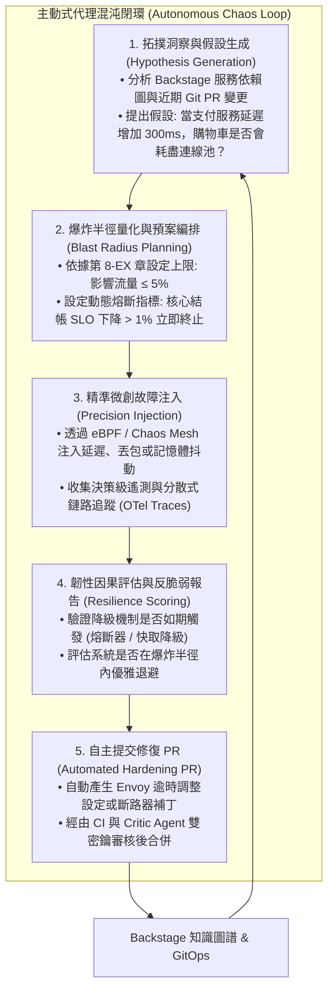
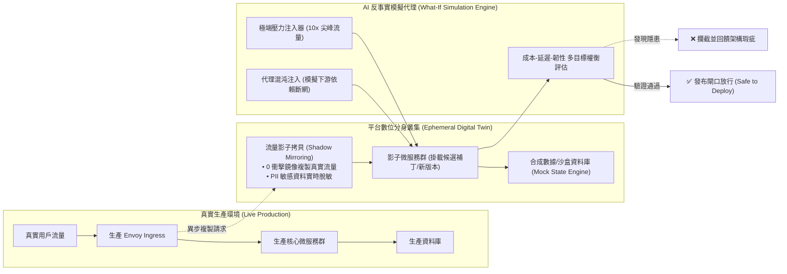

# 09-EX

# 主動式混沌工程與數位分身：從被動防禦到預測型平台韌性

在本書第 9 章中，我們探討了平台工程的未來宏偉藍圖——從「代理框架線束（Agentic Harness）」的架構解構，到「治理即模組」與「上下文即模組」的宣告式封裝，再到將模型評估正式升格為「評估即 CI（Evals-as-CI）」的嚴密軟體工程實踐。

然而，在通往完全自主平台（Full Autonomous Platform）的征途上，平台團隊面臨著一道最關鍵的哲學與工程鴻溝：

> **「我們在第 7 章建立了事故發生時的被動自癒（Self-Healing），在第 8-EX 章建立了限制代理權限的剛性防護欄（Governed Autonomy）。但難道我們只能永遠坐在儀表板前，被動等待真實故障將生產環境擊潰，才能檢驗系統的韌性嗎？」**

答案顯然是否定的。

**《代理式可靠性工程》（Agentic Reliability Engineering, ARE）**在第 9、10 與 12 章中給出了一個革命性的終極解答：
**「將維運代理的角色從『救火隊員』徹底轉變為『主動攻防演習的紅藍軍指揮官』與『數位分身預演大師』。」**

傳統的混沌工程（如早期 Netflix 的 Chaos Monkey）依賴人類工程師憑空想像假設，手動編寫定時腳本隨機殺死 Pod；而在雲原生微服務與分散式網格交織的今天，系統的弱點往往隱藏在跨服務的**偶發性延遲放大（Tail Latency Cascades）**、**重試風暴（Retry Storms）**與**快取穿透死鎖**之中——這些極度隱蔽的邊界條件，人類大腦已經無法窮舉。

本章作為第 9 章的終極延伸實踐篇，將帶你領略平台工程未來架構的兩大核心支柱：

1. **主動式代理混沌工程（Autonomous Agentic Chaos）**：由 AI 代理基於實時服務拓撲與 PR 變更，自主提出「假設驅動」的精準故障注入實驗，主動排查隱形弱點並自動提交修復 PR。
2. **雲原生數位分身與影子預演（Digital Twin & Shadow Rehearsal）**：在任何架構變更或自動化修復指令觸碰真實生產環境前，在高度保真的影子環境中進行反事實演練（Counterfactual Simulation）。

---

# 主動式代理混沌閉環：從被動救火到持續攻防

傳統混沌測試的最大痛點在於「盲目性」與「高風險」：工程師要麼不敢在生產環境動手，要麼注入的故障過於粗暴（如整台節點斷電），無法驗證精細的業務邏輯韌性。

在 ARE 框架中，AI 代理與雲原生混沌網格（如 Chaos Mesh 或 LitmusChaos）深度結合，形成了高度智能化的**主動混沌閉環（Autonomous Chaos Loop）**：



### 假設驅動（Hypothesis-Driven）而非隨機破壞
AI 代理在發起混沌實驗前，必須嚴格向審批系統提交結構化的「科學假設」：

* **前置條件（Steady State）**：當前系統處於健康基準線（99.9% 請求延遲 $\le 120\text{ms}$，錯誤率 $\le 0.01\%$）。
* **擾動變量（Fault Injection）**：對 `Order-Service` 到 `Payment-Gateway` 的 gRPC 呼叫注入 $350\text{ms}$ 的人工延遲。
* **預期行為（Expected Behavior）**：`Order-Service` 的本機端斷路器應當在第 3 次超時後觸發熔斷，將請求快速降級（Fallback）至異步佇列，終端用戶感知延遲不超過 $200\text{ms}$。
* **終止絆線（Abort Conditions）**：若全域 5xx 錯誤率上升超過 $0.5\%$，立刻硬性清除故障注入。

如果實驗結果顯示斷路器並未按預期開啟，導致 `Order-Service` 的 Tomcat 執行緒池被瞬間佔滿，AI 代理會立即判定該服務存在**「隱性級聯雪崩風險」**，並自動定位到具體的 Helm Chart 或代碼配置，直接向開發團隊提交一個修正逾時與隔離艙（Bulkhead）設定的 Pull Request！

---

# 平台數位分身（Digital Twin）與反事實預演

在航空航太與現代 F1 賽車領域，工程師絕不會直接在正賽當天測試未經調校的引擎套件；他們在超級電腦中的「數位分身（Digital Twin）」虛擬風洞中已經預演過上百萬圈。

然而，在軟體平台工程中，許多團隊依然將「在生產環境放行 Canary（金絲雀部署）」視為最後的防線——但對於核心金融交易或醫療系統，即便只影響 $1\%$ 的真實用戶，也可能招致不可承受的法規與商業罰則。

ARE 第 12 章提出了**「雲原生可靠性數位分身（Cloud-Native Reliability Digital Twin）」**的先進實踐：



### 1. 流量影子鏡像與狀態脫敏（Shadow Mirroring & Sanitization）
利用 Envoy Gateway 或 Istio 服務網格的 `Request Mirroring` 功能，平台可以在對真實生產請求延遲毫無影響的前提下，將 100% 的即時流量非同步複製一份推送到數位分身環境。代理會在網關入口對所有 JWT 身分憑證、信用卡號、個人識別資訊（PII）進行實時雜湊脫敏，確保影子環境絕對合規。

### 2. 反事實演練（What-If Counterfactual Simulation）
在變更正式發布前，AI 模擬代理會在數位分身中並行啟動多個「平行宇宙」進行極端推演：

* **宇宙 A（尖峰衝擊）**：如果遇到黑色星期五瞬間 10 倍於平常的暴增流量，新的 HPA（水平自動擴展）設定能否在 45 秒內完成擴容，還是會因為冷啟動超時造成大量連線丟棄？
* **宇宙 B（依賴失效）**：如果雲端供應商的單一可用區（AZ）遭遇光纖被挖斷引發的區域性網路分區，新的架構能否在 3 秒內無縫切換至備用可用區？

只有當新版本在多個極端平行宇宙中均通過了嚴格的驗證，平台發布控制器才會將 PR 放行至真實生產環境。

---

# 實戰代碼示範：聲明式代理混沌實驗 CRD 與控制器

在 Kubernetes 平台中，我們將 AI 代理的混沌意圖標準化為自定義資源定義（CRD），讓整個主動防禦流程完全 GitOps 化。以下展示一個具備「爆炸半徑保護」與「動態熔斷絆線」的實戰控制器實作：

```typescript
import { KubernetesObject, CustomObjectsApi } from "@kubernetes/client-node";

// 定義聲明式自主混沌實驗規範 (CRD Spec)
export interface AgenticChaosExperimentSpec {
  targetService: string;
  targetNamespace: string;
  steadyStateSLO: {
    metric: string;
    threshold: number; // e.g. p99 latency < 200ms
  };
  injectedFault: {
    type: "LATENCY" | "PACKET_LOSS" | "CPU_STRESS" | "POD_FAILURE";
    intensityMs?: number;
    intensityPercent?: number;
  };
  blastRadius: {
    maxTrafficRatio: number; // 最大允許影響流量比例, e.g. 0.05 (5%)
    maxDurationSeconds: number; // 最長持續秒數, e.g. 180s
  };
  safetyTripwire: {
    secondaryMetric: string;
    abortThreshold: number; // e.g. error rate > 1.0% 立即拔線
  };
}

export class AgenticChaosController {
  private k8sApi: CustomObjectsApi;

  constructor(apiClient: CustomObjectsApi) {
    this.k8sApi = apiClient;
  }

  // AI 代理發起混沌實驗時的受控執行邏輯
  public async executeControlledExperiment(spec: AgenticChaosExperimentSpec): Promise<void> {
    console.log(`[CHAOS-CONTROLLER] 收到 AI 代理針對 ${spec.targetService} 的混沌實驗申請...`);

    // 剛性安全檢查：驗證爆炸半徑是否超出平台政策上限
    if (spec.blastRadius.maxTrafficRatio > 0.10) {
      throw new Error("[SECURITY-VIOLATION] 混沌實驗設定影響流量超過 10% 剛性上限，拒絕執行！");
    }

    // 步驟 1：採集基準狀態 (Steady State Check)
    const isBaselineHealthy = await this.verifySteadyState(spec.steadyStateSLO);
    if (!isBaselineHealthy) {
      console.warn("[ABORT] 服務當前基準指標未達標準，系統處於亞健康狀態，禁止注入故障！");
      return;
    }

    // 步驟 2：下發微創故障 (例如透過 eBPF 攔截特定路由請求)
    await this.applyFaultInjection(spec.targetService, spec.injectedFault);
    console.log(`[INJECTED] 成功對 ${spec.targetService} 注入 ${spec.injectedFault.type}...`);

    // 步驟 3：即時監控安全絆線 (Dead Man's Tripwire)
    const timer = setInterval(async () => {
      const tripwireTriggered = await this.checkSafetyTripwire(spec.safetyTripwire);
      if (tripwireTriggered) {
        console.error("[TRIPWIRE-TRIPPED] 偵測到核心指標惡化超過臨界值！立即硬性終止故障注入！");
        clearInterval(timer);
        await this.purgeFaultInjection(spec.targetService);
        await this.notifySRETeam("自主混沌實驗觸發安全熔斷，已自動恢復環境並生成診斷記錄。");
      }
    }, 5000);

    // 步驟 4：超時自動收斂清理
    setTimeout(async () => {
      clearInterval(timer);
      await this.purgeFaultInjection(spec.targetService);
      console.log("[COMPLETED] 實驗時限已達，已清理注入故障，進入因果韌性評估階段。");
    }, spec.blastRadius.maxDurationSeconds * 1000);
  }

  private async verifySteadyState(slo: any): Promise<boolean> {
    // 實作 Prometheus 或 Datadog 指標查詢
    return true; 
  }

  private async applyFaultInjection(service: string, fault: any): Promise<void> {
    // 調用 Chaos Mesh 或 Envoy Dynamic Proxy API
  }

  private async purgeFaultInjection(service: string): Promise<void> {
    // 徹底清除所有延遲與丟包規則
  }

  private async checkSafetyTripwire(tripwire: any): Promise<boolean> {
    // 實時讀取次生報警指標
    return false;
  }

  private async notifySRETeam(message: string): Promise<void> {
    // 發送 Slack 警報
  }
}
```

---

# 讀者筆記：從從業者視角看第 9-EX 章

> **「一個從不在平時主動測試崩潰極限的平台，注定會在業務高峰最慘烈的時刻被無情擊穿。」**

### 💡 讀者思維：從「被動防禦」到「反脆弱進化」
過去的可靠性工程往往是被動的：等監控報警響起，再慌忙調用維運代理去止血。第 9-EX 章揭示的最高境界是**反脆弱性（Antifragility）**——系統能夠藉由主動承受微小、可控的壓力擾動，自主發現隱蔽缺陷並實現自愈性增強。

* 代理利用非高峰時段，自主對新上線的微服務發起小範圍混沌探針；
* 透過數位分身影子流量，新架構在未見光前就已經歷過萬千風浪；
* 開發者不再害怕「週五發布」，因為在數位分身中，代碼早已在黑五級別的流量風暴與故障組合中被證實堅不可摧。

### 🎯 核心精華萃取

1. **假設驅動的主動混沌**：
   - 杜絕盲目隨機殺 Pod，代理必須給出科學假設（前置基準、精準擾動、預期熔斷、熔斷絆線）。
2. **影子流量與合規脫敏**：
   - 藉由 Envoy/Istio 請求鏡像，將零延遲衝擊的生產流量導入數位分身，並在網關處實施 PII 脫敏。
3. **反事實多宇宙預演**：
   - 在影子叢集中平行測試「尖峰超載」、「單區斷網」等極端假設，以多目標權衡矩陣（延遲 vs 成本 vs 韌性）決定發布資格。
4. **剛性絆線兜底一切**：
   - 無論演習多麼精細，底層控制器隨時保留 5 秒一輪的硬體級別熔斷檢查，防止演習演變成真實災難。

### ⚠️ 實務踩坑警報

* **在亞健康狀態下開啟混沌演習**：如果系統本來就已經處於高延遲或依賴飽和邊界，盲目注入故障會直接引發真正的重大事故；控制器在注入前必須強制驗證 Steady State 基準指標。
* **忽略影子流量的寫入操作**：向數位分身鏡像流量時，若未對下游寫入端（如支付閘道、生產數據庫、外部 Webhook）進行嚴密 Mock，影子請求可能會重複扣款或發送真實簡訊給客戶！

### 🛠️ 明日行動清單

* [ ] 檢查公司現有的預發布（Staging）環境：其架構拓撲與數據保真度是否足以支撐高仿真的影子測試？若不足，評估採用 vCluster 搭建按需臨時影子叢集。
* [ ] 在內部 CI 管線中，挑選一個非核心無狀態微服務，試行第一場「帶有自動熔斷絆線」的微創延遲注入實驗。
* [ ] 結合本書第 11 章（Backstage）與第 12 章（OpenChoreo），將服務拓撲依賴清單作為混沌代理的輸入源。

---

# 延伸閱讀

* **《代理式可靠性工程》第 9 章與第 10 章：主動式韌性工程與代理混沌架構**：[https://tedmax100.github.io/agentic-reliability-engineering-zh-tw/ch09.html](https://tedmax100.github.io/agentic-reliability-engineering-zh-tw/ch09.html)
* **《代理式可靠性工程》第 12 章：雲端可靠性數位分身與反事實推演**：[https://tedmax100.github.io/agentic-reliability-engineering-zh-tw/ch12.html](https://tedmax100.github.io/agentic-reliability-engineering-zh-tw/ch12.html)
* **Chaos Mesh 官方文件**：雲原生混沌測試編排平台：[https://chaos-mesh.org/](https://chaos-mesh.org/)
* **Principles of Chaos Engineering**：混沌工程經典原則指南：[https://principlesofchaos.org/](https://principlesofchaos.org/)
