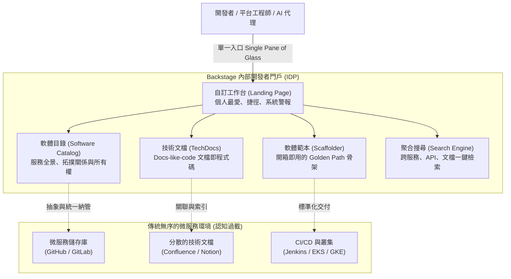
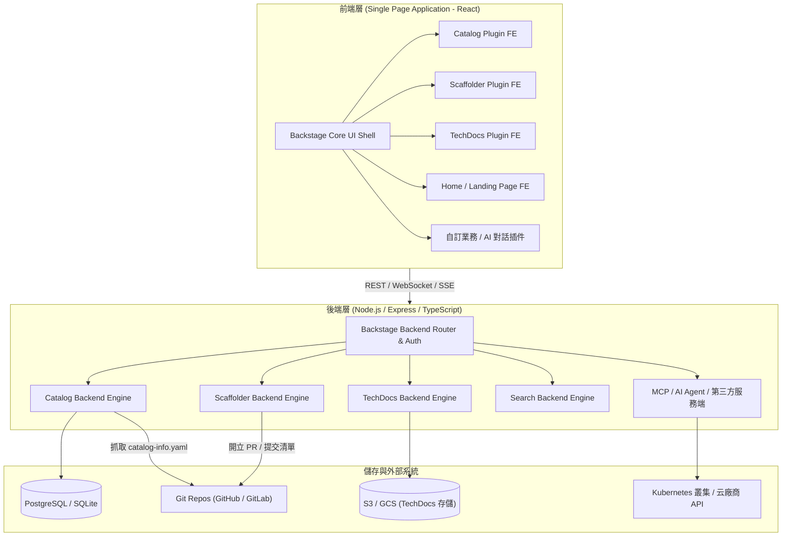
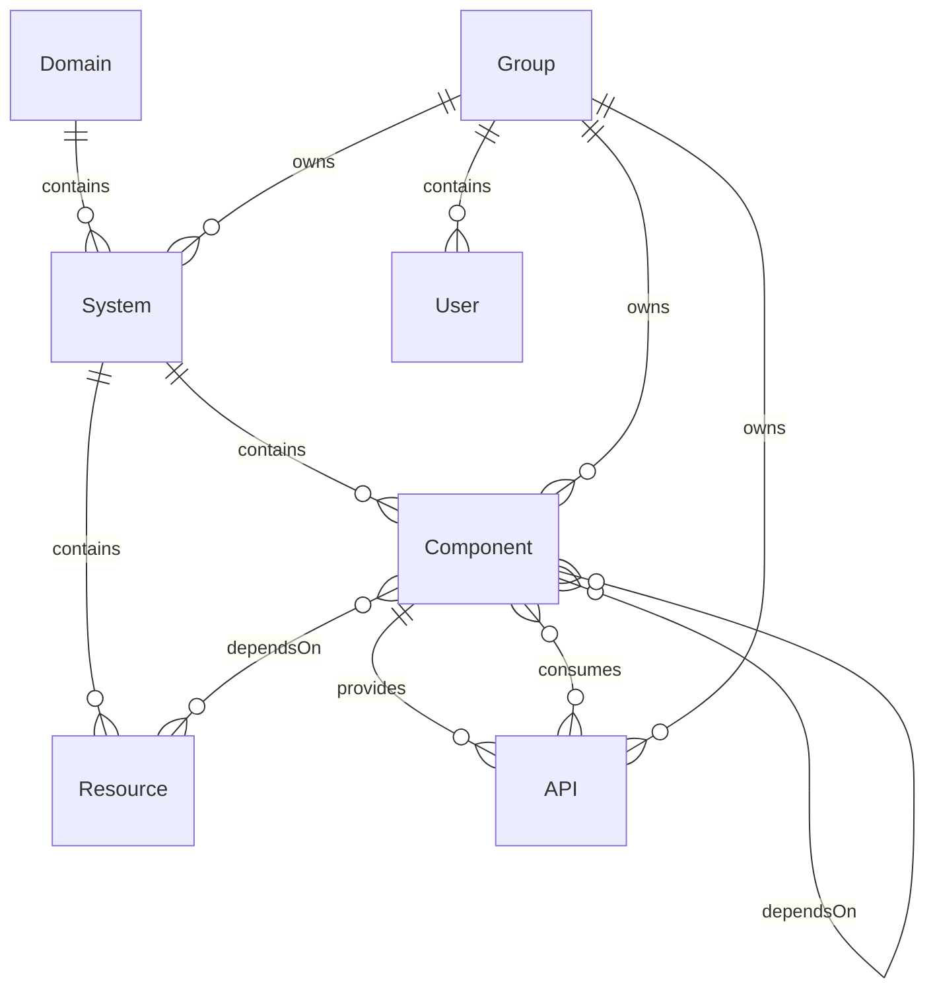
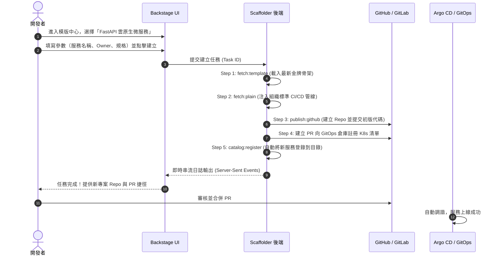
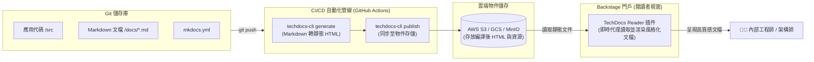
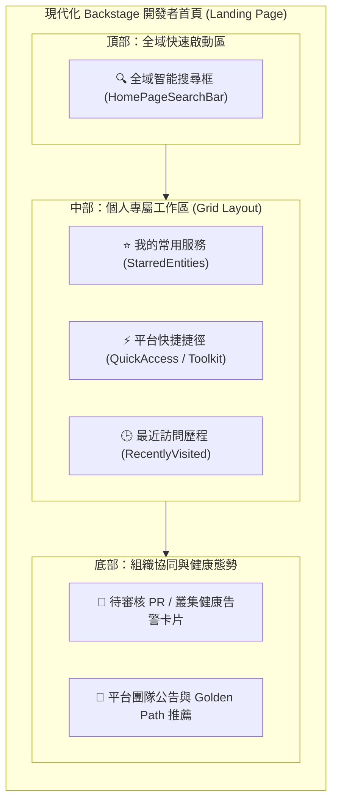
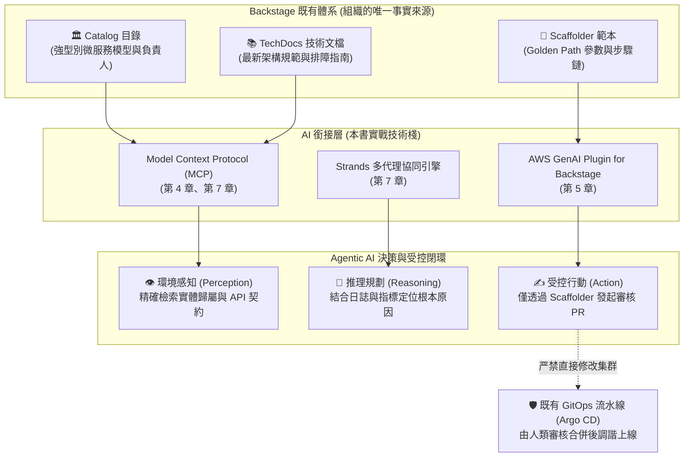

# 11

# Backstage：內部開發者門戶核心與平台工程實戰

在軟體工程規模化擴展的歷程中，我們幾乎無一例外都會遭遇同一道高聳的「認知牆」：當企業內的微服務數量從十幾個激增到數百甚至數千個，當雲端基礎設施在多個帳號與叢集中四散蔓延，當各種工具鏈、部署腳本與維運手冊散落在無數的 Wiki、Slack 頻道和工程師的大腦中時，開發者的日常體驗便不可避免地滑向混亂與窒息。

你是否也曾體會過這種痛楚？

* 新加入團隊的工程師花費了三週時間，只為了搞清楚「本地開發環境該如何搭建」以及「這項服務到底由誰負責維護」；
* 開發團隊為了開闢一個新的微服務，不得不四處尋找可用的舊專案程式碼，透過「複製貼上」的方式建立新專案，無意間複製了早已廢棄的依賴項、充滿漏洞的 Dockerfile，以及不符合當前安全合規標準的 CI/CD 流程；
* 在遭遇線上故障時，SRE 與維運人員手忙腳亂地排查，卻發現相關 API 的文件早已過期兩年，真正的 API 規範只存在於某次未被記錄的 PR 提交中。

正是在這樣的痛苦泥沼中，**內部開發者門戶（Internal Developer Portal, IDP）**應運而生，而 **Backstage** 則毫無爭議地成為了這場平台工程革命的核心旗艦。

本章將帶你全景深入 Backstage 的世界。我們不僅會依據 [Backstage 官方文件入口](https://backstage.io/docs/landing-page/doc-landing-page) 的脈絡，剖析 Backstage 的誕生背景、架構哲學與核心四大支柱（**Software Catalog、Software Templates、TechDocs、Search**），還將深入解密**首頁落地頁（Landing Page / Home Plugin）**的自訂機制，並結合本書的主軸——探討 Backstage 如何作為 **Agentic AI** 在現代平台工程中的「最強感知層」與「受控行動表面」。

---

# Backstage 的起源與平台工程使命

在深入技術細節之前，讓我們先回到這一切的起點：Spotify。

## Spotify 的困境與「軟體荒漠」

2010 年代中後期，Spotify 經歷了爆發式的業務成長。為了賦予工程團隊最大的自主權，Spotify 採取了極度去中心化的「自治小隊（Squads）」組織模型，並全面擁抱微服務架構。這種模式在早期極大地加速了創新，但隨著團隊規模擴展至數千名工程師、微服務數量突破數千個時，去中心化帶來的副作用開始顯現：

1. **資訊孤島與認知過載**：沒有人能看清整個系統的全貌。工程師不知道某個服務是否已經存在，經常重複造輪子；想要呼叫其他團隊的 API，卻找不到負責人是誰。
2. **碎片化與標準失控**：每個小隊各自挑選程式語言、框架、CI/CD 工具與監控方案。基礎設施團隊推行一項全公司範圍的安全性修補或版本升級時，推進難度猶如登天。
3. **Onboarding 的漫長折磨**：新進工程師需要閱讀數十份過期的 Confluence 文檔，加入十幾個 Slack 頻道逐一詢問，平均需要數週甚至數月才能完成首次程式碼上線。

Spotify 意識到：**自主權（Autonomy）如果缺乏適當的「鋪好之路（Paved Road / Golden Path）」，就會演變成混亂與無序。**

為了讓開發者在享有自主權的同時不必承受沉重的心智負擔，Spotify 於 2016 年在內部啟動了一個專案，目標是打造一個集中統一的開發者入口網站——這就是 Backstage 的前身。



## 從內部專案到 CNCF 頂級畢業專案

2020 年，Spotify 做出了影響深遠的決定：將 Backstage 完全開源，並將其捐贈給**雲原生運算基金會（Cloud Native Computing Foundation, CNCF）**。

在開源社群與全球企業的共同推動下，Backstage 展現了驚人的生命力。Netflix、American Airlines、Expedia、Epic Games、Toyota 等各行各業的頂尖企業紛紛採用並參與貢獻。2024 年，Backstage 正式從 CNCF 孵化階段畢業，成為與 Kubernetes、Prometheus、Envoy 並列的 **CNCF 畢業專案（Graduated Project）**，奠定了其作為全球內部開發者門戶事實現行標準（De Facto Standard）的地位。

## 什麼是內部開發者門戶（IDP）？

許多人常將「內部開發者門戶（IDP - Internal Developer Portal）」與「內部開發者平台（IDP - Internal Developer Platform）」混為一談。在平台工程的術語體系中，兩者各司其職但緊密相扣：

* **內部開發者平台（Platform）**：是由底層基礎設施、Kubernetes 叢集、雲端服務、CI/CD 管線、資料庫控制器（如 Crossplane、Terraform）組成的底層自動化能力網格。
* **內部開發者門戶（Portal / 如 Backstage）**：則是這張巨大能力網格的**前台門戶與單一視窗（Single Pane of Glass）**。它不直接承擔執行任務的工作負載，而是將所有抽象概念、服務定義、維運動作與文檔結構化地聚合在一起，為工程師提供友好、一致且受控的互動介面。

正如本書第 1 章所述：「*這宛如熱帶雨林中央繁華的城市廣場。頓時之間，大家有了一個統一的去處。*」

---

# Backstage 系統架構與技術棧

Backstage 並非一個拿來即用的套裝 SaaS 軟體，而是一個**高度模組化的開發者門戶框架（Framework）**。它的核心哲學是：**Core 僅是一個輕量級骨架，所有具體功能均由「外掛插件（Plugins）」提供。**



## 前端架構
* **React + TypeScript**：整個前端是一個現代單頁應用（SPA）。
* **Material-UI (MUI)**：提供標準化且可客製化的設計系統。
* **Composable Routing**：插件之間透過路由綁定（RouteRefs）彼此解耦。例如，Scaffolder 插件在完成範本生成後，可以直接跳轉到 Catalog 插件的實體頁面，而不需要在程式碼中寫死 URL。

## 後端架構
* **Node.js + TypeScript + Express**：後端處理常規業務邏輯、代理存取與定時任務排程。
* **Knex.js + PostgreSQL**：本地開發時可使用 SQLite，但正式生產環境必須配置 PostgreSQL。各插件在同一個資料庫內擁有獨立的 Schema，確保資料隔離。
* **Plugin-First 後端架構**：每個功能模組都是獨立的 npm 套件（例如 `@backstage/plugin-catalog-backend`、`@backstage/plugin-scaffolder-backend`）。

## 新舊系統演進（New Backend & Frontend System）

在 Backstage 的發展歷程中，目前正經歷從「舊架構系統」向「新架構系統」的全面演進，這也是工程團隊在建置與維護時必須理解的關鍵分水嶺：

| 維度 | 舊系統（Legacy System） | 新系統（New Backend / Frontend System） |
| :--- | :--- | :--- |
| **後端初始化方式** | 在 `packages/backend/src/plugins/*.ts` 中手動編寫繁瑣的 Express 路由與資料庫初始化程式碼 | 宣告式依賴注入（Dependency Injection），透過 `createBackendModule` 與 `createBackendPlugin` 自動組裝 |
| **服務擴充點** | 依賴傳統物件傳遞，難以攔截或修改其他插件的底層邏輯 | **Extension Points（擴充點）**機制，第三方插件可在宿主啟動階段精確註冊新能力 |
| **前端客製化** | 手動編輯 `App.tsx`，在 React JSX 樹狀結構中堆疊 `<Route>` 與元件 | 透過 `app-config.yaml` 或宣告式擴充點載入前端外掛，降低升級衝突 |
| **版本相容性** | 對應 `@backstage/create-app` 0.7.x 版本，也是本書第 5 章、第 7 章實戰驗證時所鎖定的基準線 | `@backstage/create-app` 0.8.x 及更新版本，為當前開源主線標準 |

---

# 核心支柱一：軟體目錄（Software Catalog）

如果說 Backstage 是企業內部平台的中心大腦，那麼**軟體目錄（Software Catalog）**就是這顆大腦的神經網路。

## 「元數據即程式碼」（Metadata as Code）

在沒有軟體目錄之前，微服務的清單通常記錄在 Excel 表格或 Wiki 頁面上。不出一個月，這份清單就會因為系統迭代而過期失效。

Backstage 徹底改變了這個遊戲規則，提出了 **Metadata as Code** 哲學：

1. 每個服務的元數據必須作為程式碼的一部分，以名為 `catalog-info.yaml` 的宣告式檔案存放在該專案自身的 Git 儲存庫根目錄中。
2. 開發者透過修改 Git 檔案來維護服務元數據，享有版本控制與 Code Review 機制。
3. Backstage 後端定期爬取 Git 儲存庫，自動解析 `catalog-info.yaml` 並將最新狀態同步進 Catalog 資料庫。

## 實體模型規範（Entity Model）

Backstage 定義了一套嚴謹且具備擴充性的資料模型體系。理解這套模型是架構師規劃內部平台的必修課：



### 1. 核心實體型態（Kinds）
* **`Component`（組件）**：軟體系統中最基礎的建構單元。可以是微服務後端（`service`）、前端單頁應用（`website`）、共用函式庫（`library`），甚至是 ETL 資料處理管線（`pipeline`）。
* **`API`（介面契約）**：描述組件對外暴露的端點規範。支援 OpenAPI (Swagger)、gRPC (Protobuf)、GraphQL 以及 AsyncAPI 等。
* **`Resource`（基礎設施資源）**：組件運行時所需的底層基礎設施，例如 AWS RDS 資料庫、S3 Bucket、Kafka 集群或 Redis 快取。
* **`System`（系統）**：將多個協同運作的 Component、API 與 Resource 聚合為一個功能模組的業務邊界。例如「使用者認證系統」、「支付結算系統」。
* **`Domain`（領域）**：最高階的組織維度，對應領域驅動設計（DDD）中的業務邊界，例如「核心電商領域」、「物流供應鏈領域」。
* **`Group` & `User`（組織架構）**：對應企業內部的團隊與員工。每個實體都**必須明確定義所屬的 `owner`**，從制度上根絕「無人認領的孤兒服務」。

## 實戰剖析：標準 `catalog-info.yaml` 範例

下面這份清單展示了一個符合生產級規範的微服務定義：

```yaml
apiVersion: backstage.io/v1alpha1
kind: Component
metadata:
  name: order-service
  description: 處理電商平台訂單建立、狀態流轉與支付確認的核心服務
  annotations:
    github.com/project-slug: acme-corp/order-service
    backstage.io/techdocs-ref: dir:.
    argocd/app-name: order-service-prod
    prometheus.io/rule: order_error_rate
    pagerduty.com/integration-key: d3b07384d113edec49eaa6238ad5ff00
  tags:
    - java
    - spring-boot
    - tier-1
    - payment
  links:
    - url: https://dashboard.grafana.internal/d/order-metrics
      title: 訂單服務即時監控儀表板
      icon: dashboard
spec:
  type: service
  lifecycle: production
  owner: team-checkout
  system: ecommerce-core
  providesApis:
    - order-api-v1
  consumesApis:
    - payment-gateway-api
    - inventory-api
  dependsOn:
    - resource:order-db-cluster
    - resource:order-kafka-topic
```

### 為什麼這份 YAML 對平台工程至關重要？
1. **Annotation（註解）驅動的插件生態**：當你填寫了 `argocd/app-name`，Backstage 的 ArgoCD 插件就會自動在介面上嵌入該服務的即時部署拓撲；當你填寫了 `pagerduty.com/integration-key`，當前輪值的 On-call 工程師資訊就會直接出現在右上角。
2. **全景依賴拓撲**：透過 `providesApis`、`consumesApis` 與 `dependsOn`，Backstage 能自動繪製出企業級微服務的拓撲圖。當某個下游服務發生故障時，維運人員一眼就能看出哪些上游業務將受到波及。

---

# 核心支柱二：軟體範本與骨架生成器（Software Templates / Scaffolder）

如果軟體目錄解決的是「發現與理解（Discovery）」的問題，那麼 **Scaffolder（軟體範本骨架生成器）** 解決的則是「標準化與加速（Standardization & Velocity）」的難題。

## 複製貼上的詛咒 vs. Golden Path

在軟體工程中，「鋪好之路（Golden Path / Paved Road）」是指平台團隊為整個組織設計的一組經過充分驗證、內建最佳實踐的標準開發路徑。

沒有 Scaffolder 時：

* 工程師想開一個新 Python 專案，從一個三年前離職員工的專案中複製程式碼；
* 忘記升級 Python 3.8 到 3.12；
* CI 流水線缺少合規性掃描；
* Kubernetes 清單中忘記配置 Pod Disruption Budget (PDB) 與資源 Limit；
* 最終在 Production 環境中引發安全漏洞與資源搶佔事故。

有了 Scaffolder 後：

* 工程師點進 Backstage 的「Create...」按鈕；
* 填寫表單：輸入專案名稱、團隊負責人、選擇資料庫類型；
* 點擊執行，後端在 30 秒內自動完成：
  1. 拉取最新的標準專案骨架（內建最新 LTS 運行環境、安全依賴與 Linting 規則）；
  2. 自動替換變數並注入配置；
  3. 在 GitHub 建立全新儲存庫並推入初版程式碼；
  4. 自動向軟體目錄註冊該組件；
  5. 甚至在 GitOps 儲存庫中發起一個自動註冊 ArgoCD Application 的 Pull Request！



## 範例實戰：宣告一個標準 Scaffolder 範本

在 Backstage 中，範本本身也是一個 Catalog 實體，其 `kind` 為 `Template`：

```yaml
apiVersion: scaffolder.backstage.io/v1beta3
kind: Template
metadata:
  name: cloudnative-fastapi-template
  title: 標準雲原生 FastAPI 微服務
  description: 建立具備 OpenTelemetry 追蹤、Docker 多階段構建與 ArgoCD 部署清單的 Python 微服務
  tags:
    - python
    - fastapi
    - kubernetes
spec:
  owner: team-platform
  type: service

  # 定義開發者在網頁介面上看見的多步驟表單
  parameters:
    - title: 填寫基礎資訊
      required:
        - component_id
        - owner
      properties:
        component_id:
          title: 服務唯一識別碼
          type: string
          description: 僅能包含小寫英數字元與連字號
          ui:field: EntityName
        description:
          title: 服務描述
          type: string
        owner:
          title: 負責團隊
          type: string
          ui:field: OwnerPicker
          ui:options:
            catalogFilter:
              kind: Group

    - title: 選擇雲端基礎設施設定
      properties:
        enable_database:
          title: 是否配置獨立 PostgreSQL 資料庫？
          type: boolean
          default: true
        target_cluster:
          title: 目標部署叢集
          type: string
          enum:
            - k8s-dev-cluster
            - k8s-stage-cluster
          default: k8s-dev-cluster

  # 定義後端依序執行的工作流動作鏈
  steps:
    - id: template
      name: 生成程式碼骨架
      action: fetch:template
      input:
        url: ./skeleton
        values:
          component_id: ${{ parameters.component_id }}
          description: ${{ parameters.description }}
          owner: ${{ parameters.owner }}
          enable_database: ${{ parameters.enable_database }}

    - id: publish
      name: 發布至 GitHub
      action: publish:github
      input:
        allowedHosts: ['github.com']
        description: ${{ parameters.description }}
        repoUrl: github.com?owner=acme-corp&repo=${{ parameters.component_id }}
        defaultBranch: main
        repoVisibility: internal

    - id: register
      name: 註冊至 Backstage 軟體目錄
      action: catalog:register
      input:
        repoContentsUrl: ${{ steps.publish.output.repoContentsUrl }}
        catalogInfoPath: '/catalog-info.yaml'

  # 執行完畢後的介面產出捷徑
  output:
    links:
      - title: 前往新建立的原始碼倉庫
        url: ${{ steps.publish.output.remoteUrl }}
      - title: 在 Backstage 中查看實體頁面
        entityRef: ${{ steps.register.output.entityRef }}
```

---

# 核心支柱三：技術文檔即程式碼（TechDocs）

技術文檔面臨的最大挑戰從來不是「沒有人會寫」，而是**「維護成本極高，寫完之後立即過期，而且永遠沒有人能找到」**。

## 什麼是 TechDocs？

TechDocs 是 Spotify 提出並實踐的 **Docs-like-Code（文檔即程式碼）** 解決方案：

1. **文檔與程式碼存於同一個 Git 儲存庫**：文檔通常以 Markdown 格式撰寫，放置在專案的 `/docs` 目錄下，並配有一份 `mkdocs.yml` 設定檔。
2. **與 PR 一同接受 Review**：修改業務程式碼時，必須同步修改 `/docs` 下的說明文件，作為代碼審查（Code Review）的一環。
3. **集中編譯與集中閱讀**：雖然文檔分散在全公司成千上萬個 Git 倉庫中，但 Backstage 會自動將其統一抓取、編譯並渲染至門戶的單一視窗中，享有強大的全文檢索與一致的使用者閱讀體驗。



## TechDocs 的兩種運作模式
1. **本地生成模式（Local Mode）**：Backstage 後端在收到閱讀請求時，現場透過本機 Docker 啟動 `spotify/techdocs` 鏡像進行編譯。此模式僅適合本地開發除錯，在生產環境中會消耗巨大伺服器運算資源且延遲極高。
2. **外部生成模式（Out-of-band / CI 模式，生產唯一推薦）**：透過 CI/CD 管線（如 GitHub Actions）在程式碼推送時執行 `@techdocs/cli`，將編譯好的靜態 HTML 部署至 AWS S3、Google Cloud Storage 或 MinIO。Backstage 後端僅作為安全的 Storage Proxy 提供快取與存取控制，毫秒級渲染出閱讀頁面。

---

# 核心支柱四：聚合搜尋平台（Search）

當組織內部擁有 500 個微服務、200 支 API 規格與數千篇 TechDocs 時，如果沒有統一的搜尋機制，門戶的價值將大打折扣。

## 搜尋架構核心要素
Backstage 的搜尋框架（Search Platform）由三個核心角色構成：

* **Collator（收集器）**：負責定時輪詢或事件驅動從特定來源提取資料。Backstage 預設提供了 `DefaultCatalogCollator`（收集目錄實體）與 `DefaultTechDocsCollator`（收集技術文檔），工程師也可以輕鬆撰寫自訂 Collator 來索引 Stack Overflow Enterprise、Confluence 或內部 Jira 數據。
* **Indexer & Search Engine（索引與搜尋引擎）**：
  * **Lunr**：內建的輕量級記憶體索引引擎，零依賴，適用於百人以內的中小型團隊。
  * **PostgreSQL**：重用現有關聯式資料庫的全文檢索能力。
  * **Elasticsearch / OpenSearch**：大中型企業首選。具備分散式橫向擴展能力、強大的權重調節（Boosting）、拼字糾錯與語意分析能力。
* **Search UI**：前端聚合搜尋介面，提供即時自動補全（Typeahead）、分類過濾器（Filters）與高亮摘要。

---

# 落地頁與首頁客製化（Landing Page / Home Plugin）

現在，讓我們聚焦於使用者所提及的官方核心指南：[Backstage Landing Page / Home Plugin 實戰](https://backstage.io/docs/landing-page/doc-landing-page)。

## 為什麼需要自訂 Landing Page？

在早期 Backstage 的預設配置中，使用者登入後會被直接導向軟體目錄（`/catalog`）。雖然目錄功能強大，但面對成百上千個無關的微服務列表，工程師往往會感到不知所措。

**「首頁（Landing Page / Homepage）」是塑造極致開發者體驗的第一戰場。** 借助 `@backstage/plugin-home`，平台團隊可以為工程師打造一個高度個人化、資訊密度適中且極富引導性的「個人作戰儀表板」。



## 安裝與配置 Home Plugin

在標準 Backstage 應用中啟用並自訂 Landing Page 只需簡單三步驟：

### 步驟 1：安裝套件
在專案根目錄下，將外掛套件加入至前端應用：
```bash
yarn --cwd packages/app add @backstage/plugin-home
```

### 步驟 2：設定根路徑路由（Routing）
Backstage 允許你將 `/` 根路徑直接映射至首頁。

**在新架構（New Frontend System）中：**
只需在 `app-config.yaml` 中配置擴充點即可無縫覆蓋：
```yaml
app:
  extensions:
    - page:home:
        config:
          path: /
```

**在經典架構（Legacy App.tsx）中：**
在 `packages/app/src/App.tsx` 中將根路由綁定至自訂的 HomePage 元件：
```tsx
import { HomepageCompositionRoot } from '@backstage/plugin-home';
import { CustomHomePage } from './components/home/CustomHomePage';

const routes = (
  <FlatRoutes>
    {/* 將根路徑導向首頁 */}
    <Route path="/" element={<HomepageCompositionRoot />}>
      <CustomHomePage />
    </Route>
    <Route path="/catalog" element={<CatalogIndexPage />} />
    {/* 其他既有路由 */}
  </FlatRoutes>
);
```

### 步驟 3：使用拖曳網格與 Widgets 組裝首頁

Backstage Home Plugin 提供了靈活的 Grid 排版系統與豐富的開箱即用小元件（Widgets）：

```tsx
import React from 'react';
import { Grid } from '@material-ui/core';
import {
  HomePageSearchBar,
  HomePageStarredEntities,
  HomePageToolkit,
  HomePageTopVisited,
} from '@backstage/plugin-home';

export const CustomHomePage = () => {
  const tools = [
    {
      label: 'ArgoCD 部署主控台',
      url: 'https://argocd.internal.net',
      icon: ,
    },
    {
      label: 'Grafana 可觀測性監控',
      url: 'https://grafana.internal.net',
      icon: ,
    },
    {
      label: 'HashiCorp Vault 密鑰中心',
      url: 'https://vault.internal.net',
      icon: ,
    },
  ];

  return (
    <div style={{ padding: 24 }}>
      <Grid container spacing={3}>
        {/* 頂部搜尋條 */}
        <Grid item xs={12}>
          <HomePageSearchBar placeholder="搜尋內部服務、API 介面或技術文檔..." />
        </Grid>

        {/* 左側：個人星標收藏與常用微服務 */}
        <Grid item xs={12} md={6}>
          <HomePageStarredEntities title="我關注的核心微服務" />
        </Grid>

        {/* 右側：快速跳轉捷徑工具箱 */}
        <Grid item xs={12} md={6}>
          <HomePageToolkit tools={tools} title="常用平台設施捷徑" />
        </Grid>

        {/* 底部：熱門造訪排行 */}
        <Grid item xs={12}>
          <HomePageTopVisited title="團隊近期高頻訪問資源" />
        </Grid>
      </Grid>
    </div>
  );
};
```

---

# 動手實戰：從零建置並啟動 Backstage

為了讓讀者能具體感受 Backstage 的建置流程，以下提供完整的從零起步實戰指南。

## 1. 系統前置條件
* **Node.js**：Active LTS 版本（推薦 Node.js 18 或 20，避免使用非 LTS 版本）。
* **套件管理工具**：Yarn 1.x (Classic) 或支援 Corepack 的 Modern Yarn。
* **Docker**：用於執行 TechDocs 本地生成或容器化建置。
* **Git**：用於代碼版本管理。

## 2. 建立新專案
透過官方提供的 Scaffolder CLI 一鍵建立專案工程：
```bash
npx @backstage/create-app@latest
```
系統會提示輸入專案名稱（例如 `my-internal-portal`），CLI 將自動下載樣板、配置前端與後端套件並安裝依賴項。

## 3. 專案目錄結構解析
生成後的專案採用典型的 Monorepo 架構：
```text
my-internal-portal/
├── packages/
│   ├── app/                 # 前端 React 應用程式
│   │   ├── src/             # App.tsx、路由、元件自訂
│   │   └── package.json
│   └── backend/             # 後端 Node.js 服務端
│       ├── src/             # 插件初始化、服務工廠
│       └── package.json
├── app-config.yaml          # 全域核心設定檔（端口、認證、目錄來源）
├── app-config.local.yaml    # 本地覆蓋設定（不納入 Git 追蹤，存放私有密鑰）
├── catalog-entities.yaml    # 本地測試用之目錄實體清單
├── lerna.json               # Monorepo 多套件協同配置
└── package.json             # 根工作區定義
```

## 4. 本地啟動與驗證
在專案根目錄下執行：
```bash
yarn dev
```
該指令將透過 `concurrently` 同時啟動：

* 後端服務：運行於 `http://localhost:7007`
* 前端介面：運行於 `http://localhost:3000`

開啟瀏覽器前往 `http://localhost:3000`，你將看見由 Backstage 驅動的全新內部開發者門戶介面！

---

# Backstage 與 Agentic AI 及平台工程的深度融合

現在，讓我們將視野拉回本書最核心的主題：**Agentic AI（代理式 AI）如何與平台工程產生化學反應？**

在傳統觀念中，許多人認為 AI 代理可以直接接管終端機或命令列，輸入指令並執行操作。然而在真實的企業生產環境中，這種「裸奔」的 AI 代理是維運團隊無法承受的惡夢。**AI 代理必須擁有邊界、擁有上下文，並在嚴格受治理的軌道上運作。**

這正是 Backstage 扮演決定性角色的時刻。Backstage 不僅是人類工程師的單一入口，**它更是 AI 代理不可或缺的「三大基石」**：



## 1. 組織感知層（Perception Layer）：強型別知識錨定
通用大型語言模型（LLM）對你的內部架構一無所知。如果任由模型自由猜測，它將產出大量荒謬的「幻覺」。

* **Catalog 作為結構化實體圖譜**：正如本書第 4 章與第 5 章所強調，Backstage Catalog 的各項屬性（Owner、System、API、Lifecycle）皆為強型別結構化資料。透過 Model Context Protocol（MCP）將 Catalog 暴露為資源與工具，AI 助理在被問及「誰負責處理購物車錯誤？」時，能精確秒回負責小隊的 Slack 頻道與輪值資訊，完全無須猜測。
* **TechDocs 作為防漂移上下文**：由於 TechDocs 與程式碼共同演進，AI 代理在生成客戶端調用程式碼時，檢索到的是與當前生產環境完全同步的 Markdown 文檔，徹底避免了因過期文檔而帶來的邏輯崩潰。

## 2. 受控行動表面（Governed Action Surface）：金牌軌道的安全閥
在第 6 章與第 7 章中，我們探討了維運代理的自主行為邊界。

* 如果賦予代理直接調用 `kubectl delete` 或直接修改雲端配置的權限，災難隨時可能發生。
* 正確的架構設計是：**將 Backstage Scaffolder 範本暴露給 AI 代理**。當代理決定建立一條修復補丁或生成一個微服務時，它必須調用既有的範本動作，將變更以 Pull Request 的形式提交至 Git 倉庫。
* **決策在自然語言中萌發，但變更永遠在 GitOps 的受控審查軌道中落地。**

## 3. 統一的人機協作視窗（Human-in-the-Loop Cockpit）
透過整合 `@aws/genai-plugin-for-backstage`（如本書第 5 章實戰所示），開發者在瀏覽 Backstage 目錄與架構圖時，右側可以直接呼出內嵌的聊天助理：

* 開發者只需輸入：「*我想為當前頁面的微服務新增一個自動擴展策略*」；
* 助理自動抓取當前頁面組件的上下文（Context Injection），產生符合組織安全規範的 Kubernetes HPA 清單，並在對話視窗中回傳 PR 連結；
* 工程師點擊、檢視、合併，ArgoCD 自動調諧上線。這就是現代平台工程與 Agentic AI 結合所能達成的極致流暢體驗。

---

# 企業落地挑戰與避坑指南

引進 Backstage 是一場深刻的組織轉型，許多團隊在推進過程中曾遭遇挫折。總結全球頂尖團隊的經驗，以下是推進時必須高度警惕的四個陷阱：

### 1. 誤將 Backstage 當成「開箱即用 SaaS」
Backstage 是一個**工程框架（Framework）**，不是 Jira，也不是 Confluence。搭建與維護 Backstage 需要專屬的平台工程團隊（至少具備 TypeScript、React 與 Node.js 開發能力）。如果企圖把它當成免維護的套裝工具扔給團隊使用，專案幾乎注定失敗。

### 2. 目錄資料腐爛（Rotting Catalog）
「初期大家興致勃勃寫了 `catalog-info.yaml`，半年後無人維護，目錄淪為數位垃圾場。」

* **對策**：推行「自動化稽核與防護欄」。在 CI 流水線中加入驗證規則（例如透過 `@backstage/cli catalog:lint`），強制檢查新程式庫必須包含合規的 `catalog-info.yaml` 才能通過 PR；同時將目錄完整度與團隊工程卓越指標掛鉤。

### 3. 過度客製化帶來的「升級地獄（Upgrade Hell）」
Backstage 社群每個月都在高速發布新版本。如果平台團隊肆意修改核心原始碼或深度依賴未經維護的第三方非官方插件，當需要升級到包含重大安全性修補的新版本時，將面臨巨大的衝突與痛苦。

* **對策**：盡可能透過官方推薦的 Extension Points 與 Config 宣告進行擴充；保持小步快跑，建立自動化 Dependabot / Renovate 工作流程，每月定期調諧升級。

### 4. 忽略「平台即產品（Platform as a Product）」心態
Backstage 不是平台團隊自嗨的玩具，內部開發者才是尊貴的付費用戶。推行前必須實地訪談開發者的日常痛點：他們最討厭開哪些工單？找哪項服務最浪費時間？優先將解決這些高頻痛點的工具做成 Golden Path 範本，用極致的流暢體驗自然吸引團隊遷入，而非仰賴行政命令強制推行。

---

# 讀者筆記：從從業者視角看第 11 章

> **「Backstage 的本質不是軟體目錄或模板引擎，它是整個工程組織文化與集體智慧的顯性載體。」**

### 💡 讀者思維：在混亂與控制之間找到黃金平衡
許多架構師在初識 Backstage 時，容易陷入兩種極端：要麼放任自流任由目錄自生自滅，要麼制定極其繁瑣沉重的元數據規範把開發者逼回開工單的舊路。第 11 章最核心的智慧，在於展示了如何運用 **Golden Path（鋪好之路）** 達成微妙的平衡：**讓做正確的事成為最容易的事（Make the right way the easiest way）**。當使用 Backstage 範本開專案只需要 30 秒，且內建了合規的監控、日誌與安全配置時，沒有任何工程師會願意花三天時間手動拼湊舊代碼。

### 🎯 核心精華萃取
1. **四大支柱相互交織成網**：
   - **Catalog** 是事實來源（Single Source of Truth）；
   - **Scaffolder** 是合規生產力引擎；
   - **TechDocs** 讓知識與程式碼同生共存；
   - **Search** 穿透資訊孤島，打通檢索壁壘。
2. **Landing Page 是開發者的第一門戶**：避免讓使用者直接迷失在巨量微服務列表中，善用 Home Plugin 打造結合「個人最愛、平台捷徑與即時搜尋」的聚焦工作台。
3. **AI 代理的最佳安全宿主**：Backstage 提供了 Agentic AI 落地生產環境最匱乏的兩件法寶——**強型別的組織上下文（感知）** 與 **受控於 GitOps 的範本路徑（行動）**。

### ⚠️ 實務踩坑警報
* **「目錄寫完就丟」綜合症**：缺少 CI 的強制 Linting 與所有權巡檢機制，導致幾個月後負責人全變成離職員工。
* **無視前後端新舊架構演進**：在升級 `@backstage/create-app` 時盲目混用 0.7.x 與 0.8.x 的擴充語法，導致依賴注入失敗。

### 🛠️ 明日行動清單
* [ ] 立即在本機執行 `npx @backstage/create-app@latest`，體驗開箱即用的現代化開發者門戶體驗。
* [ ] 檢視自家團隊核心微服務儲存庫：是否已包含宣告清晰的 `catalog-info.yaml`？所有權是否明確對應到具體的 Group？
* [ ] 評估現有微服務的開闢流程：是否能將耗時且易出錯的重複搭建步驟，抽象為一個 Backstage Software Template？
* [ ] 規劃首頁 Landing Page：盤點團隊工程師最頻繁訪問的 5 個內部系統工具，將其配置進 Home Plugin 的 Toolkit 捷徑中。

---

# 延伸閱讀與開源資源

若你想進一步深入掌握 Backstage 的底層細節與企業級實踐，以下資源是不可或缺的權威指南：

* **Backstage 官方文件入口**：全景官方指南、架構規範與最新 API 參考：[https://backstage.io/docs/landing-page/doc-landing-page](https://backstage.io/docs/landing-page/doc-landing-page)
* **Backstage Homepage Setup 官方指南**：詳解 `@backstage/plugin-home` 配置與自訂 Widget：[https://backstage.io/docs/getting-started/homepage](https://backstage.io/docs/getting-started/homepage)
* **Backstage Software Catalog 規格說明**：深入理解實體生命週期、模型擴充與關聯圖譜：[https://backstage.io/docs/features/software-catalog](https://backstage.io/docs/features/software-catalog)
* **Backstage Software Templates 指南**：學習自訂 Scaffolder Actions 與複雜多步驟工作流：[https://backstage.io/docs/features/software-templates](https://backstage.io/docs/features/software-templates)
* **TechDocs 官方實踐手冊**：深入探索外部 CI 生成模式與雲端儲存整合：[https://backstage.io/docs/features/techdocs](https://backstage.io/docs/features/techdocs)
* **Backstage 官方外掛市場（Plugin Marketplace）**：探索涵蓋 Kubernetes、ArgoCD、GitHub、AWS 等上百個開源社群外掛：[https://backstage.io/plugins](https://backstage.io/plugins)
