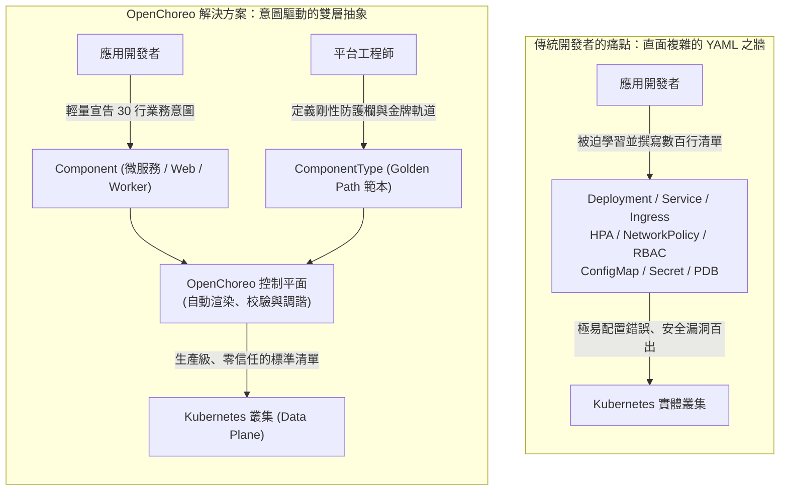
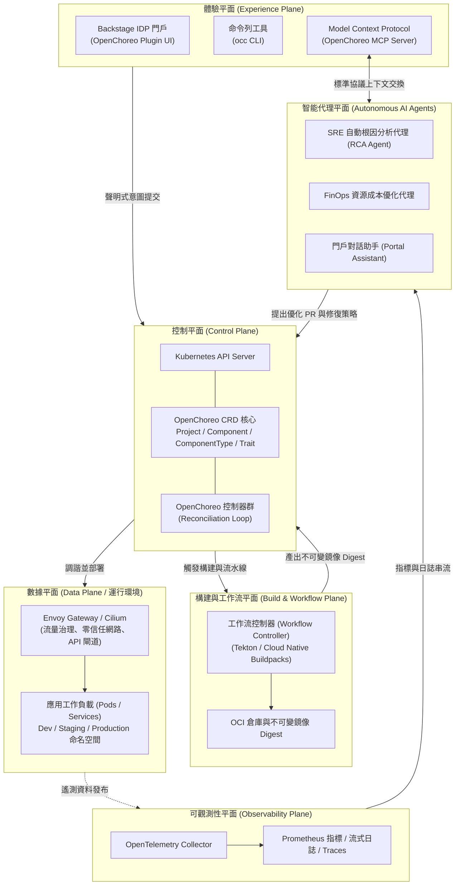
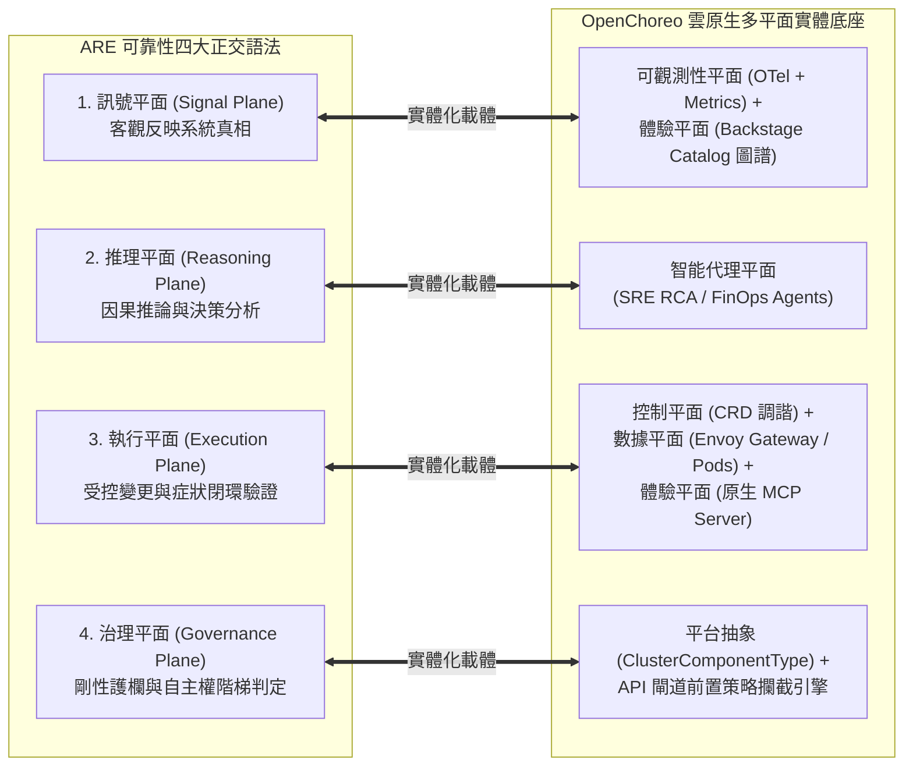
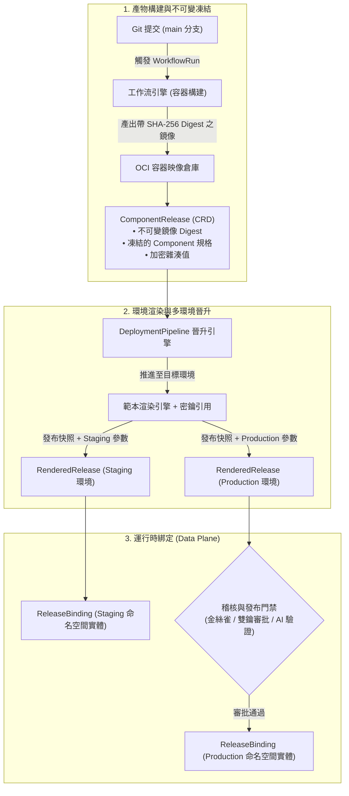
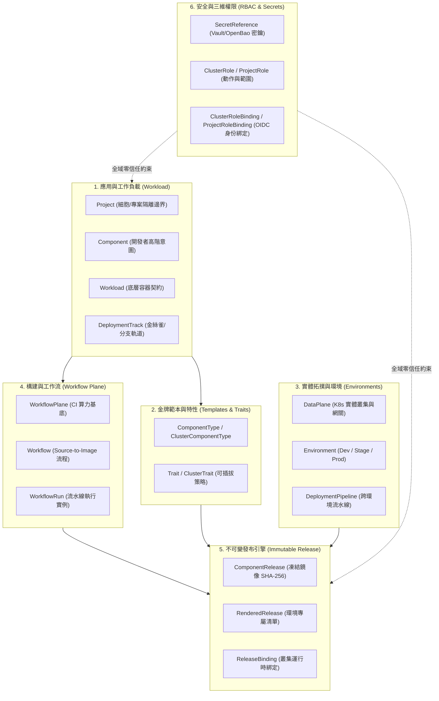
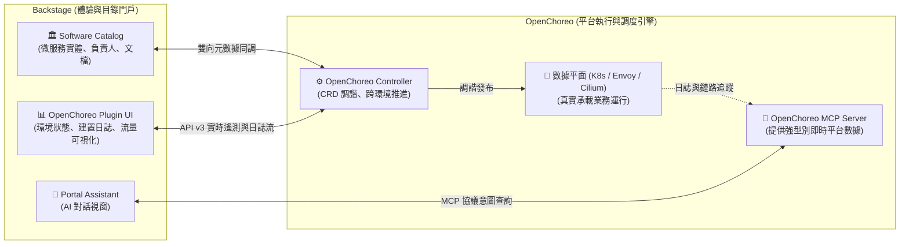
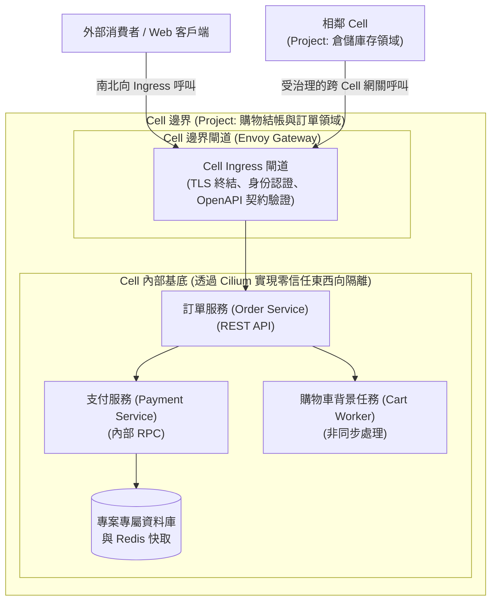
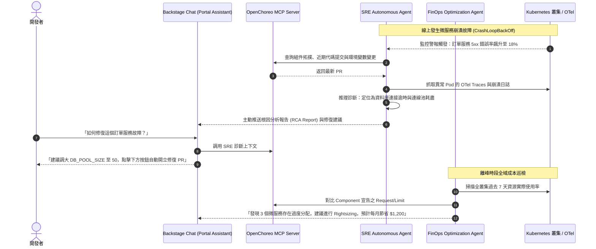

# 12

# OpenChoreo：CNCF 雲原生內部開發者平台與 Agentic AI 落地實踐

在第 11 章中，我們全面剖析了作為內部開發者門戶（Internal Developer Portal, IDP）事實標準的 **Backstage**。Backstage 以其優雅的軟體目錄（Software Catalog）、軟體範本（Scaffolder）、技術文檔（TechDocs）與外掛生態系，成功解決了企業在微服務擴展歷程中的「服務發現」與「認知過載」難題。

然而，當許多平台工程團隊滿懷熱情地將 Backstage 引入組織後，往往很快就會撞上一道更深層的架構現實：

> **「Backstage 是一個優秀的『門戶（Portal）』，但它本身並不是一個『平台執行引擎（Platform Execution Engine）』。」**

Backstage 能告訴開發者有哪些服務存在、能透過 Scaffolder 發起 Pull Request，但它本身並不負責管理 Kubernetes 資源的調度運作、動態環境隔離、網路流量分割（Traffic Splitting）、服務網格安全策略，以及自動化可觀測性鏈路的裝配。為了填補「門戶」與「底層基礎設施」之間的巨大鴻溝，許多平台團隊不得不撰寫數以萬計的「膠水代碼（Glue Code）」，將 Backstage、ArgoCD、Crossplane、Terraform、Prometheus 與 Envoy 生硬地拼湊在一起。這種拼裝方案往往架構脆弱、升級維護極為痛苦，甚至讓平台團隊自身淪為新的運維瓶頸。

更重要的是，隨著**代理式 AI（Agentic AI）**與**模型上下文協議（Model Context Protocol, MCP）**的崛起，我們迫切需要一個**能讓 AI 代理安全感知狀態、精準推理診斷，並能在雲原生環境中閉環執行維運任務的現代化控制平面**。

正是在這樣的技術浪潮下，**OpenChoreo** 應運而生。作為 2024 年正式加入 **雲原生運算基金會（CNCF）** 的 Sandbox 開源專案（源自 WSO2 的企業級雲原生實踐，官網：[https://openchoreo.dev/docs/](https://openchoreo.dev/docs/)），OpenChoreo 專為解決現代內部開發者平台（IDP）的架構斷層而設計。

本章將帶你深入 OpenChoreo 的核心世界，剖析其**多平面架構（Multi-Plane Architecture）**、解析開發者與平台工程師的**宣告式抽象分工**、探討其與 **Backstage** 的天作之合，並重點解密其**原生整合 MCP 與自主維運代理（SRE Agent、FinOps Agent）**的劃時代設計。

---

# 為什麼需要 OpenChoreo？消滅 Kubernetes 的「YAML 之牆」

在雲原生普及的今天，Kubernetes 已經成為事實上的分散式雲端作業系統。然而，對於廣大的業務應用開發者而言，Kubernetes 的學習曲線無異於一場噩夢。



## 痛點一：從「業務邏輯」到「基礎設施細節」的認知超載
一個普通的 Python FastAPI 或 Go 微服務，在原始碼層面可能只有幾百行業務邏輯。但為了將其可靠地上線到 Kubernetes 生產叢集，開發者通常被迫撰寫並維護：

* `Deployment`（包含探針、資源 Limit/Request、生命週期勾點）
* `Service` 與 `HTTPRoute` / `Ingress`（包含負載平衡、TLS 證書設定）
* `HorizontalPodAutoscaler`（HPA 彈性擴縮設定）
* `NetworkPolicy`（零信任網路隔離規則）
* `PodDisruptionBudget`（PDB 高可用保障）

這就是業界常說的**「YAML 之牆（The YAML Wall）」**。開發者將大量心力浪費在複製貼上晦澀的 Kubernetes 清單上，一旦某個安全欄位漏填（例如缺少 `runAsNonRoot` 或記憶體限制過大），就會威脅整個叢集的穩定性。

## 痛點二：黑盒 PaaS vs. 白盒 Kubernetes 的兩難
為了解決這個問題，過往許多團隊嘗試採用傳統 PaaS（如 Heroku 或早期自建系統）。但黑盒 PaaS 往往會完全封裝底層細節，當業務規模增長、需要進行精細的流量分割、服務網格調校或混合雲遷移時，PaaS 的局限性就會顯露無遺。

**OpenChoreo 的核心哲學是：「增強 Kubernetes，而非掩蓋 Kubernetes（Augment, not hide, Kubernetes）。」**

* 它是 **Kubernetes-native** 的：所有抽象概念均由 Kubernetes 自訂資源（CRD）實現，以 Kubernetes API 作為唯一的權威事實來源（System of Record）。
* 它嚴格落實 **GitOps**：開發者表達高階意圖（Component），平台團隊宣告架構規則（ComponentType），OpenChoreo 在叢集內部自動調諧生成符合組織安全規範的底層清單。

---

# OpenChoreo 多平面架構（Multi-Plane Architecture）

OpenChoreo 採用了清晰的領域驅動（Domain-Driven）多平面系統設計，將平台的各項職責精確解耦：



## 1. 控制平面（Control Plane）
控制平面是 OpenChoreo 的中心大腦。它運行在 Kubernetes 叢集內部，由一組輕量且高效的 Kubernetes Controller 與 CRD 組成。控制平面的職責是：

* 監聽開發者提交的 `Component` 與平台工程師維護的 `ClusterComponentType`；
* 評估並動態綁定可插拔的 `Trait` 運維特性（如自動擴展、限流策略）；
* 執行參數驗證、安全防護欄校驗；
* 動態編譯並生成底層 Kubernetes 資源（Deployment、Service、Envoy HTTPRoute、NetworkPolicy 等）；
* 管理跨環境（Development ➔ Staging ➔ Production）的晉升流水線（DeploymentPipeline）。

## 2. 構建與工作流平面（Build & Workflow Plane）
構建與工作流平面直接在 Kubernetes 上實現了「代碼到產物」的自動化，不再依賴外部黑盒 CI 伺服器：

* **原始碼到鏡像流水線（Source-to-Image）**：透過 `Workflow` 與 `WorkflowRun` 資源管理，觸發雲原生容器打包（整合 Buildpacks、Kaniko 或 Tekton）；
* **產物完整性保障**：生成帶有加密 SHA-256 Digest 的不可變容器鏡像，作為後續 `ComponentRelease` 不可變發布實體的權威基石。

## 3. 數據平面（Data Plane）
數據平面是應用程式容器實際運行的場所。OpenChoreo 支援單叢集或跨多叢集架構。在數據平面中：

* **網路與閘道**：全面整合 **Envoy Gateway**（遵循 Kubernetes Gateway API 標準）與 **Cilium**，實現高效能流量調度、金絲雀發布（Canary Deployment）、零信任 mTLS 通訊與細粒度網路存取隔離。
* **執行單元（Cells）**：採用 Cell-Based 架構思想，將相關聯的微服務、資料庫快取與閘道封裝為高內聚、自給自足的安全運作單元，大幅降低系統間的爆炸半徑（Blast Radius）。

## 4. 體驗平面（Experience Plane）
體驗平面為團隊提供多元且統一的使用者介面：

* **Backstage IDP 門戶**：透過官方 OpenChoreo Backstage Plugin，為工程師提供一站式的圖形化儀表板。
* **`occ` CLI**：專為喜歡終端機操作的工程師設計的高效命令列工具。
* **Model Context Protocol（MCP）伺服器**：為外部 AI 代理開放的標準協議介面，使大語言模型能安全讀取平台拓撲與資源狀態。

## 5. 可觀測性平面（Observability Plane）
基於 OpenTelemetry（OTel）建構，原生收集所有微服務的指標（Metrics）、日誌（Logs）與鏈路追蹤（Traces），並提供統一的查詢端點供工程師與 AI 代理使用。

## 6. 智能代理平面（Agentic Plane）
專門運行平台自治維運代理（如 SRE RCA 代理、FinOps 成本優化代理與對話助手）。代理平面透過標準協議從可觀測性平面獲取狀態，透過 MCP 伺服器交換拓撲與上下文，並向控制平面提交優化策略與修復建議。

---

## 專題深探：OpenChoreo 五大架構平面與 ARE 四大可靠性平面的精準映射

在《代理式可靠性工程》（ARE）第 6 章與本書第 6 章延伸篇（Ch 06-EX）中，我們確立了代理式可靠性系統的四大正交語法：**訊號平面（Signal Plane）、推理平面（Reasoning Plane）、執行平面（Execution Plane）與治理平面（Governance Plane）**。

許多團隊困惑於「理論上的可靠性四平面，在雲原生真實世界中到底該如何拼裝？」OpenChoreo 的多平面架構正是這個問題的最佳解答。兩者呈現出精確的架構對位關係：



| ARE 四大可靠性平面 | OpenChoreo 雲原生實體平面 | 職責邊界與物理協同機制 |
| :--- | :--- | :--- |
| **訊號平面<br/>(Signal Plane)** | **可觀測性平面** + **Backstage Catalog** | OpenTelemetry Collector 原生採集指標與分散式鏈路，並與 Backstage Software Catalog 綁定團隊擁有權（`catalog-info.yaml`），輸出無主觀偏見的「決策級遙測」。 |
| **推理平面<br/>(Reasoning Plane)** | **智能代理平面** | RCA 代理與 FinOps 代理在此平面運行。透過 GraphRAG 結合 TechDocs 進行因果診斷，產出「暫態緩解建議」與「修復 PR 草稿」，絕不直接碰觸底層叢集。 |
| **執行平面<br/>(Execution Plane)** | **控制平面** + **數據平面** + **MCP 伺服器** | 代理呼叫 OpenChoreo 原生 MCP Tools，由控制平面進行 Kubernetes CRD 宣告式調諧，在數據平面下發具備 TTL 的 Envoy 流量限流規則或觸發 GitOps 發布。 |
| **治理平面<br/>(Governance Plane)** | **平台抽象層 (`ClusterComponentType`)** | 平台團隊定義的 CRD 規範、資源配額與 API 閘道前置過濾器。以確定性代碼鎖死 ≤ 15% 爆炸半徑、雙密鑰聯鎖（Dual-Key）與 L0~L4 動態自主階梯。 |

這種映射關係向我們揭示了一個核心真理：**OpenChoreo 不是另一個單純的部署工具，它是 ARE 代理式可靠性語法在雲原生生態中的第一座實體工廠**。

---

# 核心抽象體系：開發者抽象 vs. 平台工程師抽象

OpenChoreo 最精妙的架構設計，在於將整個企業的平台工程邊界劃分為兩層對稱且互不干擾的宣告式抽象：

| 維度 | 開發者抽象（Developer Abstractions） | 平台工程師抽象（Platform Abstractions） | 發布與環境晉升生命週期 |
| :--- | :--- | :--- | :--- |
| **核心關注點** | 業務邏輯、程式碼倉庫、環境變數、公開端點 | 資安防護欄、合規基準線、網路拓撲、資源配額 | 不可變發布快照、環境晉升零組態漂移、秒級回滾 |
| **核心 CRD 資源** | `Project`, `Component`, `DeploymentTrack`, `Workload` | `ClusterComponentType`, `Trait`, `Environment`, `DataPlane`, `DeploymentPipeline` | `ComponentRelease`, `RenderedRelease`, `ReleaseBinding` |
| **YAML 行數** | 極致精簡（通常 20 ~ 40 行） | 結構化規範範本（定義參數 Schema 與資源模板） | 系統自動渲染生成，嚴格加密雜湊驗證 |
| **互動模式** | 自助服務（Self-Service）、意圖表達 | 鋪好之路設計（Golden Path Crafting）、全域治理 | GitOps 驅動晉升門禁與 AI 閉環驗證 |

## 1. 開發者視角：標準 `Component` 宣告

開發者只需在自己的 Git 專案中維護一份極簡的 `component.yaml`：

```yaml
apiVersion: openchoreo.dev/v1alpha1
kind: Component
metadata:
  name: payment-service
  namespace: ecommerce-project
spec:
  # 指向平台團隊預先建置的金牌範本
  type: microservice-rest
  
  # 業務代碼與建置資訊
  source:
    git:
      url: https://github.com/acme-corp/payment-service.git
      branch: main
    build:
      dockerfile: ./Dockerfile
      
  # 業務端口與端點意圖
  endpoints:
    - name: api
      port: 8080
      type: REST
      schema: ./openapi.yaml     # 關聯 OpenAPI 介面契約規格
      visibility: internal
      
  # 僅需填寫業務專屬環境變數
  env:
    - name: LOG_LEVEL
      value: "INFO"
    - name: DB_CONNECTION_SECRET
      valueFrom:
        secretKeyRef:
          name: payment-db-credentials
          key: connection-string

  # 可組合特性 (Traits)：動態疊加運維能力，無需修改範本
  traits:
    - type: auto-scaler
      properties:
        minReplicas: 2
        maxReplicas: 10
        cpuUtilizationPercentage: 75
    - type: rate-limiter
      properties:
        requestsPerSecond: 500
```

> **注意與第 11 章 API Catalog 的聯動**：
> 1. 開發者在此處完全不需要指定 Kubernetes 的 Selector、Pod Spec、Affinity、ReplicaSet 或 Envoy HTTPRoute 語法！一切底層繁雜設定皆由所引用的 `type: microservice-rest` 決定。
> 2. 注意 `endpoints` 中的 `schema: ./openapi.yaml`：OpenChoreo 不僅將其用於底層 Envoy Gateway 的路由校驗與請求過濾，更將其作為**契約驅動平台（Contract-Driven Platform）**的核心依據。這份 OpenAPI 規格會由控制平面自動同調至第 11 章所探討的 Backstage API 目錄中。

## 2. 平台工程師視角：`ClusterComponentType` 範本

平台團隊則負責撰寫並維護可重用的 `ClusterComponentType`。這份定義包含了強型別參數校驗（JSON Schema）與動態生成底層 Kubernetes 資源的宣告範本：

```yaml
apiVersion: openchoreo.dev/v1alpha1
kind: ClusterComponentType
metadata:
  name: microservice-rest
spec:
  description: "全公司統一的標準 REST 微服務金牌軌道 (內建 Cilium 網路隔離與 Envoy 路由)"
  
  # 定義開發者被允許傳遞的參數規則
  parametersSchema:
    openAPIV3Schema:
      type: object
      properties:
        cpuRequest:
          type: string
          default: "250m"
        memoryRequest:
          type: string
          default: "512Mi"
          
  # 平台強制注入的底層 Kubernetes 產物模板
  resources:
    - template:
        apiVersion: apps/v1
        kind: Deployment
        metadata:
          name: "{{ .component.metadata.name }}"
        spec:
          replicas: 2
          template:
            spec:
              containers:
                - name: app
                  image: "{{ .component.status.latestImage }}"
                  resources:
                    requests:
                      cpu: "{{ .parameters.cpuRequest }}"
                      memory: "{{ .parameters.memoryRequest }}"
                    limits:
                      cpu: "1000m"
                      memory: "1Gi"
                  securityContext:
                    runAsNonRoot: true
                    allowPrivilegeEscalation: false
```

## 3. 可插拔能力擴充：Trait 架構防止「範本爆炸」

在大型企業架構中，不同微服務的需求極度發散。若平台團隊僅依賴 `ClusterComponentType`，將不可避免地遭遇**「範本爆炸（Template Explosion）」**的困境——被迫維護 `microservice-rest-autoscale`、`microservice-rest-ratelimit`、`microservice-rest-gpu` 等數十種排列組合。

OpenChoreo 借鏡雲原生架構引入了 **`Trait`** 機制。`Trait` 封裝的是獨立、正交的運維層關注點（如 HPA 自動擴縮、Envoy 限流、Cilium 出站過濾或定時備份）：

```yaml
apiVersion: openchoreo.dev/v1alpha1
kind: Trait
metadata:
  name: auto-scaler
spec:
  appliesToWorkloads:
    - "microservice-rest"
    - "worker-service"
  propertiesSchema:
    openAPIV3Schema:
      type: object
      required: ["minReplicas", "maxReplicas"]
      properties:
        minReplicas:
          type: integer
          minimum: 1
        maxReplicas:
          type: integer
          maximum: 50
        cpuUtilizationPercentage:
          type: integer
          default: 80
  resources:
    - template:
        apiVersion: autoscaling/v2
        kind: HorizontalPodAutoscaler
        metadata:
          name: "{{ .component.metadata.name }}-hpa"
        spec:
          scaleTargetRef:
            apiVersion: apps/v1
            kind: Deployment
            name: "{{ .component.metadata.name }}"
          minReplicas: {{ .properties.minReplicas }}
          maxReplicas: {{ .properties.maxReplicas }}
          metrics:
            - type: Resource
              resource:
                name: cpu
                target:
                  type: Utilization
                  averageUtilization: {{ .properties.cpuUtilizationPercentage }}
```

透過 Trait，平台工程師只需定義一次運維能力規則，開發者即可如樂高積木般隨需附加，徹底避免維護數十種冗餘的微服務範本。

## 4. 企業級不可變發布生命週期：從 ComponentRelease 到 ReleaseBinding

OpenChoreo 在工程層面最值得稱道的一點，是其**三階段的不可變發布（Immutable Release）生命週期**。傳統 CI/CD 常因跨環境「重新渲染清單」導致組態漂移（Configuration Drift）——在 Staging 測試成功的組件，推到 Production 時因 YAML 參數微調導致非預期事故。

OpenChoreo 透過嚴格的加密不可變性確保零組態漂移：



1. **`ComponentRelease`（凍結的發布實體）**：
   代碼合併後觸發 `WorkflowRun`，一旦構建與單元測試通過，系統立即產出 `ComponentRelease`。此物件鎖定了容器鏡像唯一的 SHA-256 Digest、OpenAPI 契約與基礎配置，且具備唯讀不可變性。
2. **`RenderedRelease`（環境特定的宣告清單）**：
   當透過 `DeploymentPipeline` 執行跨環境晉升（例如 Dev ➔ Staging ➔ Prod）時，控制平面將不可變的 `ComponentRelease` 與目標環境的特定參數及金鑰（`SecretReference`）合併渲染，產出確定性的 `RenderedRelease`。
3. **`ReleaseBinding`（真實運行的叢集綁定）**：
   `ReleaseBinding` 將 `RenderedRelease` 與目標 Data Plane 上的實體命名空間正式綁定。若線上發生故障，回滾操作僅需將 `ReleaseBinding` 指向上一版驗證通過的歷史快照，叢集狀態在數百毫秒內即可恢復，完全不需要重新拉取代碼或重構鏡像。

透過這種解耦：

* 平台工程師修改了 `ClusterComponentType` 中的安全原則（例如升級了全公司的安全 Baseline），所有引用該範本的微服務在下一次調諧時自動合規，完全無需逐一通知開發者修改 YAML！
* 開發者獲得了極致流暢的自助服務體驗，再也不會因為少寫一個 Kubernetes 欄位而排查半天。
* 具備完整可追溯性（Auditability）：生產環境每一個正在運行的 Pod，皆可精確追溯至唯一的 `ComponentRelease`、Git Commit SHA 與審批記錄。

---

# OpenChoreo 全量 CRD 資源光譜一覽表

許多平台工程討論僅聚焦在 `Project` 與 `Component` 等高階入口，但 OpenChoreo 本質上是一套極度嚴謹且完整的 Kubernetes-Native 控制平面。在 `openchoreo.dev/v1alpha1` API 群組下，其實完整涵蓋了**六大業務領域、共 20 個專屬自訂資源定義（CRD）**：



下表為 OpenChoreo 全量 CRD 資源光譜速查表，清晰勾勒出各資源的範疇、操作主體與架構職責：

| 業務領域 | CRD 資源名稱 (`kind`) | 作用範圍 (Scope) | 主要操作主體 | 架構職責與物理機制 |
| :--- | :--- | :--- | :--- | :--- |
| **應用與工作負載** | **`Project`** | Namespaced | 架構師 / Squad Lead | 邏輯命名空間邊界與 Cell 細胞隔離單元，聚合相關微服務與發布管線。 |
| | **`Component`** | Namespaced | 應用開發者 | 開發者聲明式入口，宣告程式碼倉庫、公開端口、環境變數與可選特性（約 30 行 YAML）。 |
| | **`Workload`** | Namespaced | 控制平面 (編譯器) | 由 Component 編譯而成的底層容器合約，具體規定容器鏡像、端口映射、探針與資源 Quota。 |
| | **`DeploymentTrack`** | Namespaced | 開發者 / 發布工程師 | 管理組件內部的平行發布軌道（如 `main` 主幹、`canary-v2` 金絲雀、`hotfix` 補丁軌道）。 |
| **金牌範本與特性** | **`ComponentType`** /<br/>**`ClusterComponentType`** | Namespaced /<br/>Cluster | 平台工程師 | 平台統一的金牌範本（Golden Path），內含 JSON Schema 參數校驗與動態生成的 K8s 產物模板。 |
| | **`Trait`** /<br/>**`ClusterTrait`** | Namespaced /<br/>Cluster | 平台工程師 | 可插拔的運維外掛（如 HPA 自動擴縮、Envoy 限流、Cilium 出站網路安全策略），防止範本爆炸。 |
| **實體拓撲與環境** | **`DataPlane`** | Cluster | 基礎設施 / 平台管理員 | 宣告底層真實承載工作負載的 Kubernetes 叢集、CNI 網路與 Envoy Gateway 拓撲。 |
| | **`Environment`** | Cluster | 平台工程師 | 定義軟體生命週期階段（`development`, `staging`, `production`），映射至實體叢集與命名空間。 |
| | **`DeploymentPipeline`** | Namespaced | 平台 / 發布工程師 | 宣告多環境跨階段晉升規則、自動化測試門禁與人工/AI 審批流水線。 |
| **構建與工作流** | **`WorkflowPlane`** | Cluster | 平台管理員 | 管理專屬的流水線運算節點與執行器資源（基於 Tekton / Kaniko / Cloud Native Buildpacks）。 |
| | **`Workflow`** | Namespaced | 平台 / DevOps 工程師 | 宣告式 CI 流水線定義，涵蓋源碼拉取、容器鏡像編譯、靜態資安掃描與測試套件。 |
| | **`WorkflowRun`** | Namespaced | 自動化調度控制器 | 單次實例化的流水線執行任務，即時捕捉建置串流日誌並輸出最終容器產物。 |
| **不可變發布引擎** | **`ComponentRelease`** | Namespaced | Workflow 控制器 | 加密凍結之不可變發布快照，鎖定唯一的鏡像 SHA-256 Digest、OpenAPI 契約與基礎配置。 |
| | **`RenderedRelease`** | Namespaced | 晉升調諧引擎 | 將 `ComponentRelease` 與特定環境參數及機密資訊合併渲染後的確定性 Kubernetes 清單。 |
| | **`ReleaseBinding`** | Namespaced | 發布調諧控制器 | 將 `RenderedRelease` 與目標環境上的實體命名空間正式綁定，實現零組態漂移與秒級回滾。 |
| **安全、密鑰與權限** | **`SecretReference`** | Namespaced | 資安 / 平台工程師 | 外部機密存儲引用（透過 External Secrets Operator 橋接 HashiCorp Vault、OpenBao 或 AWS Secrets Manager）。 |
| | **`ClusterRole`** /<br/>**`ProjectRole`** | Cluster /<br/>Namespaced | 資安架構師 | 定義對 OpenChoreo 資源的細粒度操作動詞（`verbs` 如 `create`, `deploy`, `view`）。 |
| | **`ClusterRoleBinding`** /<br/>**`ProjectRoleBinding`** | Cluster /<br/>Namespaced | 平台管理員 | 將企業 OIDC 身分識別（如 Google Workspace、Entra ID）與角色在全域、專案或環境範圍進行綁定。 |

---

## 專題深探：OpenChoreo 企業級 OIDC SSO 與三維度 RBAC 權限引擎

在第 11 章中，我們重點實現了 **門戶層級的治理（Portal-Level Governance）**——透過 Google Workspace 認證使用者身份，並在 Backstage UI 上隱藏未授權的變更按鈕。然而，零信任平台工程的一條鋼鐵定律指出：

> **「絕對不能僅依賴 UI 前端的按鈕隱藏作為安全防線。底層平台控制平面必須具備獨立的身份驗證能力，對每一次 API 與 CRD 變更實施剛性授權檢查。」**

若工程師或自治 AI 代理繞過 Backstage 前端，直接透過 `occ` CLI 或 REST 端點發起呼叫，OpenChoreo 原生的 **企業級 OIDC 與三維 RBAC 引擎** 將作為權威看門人執行嚴格攔截。

```mermaid
flowchart TD
    subgraph IdentityLayer["企業身份提供商 (Corporate IdP)"]
        IdP["Google Workspace / Entra ID / Okta / Keycloak<br/>(簽發帶有 email 與 groups 聲明的 JWT)"]
    end

    subgraph ClientInterfaces["存取接入向量 (Access Vectors)"]
        CLI["occ CLI 命令列工具"]
        PortalProxy["Backstage 後端反向代理"]
        AgentClient["自治 AI 代理 (透過 MCP 通訊)"]
    end

    subgraph OpenChoreoAuth["OpenChoreo 控制平面安全核心"]
        JWTValidator["JWT 簽章與 OIDC 探索驗證器<br/>(解析 Claims: email, groups)"]
        RBACEngine["三維度 RBAC 決策引擎<br/>(Subject ✖ Action ✖ Scope)"]
    end

    subgraph ScopedExecution["受約束的執行範疇 (Scoped Execution)"]
        ClusterScope["範疇: Cluster-Wide<br/>(ClusterComponentType, DataPlane, Envoy Mesh)"]
        ProjectDev["範疇: Project checkout (Dev 環境)<br/>(Component 建立/部署, 日誌, 指標)"]
        ProjectProd["範疇: Project checkout (Prod 環境)<br/>(唯讀健康監控, 受稽核的晉升)"]
    end

    IdP -->|登入與憑證核發| ClientInterfaces
    ClientInterfaces -->|攜帶 Bearer JWT| JWTValidator
    JWTValidator --> RBACEngine

    RBACEngine -->|platform-admins 群組| ClusterScope
    RBACEngine -->|checkout-devs 群組 (可讀寫)| ProjectDev
    RBACEngine -->|checkout-devs 群組 (唯讀)| ProjectProd
```

### 1. 企業 OIDC 整合（串接 Google Workspace 與企業 IdP）
OpenChoreo 控制平面在 Helm values (`values.yaml`) 中即可直接宣告企業 OIDC Discovery 端點：

```yaml
security:
  authn:
    oidc:
      enabled: true
      issuer: "https://accounts.google.com"
      discoveryUrl: "https://accounts.google.com/.well-known/openid-configuration"
      clientId: "${OPENCHOREO_OIDC_CLIENT_ID}"
      claims:
        username: "email"
        groups: "groups"
```

無論呼叫來自開發者的 `occ` 終端、Backstage 後端代理或 AI Agent，皆需攜帶 OIDC 簽發的 JWT。控制平面藉由 JWKS 公鑰簽章與有效期限驗證通過後，提取出使用者的群組成員資格。

### 2. 三維度授權模型：Subject ✖ Action ✖ Scope
OpenChoreo 將每次操作的權限決策嚴格正規化為三個正交維度：

> **授權決策公式**：
> `Authorization Decision = f(Subject, Action, Scope)`

1. **Subject（發起主體是誰？）**：從 JWT Claims 中提取群組（`groups: platform-admins@company.com`、`groups: checkout-squad@company.com`）或個人信箱。
2. **Action（試圖執行什麼動作？）**：結構化動詞，如 `clustercomponenttype:create`、`component:deploy`、`component:view`。
3. **Scope（動作在何處生效？）**：
   * **`cluster`**：全域叢集層級（基礎設施、金牌範本、網關拓撲）。
   * **`project:<name>`**：專案層級（特定業務系統內的微服務與組件）。
   * **`environment:<name>`**：環境特定邊界（如允許在 `dev` 任意發布，但禁止直接在 `prod` 變更）。

### 3. 生產實戰：平台管理員 vs. 業務開發者唯讀隔離

#### A. 平台管理員全域綁定 (`ClusterRoleBinding`)
平台工程師具備叢集全域權限，可管理範本與資料平面：

```yaml
apiVersion: openchoreo.dev/v1alpha1
kind: ClusterRoleBinding
metadata:
  name: platform-engineers-admin-binding
subjects:
  - kind: Group
    name: platform-admins@yourcompany.com
roleRef:
  kind: ClusterRole
  name: platform-admin-role
```

#### B. 業務開發者領域範疇綁定 (`ProjectRoleBinding`)
業務開發組僅被授權管理自身領域專案，並受限於環境邊界：

```yaml
apiVersion: openchoreo.dev/v1alpha1
kind: ProjectRoleBinding
metadata:
  name: checkout-devs-binding
  project: checkout-project
subjects:
  - kind: Group
    name: checkout-squad@yourcompany.com
roleRef:
  kind: ProjectRole
  name: developer-readonly-prod
rules:
  # 生產環境：開發者只有唯讀權限
  - environments: ["prod"]
    actions:
      - "component:view"
      - "telemetry:logs:read"
      - "telemetry:metrics:read"
  # 開發環境：開發者擁有完整的建立、修改與發布權限
  - environments: ["dev"]
    actions:
      - "component:create"
      - "component:update"
      - "component:deploy"
      - "telemetry:*"
```

* **零信任防護結果**：若業務工程師試圖繞過 Backstage，在終端機執行 `occ component deploy --env prod`，OpenChoreo 控制平面解析 JWT 後發現該呼叫在 `prod` 範疇內缺乏權限，將立即拒絕並回傳 HTTP 403 Forbidden。

---

# OpenChoreo 與 Backstage 的深度整合

在現代平台工程的技術棧中，**Backstage 與 OpenChoreo 並非競爭對手，而是天造地設的共生體系**。



## 雙向聯動的五大價值

1. **從「靜態目錄」升級為「動態控制台」**：
   傳統 Backstage 目錄大多呈現靜態資訊（GitHub 地址、Owner 團隊）。而在整合 OpenChoreo Plugin 後，開發者點進某個 Component 實體頁面，就能直接看到該服務在 Dev、Stage、Prod 環境中的**即時運行狀態、Pod 副本數、端點 URL、記憶體消耗趨勢與即時串流日誌**。

2. **無縫銜接 Scaffolder 與 Component**：
   開發者利用 Backstage Scaffolder 建立專案時，範本除了產出業務骨架外，會自動在根目錄注入符合 OpenChoreo 規範的 `component.yaml`。專案建立完成後，OpenChoreo 控制器自動感知並拉起環境，真正達成「從點擊建立到服務上線只需 60 秒」。

3. **金絲雀流量視覺化（Canary Visualization）**：
   得益於 OpenChoreo 底層的 Envoy Gateway，開發者可以在 Backstage 介面上直觀拖動流量滑動條，將 10% 的生產流量導向新版 `DeploymentTrack`，並即時觀察錯誤率與延遲指標。

4. **消除膠水代碼的維護噩夢**：
   以往需要平台團隊手動整合 ArgoCD 插件、Kubernetes 插件、Prometheus 插件等多個獨立外掛；OpenChoreo 提供了一站式封裝的官方 Backstage 插件，將建置、發布、流量與監控整合在同一視窗中。

5. **自動化 API 契約註冊與門戶呈現（Zero-Touch API Cataloging）**：
   微服務上線後，最怕文檔與代碼脫節。在 OpenChoreo 體系下，只要在 `component.yaml` 中宣告了 `endpoints[].schema: ./openapi.yaml`，OpenChoreo 控制平面在調諧完成後，會**自動向第 11 章介紹的 Backstage Catalog 註冊或更新對應的 `kind: API` 實體**，並自動注入 Envoy Gateway 生成的內部與外部 Base URL。微服務部署成功的瞬間，全組織工程師即可在 Backstage 的 API Docs 分頁看到包含即時路由與測試沙盒的 Swagger UI，徹底打通從底層數據平面（Data Plane）到體驗平面（Experience Plane）的最後一哩路。

---

# 細胞架構（Cell-Based Architecture, CBA）：領域邊界與架構治理實踐

當企業的微服務規模擴展至數百或數千個時，組織往往會深陷**「微服務義大利麵陷阱（Spaghetti Trap）」**：東西向網路呼叫網狀交織、跨服務連鎖故障難以定位，分散式死鎖頻傳。

為了解決這個系統性頑疾，OpenChoreo 全面實作了 **細胞架構（Cell-Based Architecture, CBA）** 模式（這也是由 WSO2 開創並被廣泛借鏡的現代雲原生參考架構）。在 OpenChoreo 中，**每一個業務 `Project` 即代表一個實體與邏輯上的「Cell（細胞）」邊界**：



### OpenChoreo Cell 架構的三大剛性治理法則

1. **南北向與東西向嚴格解耦**：
   * **Cell 入口閘道（南北向）**：Cell 對外嚴格透過獨立的邊界閘道暴露能力。外部消費者或相鄰 Cell **絕無可能**直接透過 IP 存取內部的 Pod 或私有端口。
   * **Cell 內部網格（東西向）**：Cell 內部微服務間的呼叫，由 Cilium 與 Envoy 在專屬命名空間中進行高吞吐、零信任的 mTLS 加密通訊。
2. **確定性限制爆炸半徑（≤ 15%）**：
   完全符合《代理式可靠性工程》（ARE）的治理準則：即使內部 `PaymentSvc` 發生記憶體洩漏或嚴重死鎖，事故只會被嚴格隔離在該 Cell 內部。Cell 邊界閘道的斷路器（Circuit Breaker）會立即阻斷上游衝擊，防止故障演變成全叢集大雪崩。
3. **對齊康威定律的領域自治**：
   每個 Cell 直接映射至獨立的領域團隊（Domain Squad）。團隊擁有在自己的 Cell 內部快速迭代、部署金絲雀版本與調整組件的完全自治權，無需與全公司的基礎設施團隊反覆協調跨服務防火牆規則。

---

# 雲原生 IDP 生態光譜全景對比（Comparison Matrix）

許多技術主管常問：OpenChoreo 與 Backstage、KubeVela、ArgoCD、Crossplane 等 CNCF 明星專案到底有何本質區別？現代平台工程並非「零和博弈」，而是將各項技術各司其職地放置於正交的架構層次中：

| 維度 | OpenChoreo | Spotify Backstage | KubeVela / OAM | ArgoCD | Crossplane / Terraform |
| :--- | :--- | :--- | :--- | :--- | :--- |
| **核心定位** | **完整內部開發者平台 (IDP)** | **開發者門戶與服務目錄** | **應用交付與 OAM 內核引擎** | **宣告式 GitOps 同步控制器** | **雲端基礎設施宣告與開箱 (IaaS)** |
| **架構涵蓋層級** | 全生命週期 (控制、工作流、數據、可觀測性、AI 平面) | 體驗平面 (UI 前端與軟體資產目錄) | 控制平面內核 (Application / Trait 解析) | 執行層 (將 Git 清單持續比對同步至 K8s) | 基礎設施層 (雲端 DB、VPC、S3 存儲桶) |
| **底層執行引擎** | 內建 K8s 控制器集群與 Envoy Gateway | 無 (完全依賴社群外掛拼裝後端) | 基於 OAM 與 CUE 語言的模板轉換引擎 | Kubernetes 原生 CRD 同步器 (`Application`) | Kubernetes CRD 封裝雲端 API |
| **開發者自服務** | 極高 (30 行意圖 `component.yaml` 與 `occ` CLI) | 高 (Scaffolder 軟體範本與 UI 表單) | 中 (需學習 OAM Application 規格) | 低 (直面原始 K8s 清單或 Helm/Kustomize) | 低 (平台工程師導向之基礎設施 Composition) |
| **多環境晉升管理** | 原生內建 (`DeploymentPipeline`, `ComponentRelease`) | 需手動串接外部 CI 或 Argo Rollouts 外掛 | 需透過 Policy/Workflow 腳本編排多目標 | 透過分支或目錄結構管理環境清單 | 透過 Workspace 或目錄管理環境實例 |
| **Agentic AI 與 MCP** | **原生一等公民** (內建 MCP Server 與 RCA/FinOps 代理) | 社群外掛聊天視窗；缺乏標準化底層協議鏈路 | 需自行擴充 Controller；無原生 MCP 支援 | 基於 Webhook 觸發；無原生 MCP 上下文層 | CLI 查詢狀態；無原生 MCP 推理閉環 |

### 企業級「金牌技術棧（Golden Stack）」協同典範

在成熟的企業級平台工程實踐中，這些工具能組裝成完美的互補閉環：
1. **Crossplane**：宣告並開箱雲端基礎設施（AWS RDS、Kafka、雲端儲存）；
2. **OpenChoreo**：將業務意圖轉換為微服務 Workload，配置 Envoy Gateway 路由，並凍結不可變的 `ComponentRelease` 快照；
3. **ArgoCD**：負責將 OpenChoreo 渲染出的不可變清單自動同步至全球多叢集；
4. **Backstage**：提供統一的企業級單一入口體驗（Single Pane of Glass）；
5. **OpenChoreo MCP Server**：將全平台的拓撲事實開放給 SRE Agent 與 FinOps Agent，實現故障閉環自癒與成本優化。

---

# 原生 Agentic AI 與 MCP 融合架構

OpenChoreo 最具前瞻性的亮點，莫過於其**在雲原生平台工程領域率先全面擁抱 Model Context Protocol（MCP）與自治型維運代理（Autonomous AI Agents）**。

在本書第 5 章與第 7 章中，我們探討了如何透過自建 MCP 伺服器與 Strands 代理為平台注入智慧。而 OpenChoreo 則直接在**平台核心內建了開箱即用的 MCP 伺服器與三大自治代理**：



## 1. 核心亮點一：SRE 自治診斷代理（SRE Agent）
在傳統維運中，當微服務在生產環境發生故障（如 OOMKilled、CrashLoopBackOff、HTTP 504 Gateway Timeout）時，值班工程師往往需要花費數十分鐘甚至數小時在各個系統間切換。正如第 11 章圖 11.2 所展示的真實門戶聯動畫面，當 ArgoCD 與 OpenChoreo 偵測到金絲雀 Pod 崩潰時，SRE Agent 會直接在 Backstage 上主動推播結構化診斷結論與修復按鈕。

OpenChoreo 內建的 **SRE Agent** 實現了全自動的事故破案流程：

* **事件觸發**：當 OpenTelemetry 或 Prometheus 偵測到異常指標時，SRE Agent 自動喚醒；
* **上下文聚合**：代理透過 OpenChoreo MCP 伺服器，自動關聯該 Component 的依賴拓撲、最近是否有新版本發布、Git Commit 記錄，以及近期組態變更；
* **深層日誌與鏈路分析**：代理自動下鑽追蹤異常 Trace ID，分析例外堆疊資訊；
* **自動產出 RCA 報告**：在幾秒鐘內產出結構化的根因分析報告（Root Cause Analysis），精確指出：「*本次故障係因 PR #42 引入的 Redis 逾時參數過短，導致上游連接池耗盡*」，並給出具體建議修復值。

## 2. 核心亮點二：FinOps 資源成本優化代理（FinOps Agent）
多數開發團隊為了防止線上出問題，往往傾向於過度配置資源（例如實際只需 200MB 記憶體，卻設定了 4GB Request）。在大規模叢集中，這種「資源幽靈」會導致巨大的雲端成本浪費。

OpenChoreo 的 **FinOps Agent** 扮演著全天候的財務健康顧問：

* 持續分析各 Component 的實際 CPU/Memory 使用峰值與常態值；
* 與平台工程師設定的 SLO 指標交叉比對；
* 產出精準的 **Rightsizing（規格最適化）** 建議，並能一鍵發起修改 `component.yaml` 的 Pull Request，在確保穩定性的前提下大幅降低雲端帳單。

## 3. 核心亮點三：門戶對話助手（Portal Assistant）與原生 MCP 伺服器
OpenChoreo 開箱即附帶原生實作的 **Model Context Protocol（MCP）伺服器**：

* 它將 OpenChoreo 控制平面的所有實體（Projects, Components, Builds, Releases, Environments）封裝為標準化的 **MCP 資源（Resources）**；
* 將查詢運行狀態、調取 OTel 遙測日誌封裝為 **MCP 工具（Tools）**；
* **OpenAPI 規格昇華為 AI 工具（OpenAPI-to-MCP Tooling）**：MCP 伺服器還能自動讀取各組件宣告的 OpenAPI 規格，動態轉換為 AI 代理的結構化 Tool Definitions。當值班工程師詢問「*幫我向支付服務發送一筆測試扣款以驗證網關*」時，AI 助理能直接調取 `payment-service` 的 OpenAPI Schema、精確組裝符合校驗規則的 JSON Payload，並安全觸發沙盒測試。
* 開發者在 Backstage 的聊天視窗中，可以使用自然語言隨時提問：「*查看支付服務目前在生產環境的 Pod 狀態*」、「*幫我抓出過去半小時的所有 ERROR 日誌*」——助理透過 MCP 協議獲得安全、權威、即時的結構化資料，徹底告別傳統聊天機器人的幻覺。

---

# 動手實戰：在本地體驗 OpenChoreo

為了讓讀者能夠親自體驗 OpenChoreo 的強大魅力，官方提供了極為簡潔的本地快速起步流程。

## 1. 前置依賴環境
* **Docker**：已啟動並正常運行。
* **Kubectl**：Kubernetes 命令列工具。
* **Kind**（Kubernetes in Docker）：本地快速啟動叢集。

## 2. 安裝 OpenChoreo 命令列工具（`occ`）
在終端機中執行官方安裝指令碼：
```bash
curl -fsSL https://openchoreo.dev/install.sh | bash
```
驗證安裝結果：
```bash
occ version
```

## 3. 一鍵建立本地全功能叢集
執行以下指令，`occ` 將自動透過 Kind 建立一個名為 `openchoreo-local` 的叢集，並自動安裝 OpenChoreo 控制平面、Envoy Gateway 與核心 CRD：
```bash
occ cluster create --wait
```

## 4. 建立你的第一個專案與微服務
建立一個名為 `demo-project` 的命名空間專案，並部署一個標準的範例微服務：
```bash
# 建立專案
occ project create demo-project

# 建立微服務組件 (引用官方示範倉庫)
occ component create hello-service \
  --project demo-project \
  --type microservice-rest \
  --git-repo https://github.com/openchoreo/sample-apps \
  --git-branch main \
  --context-dir ./hello-world \
  --port 8080
```

## 5. 觀察即時調諧與驗證端點
透過 `occ` 查看元件的建置與調諧狀態：
```bash
occ component status hello-service --project demo-project
```
短短數十秒內，你會看到 OpenChoreo 自動完成了容器鏡像建置、產生了具備 Envoy Gateway 路由的 HTTPRoute，並成功上線。

呼叫公開端點測試：
```bash
curl http://localhost:8080/hello
```
終端機將回傳：
```json
{
  "message": "Hello from OpenChoreo Cloud-Native IDP!",
  "status": "healthy"
}
```

---

# 讀者筆記：從從業者視角看第 12 章

> **「未來的內部開發者平台，必定是『宣告式意圖驅動』與『AI 自治調諧閉環』的深度結合。」**

### 💡 讀者思維：平台工程的核心不是發明新術語，而是劃定職責邊界
許多企業在推進平台工程時，容易陷入兩種誤區：要麼強迫所有開發者考取 CKA、直接手寫複雜的 Kubernetes YAML；要麼試圖用封閉的自研 PaaS 阻隔一切雲原生特性。第 12 章 OpenChoreo 所展示的最大智慧，在於其**「雙層宣告式抽象」**：

1. 開發者只需宣告 30 行以內的業務意圖（我是什麼、端口是多少、依賴什麼）；
2. 平台工程師則專注於打造具備剛性防護欄的 `ComponentType`（Golden Path 範本）。
這種劃分徹底解放了雙方的生產力：開發者獲得極致自由，平台團隊獲得全域掌控。

### 🎯 核心精華萃取
1. **Backstage + OpenChoreo 的黃金搭檔**：
   - Backstage 是最佳門戶前端（Single Pane of Glass / Developer Portal）；
   - OpenChoreo 是最佳雲原生執行引擎（Control Plane & Data Plane）。
2. **Kubernetes 原生即正義**：
   - 拒絕黑盒，以 Kubernetes CRD 與 GitOps 作為權威事實來源，享受雲原生生態系的所有紅利。
3. **原生 MCP 與自主 AI 代理新典範**：
   - 不是在平台外掛一個獨立的聊天機器人，而是將平台狀態封裝為標準 MCP 伺服器，讓 SRE Agent 與 FinOps Agent 真正具備「看清系統、定位根因、提出安全變更」的端到端能力。

### ⚠️ 實務踩坑警報
* **過度泛化的 `ComponentType`**：試圖打造一個能支援所有語言、所有架構的「萬能範本」；最佳實踐是針對具體場景（如 REST API、批處理 Worker、靜態前端）提供明確分工的專精範本。
* **忽略數據平面（Data Plane）的網路規劃**：OpenChoreo 依賴 Envoy Gateway 與 Cilium 實現零信任網路與流量分割，在私有雲落地時需預先規劃好 CNI 與 Gateway 的路由轉發。

### 🛠️ 明日行動清單
* [ ] 在本地透過 `occ cluster create` 啟動一個 OpenChoreo 實驗環境，親身體驗從 `component.yaml` 到自動生成 Envoy 路由的過程。
* [ ] 檢視自家目前平台中「開發者撰寫的 Kubernetes 清單」：有多少欄位是千篇一律的重複設定？能否將其抽象為標準的 `ComponentType` 範本？
* [ ] 深入探索 OpenChoreo 官方的 Backstage 外掛與 MCP 伺服器設計，評估如何將其借鑑至既有的內部開發者門戶之中。

---

# 延伸閱讀與開源社群資源

* **OpenChoreo 官方文件中心**：全景架構規範、概念解析與安裝指南：[https://openchoreo.dev/docs/](https://openchoreo.dev/docs/)
* **OpenChoreo GitHub 開源儲存庫**：探索控制平面、CLI 工具與 CRD 原始碼：[https://github.com/openchoreo/openchoreo](https://github.com/openchoreo/openchoreo)
* **CNCF Landscape - OpenChoreo 專案卡片**：了解其作為雲原生計算基金會 Sandbox 專案的生態定位：[https://landscape.cncf.io/?item=app-definition-and-development--application-definition-image-build--openchoreo](https://landscape.cncf.io/)
* **Model Context Protocol 官方規範**：深入理解 OpenChoreo MCP 伺服器的傳輸與工具協同機制：[https://modelcontextprotocol.io](https://modelcontextprotocol.io/)
