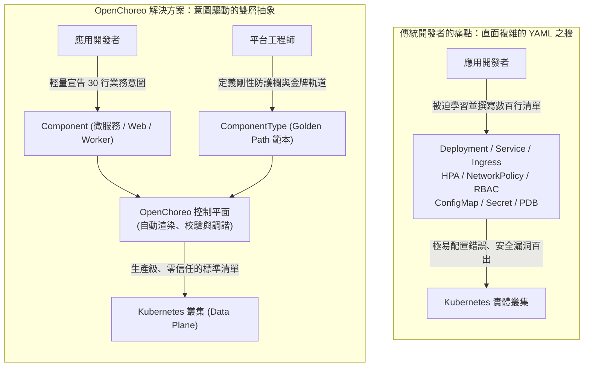
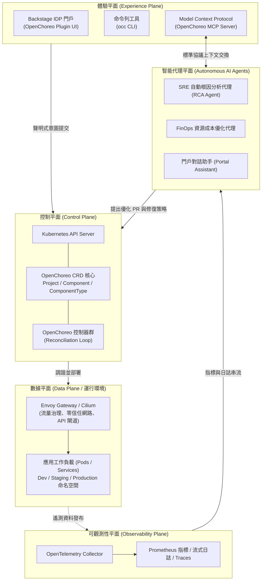
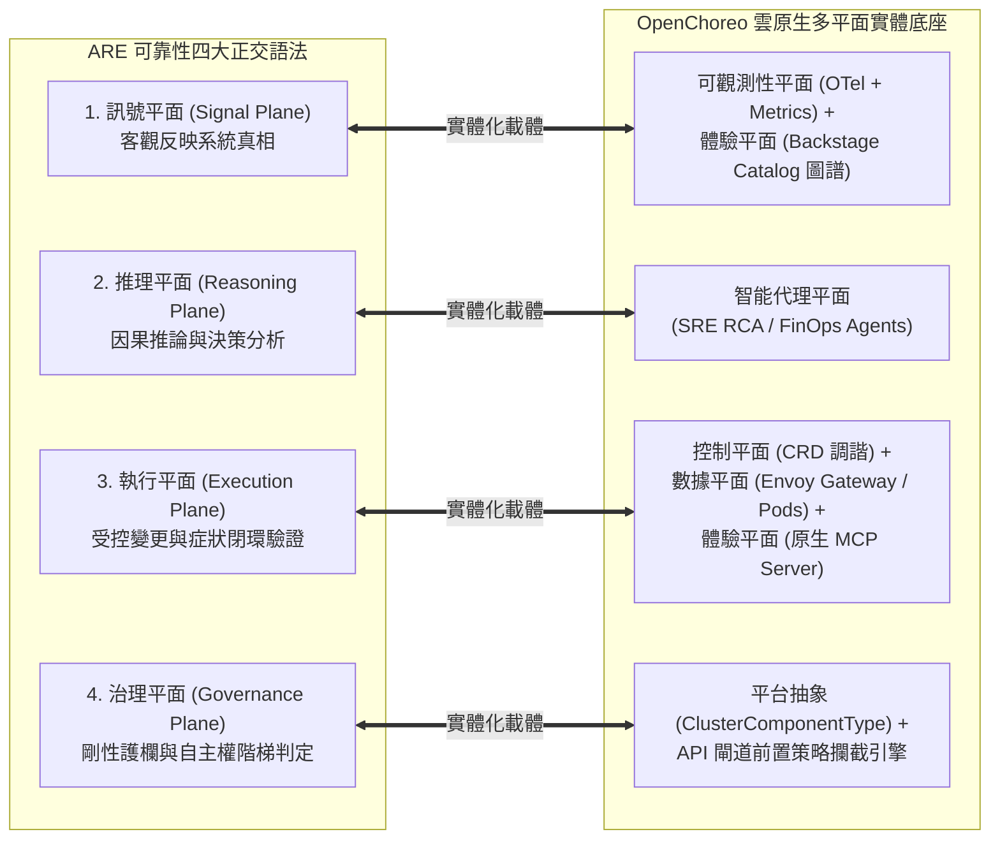
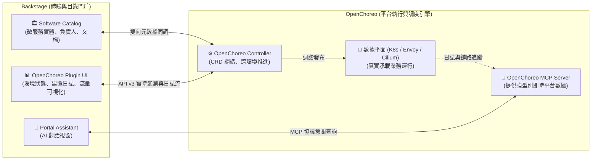
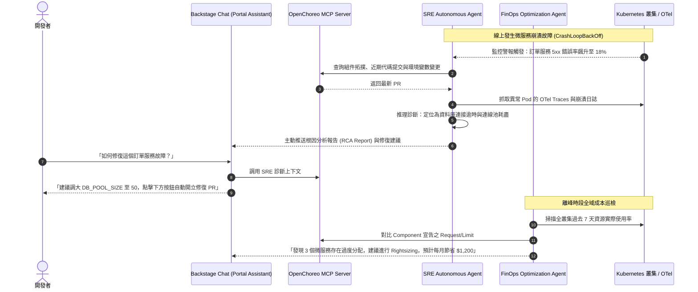

# 12

# OpenChoreo：CNCF 雲原生內部開發者平台與 Agentic AI 落地實踐

在第 11 章中，我們全面剖析了作為內部開發者門戶（Internal Developer Portal, IDP）事實標準的 **Backstage**。Backstage 以其優雅的軟體目錄（Software Catalog）、軟體範本（Scaffolder）、技術文檔（TechDocs）與外掛生態系，成功解決了企業在微服務擴展歷程中的「服務發現」與「認知過載」難題。

然而，當許多平台工程團隊滿懷熱情地將 Backstage 引入組織後，往往很快就會撞上一道更深層的架構現實：

> **「Backstage 是一個優秀的『門戶（Portal）』，但它本身並不是一個『平台執行引擎（Platform Execution Engine）』。」**

Backstage 能告訴開發者有哪些服務存在、能透過 Scaffolder 發起 Pull Request，但它本身並不負責管理 Kubernetes 資源的調度運作、動態環境隔離、網路流量分割（Traffic Splitting）、服務網格安全策略，以及自動化可觀測性鏈路的裝配。為了填補「門戶」與「底層基礎設施」之間的巨大鴻溝，許多平台團隊不得不撰寫數以萬計的「膠水代碼（Glue Code）」，將 Backstage、ArgoCD、Crossplane、Terraform、Prometheus 與 Envoy 生硬地拼湊在一起。這種拼裝方案往往架構脆弱、升級維護極為痛苦，甚至讓平台團隊自身淪為新的運維瓶頸。

更重要的是，隨著**代理式 AI（Agentic AI）**與**模型上下文協議（Model Context Protocol, MCP）**的崛起，我們迫切需要一個**能讓 AI 代理安全感知狀態、精準推理診斷，並能在雲原生環境中閉環執行維運任務的現代化控制平面**。

正是在這樣的技術浪潮下，**OpenChoreo** 應運而生。作為 2024 年正式加入 **雲原生運算基金會（CNCF）** 的 Sandbox 開源專案（源自 WSO2 的企業級雲原生實踐，官網：[https://openchoreo.dev/docs/](https://openchoreo.dev/docs/)），OpenChoreo 專為解決現代內部開發者平台（IDP）的架構斷層而設計。

本章將帶你深入 OpenChoreo 的核心世界，剖析其**多平面架構（Multi-Plane Architecture）**、解析開發者與平台工程師的**宣告式抽象分工**、探討其與 **Backstage** 的天作之合，並重點解密其**原生整合 MCP 與自主維運代理（SRE Agent、FinOps Agent）**的劃時代設計。

---

# 為什麼需要 OpenChoreo？消滅 Kubernetes 的「YAML 之牆」

在雲原生普及的今天，Kubernetes 已經成為事實上的分散式雲端作業系統。然而，對於廣大的業務應用開發者而言，Kubernetes 的學習曲線無異於一場噩夢。



## 痛點一：從「業務邏輯」到「基礎設施細節」的認知超載
一個普通的 Python FastAPI 或 Go 微服務，在原始碼層面可能只有幾百行業務邏輯。但為了將其可靠地上線到 Kubernetes 生產叢集，開發者通常被迫撰寫並維護：

* `Deployment`（包含探針、資源 Limit/Request、生命週期勾點）
* `Service` 與 `HTTPRoute` / `Ingress`（包含負載平衡、TLS 證書設定）
* `HorizontalPodAutoscaler`（HPA 彈性擴縮設定）
* `NetworkPolicy`（零信任網路隔離規則）
* `PodDisruptionBudget`（PDB 高可用保障）

這就是業界常說的**「YAML 之牆（The YAML Wall）」**。開發者將大量心力浪費在複製貼上晦澀的 Kubernetes 清單上，一旦某個安全欄位漏填（例如缺少 `runAsNonRoot` 或記憶體限制過大），就會威脅整個叢集的穩定性。

## 痛點二：黑盒 PaaS vs. 白盒 Kubernetes 的兩難
為了解決這個問題，過往許多團隊嘗試採用傳統 PaaS（如 Heroku 或早期自建系統）。但黑盒 PaaS 往往會完全封裝底層細節，當業務規模增長、需要進行精細的流量分割、服務網格調校或混合雲遷移時，PaaS 的局限性就會顯露無遺。

**OpenChoreo 的核心哲學是：「增強 Kubernetes，而非掩蓋 Kubernetes（Augment, not hide, Kubernetes）。」**

* 它是 **Kubernetes-native** 的：所有抽象概念均由 Kubernetes 自訂資源（CRD）實現，以 Kubernetes API 作為唯一的權威事實來源（System of Record）。
* 它嚴格落實 **GitOps**：開發者表達高階意圖（Component），平台團隊宣告架構規則（ComponentType），OpenChoreo 在叢集內部自動調諧生成符合組織安全規範的底層清單。

---

# OpenChoreo 多平面架構（Multi-Plane Architecture）

OpenChoreo 採用了清晰的領域驅動（Domain-Driven）多平面系統設計，將平台的各項職責精確解耦：



## 1. 控制平面（Control Plane）
控制平面是 OpenChoreo 的中心大腦。它運行在 Kubernetes 叢集內部，由一組輕量且高效的 Kubernetes Controller 與 CRD 組成。控制平面的職責是：

* 監聽開發者提交的 `Component` 與平台工程師維護的 `ClusterComponentType`；
* 執行參數驗證、安全防護欄校驗；
* 動態編譯並生成底層 Kubernetes 資源（Deployment、Service、Envoy HTTPRoute、NetworkPolicy 等）；
* 管理跨環境（Development ➔ Staging ➔ Production）的晉升流水線（DeploymentPipeline）。

## 2. 數據平面（Data Plane）
數據平面是應用程式容器實際運行的場所。OpenChoreo 支援單叢集或跨多叢集架構。在數據平面中：

* **網路與閘道**：全面整合 **Envoy Gateway**（遵循 Kubernetes Gateway API 標準）與 **Cilium**，實現高效能流量調度、金絲雀發布（Canary Deployment）、零信任 mTLS 通訊與細粒度網路存取隔離。
* **執行單元（Cells）**：採用 Cell-Based 架構思想，將相關聯的微服務、資料庫快取與閘道封裝為高內聚、自給自足的安全運作單元，大幅降低系統間的爆炸半徑（Blast Radius）。

## 3. 體驗平面（Experience Plane）
體驗平面為團隊提供多元且統一的使用者介面：

* **Backstage IDP 門戶**：透過官方 OpenChoreo Backstage Plugin，為工程師提供一站式的圖形化儀表板。
* **`occ` CLI**：專為喜歡終端機操作的工程師設計的高效命令列工具。
* **Model Context Protocol（MCP）伺服器**：為外部 AI 代理開放的標準協議介面，使大語言模型能安全讀取平台拓撲與資源狀態。

## 4. 可觀測性平面（Observability Plane）
基於 OpenTelemetry（OTel）建構，原生收集所有微服務的指標（Metrics）、日誌（Logs）與鏈路追蹤（Traces），並提供統一的查詢端點供工程師與 AI 代理使用。

## 5. 智能代理平面（Agentic Plane）
專門運行平台自治維運代理（如 SRE RCA 代理、FinOps 成本優化代理與對話助手）。代理平面透過標準協議從可觀測性平面獲取狀態，透過 MCP 伺服器交換拓撲與上下文，並向控制平面提交優化策略與修復建議。

---

## 專題深探：OpenChoreo 五大架構平面與 ARE 四大可靠性平面的精準映射

在《代理式可靠性工程》（ARE）第 6 章與本書第 6 章延伸篇（Ch 06-EX）中，我們確立了代理式可靠性系統的四大正交語法：**訊號平面（Signal Plane）、推理平面（Reasoning Plane）、執行平面（Execution Plane）與治理平面（Governance Plane）**。

許多團隊困惑於「理論上的可靠性四平面，在雲原生真實世界中到底該如何拼裝？」OpenChoreo 的多平面架構正是這個問題的最佳解答。兩者呈現出精確的架構對位關係：



| ARE 四大可靠性平面 | OpenChoreo 雲原生實體平面 | 職責邊界與物理協同機制 |
| :--- | :--- | :--- |
| **訊號平面<br/>(Signal Plane)** | **可觀測性平面** + **Backstage Catalog** | OpenTelemetry Collector 原生採集指標與分散式鏈路，並與 Backstage Software Catalog 綁定團隊擁有權（`catalog-info.yaml`），輸出無主觀偏見的「決策級遙測」。 |
| **推理平面<br/>(Reasoning Plane)** | **智能代理平面** | RCA 代理與 FinOps 代理在此平面運行。透過 GraphRAG 結合 TechDocs 進行因果診斷，產出「暫態緩解建議」與「修復 PR 草稿」，絕不直接碰觸底層叢集。 |
| **執行平面<br/>(Execution Plane)** | **控制平面** + **數據平面** + **MCP 伺服器** | 代理呼叫 OpenChoreo 原生 MCP Tools，由控制平面進行 Kubernetes CRD 宣告式調諧，在數據平面下發具備 TTL 的 Envoy 流量限流規則或觸發 GitOps 發布。 |
| **治理平面<br/>(Governance Plane)** | **平台抽象層 (`ClusterComponentType`)** | 平台團隊定義的 CRD 規範、資源配額與 API 閘道前置過濾器。以確定性代碼鎖死 $\le 15\%$ 爆炸半徑、雙密鑰聯鎖（Dual-Key）與 L0~L4 動態自主階梯。 |

這種映射關係向我們揭示了一個核心真理：**OpenChoreo 不是另一個單純的部署工具，它是 ARE 代理式可靠性語法在雲原生生態中的第一座實體工廠**。

---

# 核心抽象體系：開發者抽象 vs. 平台工程師抽象

OpenChoreo 最精妙的架構設計，在於將整個企業的平台工程邊界劃分為兩層對稱且互不干擾的宣告式抽象：

| 維度 | 開發者抽象（Developer Abstractions） | 平台工程師抽象（Platform Abstractions） |
| :--- | :--- | :--- |
| **核心關注點** | 業務邏輯、程式碼倉庫、環境變數、公開端點 | 資安防護欄、合規基準線、網路拓撲、資源配額 |
| **核心 CRD 資源** | `Project`, `Component`, `DeploymentTrack` | `ClusterComponentType`, `Environment`, `DataPlane`, `DeploymentPipeline` |
| **YAML 行數** | 極致精簡（通常 20 ~ 40 行） | 結構化規範範本（定義參數 Schema 與資源模板） |
| **互動模式** | 自助服務（Self-Service）、意圖表達 | 鋪好之路設計（Golden Path Crafting）、全域治理 |

## 1. 開發者視角：標準 `Component` 宣告

開發者只需在自己的 Git 專案中維護一份極簡的 `component.yaml`：

```yaml
apiVersion: openchoreo.dev/v1alpha1
kind: Component
metadata:
  name: payment-service
  namespace: ecommerce-project
spec:
  # 指向平台團隊預先建置的金牌範本
  type: microservice-rest
  
  # 業務代碼與建置資訊
  source:
    git:
      url: https://github.com/acme-corp/payment-service.git
      branch: main
    build:
      dockerfile: ./Dockerfile
      
  # 業務端口與端點意圖
  endpoints:
    - name: api
      port: 8080
      type: REST
      schema: ./openapi.yaml     # 關聯 OpenAPI 介面契約規格
      visibility: internal
      
  # 僅需填寫業務專屬環境變數
  env:
    - name: LOG_LEVEL
      value: "INFO"
    - name: DB_CONNECTION_SECRET
      valueFrom:
        secretKeyRef:
          name: payment-db-credentials
          key: connection-string
```

> **注意與第 11 章 API Catalog 的聯動**：
> 1. 開發者在此處完全不需要指定 Kubernetes 的 Selector、Pod Spec、Affinity、ReplicaSet 或 Envoy HTTPRoute 語法！一切底層繁雜設定皆由所引用的 `type: microservice-rest` 決定。
> 2. 注意 `endpoints` 中的 `schema: ./openapi.yaml`：OpenChoreo 不僅將其用於底層 Envoy Gateway 的路由校驗與請求過濾，更將其作為**契約驅動平台（Contract-Driven Platform）**的核心依據。這份 OpenAPI 規格會由控制平面自動同調至第 11 章所探討的 Backstage API 目錄中。

## 2. 平台工程師視角：`ClusterComponentType` 範本

平台團隊則負責撰寫並維護可重用的 `ClusterComponentType`。這份定義包含了強型別參數校驗（JSON Schema）與動態生成底層 Kubernetes 資源的宣告範本：

```yaml
apiVersion: openchoreo.dev/v1alpha1
kind: ClusterComponentType
metadata:
  name: microservice-rest
spec:
  description: "全公司統一的標準 REST 微服務金牌軌道 (內建 Cilium 網路隔離與 Envoy 路由)"
  
  # 定義開發者被允許傳遞的參數規則
  parametersSchema:
    openAPIV3Schema:
      type: object
      properties:
        cpuRequest:
          type: string
          default: "250m"
        memoryRequest:
          type: string
          default: "512Mi"
          
  # 平台強制注入的底層 Kubernetes 產物模板
  resources:
    - template:
        apiVersion: apps/v1
        kind: Deployment
        metadata:
          name: "{{ .component.metadata.name }}"
        spec:
          replicas: 2
          template:
            spec:
              containers:
                - name: app
                  image: "{{ .component.status.latestImage }}"
                  resources:
                    requests:
                      cpu: "{{ .parameters.cpuRequest }}"
                      memory: "{{ .parameters.memoryRequest }}"
                    limits:
                      cpu: "1000m"
                      memory: "1Gi"
                  securityContext:
                    runAsNonRoot: true
                    allowPrivilegeEscalation: false
```

透過這種解耦：

* 平台工程師修改了 `ClusterComponentType` 中的安全原則（例如升級了全公司的安全 Baseline），所有引用該範本的微服務在下一次調諧時自動合規，完全無需逐一通知開發者修改 YAML！
* 開發者獲得了極致流暢的自助服務體驗，再也不會因為少寫一個 Kubernetes 欄位而排查半天。

---

# OpenChoreo 與 Backstage 的深度整合

在現代平台工程的技術棧中，**Backstage 與 OpenChoreo 並非競爭對手，而是天造地設的共生體系**。



## 雙向聯動的五大價值

1. **從「靜態目錄」升級為「動態控制台」**：
   傳統 Backstage 目錄大多呈現靜態資訊（GitHub 地址、Owner 團隊）。而在整合 OpenChoreo Plugin 後，開發者點進某個 Component 實體頁面，就能直接看到該服務在 Dev、Stage、Prod 環境中的**即時運行狀態、Pod 副本數、端點 URL、記憶體消耗趨勢與即時串流日誌**。

2. **無縫銜接 Scaffolder 與 Component**：
   開發者利用 Backstage Scaffolder 建立專案時，範本除了產出業務骨架外，會自動在根目錄注入符合 OpenChoreo 規範的 `component.yaml`。專案建立完成後，OpenChoreo 控制器自動感知並拉起環境，真正達成「從點擊建立到服務上線只需 60 秒」。

3. **金絲雀流量視覺化（Canary Visualization）**：
   得益於 OpenChoreo 底層的 Envoy Gateway，開發者可以在 Backstage 介面上直觀拖動流量滑動條，將 10% 的生產流量導向新版 `DeploymentTrack`，並即時觀察錯誤率與延遲指標。

4. **消除膠水代碼的維護噩夢**：
   以往需要平台團隊手動整合 ArgoCD 插件、Kubernetes 插件、Prometheus 插件等多個獨立外掛；OpenChoreo 提供了一站式封裝的官方 Backstage 插件，將建置、發布、流量與監控整合在同一視窗中。

5. **自動化 API 契約註冊與門戶呈現（Zero-Touch API Cataloging）**：
   微服務上線後，最怕文檔與代碼脫節。在 OpenChoreo 體系下，只要在 `component.yaml` 中宣告了 `endpoints[].schema: ./openapi.yaml`，OpenChoreo 控制平面在調諧完成後，會**自動向第 11 章介紹的 Backstage Catalog 註冊或更新對應的 `kind: API` 實體**，並自動注入 Envoy Gateway 生成的內部與外部 Base URL。微服務部署成功的瞬間，全組織工程師即可在 Backstage 的 API Docs 分頁看到包含即時路由與測試沙盒的 Swagger UI，徹底打通從底層數據平面（Data Plane）到體驗平面（Experience Plane）的最後一哩路。

---

# 原生 Agentic AI 與 MCP 融合架構

OpenChoreo 最具前瞻性的亮點，莫過於其**在雲原生平台工程領域率先全面擁抱 Model Context Protocol（MCP）與自治型維運代理（Autonomous AI Agents）**。

在本書第 5 章與第 7 章中，我們探討了如何透過自建 MCP 伺服器與 Strands 代理為平台注入智慧。而 OpenChoreo 則直接在**平台核心內建了開箱即用的 MCP 伺服器與三大自治代理**：



## 1. 核心亮點一：SRE 自治診斷代理（SRE Agent）
在傳統維運中，當微服務在生產環境發生故障（如 OOMKilled、CrashLoopBackOff、HTTP 504 Gateway Timeout）時，值班工程師往往需要花費數十分鐘甚至數小時在各個系統間切換。正如第 11 章圖 11.2 所展示的真實門戶聯動畫面，當 ArgoCD 與 OpenChoreo 偵測到金絲雀 Pod 崩潰時，SRE Agent 會直接在 Backstage 上主動推播結構化診斷結論與修復按鈕。

OpenChoreo 內建的 **SRE Agent** 實現了全自動的事故破案流程：

* **事件觸發**：當 OpenTelemetry 或 Prometheus 偵測到異常指標時，SRE Agent 自動喚醒；
* **上下文聚合**：代理透過 OpenChoreo MCP 伺服器，自動關聯該 Component 的依賴拓撲、最近是否有新版本發布、Git Commit 記錄，以及近期組態變更；
* **深層日誌與鏈路分析**：代理自動下鑽追蹤異常 Trace ID，分析例外堆疊資訊；
* **自動產出 RCA 報告**：在幾秒鐘內產出結構化的根因分析報告（Root Cause Analysis），精確指出：「*本次故障係因 PR #42 引入的 Redis 逾時參數過短，導致上游連接池耗盡*」，並給出具體建議修復值。

## 2. 核心亮點二：FinOps 資源成本優化代理（FinOps Agent）
多數開發團隊為了防止線上出問題，往往傾向於過度配置資源（例如實際只需 200MB 記憶體，卻設定了 4GB Request）。在大規模叢集中，這種「資源幽靈」會導致巨大的雲端成本浪費。

OpenChoreo 的 **FinOps Agent** 扮演著全天候的財務健康顧問：

* 持續分析各 Component 的實際 CPU/Memory 使用峰值與常態值；
* 與平台工程師設定的 SLO 指標交叉比對；
* 產出精準的 **Rightsizing（規格最適化）** 建議，並能一鍵發起修改 `component.yaml` 的 Pull Request，在確保穩定性的前提下大幅降低雲端帳單。

## 3. 核心亮點三：門戶對話助手（Portal Assistant）與原生 MCP 伺服器
OpenChoreo 開箱即附帶原生實作的 **Model Context Protocol（MCP）伺服器**：

* 它將 OpenChoreo 控制平面的所有實體（Projects, Components, Builds, Releases, Environments）封裝為標準化的 **MCP 資源（Resources）**；
* 將查詢運行狀態、調取 OTel 遙測日誌封裝為 **MCP 工具（Tools）**；
* **OpenAPI 規格昇華為 AI 工具（OpenAPI-to-MCP Tooling）**：MCP 伺服器還能自動讀取各組件宣告的 OpenAPI 規格，動態轉換為 AI 代理的結構化 Tool Definitions。當值班工程師詢問「*幫我向支付服務發送一筆測試扣款以驗證網關*」時，AI 助理能直接調取 `payment-service` 的 OpenAPI Schema、精確組裝符合校驗規則的 JSON Payload，並安全觸發沙盒測試。
* 開發者在 Backstage 的聊天視窗中，可以使用自然語言隨時提問：「*查看支付服務目前在生產環境的 Pod 狀態*」、「*幫我抓出過去半小時的所有 ERROR 日誌*」——助理透過 MCP 協議獲得安全、權威、即時的結構化資料，徹底告別傳統聊天機器人的幻覺。

---

# 動手實戰：在本地體驗 OpenChoreo

為了讓讀者能夠親自體驗 OpenChoreo 的強大魅力，官方提供了極為簡潔的本地快速起步流程。

## 1. 前置依賴環境
* **Docker**：已啟動並正常運行。
* **Kubectl**：Kubernetes 命令列工具。
* **Kind**（Kubernetes in Docker）：本地快速啟動叢集。

## 2. 安裝 OpenChoreo 命令列工具（`occ`）
在終端機中執行官方安裝指令碼：
```bash
curl -fsSL https://openchoreo.dev/install.sh | bash
```
驗證安裝結果：
```bash
occ version
```

## 3. 一鍵建立本地全功能叢集
執行以下指令，`occ` 將自動透過 Kind 建立一個名為 `openchoreo-local` 的叢集，並自動安裝 OpenChoreo 控制平面、Envoy Gateway 與核心 CRD：
```bash
occ cluster create --wait
```

## 4. 建立你的第一個專案與微服務
建立一個名為 `demo-project` 的命名空間專案，並部署一個標準的範例微服務：
```bash
# 建立專案
occ project create demo-project

# 建立微服務組件 (引用官方示範倉庫)
occ component create hello-service \
  --project demo-project \
  --type microservice-rest \
  --git-repo https://github.com/openchoreo/sample-apps \
  --git-branch main \
  --context-dir ./hello-world \
  --port 8080
```

## 5. 觀察即時調諧與驗證端點
透過 `occ` 查看元件的建置與調諧狀態：
```bash
occ component status hello-service --project demo-project
```
短短數十秒內，你會看到 OpenChoreo 自動完成了容器鏡像建置、產生了具備 Envoy Gateway 路由的 HTTPRoute，並成功上線。

呼叫公開端點測試：
```bash
curl http://localhost:8080/hello
```
終端機將回傳：
```json
{
  "message": "Hello from OpenChoreo Cloud-Native IDP!",
  "status": "healthy"
}
```

---

# 讀者筆記：從從業者視角看第 12 章

> **「未來的內部開發者平台，必定是『宣告式意圖驅動』與『AI 自治調諧閉環』的深度結合。」**

### 💡 讀者思維：平台工程的核心不是發明新術語，而是劃定職責邊界
許多企業在推進平台工程時，容易陷入兩種誤區：要麼強迫所有開發者考取 CKA、直接手寫複雜的 Kubernetes YAML；要麼試圖用封閉的自研 PaaS 阻隔一切雲原生特性。第 12 章 OpenChoreo 所展示的最大智慧，在於其**「雙層宣告式抽象」**：

1. 開發者只需宣告 30 行以內的業務意圖（我是什麼、端口是多少、依賴什麼）；
2. 平台工程師則專注於打造具備剛性防護欄的 `ComponentType`（Golden Path 範本）。
這種劃分徹底解放了雙方的生產力：開發者獲得極致自由，平台團隊獲得全域掌控。

### 🎯 核心精華萃取
1. **Backstage + OpenChoreo 的黃金搭檔**：
   - Backstage 是最佳門戶前端（Single Pane of Glass / Developer Portal）；
   - OpenChoreo 是最佳雲原生執行引擎（Control Plane & Data Plane）。
2. **Kubernetes 原生即正義**：
   - 拒絕黑盒，以 Kubernetes CRD 與 GitOps 作為權威事實來源，享受雲原生生態系的所有紅利。
3. **原生 MCP 與自主 AI 代理新典範**：
   - 不是在平台外掛一個獨立的聊天機器人，而是將平台狀態封裝為標準 MCP 伺服器，讓 SRE Agent 與 FinOps Agent 真正具備「看清系統、定位根因、提出安全變更」的端到端能力。

### ⚠️ 實務踩坑警報
* **過度泛化的 `ComponentType`**：試圖打造一個能支援所有語言、所有架構的「萬能範本」；最佳實踐是針對具體場景（如 REST API、批處理 Worker、靜態前端）提供明確分工的專精範本。
* **忽略數據平面（Data Plane）的網路規劃**：OpenChoreo 依賴 Envoy Gateway 與 Cilium 實現零信任網路與流量分割，在私有雲落地時需預先規劃好 CNI 與 Gateway 的路由轉發。

### 🛠️ 明日行動清單
* [ ] 在本地透過 `occ cluster create` 啟動一個 OpenChoreo 實驗環境，親身體驗從 `component.yaml` 到自動生成 Envoy 路由的過程。
* [ ] 檢視自家目前平台中「開發者撰寫的 Kubernetes 清單」：有多少欄位是千篇一律的重複設定？能否將其抽象為標準的 `ComponentType` 範本？
* [ ] 深入探索 OpenChoreo 官方的 Backstage 外掛與 MCP 伺服器設計，評估如何將其借鑑至既有的內部開發者門戶之中。

---

# 延伸閱讀與開源社群資源

* **OpenChoreo 官方文件中心**：全景架構規範、概念解析與安裝指南：[https://openchoreo.dev/docs/](https://openchoreo.dev/docs/)
* **OpenChoreo GitHub 開源儲存庫**：探索控制平面、CLI 工具與 CRD 原始碼：[https://github.com/openchoreo/openchoreo](https://github.com/openchoreo/openchoreo)
* **CNCF Landscape - OpenChoreo 專案卡片**：了解其作為雲原生計算基金會 Sandbox 專案的生態定位：[https://landscape.cncf.io/?item=app-definition-and-development--application-definition-image-build--openchoreo](https://landscape.cncf.io/)
* **Model Context Protocol 官方規範**：深入理解 OpenChoreo MCP 伺服器的傳輸與工具協同機制：[https://modelcontextprotocol.io](https://modelcontextprotocol.io/)
