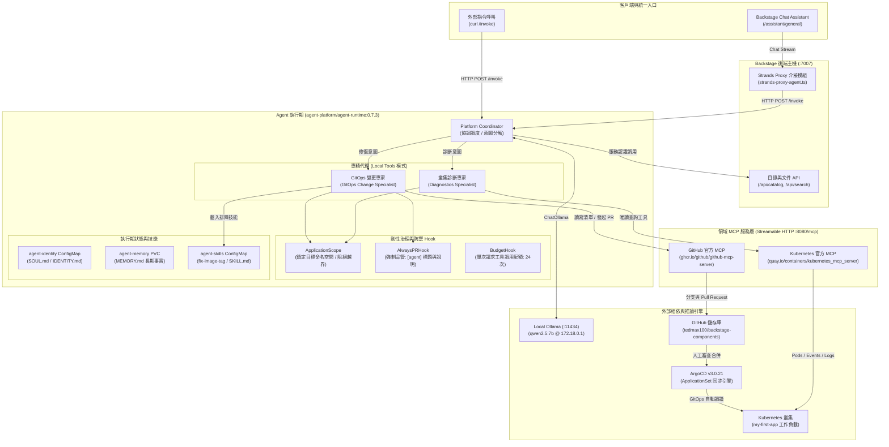

# 7

# 生產環境中的維運代理

在上一章中，我們從零開始確立了生產級代理的底層架構，包括雙層記憶、排程自主調用以及受治理的工具。本章將把這套架構付諸實戰。但是，你是否曾遭遇過這種窘境：某個功能在展示示範中運行得完美無瑕，但一放到真實流量下就以一種前所未見的方式徹底崩潰？我們當然深有體會。

絕大多數構建生產級代理的團隊，在專案推進到一半時都會發現同一個令人不安的事實：**我們的代理往往比我們的平台更早準備就緒。** 我們的模型推理邏輯嚴密，工具調用反應靈敏。然而，當第一批真實維運負載湧入時，系統卻以誰都未曾預料到的方式頻頻出錯——例如 Trace 鏈路在高流量下遺失、重試機制導致同一個部署被重複觸發了兩次，或是日誌中根本找不到任何有助於理解代理決策依據的有用資訊。這個斷層出在代理身上嗎？不，斷層出在支撐它的底層平台。

本章的核心宗旨正是彌合這道鴻溝。我們將從「單純構建代理」，轉變為「為承接代理在機器速度下的行為全面準備我們的平台」——在沒有人類工程師即時盯著每個迴圈的情況下，安全地為依賴我們基礎設施的每個內部租戶提供服務。

在本章中，我們將深入探討以下核心主題：

* **評估代理就緒度（Agent Readiness）**：區分「已為自主消費者做好準備的平台」與「事故製造平台」的四大核心特質：介面成熟度、可觀測性、身分透傳，以及具備受限影響範圍的等冪收斂能力。
* **專精代理與架構輪迴（Specialist Agents and the Cycle of Architecture）**：為什麼代理拓撲重新經歷了微服務的歷史教訓、康威定律（Conway's Law）在組織多代理系統時帶給我們的啟示，以及何時不應過度拆解代理。
* **構建生產級代理**：將代理從開發者入口網站中徹底解耦、引入持久化記憶、技能、受控工具與領域 MCP 伺服器，並將 Backstage 重新對接到代理執行期。
* **可觀測性、稽核與維運控制**：利用 Langfuse 追蹤代理活動、記錄防篡改的稽核軌跡，並將本地實驗組件逐一映射至生產級替代方案。

讀完本章後，你將能夠精準評估內部平台是否已準備好被代理消費、明智裁決何時應將全能型代理拆解為專精代理、以獨立服務的形式部署具備受控 MCP 寫入權限的 Strands 代理，並為其配備深度追蹤與防篡改的稽核日誌。在「*實戰構建：利用 Strands 從洞察邁向行動*」一節中的所有動手練習，均可直接運行在你在*[第 5 章](ch05.html)*中建立的同一個本地 `kind` 叢集上。所有的實驗程式碼均收錄於官方配套儲存庫：[`https://github.com/PacktPublishing/Agentic-AI-for-Platform-Engineering/tree/main/chapter-07`](https://github.com/PacktPublishing/Agentic-AI-for-Platform-Engineering/tree/main/chapter-07)，其中的 *Lab 0* 會在開始前自動檢查你的*[第 5 章](ch05.html)*環境是否就緒。

# 代理就緒度：我們的平台準備好被消費了嗎？

以下四大特質源自我們反覆目睹的一種普遍現象：**代理早已準備好了，但底層平台還沒有。**

面對「*我們的平台準備好了嗎？*」這個問題，我們的解答不是一份僵化的成熟度模型，也不是一份打勾清單，而是一個審視我們平台的全新視角：

*開發者體驗（Developer Experience）絕不等於代理體驗（Agent Experience）。*

我們的內部平台可能早已實現了雲原生、全面容器化、運行於 Kubernetes 之上，配備了成熟的 CI/CD 管線以及精美的開發者入口網站，但它依然**完全沒有準備好被 AI 代理所維運**。那些在人類開發者眼中運作順暢的介面，並不會自動適用於自主運行的消費者。代理就緒度引入了一個截然不同的考量維度：我們平台的**介面**，是否準備好迎接一個以機器速度運作、且迴圈中可能完全沒有人類即時把關的全新消費者？

平台工程社群在過去十年間全力為人類開發者打造各類介面：自助服務門戶、命令列工具（CLI）、樣板化工作流程，以及那些在被工程師讀過一次理解操作後便被拋諸腦後的說明文件。代理是一種全新的消費者，過去深植於「開發者體驗」之中的絕大多數假設都無法直接套用。

我們並非刻意制定一套教條規範。在我們親手構建與審查眾多生產級代理的歷程中，我們歸納出了這四項關鍵特質，它們決定了一個平台究竟能與代理和諧共舞，還是淪為事故生產機。有些特質本就是始終重要的平台工程基本功，如今只不過變得更加關鍵；而另一些特質則是只有當自主消費者真正登場時才會暴露的全新系統需求。其核心目的不是為了給自己打分，而是帶著這些特質重新審視我們自己的平台，並清醒地意識到到底缺失了哪一塊。

一個反覆印證的主旋律是：**代理會成倍放大底層平台的現狀。** 一個擁有成熟、具備深度觀測能力且受嚴格治理介面的平台，在被代理消費時會釋放出成倍的強大戰力；反之，一個充滿隱形缺陷的平台，則會變得更加致命危險。這種放大效應絕非微不足道：由於缺陷會隨著調用頻率迅速擴散，維運事件的爆發量會劇烈飆升，在這種規模下，底層的任何微小瑕疵都會被無限放大。

## 特質 1：介面成熟度

在平台工程中，「介面（Interface）」的內涵遠比單純的 API 更為廣泛。它是開發者或代理用來消費內部平台的每一個接觸表面：自助入口網站端點、CLI 指令、CI/CD 觸發器、Backstage 軟體範本、Terraform 模組、Helm Charts，以及封裝這些能力的 MCP 伺服器。每一個都是介面。每一個都需要做好準備，以承受代理特有的互動方式：**字面直譯、高頻重複，且毫無臨機應變能力。**

一位人類開發者在面對一份語焉不詳的文件時，會閱讀原始碼、向同事請教，或是憑經驗猜測。而代理只會閱讀 Schema 定義、按字面執行，然後要麼成功要麼失敗。它絕不可能在 Slack 上向負責該服務的團隊敲一聲求助。契約要麼以機器可讀的形式清晰記載，要麼代理就只能瞎猜——而猜測帶來的後果就是：幻覺出虛構的參數、憑空捏造 Enum 枚舉值、臆測不存在的資源 ID，以及發起看似合理卻排查成本極其高昂的錯誤工具調用。

一個適合代理消費的成熟平台介面具備幾項不可妥協的硬性指標：穩定的契約與絕不暗中破壞消費者的版本控制體系；完整的 Schema 定義（REST 介面的 OpenAPI、結構化工具的 JSON Schema、IaC 模組的 Terraform 變數型別），確保每個參數皆有明確型別、每個枚舉欄位皆完整列舉、每個錯誤模式皆傳回代理能基於此進行分支判斷的錯誤代碼（而非自由格式的字串文字）；文件中的範例能按字面直接運行無誤。此外，最容易被多數團隊忽略的一點是：**工具的文字描述必須是寫給 LLM 閱讀的，而不是寫給人類開發者的。** 一句寫著「*建立部署*」的描述對人類而言足夠清楚；但在代理眼中，這很難與另外十個同樣在「*建立*」某物的工具區分開來。工具描述必須在一兩句話內精確釐清範圍、副作用、前置條件與等冪性。**請將工具描述撰寫成：為一位從未接觸過你的平台、且只有三十秒時間挑選出正確工具的人所準備的專業文件。**

對平台團隊而言，這種成熟度其實早已潛伏在團隊多年深耕的各個角落。一個擁有完整 Component、API 與 Resource 實體定義的 Backstage 軟體目錄，在結構上正是代理所需的精準契約面；一個帶有完備 `values.schema.json` 的 Helm Chart 就是一個強型別介面；一個變數宣告中包含型別、描述與驗證區塊的 Terraform 模組亦是如此。在這些情境下，我們的工作並非憑空發明新契約，而是透過 MCP 將既有契約規範暴露出來，並確保它們隨著平台的演進始終保持精準誠實。

更具挑戰性（且在各類代理轉型專案中屢見不鮮）的情境是：底層根本沒有任何現成介面。系統屬於老舊遺留架構，其業務邏輯極具價值，理論上代理可以驅動它，但這套系統當初完全沒有考慮過會被它不認識的軟體程式直接調用。在任何代理部署具備可行性之前，首要之務是先暴露出一套規範介面。**草率應付此事的代價絕非抽象概念：含糊不清的工具描述或缺乏明確規範的 Schema，恰恰是導致代理在每次調用時都必須從零開始重新推理、瘋狂累積上下文，並在決定原本應在事前就明確宣告的事情上白白燃燒 Token 的罪魁禍首。** 一款在個人層面每天燒掉 6 美元 Token 的激勵打氣代理就是這種問題的微縮版；而平台層面的版本，則是完全相同的動態惡意，在生產環境中每天乘以成百上千個租戶成倍爆發。

## 特質 2：能經受機器速度考驗的可觀測性

這項特質在我們的實踐中出現最為頻繁，因為「人類規模」與「機器規模」平台之間的鴻溝最先在此顯現。一句簡潔有力的工作準則：

*如果我們連單一使用者的請求都無法可靠追蹤，我們就絕不可能追蹤以機器速度運作的代理請求。*

一位人類開發者每小時可能只點擊我們的平台幾次。而接替該開發者部分工作流程的代理，在持續運作下每秒可以發起數次請求。過去適用於人類流量的抽樣式分散式追蹤（Sampling-based Tracing），在代理帶來的負載下會產生致命的資訊斷層；缺乏結構化上下文的日誌在代理生成的巨量數據面前將徹底失去可讀性；專為單一租戶設計的儀表板，當代理開始排程發起跨租戶查詢時將瞬間崩潰。

早年職業生涯中最貼切的類比，正是從單體架構邁向微服務架構的轉變。分散式追蹤之所以成為必需品，是因為單一使用者請求會扇出為十幾個微服務調用，我們再也無法透過單純 tail 一份日誌檔案來排查延遲或故障模式。代理在架構的更高層次重現了這個難題：代理自主決定該做什麼、調用工具、工具調用微服務，微服務進一步向下游扇出。**我們現在必須在兩個截然不同的層次維護可觀測性：代理的調用與工具調用 Trace，以及底層的微服務 Trace，且兩者必須緊密關聯。** 如果說缺乏鏈路追蹤透傳的微服務可觀測性令人痛苦，那麼缺乏關聯的代理可觀測性則堪稱災難——因為促成這次調用的代理級核心上下文，在微服務的追蹤鏈路中根本無跡可尋。

最基本的底線是：橫跨代理請求所觸及的每一個跳躍點實現端到端追蹤，並將**代理的身分識別**與**發起請求的使用者身分識別**同時作為 Trace 屬性進行關聯綁定。我們還需要攜帶關聯 ID（Correlation ID）的結構化日誌，使其能完整穿透 MCP 伺服器、平台 API 以及任何下游服務；我們還需要能將代理流量與人類流量清晰劃分的監控儀表板，以便能獨立分析其行為特徵。**缺乏這些基礎，生產環境中的代理一旦出事，事故復盤會議的第一句話必定是：「我們根本不知道它當時到底幹了什麼。」**

具體落實為：在 OpenTelemetry Trace 中將 `gen_ai.agent.id`、`gen_ai.conversation.id` 與 `enduser.id` 設置為標準 Span 屬性；在 CloudWatch、Loki 或團隊現有的日誌系統中使用結構化 JSON 日誌，將相同的標識符貫穿每個躍點；在 Grafana 儀表板上依據 `agent.id` 進行過濾，將錯誤率、重試率與工具調用分布情況與人類流量指標並排對比呈現。你的平台團隊很可能早已為人類使用者建立了大部分此類機制，當下的核心任務是確保它能經受住流量規模的衝擊並相容全新的身分識別屬性。

一旦建立了這層可觀測性基石，稽核軌跡（Audit Trail）便可重用大部分相同的遙測數據，但它面臨著截然不同的**完整性與資料留存要求**。一套完備的稽核軌跡必須精確記錄：代理發起的每次工具調用（精確時間戳記與完整參數）、引導每次調用的原始請求與政策上下文、完整的身分上下文（代理、使用者、租戶）、每次調用的最終結果（包含各類失敗細節），以及向下游傳播引發的實質影響。這些數據大多可與 Trace 鏈路進行交叉比對，但稽核紀錄必須置於明確的完整性防護與留存原則之下進行持久化儲存。

區分除錯日誌與值得信賴的稽核紀錄的核心分水嶺在於：**防篡改性（Tamper Resistance）**。**一條可以在事後被悄無聲息竄改的紀錄，絕不可能構成值得信賴的稽核軌跡。** 當生產環境中的代理發生意外時——無論是預算超支事故、安全合規審查還是法規問責——稽核日誌的法律與架構價值完全取決於其具備的防篡改特質：純追加寫入儲存（Append-only Storage）、一次寫入多次讀取（WORM）留存原則，以及當威脅模型涵蓋擁有底層儲存存取權限的人員時所必須引入的雜湊鏈（Hash-chained）或密碼學數位簽章。在 AWS 環境中，這可能意味著啟用 Compliance 模式的 S3 Object Lock，並將其託管於獨立的安全審計專用帳號中；在 Kubernetes 環境中，這意味著將稽核串流傳輸到叢集維運人員自身完全無權修改的外部儲存接收器（Sink）。具體技術實作或許各異，但其背後的架構特質神聖不可侵犯：**寫入該紀錄的代理絕無權回頭修改它；維運人員無權修改它；平台團隊本身同樣無權修改它。動作一旦被記錄，便成鐵證。**

這正是自主系統所樹立的高標準。人類工程師可以被要求回憶並解釋自己的行為；但我們絕不能依賴代理自己的「回憶」來重構案發現場——唯有具備不可否認性的客觀稽核紀錄，才能讓我們完全獨立地重現事件的完整時序。

## 特質 3：身分透傳（Identity Propagation）

生產級代理極少完全代表自己採取行動。它代表的是某位具體的使用者、團隊、租戶，或是某個觸發它的上游系統。**稽核日誌所要回答的最核心問題，始終是「這項操作究竟是在誰的授權之下被執行的」。** 如果我們的平台無法區分「*代理正在代表使用者 A 執行 X*」與「*代理正在代表使用者 B 執行 X*」（因為代理在兩次調用中均使用自己統一的 ServiceAccount 服務身分接入），我們就徹底喪失了責任歸屬與問責能力。

將身分識別穿透代理並深入透傳到底層平台的工具鏈中絕非易事。代理具備自己的身分（它運行時所依託的服務主體 Service Principal）；使用者同樣具備自己的身分。底層的平台調用必須同時知悉兩者：基於代理身分進行信任評估與調用速率限制；基於使用者身分進行精確授權與合規審計。大多數開源代理框架並不會自動為我們處理這些細節，它必須被主動設計進平台的介面之中，並在每個網路躍點被剛性強制執行。

在實踐中被驗證行之有效的機制，正是平台團隊早已熟稔的服務間身分傳遞模式：
- **OAuth 2.0 Token Exchange（RFC 8693）**：平台藉此獲取委派權杖（Delegated Token），明確將發起請求的使用者標記為主體（Subject），將代理服務標記為執行主體（Actor）。
- **AWS `sts:AssumeRoleWithWebIdentity`**：由使用者的 OIDC 權杖驅動角色扮演，而非依賴靜態的全局服務主體。
- **Kubernetes Projected ServiceAccount Tokens**：為代理工作負載配置嚴格的對象受眾（Audience）約束，並將調用者的原始身分透過獨立管道進行安全透傳。
- **SPIFFE/SPIRE 身分識別**：在整個微服務調用鏈路中端到端攜帶可加密驗證的證明文件（Attestations）。

這些機制為工作負載身分識別與權限委派提供了堅實的基石，但平台依然必須保留足夠豐富的上下文，以供其授權層進行核心檢驗：**這項操作究竟是在代表誰執行？** 我們將在*[第 8 章](ch08.html)*中對威脅模型與具體技術模式展開更詳盡的探討。針對就緒度而言，檢驗標準非常純粹：**對於代理所採取的每一項操作，我們的平台能否確切回答「這是代表誰執行的」？如果答案是否定的，那麼我們的稽核軌跡只是一紙空文。**

## 特質 4：收斂性、等冪性與受限的爆炸半徑

代理會頻繁重試。在遭遇暫態網路抖動時重試、在收到無法解析的模糊回應時重試、在自身推理陷入混亂時也會重試。有時因為規劃邏輯中的內部迴圈，它會在 300 毫秒內連續發起三次完全相同的調用。這些行為毫無異常，完全在預期之中。一個沒有針對「頻繁重試」做出防禦假設的平台介面，注定會產生重複雜亂的髒狀態。

前半部分的解答是**收斂性（Convergence）**。好消息是，平台工程師多年來始終在設計具備收斂特性的介面，只是過去未必冠以此名。重新套用相同的 Helm Chart 與 Values 設定檔通常會對準同一個 Kubernetes 資源狀態（哪怕 Helm 仍會記錄新的 Release 修訂版本）；針對未變更的確定性設定執行 `terraform apply`，會穩定收斂到相同的期望狀態；重複套用一份完全相同的 Kubernetes Deployment 清單，只要 Spec 沒有變更，絕不會觸發新的滾動更新——Kubernetes 控制器會持續將相同的 Deployment 朝向期望狀態調諧，重複 Apply 絕不會建立出第二個 Deployment。這些全都是經典的收斂模式。它們最初是為了應對人類維運人員難免會重複執行同一條指令而設計的，如今恰好完美相容於那些在收到模糊訊號時便慣性重試的 AI 代理。

然而，那些天生**不具備等冪性**的危險模式，往往潛伏在開發時未考慮重試語意的 REST 端點中：一個每次被調用都不問青紅皂白建立新部署的 `POST /deployments`、一個觸發兩次就會發送兩次通報的 Webhook、一個只會 Append 附加而非 Upsert 更新的服務目錄寫入介面。其緩解方案成熟卻常被忽視：**在每個寫入操作中強制引入等冪鍵（Idempotency Keys），由平台端基於該 Key 進行伺服器端去重。** 代理在形成執行意圖時生成唯一金鑰，在隨後的每次重試中均攜帶該金鑰；平台辨識出攜帶相同金鑰的重試請求，堅決避免將同一意圖重複執行多次。**等冪性不是一種锦上添花的效果最佳化，而是系統維運的最低生存底線。**

後半部分的解答是**受限的爆炸半徑（Bounded Blast Radius）**。等冪性確保了我們的平台能在重試迴圈中倖存；但單靠等冪性，並不能阻止代理在其推理出現嚴重缺陷時，短時間內連續做出上千次「錯誤卻不重複」的致命決策。防禦這類災難的手段是結構性的，且絕大多數依然屬於平台團隊駕輕就熟的領域：命名空間維度的 Kubernetes `ResourceQuota` 與 `LimitRange`、AWS 服務配額（Service Quotas）與 IAM 權限邊界（Permission Boundaries）、置於平台 MCP 伺服器前端的 API 閘道調用速率限制，以及針對破壞性操作提供 Dry-run 模擬模式——允許代理預覽變更結果、由平台傳回 Diff 差異，而非直接套用。基於 GitOps 的變更流天然賦予了這項特質：**代理只能透過 Pull Request 提出變更建議，而合併動作被嚴格鎖定在與人類工程師完全相同的程式碼審查與 CI 檢查關卡之後。**

等冪性與受限爆炸半徑是什麼高深莫測的新技術嗎？絕非如此。但它們卻常常在代理與平台最核心工具之間的通道上集體失守。**這兩項防線失守的代價，往往會在代理最自信犯錯的致命瞬間被一次性全額清算。** 無限制爆炸半徑在個人規模下的翻車版本，正是*[第 6 章](ch06.html)*開頭提到的 OpenClaw 兩天狂燒 160 美元的鬧劇——沒有任何機制約束代理從頭重新推理的頻率；而在平台規模下則是相同的惡果被成倍放大：此時代理正以每分鐘上千次的速度調用真實的生產 API，代表著它根本無法準確代表的使用者，而隨後寄來的帳單，計費單位將遠不再只是 Token。

## 審視我們自己的內部平台

這四大特質是否真正獨立？身分透傳唯有在可觀測性將其完整記錄時才具備實質意義；受限的爆炸半徑唯有在收斂機制生效時才具備災後復原可能；不可篡改的稽核日誌唯有在它記錄的 Trace 本身完整無缺時才具備參考價值。這些特質彼此共生強化，這固然是天大的好事——在其中一項上的投入往往能直接惠及其他維度；但壞消息是，**它們往往也會集體潰敗**。一個缺乏可觀測性的平台，在事故發生後通常也拿不出所需的完整稽核軌跡，且極大概率也是那個介面缺乏等冪保護的脆弱平台。

在團隊即將將代理推向生產環境時，我們極力推薦的實踐練習是：**針對代理即將調用的具體工具逐一盤點這四大特質，而非抽象評估整個大平台。** 你的平台整體可能處於某一成熟度水準，但代理即將伸入觸碰的那個特定角落，可能完全處於另一個脆弱狀態。在代理上線之前摸清這些底細，遠比在事後透過事故復盤來交學費要廉價得多。

下一節將轉向探討代理拓撲（Agent Topology）本身：我們該如何組織構建那些消費我們內部平台的代理群？過去塑造我們組織微服務架構的歷史經驗，在組織代理時將為我們帶來極具深度的指引。

# 專精代理與架構輪迴

平台已準備就緒：介面成熟規範、可觀測性無懼機器速度、身分正確透傳、重試具備等冪性，且爆炸半徑受到嚴密控制。接下來的問題轉向了邊界的另一側：**我們該如何組織架構那些前來消費平台的代理？**

最天真直接的直覺往往是：構建一個無所不包的「全能型超大代理」，塞入我們擁有的每個工具、每項技能以及每座 MCP 伺服器。這在直覺上顯得無比高效：只需部署一套環境、只需除錯一個地方、只需升級一次底層模型；代理通曉平台暴露的一切功能，任何開發者請求都能在單一對話會話中搞定。在小型專案剛啟動的最初幾週內，這種架構確實運行得十分愜意。

然而，一旦系統開始規模化擴展，這種架構還能安然無恙嗎？

## 為什麼「全能型代理」必然崩潰

全能型代理的崩潰模式並不新奇。任何見證過面向服務架構（SOA）逐步退化為「分散式單體（Distributed Monolith）」的人，對這些症狀都會無比眼熟：

* **上下文膨脹（Context Bloat）**：每個工具的描述文字、每項技能的元數據、每座 MCP 伺服器的 Schema 綱要，在系統啟動時都被全量堆砌進系統提示詞中。隨著平台能力的擴充，該提示詞長度呈現線性爆炸。響應延遲劇增、推論成本暴漲；而模型的注意力焦點，在上下文視窗被填滿之前就早已嚴重渙散劣化。我們在*[第 6 章](ch06.html)*「工具即受治理的平台 API」一節中探討的動態規律在此同樣適用，這也解釋了為什麼漸進式揭露是不可或缺的生存法則——**代理能做的事情越多，它在「決定究竟該做什麼」上所耗費的心智代價就越昂貴。**
* **決策開銷過載（Decision Overhead）**：當面對數百個可用工具時，模型耗費在「挑選該調用哪個工具」上的推理算力，往往遠超過「實際執行調用」本身。隨著可選工具庫的盲目擴張，工具選取的精確度會呈現雪崩式下跌。相較於面對一個無邊無際的龐大工具庫，一組規模受控、描述精準的專屬工具集更有助於模型做出精確無誤的調用抉擇。
* **爆炸半徑失控（Uncontrolled Blast Radius）**：一個握有整座平台所有鑰匙的超級代理，只要遭遇一次提示詞注入（Prompt Injection）、陷入一次混亂的推理死迴圈，或讀到一條過期的指令，就足以橫跨多個領域釀成毀滅性的災難。我們前文引述的 PocketOS 慘案正是教科書級的範例：一個握有過度寬鬆權限權杖的代理，同時橫跨預發布與生產環境，一擊致命。而一個嚴格限縮在單一領域的專精代理則在物理上無法犯下此類大錯——因為能造成該破壞的工具根本不在它的工具箱內。
* **部署耦合地獄（Deployment Coupling）**：對單項能力的微調更新，被迫需要重新部署整座超級代理。新增一項新技能，全量發布；修改一個工具的描述措辭，全量發布。演進任何單一能力的代價，隨之與整座代理的龐大接觸面綁定，而非與變更本身對齊。這聽起來是否無比耳熟？這恰恰是十年前驅使工程界徹底告別單體服務架構的同一套耦合噩夢。

在生產環境中真正沉澱下來的架構模式是什麼？正是**職責邊界清晰、透過標準介面協同互動的專精代理（Specialist Agents）**：一個專注於讀取可觀測性數據並深度推理故障本質的**診斷代理（Diagnostic Agent）**；一個專門透過 GitOps 流程規範提出變更提案的**修復代理（Remediation Agent）**；一個嚴格依據企業政策審查變更內容的**驗證代理（Validator Agent）**；以及一個專門為人類總結提煉維運現狀的**通報代理（Reporter Agent）**。各自做好一件專精之事、各自暴露清晰透明的介面、各自能被獨立升級替換而不影響全域。**這正是微服務架構在技術堆疊的全新層次上的浴火重生。**

## 康威定律在代理架構中的深刻體現

Melvin Conway 於 1968 年提出了一條經典洞見：系統的設計架構往往對應著設計該系統之組織的溝通結構。Ruth Malan 隨後補充了一條每位工程領袖都應深思的推論：

*如果系統的架構與組織的架構產生衝突，組織架構永遠是最後的贏家。*

這是否正是我們許多平台現代化改造最終只產出了「分散式單體」而非真正微服務的根本肇因？團隊試圖在後端推行架構解耦，卻依然維持著中央集權式的垂直組織架構。系統架構最終無奈退化為組織形態所能真正支撐的模樣。

相同的動態規律如今是否正在代理設計中原樣重演？一支中央集權式的 AI 團隊構建了一個試圖為所有開發者場景服務的「全能平台代理」，結果該代理的邊界最終長得與該 AI 團隊的溝通邊界一模一樣：大而無當、浮於表面且高度中心化——即便底層的內部平台早已被拆解為優雅清爽的邊界領域。代理拓撲鏡像反射的是團隊拓撲，而非系統拓撲，而團隊拓撲永遠是勝者。

這帶給我們的具體實踐啟示無比清晰：**代理的拓撲架構應當鏡像映射「業務領域的所有權（Domain Ownership）」，而非中心化的 AI 所有權。** 如果我們的內部平台擁有由團隊 A 負責的軟體目錄領域、由團隊 B 負責的 GitOps 領域、由團隊 C 負責的叢集維運領域，以及由團隊 D 負責的可觀測性領域，那麼最自然的代理拓撲，便是每個領域配備一個專精代理，並由負責該領域的團隊親自擁有與維護。我們的平台團隊則專注於擁有供它們協同運作的通用底座：代理執行期、MCP 閘道，以及讓整套系統清晰可見的可觀測性體系。**代理即服務。服務應由擁有該領域的專業團隊親自掌舵。** 我們為什麼需要一個擁有所有代理的孤立「AI 團隊」，正如我們過去從不需要一個擁有所有服務的所謂「微服務團隊」一樣。

## 何時不應盲目拆解

微服務歷史帶給我們最重要、卻也最常被拋諸腦後的教訓是：**切忌過早拆解（Do not decompose prematurely）。** 當某個業務問題能被單一代理的職責與上下文舒適承載時，一個構建優良、職責聚焦且工具集規模適中的單體代理，往往遠勝過一個過度複雜的專精代理網路。拆解的代價是極其沉重的：每增加一個新代理，就意味著增加一份跨代理契約、引入一道額外的網路延遲源、增加一個需要被監控的可觀測對象，並多了一處潛在的崩潰點。拆解的紅利只有在問題內部真正具備能從專精化中切實獲益的結構時才會顯現。

其判斷準則與平台團隊劃分微服務時的經驗完全相通：**盡可能小，但絕不盲目求小。** 如果我們能將工作流程表達為帶有一兩個代理節點的確定性圖形，請優先選擇該方案（正如*[第 6 章](ch06.html)*在「確定性光譜」中所論證的）；如果我們的工作確實包含邊界截然不同、工具互不相通、技能專屬且爆炸半徑天壤之別的子領域，請果斷拆解；但如果拆解的唯一理由只是「*為了趕架構時髦*」，請堅決說不。

來自我們真實生產實踐的一條寶貴經驗法則：**當協同運作的代理數量突破兩位數（10 個以上）時，多代理系統的人工排查難度將面臨斷崖式崩潰。** 在此閾值之下，一位經驗豐富的架構師依然能在大腦中推演出系統的全域行為；一旦超越此閾值，團隊若沒有在代理可觀測性與鏈路追蹤上進行重大投入，整座系統將瞬間淪為不可知曉的黑暗黑盒。具體數字或許因人而異，但那條非線性的複雜度曲線卻是客觀存在的。

一旦拆解確實是正確的架構決策，**代理之間的契約介面將遠比代理自身更具決定性**。一個在診斷代理與修復代理之間定義優雅清爽的任務交接協議，其架構價值遠勝過將其中任何一個代理單獨打磨得完美無瑕。最容易暴死失敗的模式，正是每個代理在局部設計得極其精妙，但全局系統卻缺乏統一連貫的契約表面。好在工程底座正在快速成熟：Strands 提供了多代理核心基語（Swarm 群體、Graph 圖編排、Workflow 工作流、Agents-as-Tools 代理即工具、Handoffs 任務交接），精準映射著分散式架構師十餘年來反覆淬煉的經典模式。

貫穿每次解耦浪潮的主線始終如一：**最棘手的難題從來不是單一組件本身，而是組件之間該如何溝通協同。** 為了讓代理和諧共舞而投入的平台工程心血，與當年為了讓微服務穩定協同而付出的努力在本質上毫無二致。這裡沒有捷徑，也沒有專屬於 AI 的玄學魔法，唯有將同一套嚴謹的工程紀律，堅定貫徹至這片全新的技術基質之上。

下一節將把這一切理論全面付諸工程實踐。我們將接過*[第 5 章](ch05.html)*中那個純對話式的唯讀助理，逐步將其重塑為一個生產級的自主維運代理：賦予其雙層記憶、排程能力、受治理的工具、立即可供代理消費的成熟介面，以及克制拆解的專精拓撲。我們將採用 Strands 作為開發框架，並以 OpenClaw 藍圖作為概念參考範式。

# 實戰構建：利用 Strands 從洞察邁向行動

*[第 5 章](ch05.html)*以一個能夠讀取平台現狀的對話式介面作結：透過在 Backstage 中註冊的唯讀動作，它能讀取目錄條目、技術文件以及 Kubernetes 叢集執行期狀態，一切互動均發生在內嵌於入口網站的聊天外掛中。這條邊界是深思熟慮的產物：讀取屬於觀察；寫入屬於行動；行動伴隨著爆炸半徑。我們真正精彩的實戰硬仗，正是從*[第 5 章](ch05.html)*止步之處正式打響。

我們的下一步絕不是向現有的聊天外掛中草率添加寫入權限（那樣只會把代理繼續鎖死在 Backstage 內部，使其淪為入口網站的一個附屬功能），而是**徹底解耦（Decouple）**。我們的代理將升格為頭等系統公民：一個運行於專屬命名空間中的獨立執行期服務、擁有並可自主寫入的持久化記憶、一個直接與 GitHub 溝通的專用 MCP 伺服器，以及一份連它自己也無權覆蓋改寫的防篡改稽核日誌。本章所探討的每一項核心概念都將在此架構中精準落地——不是因為我們刻意堆砌，而是因為當助理試圖採取實質行動時，每一項機制都展現出了其不可或缺的存在價值。

我們即將跟隨的實戰走查具備極高的實用性與可重現性。這套參考實作端到端運行在一個本地 `kind` 叢集上：透過*[第 5 章](ch05.html)*建立的同一個 Argo CD `ApplicationSet` 進行構建與自動部署；在真實示範中，由代理主動發起真實的 Pull Request，精準修復開發者在 `my-first-app` 中犯下的拼寫錯誤。本節中的每件實驗產物、每份 Manifest 清單與每張截圖，均產自這套真實運轉的系統。完整程式碼收錄於本書配套儲存庫的 `chapter-07` 目錄下：[`https://github.com/PacktPublishing/Agentic-AI-for-Platform-Engineering/tree/main/chapter-07`](https://github.com/PacktPublishing/Agentic-AI-for-Platform-Engineering/tree/main/chapter-07)。

## 我們即將構建什麼，以及刻意略過什麼

在展開架構細節前，有必要先釐清邊界。本章主張生產級代理需要具備領域 MCP 伺服器而非雜亂工具堆、透過事件匯流排實現自主調用、跨躍點透傳身分，以及對齊領域所有權的多代理拓撲架構。我們的動手示範將精準實現第一項與最後一項，因為它們是本章的核心重心所在。各領域表現為具備獨立憑證的獨立伺服器：一座對叢集擁有純唯讀權限，另一座則嚴格限制僅能針對單一儲存庫路徑提出變更提案。兩者無法越俎代庖，且不存在任何跨越兩者的共享全局憑證。

我們在此刻意暫緩實作兩件事：

* **暫不實作自主調用**：我們的代理依然同步回應請求。帶有 `agent_action` 過濾機制的 Cron 觸發迴圈已在*[第 6 章](ch06.html)*「代理系統中的排程與自我調用」一節中進行了詳細論述，此處作為課後擴展作業留給讀者。
* **採用共享代理身分**：代理在單一 ServiceAccount 與單一 GitHub PAT 權杖下運作。針對逐使用者與多租戶的細粒度身分透傳，將留待*[第 8 章](ch08.html)*全面展開。

其餘的所有核心設計均完整落地：雙層記憶體系、作為程序性知識的技能、透過 Hook 實施的受控寫入、全鏈路可觀測性與稽核，以及一個極具哲學美感的**遞迴架構時刻**——代理本身正是由它日後所要消費的同一個 `ApplicationSet` 親手交付部署的。負責交付 `my-first-app` 的平台，正是交付前來修復 `my-first-app` 的代理的同一座平台。這正是本章核心論點在代碼層面的終極具象化。

## 我們的起點

*[第 5 章](ch05.html)*的簡化架構如下圖所示。聊天功能內嵌於 Backstage 之中，LLM 調用、MCP 客戶端與工具執行全都在入口網站的外掛執行期程序內發生：


圖 7.1：初始起點架構：內嵌於 Backstage 的聊天外掛

作為一個教學起點，這套架構很優雅；但作為一個生產級代理，它卻存在著三大硬傷。首先，外掛**就是**代理本體：如果我們希望從 Slack 訊息、監控告警或定時作業中調用同一個代理，我們必須徹底重寫一套；其次，外掛的身分綁定在當前使用者的前端會話中：如果我們希望代理自主採取行動，它根本沒有可依託的獨立身分；第三，其 MCP 整合是單一程序內的單一工具大雜燴，根本無法按業務領域進行獨立權限劃分，更無法讓專精代理與專精工具集對接。一旦我們試圖跨越單一瀏覽器分頁中的單一使用者，我們在「專精代理與架構輪迴」一節中所警告的每項缺陷都會立刻爆發。

## 我們的目標架構

解耦後的架構將代理徹底移出入口網站，將 Backstage 僅僅視為通往這套獨立服務的多種前端介面之一。它由 Argo CD 從我們在*[第 5 章](ch05.html)*搭建的同一個組件儲存庫自動部署，且它不再是一個孤立的單體代理，而是一支小巧精悍的專精代理團隊：


圖 7.2：目標目標架構：解耦後的代理即服務與專精代理團隊

一個**協調代理（Coordinator Agent）**負責接收請求，並將任務委派給各自掌管特定業務領域的專精代理。三大架構決策促成了這一切：首先，代理執行期是一個由入口網站遠端調用的**獨立微服務**，而非入口網站動態載入的本機外掛；其次，**沒有任何代理能存取整座平台**：協調代理根本不持有任何底層平台工具，診斷專精代理只能讀取叢集狀態，而變更專精代理只能針對特定路徑發起 Pull Request 提案；第三，**記憶與稽核全面獨立於代理程序之外**：記憶沉澱於 ConfigMap（經由 GitOps 嚴格版本控制）與 PVC（代理專屬的唯一可寫檔案空間），而稽核紀錄則儲存於獨立 PVC 上具備雜湊鏈保護的檔案中。

## 執行期核心：代理即服務（Agent as a Service）

我們的第一步是將推理迴圈從前端外掛中徹底抽離。利用 Strands SDK，這項實作變得異常精簡。`Agent` 建構子接收一個可配置的模型（本實驗預設採用 Bedrock Claude Sonnet 4.5，並支援 Anthropic API 作為後備備援）、一份系統提示詞、一組工具清單，以及一個指向磁碟目錄的 `FileSessionManager`。一個由 FastAPI 驅動的後端進程暴露 `POST /invoke` 端點，接收來自 Backstage、Slack、curl 或排程作業的工程師意圖，並傳回代理的推論結果。我們的開發者入口網站如今只是代理的一個標準**客戶端（Client）**，不再是它的宿主。

以下兩點對後續架構至關重要：

* **系統提示詞是動態組裝的，絕非靜態寫死的字串**：它在每次調用時，由代理的身分檔案（`SOUL.md`、`IDENTITY.md`、`USER.md`）以及 `MEMORY.md` 的即時內容動態拼接而成。模型推理所依據的提示詞，精確反映了當前平台對該代理的最新角色認知，絕非映像檔構建時的陳舊快照。
* **刻意記憶採用了嚴格的雙層持久化設計**：`SOUL.md`、`IDENTITY.md` 與 `USER.md` 掛載自 GitOps 儲存庫所管理的 ConfigMap——對運行中的 Pod 而言是**純唯讀**的，修改必須透過 Pull Request 審查流程；而 `MEMORY.md` 則掛載自 PersistentVolumeClaim（PVC）——對 Pod 是**可寫**的，在 Pod 重啟後依然長久留存，且外部系統絕無法隨意介入竄改。

這種雙層分離讓書中所論述的「刻意記憶對比自動記憶」在代碼層面獲得了具象化：若想調整代理的回應語氣，我們只需在組件庫中打開 `SOUL.md` 修改一句話，發起 PR 並合併，Argo CD 便會自動更新 ConfigMap，下一次調用立即反映新風格；而若想記錄代理學到的新知識，模型會調用 `save_to_memory(fact)` 工具，在 PVC 上的 `/state/memory/MEMORY.md` 末尾追加一行記錄。**平台擁有的記憶存放在 Git 中；代理擁有的記憶存放在代理以明確意圖寫入的磁碟區中。** 書中將其稱為雙層架構模式，此處它化身為兩個優雅的 Kubernetes 原生資源物件。

第三層持久化機制（供 `FileSessionManager` 使用的 `emptyDir`）則扮演對話暫存區的角色，在設計上純屬短暫瞬態。Strands 負責上下文壓縮管理，其生命週期完全與 Pod 綁定。

我們在真實運行的叢集上端到端驗證了這套迴圈：

發送 `POST /invoke`，意圖為：「*請用一句話告訴我你是誰，以及你必須遵守的最嚴格的一條約束。*」代理清晰作答：「*我是 Backstage/ArgoCD 開發者平台的維運代理，我最嚴格的約束是絕對不能直接修改叢集，所有變更必須透過 GitOps 儲存庫的 Pull Request 進行。*」這條核心約束源自 `SOUL.md`；角色定義源自 `IDENTITY.md`；系統提示詞在執行期將它們完美拼裝。

發送 `POST /invoke`，意圖為：「*請為後續會話記住：nginx 容器映像檔的首選預設標籤為 :alpine。*」代理主動調用了 `save_to_memory` 工具。隨後執行 `kubectl exec -- cat /state/memory/MEMORY.md`，終端機中清晰印出了 PVC 上的這條新記錄。

在一個帶有全新 `session_id` 的乾淨新會話中，我們提問：「*nginx 的首選預設標籤是什麼？*」代理直接引用了 `MEMORY.md` 中的 `:alpine` 作答。系統提示詞在全新調用啟動時精準重新載入了該檔案。

隨後我們執行了破壞性測試：
```bash
kubectl delete pod -l app=agent-runtime
```

Kubernetes 立即調度啟動了一個全新 Pod，但由於 PVC 的存在，`MEMORY.md` 毫髮無損。**記憶成功穿越了 Pod 崩潰與重啟的生死考驗**，這正是長期刻意記憶理應展現的強韌特質。


圖 7.3：助理回報 my-first-app 當前的映像檔標籤

代理依循技能中所記載的標準程序展開推理、調用工具並傳回精準答案，在單一對話輪次中完美實踐了本章所強調的漸進式揭露與受限行動特質。

這為我們換來了極具啟發性的**遞迴閉環時刻**：整座代理系統的部署，完全是透過*[第 5 章](ch05.html)*中的同一個 `backstage-app-discovery` ApplicationSet 完成的——只需在組件庫中新增一個 `agent-platform/` 資料夾，代理的清單便與 `my-first-app/` 並排躺在同一個 Git 樹狀結構中。**內部平台透過自己的黃金路徑，親手交付了日後前來維護這條黃金路徑的 AI 代理。** 這正是生產級代理所不可或缺的血統證明。


圖 7.4：Argo CD 介面同時展示 agent-platform、langfuse 與 my-first-app 的健康同步狀態

## 眼睛與雙手：劃定狹窄邊界的專精代理

我們的執行期現在擁有了大腦與軀體，但尚缺乏眼睛與雙手。兩位專精代理將改變這一切，而**它們各自被允許看見什麼**，正是整套架構的靈魂所在。

**眼睛先行就位**。一位**診斷專精代理（Diagnostics Specialist）**透過在架構層面就宣告為純唯讀的領域伺服器接入叢集。它有權列出運行資源、讀取 Pod 狀態，並拉取近期的事件與日誌；但它在物理上無法建立、更新、刪除、擴縮資源，更無法讀取敏感的 Secret。這項禁令受到雙重強制保證：第一道防線是伺服器本身以唯讀模式啟動；第二道防線是 Kubernetes 叢集自身的 RBAC Role，僅授予其維運所需的唯讀動詞。必須同時突破兩道互不關聯的獨立防線，這位專精代理才有可能造成破壞——這正是本章前文所定義的**受限爆炸半徑**，以具體設定而非口頭承諾嚴格落地。

**請留意我們並未重複造輪子**。這裡完全沒有任何生搬硬套的特製 Kubernetes 整合代碼。我們直接採用了發布的領域伺服器，將全部心力投注在**邊界治理**上：限制哪些動詞、圈定哪個命名空間、綁定何種身分憑證。這正是平台團隊真正的核心競爭力所在——**平台團隊的壁壘極少在於工具本身，而在於環繞工具的嚴密架構治理。**

其配套的 `fix-image-tag/SKILL.md` 包含標準的 YAML 前置元數據（名稱、描述、*何時使用*、硬性約束），緊隨其後的是結構化的序號處置流程：辨識目標組件與命名空間、讀取清單定義、制定修復方案（明確指引其優先使用記住的預設值，並在無法確認安全替換方案時**停下來向使用者請示**），並以帶有 `[agent]` 前綴的標題以及包含「症狀、根本肇因、修改前後比對、決策依據」的標準格式發起 Pull Request 提案。該技能透過 ConfigMap 掛載至專精代理的 Pod 中。在啟動時，代理僅將所有技能的元數據索引至系統提示詞；只有當模型判定該技能與當前意圖吻合時，才會動態調用 `consult_skill("fix-image-tag")` 載入完整內文。漸進式揭露在此具象化為一次標準的工具調用。

**現在輪到雙手登場，而它的操作介面被收縮得更加狹窄**。**變更專精代理（Change Specialist）**僅有權讀取單一檔案，並透過專用分支上的 Pull Request 提出修改建議。它無權執行合併、無權直接碰觸實體叢集，且除了授權路徑之外無權向任何其他目錄寫入任何內容。守住這條防線的絕非脆弱的提示詞，而是 **Strands Hooks 在代碼層面攔截工具調用**：儲存庫中的 `AlwaysPRHook` 會在任何變更提案發起之前剛性介入並展開驗證。（實證數據來源：Clare Liguori，《How Steering Hooks Achieved 100% Agent Accuracy Where Prompts and Workflows Failed》，Strands Agents，2026 年 3 月 18 日。每個代理版本針對 6 個場景各運行 100 次，總計進行了 3,000 次基準測試。）Hook 嚴格驗證標題（必須以 `[agent]` 開頭）以及正文描述（必須包含至少 20 個字元的修改依據）。一旦驗證失敗，Hook 將 `event.cancel_tool` 設為報錯訊息；該調用將**徹底被就地中斷**，代理會收到一條明確的拒絕回執，供其反思並重新修正重試。在提示詞中苦口婆心地要求遵循規範只是一份奢求；而一段在底層檢查調用並有權直接阻斷執行的代碼才是一條真正的鐵律——無論模型當下是否分心，它都必須無條件服從。**100% 的攔截成功率（相較於簡單提示詞約束的 82.5%），並不會因為我們只用了八行代碼編寫該 Hook 而打半點折扣。**

此時，**協調代理（Coordinator）**展現了其核心價值。它自己不持有任何底層平台工具。它的職責是解讀使用者請求、判定應當委派給哪位專精代理處置、執行任務交接，並以統一的口吻向外通報結果。每位專精代理僅能看見自己專屬的領域邊界，使得任何單一模型需要進行推理的工具清單長度被嚴格壓制在極短範圍內。這從架構根源上徹底化解了「全能型代理」面臨的**決策開銷過載**難題，使得整套示範與本書所宣導的架構模式完美對齊。

我們在真實叢集上完整演練了修復閉環：一條 `sed` 指令在 `my-first-app/k8s/deployment.yaml` 中惡意注入了一個拼寫錯誤（`nginx:alpine` → `nginx:does-not-exist`），維運人員手動合併了這筆錯誤的 PR，Argo CD 隨後將其套用，大約三分鐘內該工作負載便陷入了 `ImagePullBackOff` 崩潰狀態。維運人員隨即向代理請求救援：協調代理將問題交接給診斷專精代理，後者精準定位了發生故障的 Pod 以及記錄拉取映像檔失敗的底層事件；隨後協調代理將修復任務委派給變更專精代理，後者讀取清單並主動提出了修正後的標籤。我們的 Hook 在調用尚未離開進程前對其進行了嚴格審核，Pull Request 順利發起。代理的回應中包含了這筆 PR 的完整 URL：標題為 `[agent] fix my-first-app image tag in default`；正文條理分明地列出了症狀、肇因、修改前後對比與決策依據；Diff 差異僅精準更動了一行代碼（`nginx:does-not-exist` → `nginx:alpine`）。當人類工程師審查並點擊合併後，Argo CD 自動調諧，工作負載瞬間自癒復原。**代理的直接寫入邊界嚴格止步於 Pull Request；部署上線依然必須取得人類的審批合併。代理絕不會直接修改叢集中的應用資源；它自身的實質寫入權限，嚴格受限於 PVC 上的 `MEMORY.md` 以及 `emptyDir` 上的會話暫存區。**

## 入口網站僅是眾多觸發管道之一

我們的代理群已能穩定運作，但目前唯一的客戶端是終端機。開發者入口網站顯然是下一個最直觀的觸發入口，而架構徹底解耦的美妙之處在於：**將其接入入口網站完全不需要對代理本身做出任何更動。**

我們在*[第 5 章](ch05.html)*中使用的 GenAI 外掛具備一個擴展點：`agentTypeExtensionPoint`，任何後端模組均可透過它註冊全新的代理型別。*[第 5 章](ch05.html)*聊天視窗所採用的 `langgraph-react` 代理型別，本質上就是透過該擴展點註冊的獨立模組（`@aws/genai-plugin-langgraph-agent-for-backstage`）。任何人都可以編寫一個平行模組來註冊自訂代理型別，本實驗正是如此。

一個僅約百行 TypeScript 代碼的微型介接模組註冊了全新的代理型別。當 GenAI 外掛委託該型別的代理處理某一輪對話時，該模組向預設的 URL（在本地開發時為代理執行期的連接埠轉發位址，在生產環境中為叢集內部的 Service DNS 名稱）發起 HTTP `POST` 請求，並將傳回的單次 JSON 回應優雅轉化為聊天 UI 所期待的 `ChunkEvent` + `ResponseEvent` 事件串流。（真實的逐 Token 串流傳輸留作讀者自習作業，單區塊適配器已足以提供流暢的聊天體驗。）

讀者在*[第 5 章](ch05.html)*構建的對話助理依然安然佇立在原處：完全相同的聊天視窗、完全相同的路由路徑、側邊欄完全相同的點擊位置。**真正發生翻天覆地變革的，是隱匿於其身後的整個執行期架構。** 這值得我們駐足深思，因為這正是將代理視為獨立微服務所帶來的豐厚回報：入口網站不需要學習任何新概念，它沒有增加任何對 Strands、Bedrock 或各領域伺服器的強依賴；它只是發起了一次單純的 HTTP 調用，而背後整套由一個協調代理與兩位專精代理組成的龐大拓撲，對它而言完全是透明不可見的。

讀者唯一能直觀感受到的變化是：那個在*[第 5 章](ch05.html)*只能動口回答問題的助理，如今**能夠真正動手解決問題了**。相同的對話方塊、相同的溝通口吻，但在對話結尾卻產出了一筆實實在在的 Pull Request。這正是*[第 6 章](ch06.html)*「確定性光譜」架構思維的具象化體現：同一個入口網站既能驅動單一節點的受控工作流程，亦能駕馭基於自身工具深入推理的自主代理，而平台團隊有權自主裁決哪類工作負載應當劃歸哪一階段。


圖 7.5：聊天助理在對話結尾成功發起了一筆合規的 Pull Request

我們透過聊天介面完整重演了前述的修復流程：帶有錯誤標籤的 PR 搞垮了 `my-first-app`，使用者開啟聊天助理並請求協助；助理在對話中回傳了修復 PR 的連結；使用者點擊開啟、審查、確認合併；Argo CD 自動調諧。在系統發生故障後的五分鐘之內，工作負載全面亮起健康的綠燈。整套修復閉環完全是由一個連非工程師都能輕鬆操作的 Backstage 聊天介面所驅動。這正是*[第 6 章](ch06.html)*引言中所描繪的平民化願景，在真實的叢集環境中完美落地。

## 讓一切透明可見：全鏈路追蹤與稽核紀錄

我們的代理已能透過聊天視窗穩定工作。但從外部視角來看，聊天視窗難道是我們窺探其內部行為的唯一窗口嗎？最後的關鍵拼圖，正是落實本章在「可觀測性與稽核」中所大力宣導的兩大核心層次：**一個供維運人員像使用除錯器般查閱的 LLM 專用追蹤後端**，以及**一份供維運人員像檢驗飛行紀錄器般驗證的雜湊鏈稽核檔案**。

**Langfuse 登場**。在專屬的 `langfuse` 命名空間中部署了兩個 Pod，其交付完全遵循相同的 ApplicationSet 模式：包含 PVC 的 `langfuse-postgres` 部署，以及讀取同一資料庫連線字串的單容器 `langfuse/langfuse:2` 部署。Langfuse 與 Postgres 的帳號憑證均為維運人員透過 `kubectl` 建立的頻外 Secret，機密資訊嚴禁簽入 Git。首次引導透過前端互動完成：維運人員透過連接埠轉發開啟 UI、建立組織與專案，並將生成的 `pk-lf-...` 與 `sk-lf-...` 金鑰對寫入 `agent-platform` 命名空間下名為 `agent-langfuse-keys` 的 Secret 中。代理在下一次 Pod 重啟時透過 `envFrom` 自動讀取這些金鑰。

（本實驗於 2026 年 8 月採用 Langfuse v2 進行驗證。本書付梓之際 Langfuse v4 已正式推出；採用最新發行版的讀者應遵循官方自建指南並優先採用 OTLP 原生整合，而非重現特定於 v2 的 SDK Hook 代碼。）

**我們的 Strands 整合實踐**。最優雅的架構直覺無疑是依賴 Strands 原生的一等公民 OpenTelemetry 支援，直接將 OTel Exporter 對準 Langfuse 的 OTLP 端點。然而，在撰寫本書之際的客觀現狀更為微妙：Langfuse v2 尚未暴露 OTLP 端點（該特性於 v3 正式引入），而自建 v3 附帶了沉重得多的技術堆疊：Postgres、ClickHouse、Redis 與 MinIO，外加 `langfuse-web` 與 `langfuse-worker`（總計需要 6 個 Pod，相較之下 v2 僅需 2 個 Pod）。為了將叢集的資源佔用控制在極為輕巧的合理水準，我們選用了 v2，並透過 Strands Hook 直接調用 Langfuse 官方 Python SDK。其最終呈現出完全相同的 Langfuse UI 體驗、相同的 Trace-Span 鏈路模型，以及相同的會話級與使用者級過濾維度。整段 Hook 僅約 50 行代碼：它精準訂閱 `BeforeInvocationEvent`、`BeforeToolCallEvent`、`AfterToolCallEvent` 與 `AfterInvocationEvent`，並相應發出 `client.trace(...)` 與 `trace.span(...)` 調用。未來切換至 v4 與原生 OTLP 極為輕鬆：移除 SDK、配置 `OTEL_EXPORTER_OTLP_ENDPOINT` 環境變數與 Headers，並刪除該 Hook 即可，Strands 會全權搞定其餘部分。

維運人員在 Langfuse 中看到的追蹤拓撲結構非常清晰：每次 `/invoke` 調用對應一條名為 `<agent_id>.invoke` 的 Trace，標註著請求體中傳入的 `session_id` 與 `user_id`（我們透過 Python `ContextVar` 將兩者從 FastAPI 處理常式精準透傳至 Hook 中）。在 Trace 內部，每次工具調用表現為名為 `tool:<tool_name>` 的子 Span，完整記錄了輸入參數與執行耗時。隨著模型輸出用量，逐 Token 的計費開銷清晰可見，並在 Langfuse UI 中按會話自動彙整。


圖 7.6：Langfuse 儀表板清晰呈現呼叫追蹤記錄

開啟 Langfuse 的會話檢視，即可在單一畫面中縱覽完整的請求流動軌跡。該會話將處理請求過程中所產生的所有 Trace 完整歸納分組，包括協調代理、診斷專精代理以及 GitOps 工具的所有執行細節：


圖 7.7：Langfuse 會話檢視聚合展示多代理協同的多條 Trace

點擊展開單一 Trace，右側面板隨即呈現清晰的調用樹狀結構：根調用以及每次工具調用所對應的巢狀子 Span，連同模型接收到的原始提示詞與其產生的回應全文均無所遁形：


圖 7.8：展開單一 Trace 詳情（GitOps 專精代理的執行細節）

**鏈路追蹤告訴我們在執行期間究竟發生了什麼；而稽核日誌則為這些動作永久保存不可磨滅的歷史鐵證。** 這兩者的職責邊界無比鮮明：**Langfuse 是維運人員的即時除錯器；而稽核日誌則是整座平台的黑盒子飛行紀錄器。** 在本地示範中，雜湊鏈（Hash Chain）主要提供的是「防篡改可證性（Tamper Evidence）」而非絕對的物理不可變性。日誌寫入器本身作為 Hook 與其他治理邏輯一同運行於代理進程內部，這最大程度精簡了組件複雜度；而在正式生產環境中，它必須置於代理在物理上完全無法觸碰的安全孤島（正如後文表格所示）。我們的稽核 Hook 同樣訂閱了 `BeforeToolCallEvent` 與 `AfterToolCallEvent`，並在獨立 PVC 上的 `/state/audit/AUDIT.log` 末尾追加一行 JSON 紀錄。每筆紀錄均攜帶 `prev_hash`（前一筆紀錄主體的 SHA-256 摘要值）以及自身基於其他欄位確定性計算出的 Hash 值。對歷史上任何一筆紀錄的惡意篡改，都會導致該紀錄之後的整條雜湊鏈全面斷裂失效。一條僅有 20 行的 Python 驗證指令稿能重新計算每筆紀錄的雜湊值並與儲存的摘要進行比對，在遭遇首次不匹配時發出嚴厲告警。

我們進行了實彈篡改測試：刻意修改了某條歷史紀錄中的單個字元並重新運行驗證指令稿，輸出結果瞬間翻紅為 `BAD CHAIN`（鏈路已損壞）。一般的除錯日誌充其量只是草稿；而雜湊鏈日誌則讓任何拙劣的篡改行為無所遁形（儘管擁有本地檔案完全存取權限的攻擊者理論上可以全鏈重算，因此生產架構必須依託底層只讀寫入管道來確保不可變性）。

兩層體系，捍衛著截然不同的威脅模型：Langfuse 忠實記錄了模型說了什麼以及耗費了多少成本；而稽核日誌則無可爭辯地記錄了究竟在何時、按何種順序、攜帶何種參數調用了哪個具體工具，以及事後是否有人偷偷動過該檔案。在邁向正式生產時，後續的對照表將以 Langfuse Cloud（或規模化自建 v4）替換本地 v2 部署，並以獨立 AWS 帳號中開啟 Object Lock 的 S3 Bucket 徹底替換本地磁碟區上的稽核檔案。

## 全景整合一覽

橫跨本章的多項動手實驗，內部平台已從單一對話代理演進為高度協同的自動化工作流：診斷代理深入檢查 Kubernetes 即時狀態、GitOps 代理透過 GitHub 規範發起變更提案，而協調代理則流暢貫穿兩者的核心能力。Backstage 提供了面向使用者的優雅入口，Langfuse 全程記錄代理調用與工具鏈路，而具備雜湊鏈保護的稽核日誌則忠實銘刻了所採取的每一步行動。

由此產生的 Pull Request 完美具現了貫穿全章的維運哲學：代理負責提出聚焦精準的變更建議、代碼庫忠實記錄所有上下文依據與變更意圖，而**人類工程師始終手握最終審核與合併的裁決大權**。


圖 7.9：由代理自動發起、等待人工審查的 GitHub Pull Request

隨後 Argo CD 自動調諧經審核批准的變更，工作負載自癒復原。各組件各司其職，從故障診斷、變更提案、人工審批到自動調諧收斂的整個演進歷程清晰可見。在整套系統運轉就緒後，以下兩項動手驗證非常值得一試，它們分別檢驗了不同的關鍵防禦機制：

* **親眼見證 Hook 的當場執法**：修改 `SKILL.md` 的操作步驟，刻意拿掉建議標題中的 `[agent]` 前綴，重新部署並觸發修復示範。聊天視窗將不再回傳 PR 連結，而是直接印出 Hook 拋出的嚴厲拒絕訊息，告知標題必須以 `[agent]` 開頭。**提示詞層面的溫和引導對比代碼層面的剛性執法，在此刻涇渭分明。**
* **觸發無匹配技能的安全閉環**：透過將 `replicas: 0` 搞垮工作負載（而非篡改映像檔標籤），並要求代理將其擴展修復。由於環境中根本沒有安裝任何擴縮部署的相關技能，代理表現出高度的「安全失敗（Fail-closed）」：它精確引述了 `SOUL.md` 中「若無法確認安全的替換方案，立即停下來向使用者請示」的鐵律，斷然拒絕憑空捏造任何未知動作，並主動向使用者如實回報。**代理就緒度中的「安全失敗」特質，在此刻得到精準驗證。**

## 邁向正式維運：需要做出哪些生產級替換

上述架構嚴格貫徹了本章所論述的每一項核心理念，但它做出的部分簡化抉擇在正式生產部署中需要進一步升級。下表列出的替換方案在完整保留本地實驗所驗證的關鍵特質的同時，將維運負擔平滑轉移給託管服務（生產替換列以 AWS 作為具體實例，而保持不變列則歸納了適用於任何雲端平台的通用架構特質）：

| **本地實驗組件** | **生產級替代方案** | **本質保持不變的架構特質** |
| :--- | :--- | :--- |
| 寫入 `emptyDir` 的 `FileSessionManager` | Amazon Bedrock AgentCore Memory 短期記憶體（或其他高可用會話儲存） | 對話/會話狀態在執行期節點重啟後長久留存 |
| 來自 Git 的 `agent-identity` ConfigMap + `MEMORY.md` PVC | 開啟版本控制與 Object Lock 的 S3（承載身分文字）+ AgentCore Memory 長期記憶體（承載代理自學事實） | 版本化的刻意身分；高耐久的代理記憶；兩者享有各自獨立的治理原則 |
| 作為叢集內獨立 Pod 運行的變更領域伺服器 | 掛載於 AgentCore Gateway 後端的 Lambda 標的，或由 API 閘道/服務網格政策嚴密保護的 Kubernetes 託管 MCP 伺服器 | 嚴格的領域劃分；每個領域對應一座獨立 MCP；伺服器具備獨立權限範圍 |
| （示範中未包含事件匯流排） | 具備過濾原則的 SNS 主題搭配 SQS 訂閱者，或具備消費者群組的 Kafka | `agent_action` 旗標模式；透過過濾原則實現防死迴圈斷路器 |
| 本地 Langfuse v2 + Python SDK | Langfuse Cloud（或規模化自建 v4 並啟用原生 OTel） | 具備 LLM 感知能力的鏈路追蹤；支援逐會話與逐使用者的維度檢視 |
| 位於 PVC 上的 `AUDIT.log` | 位於獨立安全審計帳號中、啟用 Compliance 模式的 S3 Object Lock | 具備防篡改可證性；雜湊鏈校驗；在生產環境具備純追加不可變性 |
| 指向 `localhost:18080` 的 Strands 代理模組 | 指向叢集內部 Service DNS 名稱的 Strands 代理模組，啟用 mTLS 雙向加密 | 代理介接（Proxy Adapter）模式本身 |

表 7.1：本地實驗組件與其生產級替代方案對照表

在邁向生產環境時，還有三大核心維度將升格為頭等考量：**身分透傳（Identity Propagation）**必須從「*誰在本地啟動進程即代表誰*」全面轉向 OAuth 2.0 Token Exchange、`AssumeRoleWithWebIdentity` 或 SPIFFE 體系（這正是*[第 8 章](ch08.html)*將深入剖析的核心）；**受限的爆炸半徑**必須從「*代理握有開發者個人 PAT 的所有權限*」全面升級為多租戶調用速率限制、各 MCP 伺服器後端 Lambda 上的 IAM 權限邊界，以及在所有破壞性操作中全面強制引入 Dry-run 模擬預覽；而**代理拓撲結構**將超越此處構建的一協調雙專精模型，進一步為每個領域擴展獨立專精代理（驗證代理、可觀測性代理等），正如「專精代理與架構輪迴」一節所論證的那樣——每個專精代理均由掌管該業務領域的團隊親自擁有與維護，而非交給一個大一統的中央 AI 團隊。

這一切會改變代理所**做**的事情嗎？完全不會。它改變的是代理賴以運作的**底層維運基質**。採用這種方式構建示範的初衷，正是為了讓我們能將架構中的每個細節作為清晰可讀的文字檔案親手檢視與修改；而生產替代方案的真正意義，則在於當代理真正投入實戰時，我們不必再被迫親自去維運底層那些繁瑣的輪子。

# 總結

在本章中，我們將*[第 5 章](ch05.html)*中的對話式助理，全面重構升級為面向正式維運的生產級代理架構。我們深入探討了代理就緒度的四大核心特質：介面成熟度、可觀測性、身分透傳，以及具備受限爆炸半徑的等冪收斂能力；我們釐清了專精代理在何時遠勝於全能型代理，以及為何代理的組織邊界應當堅決對齊業務領域所有權。

隨後的 Strands 動手實驗將這些思想全面付諸工程落地：雙層記憶體系、技能規範、受控的 MCP 寫入流程、Backstage 無縫接入、Langfuse 深度鏈路追蹤，以及本地防篡改的雜湊鏈稽核日誌。完全相同的 GitOps 平台，在交付代理系統本身的同時，亦在嚴格治理著代理所提出的每一筆變更建議。*[第 8 章](ch08.html)*將接續深入探討安全性、合規性、身分架構與深層治理機制。

# 延伸閱讀

* Melvin E. Conway，《*How Do Committees Invent?*》（Datamation，1968 年 4 月）。關於系統設計中組織結構鏡像反射的經典開山之作。
* 關於 2025 年 7 月 Replit / SaaStr 的重大事故，參見 Sharon Goldman，《*AI-powered coding tool wiped out a software company's database in 'catastrophic failure'*》，Fortune，2025 年 7 月 23 日，[https://fortune.com/2025/07/23/ai-coding-tool-replit-wiped-database-called-it-a-catastrophic-failure/](https://fortune.com/2025/07/23/ai-coding-tool-replit-wiped-database-called-it-a-catastrophic-failure/)；以及 Simon Sharwood，《*Vibe coding service Replit deleted production database*》，The Register，2025 年 7 月 21 日，[https://www.theregister.com/2025/07/21/replitsaastrvibecodingincident/](https://www.theregister.com/2025/07/21/replitsaastrvibecodingincident/)。關於 2026 年 4 月 PocketOS / Cursor / Railway 刪庫慘劇（包含代理對自身刪庫行為的自白復盤報告），參見 Thomas Claburn，《*Cursor-Opus agent snuffs out startup's production database*》，The Register，2026 年 4 月 27 日，[https://www.theregister.com/2026/04/27/cursoropusagentsnuffsoutpocketos/](https://www.theregister.com/2026/04/27/cursoropusagentsnuffsoutpocketos/)；以及 AI 事故資料庫 Incident 1469，[https://incidentdatabase.ai/cite/1469/](https://incidentdatabase.ai/cite/1469/)。
* L. Alves Duarte 與 S. Vennam，《*Streamline Amazon EKS operations with Agentic AI*》（CNS421），AWS re:Invent 2025，2025 年 12 月。該會議展示了基於 Strands SDK 構建的多代理系統，利用 EKS 託管的模型上下文協議（MCP）執行叢集維運。
# 讀者筆記：從從業者視角看第 7 章

> **「康威定律在 AI 時代依然適用：千萬不要試圖建立一個中央全能的大一統代理。」**

### 💡 讀者思維：專精代理拓撲與平台就緒度檢驗
第七章是整本書實戰含金量最高的核心之一。作者提出了靈魂拷問：「我們的平台真的準備好以機器速度被消費了嗎？」當初為了人類工程師設計的介面，換成每秒調用幾百次的 AI 代理時，會瞬間暴露出可觀測性匱乏、缺乏等冪性以及權限混亂等致命傷。解決方案不是退縮，而是**以康威定律為指引，將全能單體代理拆解為專精代理拓撲（Specialized Agent Topology）**——監控團隊管監控代理、網路團隊管網路代理，透過身分透傳與受控 GitOps 流水線優雅協同。

### 🎯 核心精華萃取
1. **平台代理就緒度四大硬指標**：
   - **介面成熟度**：API 是否結構化、有型別定義且回傳機器友好的錯誤代碼？
   - **機器速度下的可觀測性**：調用鏈路能否承受每分鐘上千次躍點，並攜帶全局 Correlation ID？
   - **身分透傳（Identity Propagation）**：平台能否確切回答「代理的每一次點擊究竟代表哪位真實使用者」？
   - **等冪性與受限爆炸半徑**：寫入操作是否強制要求 Idempotency Key？破壞性變更是否有 Dry-run 模擬？
2. **專精代理對齊業務領域所有權**：
   - 調度協同代理（Coordinator）：只負責釐清意圖、拆解任務與委派。
   - 領域專精代理（Diagnostics、GitOps PR）：只握有該領域最小必要工具，由該領域專家親自維護。
3. **雙層審計日誌與鏈路追蹤**：
   - Langfuse/OTel 負責模型維度的鏈路追蹤（Prompt、Token、延遲）。
   - 本地雜湊鏈（Hash-chained Audit Log）或 S3 Object Lock 負責法律與合規級別的不可否認性審計。

### ⚠️ 實務踩坑警報
* **「代理即使用者」的權限偷懶做法**：建立一個名為 `ai-agent` 的超級帳號讓它做所有事，這會徹底摧毀整個組織的審計追蹤軌跡，違反所有金融與企業合規準則。
* **忽略上下文膨脹（Context Bloat）**：把 50 個工具的描述全塞進單一代理的提示詞裡，不僅浪費大量 Token，還會導致模型在選擇工具時嚴重幻覺與誤判。

### 🛠️ 明日行動清單
* [ ] 拿「就緒度四大特質」自我檢視公司的內部 API：如果明天有一個自主代理開始調用，我們的 API 會不會因為缺乏等冪性或被限流而崩潰？
* [ ] 在本地端把玩本書的第 7 章配套儲存庫，親身體驗 `AlwaysPRHook` 是如何在底層硬生生攔截未經許可的直寫操作。

---

## 讀者實戰筆記：本地多代理維運架構與 GitOps 自癒全流程（Lab 0 ~ Lab 4 端到端驗證紀錄）

為了將書中「從洞察邁向行動（From Insight to Action）」、「專精代理協同」與「受控 GitOps 自癒閉環」的架構哲學完全實體化，我們在本地 `kind` 叢集（`agentic-platform`）中完成了完整的端到端實機搭建與真實故障修復演練：



---

### 步驟 1：基礎環境與密鑰準備（Lab 0）

在進入代理構建之前，必須建立嚴格的身分憑證與隔離環境：
1. **建立專屬命名空間**：建立 `agent-platform` 作為代理基礎設施的運行環境。
2. **密鑰配置**：
   - `agent-llm-credentials`：注入推論金鑰或配置（在本地環境中使用 Ollama 供應者）。
   - `gitops-mcp-github`：存放具備儲存庫讀寫與 PR 建立權限的 `GITHUB_PERSONAL_ACCESS_TOKEN`。
   - `argocd/github-creds`：確保 ArgoCD 具備拉取組件儲存庫的憑證。
3. **驗證腳本**：執行配套的 `verify.sh`，確認叢集所有前置資源皆已就緒。

---

### 步驟 2：Strands 代理執行期、Ollama 本機整合與雙層記憶（Lab 1）

在 Lab 1 中，我們將代理從入口網站中徹底解耦，以獨立的雲原生微服務形式運行：

#### 1. 擴充本地 Ollama 供應者
書中配套代碼原生僅預設了 AWS Bedrock 與 Anthropic。為了在完全本地端無縫閉環，我們在 `requirements.txt` 中引入 `ollama>=0.3.0`，並在 `settings.py` 與 `agent.py` 擴充 `strands.models.ollama.OllamaModel`：
```python
# settings.py
ollama_model_id: str = os.getenv("OLLAMA_MODEL_ID", "qwen2.5:7b")
ollama_host: str = os.getenv("OLLAMA_HOST", "http://172.18.0.1:11434")

# agent.py
if settings.llm_provider == "ollama":
    from strands.models.ollama import OllamaModel
    return OllamaModel(host=settings.ollama_host, model_id=settings.ollama_model_id)
```
> [!NOTE]
> 在 `kind` 叢集內的容器中，宿主機（Host）的預設網關 IP 通常為 `172.18.0.1`。將 `OLLAMA_HOST` 指向 `http://172.18.0.1:11434`，即可讓叢集內運行的代理直接調用本機 GPU/CPU 執行的 `qwen2.5:7b` 模型。

#### 2. 映像檔打包與 GitOps 部署
建置 `agent-runtime:0.7.1` 並載入 kind 叢集，隨後透過分支 `chapter-07/lab-1` 提交 Kubernetes 清單至 `tedmax100/backstage-components`，發起 PR #2 並合併。ArgoCD 自動調諧部署出包含 PVC 掛載的 `agent-runtime`。

#### 3. 人設與長期記憶驗證
- **人設約束**：透過 ConfigMap 掛載 `SOUL.md` 與 `IDENTITY.md`，代理嚴格以「平台維運工程師」身分回應，並遵守「未經確認絕不發起破壞性操作」的底線。
- **持久化記憶（MEMORY.md）**：透過 `save_to_memory` 工具將事實記錄至掛載於 PVC 的 `/state/memory/MEMORY.md`。重啟 Pod 後再次提問，代理仍能精準提取先前記憶的事實，達成跨生命週期的記憶留存。

---

### 步驟 3：叢集診斷專家與官方 Kubernetes MCP（Lab 2）

全能型代理（Generalist）容易因為工具過多導致上下文爆炸與推理幻覺。Lab 2 開始將代理職責拆分：

1. **部署官方 Kubernetes MCP 伺服器**：
   - 映像檔：`quay.io/containers/kubernetes_mcp_server:v0.0.66`
   - 暴露端點：Streamable HTTP `http://cluster-mcp.agent-platform.svc.cluster.local:8080/mcp`
   - 最小權限 RBAC：透過 `ClusterRole` 僅授予 `deployments`、`replicasets`、`pods`、`services` 與 `events` 的 `get` 和 `list` 唯讀權限，以及 `pods/log` 的讀取權限，**徹底從核心杜絕叢集寫入風險**。
2. **部署診斷專家**：建置 `agent-runtime:0.7.2`，透過 PR #3 部署上線。
3. **實機診斷呼叫驗證**：
   透過 `/invoke` 端點請求診斷 `my-first-app`：
   ```bash
   curl -s -X POST http://localhost:18080/invoke \
     -H 'Content-Type: application/json' \
     -d '{"intent":"Inspect my-first-app. Explain its health with evidence and any uncertainty.","session_id":"chapter07-diagnosis"}' | jq .
   ```
   **代理真實回應結果**：
   ```json
   {
     "session_id": "chapter07-diagnosis",
     "response": "Based on the provided pod information, here are the observations and evidence:\n\n### Application\n- **Name:** `my-first-app`\n- **Namespace:** `my-first-app`\n\n### Observations\n1. **Pod State:** The pod is in the Running state. All containers are ready...\n2. **Container:** Name: nginx, Image: public.ecr.aws/nginx/nginx:alpine\n3. **Resources:** Limits: CPU: 100m, Memory: 128Mi; Requests: CPU: 50m, Memory: 64Mi\n...\n### Evidence\n- The pod has been running since 2026-10-24T15:22:44Z.\n- The container nginx is running and has started at 2026-10-24T15:22:50Z."
   }
   ```
   代理精準調用 `pods_list_in_namespace` 與 `pods_get`，以詳實的數據證據（啟動時間戳、探針狀態、資源限制）產出專業的診斷報告。

---

### 步驟 4：GitOps 變更專家、平台協調者與真實自癒 PR 閉環（Lab 3）

這是全書最精彩的章節——**讓 AI 代理能夠「動手修復」，但變更「只能透過 PR」落地，由人類掌控最終合併權**。

#### 1. 部署官方 GitHub MCP 伺服器
- 映像檔：`ghcr.io/github/github-mcp-server:v1.12.1`
- 暴露端點：Streamable HTTP `http://gitops-mcp.agent-platform.svc.cluster.local:8080/mcp`
- 嚴格限制啟用工具：`get_file_contents`、`create_branch`、`create_or_update_file`、`create_pull_request`。

#### 2. 多代理協同架構：Coordinator 與 Agents as Local Tools
在 `platform_coordinator.py` 中，協調者並不直接握有任何 Kubernetes 或 GitHub 工具，而是透過三項受控的本地委派工具調度專精代理：
- `diagnose_application` ➜ 委派給 `Diagnostics Specialist`
- `review_configuration` ➜ 委派給 `GitOps Specialist`
- `propose_change` ➜ 委派給 `GitOps Specialist` 並傳入現場診斷證據

#### 3. 程式碼層級的剛性安全防線（Hooks）
提示詞（Prompt）只是模型可能忽略的軟性建議；程式碼 Hook 才是不可踰越的剛性法律：
- **`ApplicationScope`**：限制診斷代理只能查詢目標命名空間；限制 GitOps 代理只能修改目標應用的 `k8s/deployment.yaml`，且分支名稱必須以 `agent/` 開頭。
- **`AlwaysPRHook`**：攔截所有 `create_pull_request` 調用，強制檢查：
  1. PR 標題必須以 `[agent] ` 開頭（符合規範審查前綴）。
  2. PR 說明文字必須大於 20 個字元，詳述故障根因與修復理由。
  若有任一不符，Hook 當場阻斷調用，逼迫模型修正重試。
- **`fix-image-tag/SKILL.md`**：以 ConfigMap 掛載的標準維運程序（SOP），指導 GitOps 代理按步就班完成「讀取現有 Manifest ➜ 取得 SHA ➜ 建立分支 ➜ 提交更新 ➜ 發起 PR」。

#### 4. 真實故障演練與自癒全紀錄

**第一步：刻意注入故障**
我們在 `my-first-app` 中刻意將映像檔修改為不存在的標籤：
```bash
sed -i -E 's#(image:[[:space:]]*)([^[:space:]]*nginx[^[:space:]]*)#\1nginx:does-not-exist#' my-first-app/k8s/deployment.yaml
```
透過 PR #5 合併後，ArgoCD 自動調諧，`my-first-app` 進入故障狀態：
```bash
$ kubectl -n my-first-app get pods
NAME                            READY   STATUS         RESTARTS   AGE
my-first-app-5dfc586bb6-msl8v   0/1     ErrImagePull   0          39s
```

**第二步：呼叫 Coordinator 進行現場診斷**
```bash
curl -s --fail-with-body http://localhost:18080/invoke -H 'Content-Type: application/json' \
  -d '{"intent":"Why is my-first-app failing? Inspect its live state.","session_id":"chapter07-lab3-broken"}' | jq .
```
Coordinator 委派給 Diagnostics 專家，透過 Kubernetes MCP 探查叢集，回報：
> *「`my-first-app` 由於 `ErrImagePull` 錯誤導致失敗，Pod 無法拉取映像檔。建議檢查映像檔標籤是否正確。」*

**第三步：要求 Coordinator 發起修復**
在同一個對話 Session 中發送修復請求：
```bash
curl -s --fail-with-body http://localhost:18080/invoke -H 'Content-Type: application/json' \
  -d '{"intent":"If the evidence establishes a broken nginx image tag, propose a PR changing it to nginx:alpine. Otherwise explain what is missing.","session_id":"chapter07-lab3-broken"}' | jq .
```

**執行期後台調度軌跡（摘自 `agent-runtime` 容器日誌）**：
```
1. Coordinator 調用 propose_change(application="my-first-app", request="...")
2. GitOps 專家啟動，調用 get_file_contents 讀取 my-first-app/k8s/deployment.yaml (取得 SHA)
3. GitOps 專家調用 consult_skill(name="fix-image-tag") 載入標準作業程序
4. GitOps 專家調用 create_branch(branch="agent/fix-my-first-app-image-tag")
5. GitOps 專家調用 create_or_update_file 更新映像檔為 nginx:alpine
6. AlwaysPRHook 檢查標題與 Rationale 通過
7. GitOps 專家調用 create_pull_request 成功發起 PR #6！
```

**第四步：人類審查代理自動建立的 GitHub PR**
```bash
$ gh pr view 6 --repo tedmax100/backstage-components
[agent] fix my-first-app image tag in my-first-app tedmax100/backstage-components#6
Open • tedmax100 (Nathan.Lu) wants to merge 1 commit into main from agent/fix-my-first-app-image-tag

  Deployment image tag for my-first-app has been updated to 'nginx:alpine'.
  Before: image: nginx:does-not-exist
  After:  image: nginx:alpine

$ gh pr diff 6 --repo tedmax100/backstage-components
--- a/my-first-app/k8s/deployment.yaml
+++ b/my-first-app/k8s/deployment.yaml
@@ -19,7 +19,7 @@ spec:
     spec:
       containers:
       - name: nginx
-        image: nginx:does-not-exist
+        image: nginx:alpine
```
代理產出的 PR 完美遵守了 `[agent]` 命名規範、精準只修改映像檔標籤，且附帶了清晰的變更原由！

**第五步：合併 PR，見證 ArgoCD 自動調諧修復**
```bash
$ gh pr merge 6 --merge --delete-branch --repo tedmax100/backstage-components
✓ Merged pull request tedmax100/backstage-components#6

$ kubectl -n my-first-app get pods
NAME                            READY   STATUS    RESTARTS   AGE
my-first-app-7d4bcb9f6b-7dl2t   1/1     Running   0          25s
my-first-app-7d4bcb9f6b-jkd2n   1/1     Running   0          36s
```
工作負載在人類核准 PR 後瞬間自癒收斂，無任何人員手動操作 `kubectl edit`！

---

### 步驟 5：回到 Backstage Chat 統一協同視窗（Lab 4）

在 Lab 4 中，我們把這套強大的多代理系統無縫接回開發者的日常工作介面——Backstage Chat Assistant：

1. **開發 `strands-proxy-agent.ts` 後端模組**：
   實作 `@aws/genai-plugin-for-backstage-node` 的 `AgentType` 介面，將使用者的對話意圖與 `sessionId` 透傳至 `http://localhost:18080/invoke`。
2. **Backstage 服務間認證（Service-to-Service Auth）**：
   Coordinator 需要查詢 Backstage 的目錄與 TechDocs，但身處獨立容器中。我們產生了 `BACKSTAGE_SERVICE_TOKEN`：
   - 注入叢集 Secret：`agent-backstage-read`
   - 配置 Backstage `app-config.local.yaml` 的 `backend.auth.externalAccess`，開放 `catalog` 與 `search` 插件存取權限。
3. **統一聊天對話驗證**：
   在 Backstage 對話視窗中輸入：
   - *「Find my-first-app in the catalog.」* ➜ Coordinator 透過 `search_catalog` 工具查得 `my-first-app` 隸屬於 `user:guest`。
   - *「Why is my-first-app failing? Inspect its live state.」* ➜ Coordinator 委派 Diagnostics 專家探查叢集，回報應用剛經過 ArgoCD 調諧，目前處於健康狀態（Healthy），並如實說明目前無需發起任何修復 PR。

---

### 💡 核心工程避坑指南

1. **Host 路由互通性（Kind 內部訪問宿主機服務）**：
   - 在 Linux 環境下的 `kind` 叢集內，`host.docker.internal` 可能無法直接解析。Pod 內部訪問宿主機上的 Ollama（`:11434`）或 Backstage（`:7007`）時，應使用 Docker 預設網橋閘道 `172.18.0.1`，確保連線穩定暢通。
2. **剛性 Hook 執法優於軟性提示詞**：
   - 絕不能只在 System Prompt 裡寫「請在 PR 標題加上 [agent]」；LLM 在多輪推理或小參數模型（如 7B）下極易忽略提示詞。透過 Strands `BeforeToolCallEvent` Hook 進行正規表達式攔截，是確保 AI 行為符合組織規範的唯一可靠手段。
3. **單執行期多代理 vs. 跨網路 A2A 的權衡**：
   - 書中將專精代理設計為 Coordinator 的「Local Tools」，共享同一個 Python 執行期與 Tool Budget。這種模式極大幅度簡化了會話管理、網路延遲與除錯成本。只有當不同領域代理需要獨立伸縮、獨立發布或隸屬於不同團隊時，才需要進一步演進至基於網路協議的 Agent2Agent (A2A) 架構。
