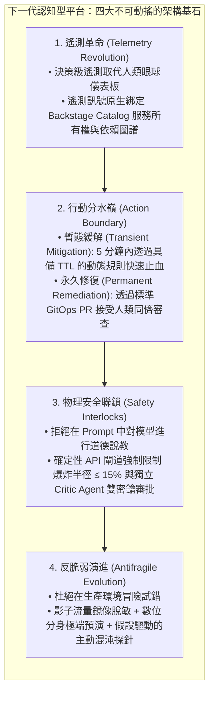
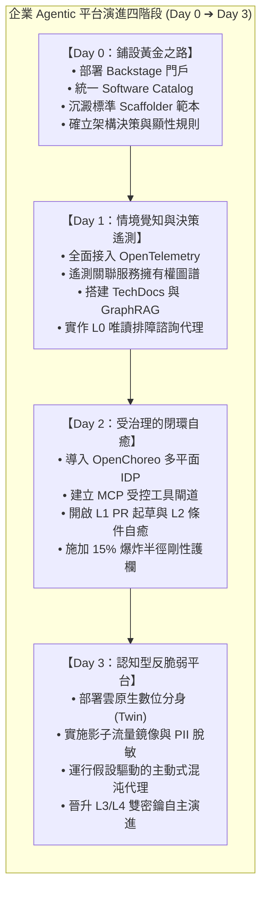

# EPILOGUE

# 全書結語：邁向認知自適應平台——企業落地成熟度演進藍圖

當你翻閱至全書的最後一頁，一幅貫通「平台工程（Platform Engineering）」與「可靠性工程（Reliability Engineering, ARE）」的宏偉架構拼圖已完整拼合。

回望全書的探索之旅：

* 我們從第 1、2 章打破傳統 AIOps 孤島與 DevEx 摩擦開始，確立了將平台作為一項產品經營的核心宗旨；
* 在第 3、4 章與第 4-EX 章中，我們將組織知識庫升華為具備因果推理能力的「決策級遙測（Decision-Grade Telemetry）」與 DRAL 自治閉環；
* 在第 5、6、7 章與第 7-EX 章中，我們組裝了對話介面、Model Context Protocol（MCP）與生產環境維運代理，嚴格區隔了「機器速度的暫態緩解」與「人類審查的永久修復」；
* 在第 8 章與第 8-EX 章中，我們直面內部自主代理可能失控的生死難題，建立了 L0 至 L4 的自主邊界階梯、爆炸半徑剛性上限與雙密鑰審查防護欄；
* 在第 9 章與第 9-EX 章中，我們推動平台從「被動防禦」邁向「主動反脆弱」，實作了假設驅動的微創混沌工程與數位分身影子預演；
* 在第 11 章與第 12 章中，我們紮實地將這座理論大廈落腳於雲原生世界的兩大開源旗艦——Spotify Backstage（門戶與感官）與 CNCF OpenChoreo（執行與防護抽象）。

在本篇結語中，我們將全書的所有核心思考進行最終收網，並為企業技術決策者繪製一張踏實可行的**「企業落地成熟度四階段演進藍圖（Roadmap）」**。

---

# 一、 四大核心架構共識的終極收網

縱觀現代軟體工程的演進歷程，每一次生產力的巨大躍升，本質上都是對「隱性不確定性」的剛性工程化約束。總結全書，我們確立了四大不可動搖的架構基石：

---

# 二、 企業落地成熟度四階段演進藍圖（Roadmap）

任何試圖「一步登天」直接在生產環境解鎖全閉環自主維運的組織，都必將在嚴酷的現實面前撞得頭破血流。企業在推行 Agentic 平台工程時，應嚴格遵循如下四個成熟度階段：

### 階段 1：Day 0——鋪設黃金之路（資產盤點與顯性化）

* **核心任務**：在引入任何 AI 代理之前，先把人類團隊的混亂治理好。
* **行動重點**：
  1. 導入 Spotify Backstage，強制要求所有業務微服務登記 `catalog-info.yaml`，釐清服務邊界、API 協議與負責團隊。
  2. 將核心微服務的標準部署範本（Docker / Helm / K8s）封裝進 Backstage Scaffolder，消除複製貼上帶來的技術債。
  3. 將隱匿在老員工腦海中的 Runbook 與架構規範，整理為版本化存檔在 Git 中的 TechDocs Markdown。

### 階段 2：Day 1——情境覺知與決策遙測（看清系統真實狀態）

* **核心任務**：讓 AI 代理獲得「高信噪比的感官」，拒絕無頭蒼蠅式的盲目排障。
* **行動重點**：
  1. 全域實施 OpenTelemetry 標準，並在遙測資料中自動注入 Backstage Catalog 的服務元數據。
  2. 搭建基於 GraphRAG 的內部知識檢索代理，為工程師提供架構諮詢與故障排查指引。
  3. 上線 **L0（唯讀諮詢）維運代理**，代理僅負責生成因果診斷報告，操作 100% 由人類工程師親手敲擊執行。透過 Langfuse 持續追蹤評估代理決策品質（DQ-SLO）。

### 3. 階段 3：Day 2——受治理的閉環自癒（機器速度止血）

* **核心任務**：在剛性物理護欄的保護下，解鎖局部的生產環境自主止血。
* **行動重點**：
  1. 導入 CNCF OpenChoreo，將雲原生基礎設施解耦為「開發者平面」與「平台控制平面」，杜絕代理接觸裸露的底層叢集。
  2. 將常用維運操作封裝為標準 Model Context Protocol（MCP）Server，並在 API 網關層植入確定性的 `AutonomyPolicyEngine`。
  3. 正式開放 **L1（起草 PR）** 與 **L2（白名單條件自癒）** 權限，強制實施單次影響實例比例 $\le 15\%$ 的爆炸半徑硬上限。

### 4. 階段 4：Day 3——認知型反脆弱平台（主動進化與極端預演）

* **核心任務**：從被動救火走向主動攻防，平台具備預測與自我增強能力。
* **行動重點**：
  1. 搭建按需拉起的雲原生數位分身環境，透過 Envoy Request Mirroring 實施無衝擊的真實流量非同步預演，並在網關處完成 PII 數據脫敏。
  2. 啟用主動式混沌代理（Autonomous Chaos Agent），在離峰時段針對近期 Git 變更自主提出微創故障假設，自動提交韌性加固 PR。
  3. 建立獨立部署的 Safety Critic Agent，實現跨核心服務自癒的 **L3 雙密鑰核簽** 與全域熔斷絆線。

---

# 三、 組織文化洗禮：架構師從「築牆者」蛻變為「策展人」

在 AI 時代的平台工程實踐中，最深刻的變革往往不在於技術棧的升級，而在於**工程組織文化的重塑**。

過去的架構師與運維團隊往往扮演著「築牆者（Gatekeepers）」的角色：設立繁瑣的工單審批流程、嚴格限制開發者的環境權限，以犧牲組織交付速度為代價換取脆弱的穩定性。

而在本書所描繪的認知自適應平台中，架構師的職責徹底轉化為**「規則的策展人（Platform Curators）」**：

* 你的職責不再是親手審核每一張變更工單，而是**將安全與可靠性規範沉澱為確定性的治理模組（Governance-as-a-module）**；
* 你的職責不再是半夜登入伺服器人肉搶救故障，而是**為 AI 代理設計精準的上下文模組（Context-as-a-module）與剛性的防護欄攔截器**；
* 你的職責不再是在事故覆盤中苛責人為疏失，而是**審視信任遙測指標（Trust Telemetry / ARR），持續擴展系統的自動化邊界**。

---

# 四、 明日轉型實踐檢查清單（Executive Checklist）

當你合上本書、重新踏入團隊的晨會與架構討論時，請隨身攜帶這份清單，開啟你的平台工程演進征程：

* [ ] **資產能見度**：我們公司的微服務依賴關係與責任團隊清單，是否具備單一可信的源頭？（若無，立刻啟動 Backstage Catalog 試點）。
* [ ] **遙測語意化**：我們的 APM 報警是否仍然只拋出抽象的錯誤代碼？（推進 OpenTelemetry 屬性注入，將服務所有權融入 Trace）。
* [ ] **工具受控化**：如果明天要讓 AI 代理執行一次重啟或限流，它是否只能透過帶有驗證邊界的 MCP 工具調用？（杜絕發放任何無上限的 root API Key）。
* [ ] **防護剛性化**：平台中介軟體是否具備「單次變更實例比例 $\le 15\%$」的確定性攔截代碼？（嚴禁用 Prompt 道德約束模型）。
* [ ] **演練常態化**：我們上次驗證依賴服務超時熔斷是什麼時候？（挑選一個非核心無狀態服務，嘗試由代理發起第一場有保護絆線的微創延遲注入）。

> **「未來的雲原生平台不會是一座冰冷死板的機器，而是一座生生不息、具備免疫力與神經反射的認知有機體。」**

旅程已經開啟，舞台已經就緒，祝你的平台在 AI 時代中穩健航行、蓬勃進化！
