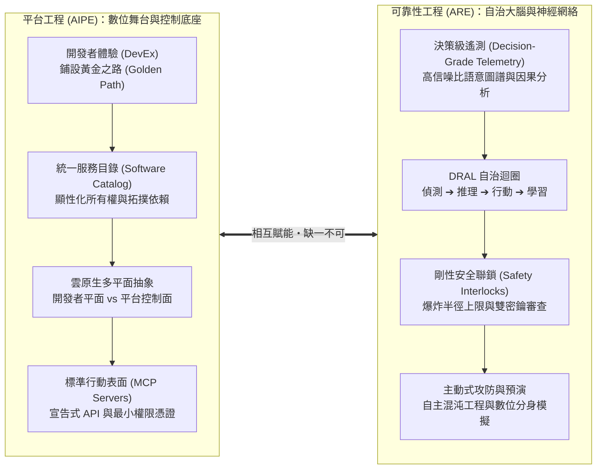
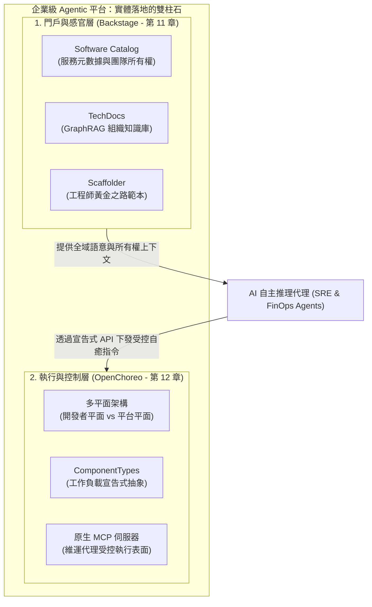
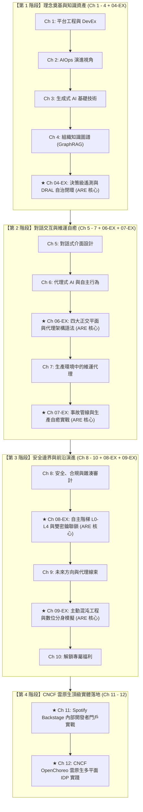

# PREFACE

# 全書導讀：平台工程與可靠性工程的雙螺旋——兼論 Backstage 與 OpenChoreo 的核心基石地位

歡迎翻開這部為 AI 時代雲原生架構師、平台工程師與 SRE 團隊量身打造的綜合實踐專著。

當你瀏覽本書的目錄時，或許會萌生幾個深刻而直接的疑問：

1. **「為什麼這本書一方面深入探討平台工程（Platform Engineering），另一方面又穿插了大量的可靠性工程（Reliability Engineering, ARE）延伸篇章？」**
2. **「在雲原生開源生態中，Spotify Backstage 與 CNCF 新興的 OpenChoreo 究竟在整套體系中扮演什麼角色？為什麼它們是這兩部理論不可或缺的落腳點？」**
3. **「面對市面上鋪天蓋地的 LLM、AI Agent 與 AIOps 宣傳，身處企業一線的工程團隊該如何抽絲剝繭，建構出一套真正安全、防範毀滅性災難、且具備真實業務價值的自癒系統？」**

本導讀旨在為你拆解整本書的架構全景，揭示現代雲原生軟體工程中最具決定性的範式轉移。

---

# 一、 舞台與大腦：雙螺旋架構的必然合流

在過去十年間，軟體工程組織內部長期存在一堵難以逾越的高牆：

* **平台工程團隊（Platform Team）**專注於「Day-0 / Day-1 的開發者體驗」：搭建內部開發者門戶（IDP）、提供標準化腳手架、優化 CI/CD 流水線，目標是降低工程師的心智負擔，鋪好「黃金之路（Golden Path）」。
* **站點可靠性工程團隊（SRE / Operations Team）**則默默駐守在「Day-2 的生產戰場」：緊盯 Grafana 儀表板、應對深夜 PagerDuty 奪命警報、人工撰寫事後覆盤（Postmortem），在錯綜複雜的分散式微服務中撲滅火災。

然而，當系統規模急劇膨脹至數千個微服務，且大語言模型（LLM）與代理式架構（Agentic AI）全面進駐維運流程時，**這兩大體系的傳統邊界在瞬間徹底崩塌**：

### 為什麼「平台工程」不能沒有「可靠性工程」？
一個只懂建置門戶表單的平台，充其量只是個「精美的工單系統」。如果平台無法感知運行時的健康狀況、無法在事故發生時主動自癒，它就永遠無法解決 SRE 面臨的規模化危機。**《代理式可靠性工程》（Agentic Reliability Engineering, ARE）**為平台注入了靈魂——**決策級遙測（Decision-Grade Telemetry）**、**DRAL 自治閉環**、**5 大代理 SLO** 與 **主動式混沌防禦**，讓冷冰冰的靜態平台進化為具備神經反射與自我修復能力的**認知型平台（Cognitive Platform）**。

### 為什麼「可靠性工程」不能沒有「平台工程」？
反過來看，脫離了平台工程的 SRE 代理只是一場災難。如果沒有平台提供的統一服務目錄，AI 代理根本不知道發生報警的 Pod 屬於哪位工程師；如果沒有平台提供的沙盒化多平面隔離與標準工具表面（MCP），AI 代理就只能手握危險的 root/kubectl 權限在真實環境裸奔，稍有幻覺便會引發全公司級的連鎖雪崩。**平台工程為 AI 代理提供了合法的身分、乾淨的上下文、受約束的行動表面，以及不可逾越的物理護欄。**

> **「平台工程打造了舞台，可靠性工程賦予了演員靈魂。兩者如同雙螺旋結構，緊密交織出下一代自主運行的雲原生生態。」**

---

# 二、 破除迷思：Backstage 與 OpenChoreo 為何是落地的核心基石？

當讀者研讀架構理論時，往往會面臨抽象與現實的巨大鴻溝：書籍為了保持理論的中立性，往往使用「內部開發者門戶」、「軟體目錄」、「平台控制平面」等通用詞彙。但任何一線工程團隊在走出會議室後，都必須回答一個最殘酷的工程問題：

> **「我們到底要用什麼開源專案把這一切搭出來？AI 代理的 MCP 工具到底要向誰發起請求？」**

這正是本書特別收錄 **第 11 章（Spotify Backstage）** 與 **第 12 章（CNCF OpenChoreo）** 的根本原因。它們是這兩部理論在現實世界中**唯一具備完整生態支撐的實體落地載體**。

### 1. Spotify Backstage（第 11 章）：AI 代理的「感官神經與記憶中樞」

* **提供所有權情報（Ownership Graph）**：ARE 第 3、4 章強調，AI 排障絕不能停留在 IP 或 Pod 層級。Backstage 的 `catalog-info.yaml` 將服務、系統、API 與團隊（Team）緊密關聯，讓代理在故障發生 3 秒內精準找到責任人與依賴關係。
* **提供企業知識語料（Living Knowledge Base）**：本書第 4 章的 GraphRAG，其底層最權威的文件來源正是 Backstage TechDocs。代理不再需要盲目爬取混亂的內部 Confluence，而是依賴與代碼一同版本化的 Markdown 文件完成因果推理。

### 2. CNCF OpenChoreo（第 12 章）：AI 代理的「執行骨架與防護手套」

* **實作可靠性四平面的解耦**：ARE 第 6 章提出「訊號、推理、執行、治理」四大平面。OpenChoreo 在 Kubernetes 之中原生落實了「開發者控制平面」與「平台控制平面」的物理隔離——開發者只接觸簡潔的 `Component` 抽象，平台團隊與 AI 代理在後端透過控制器運作。
* **為代理提供原生的 Model Context Protocol（MCP）**：AI 代理不能隨意執行任意 Shell 指令。OpenChoreo 透過 CRD 與 MCP 規範，將「擴容」、「切換流量」、「重試」等操作封裝為標準化工具，並自動施加多租戶隔離與配額限制。

---

# 三、 全書架構地圖與閱讀路徑

為了讓讀者能夠依照自身的工程階段按圖索驥，本書構建了立體的「主幹＋延伸＋落地」三維矩陣：

### 🎯 針對不同角色的推薦閱讀路徑：

* **如果妳/你是平台工程架構師（Platform Architect）**：
  - 推薦優先研讀：`Ch 1` ➔ `Ch 4` ➔ `Ch 06-EX（四大正交平面）` ➔ `Ch 11（Backstage）` ➔ `Ch 12（OpenChoreo）` ➔ `Ch 08-EX（自主階梯）`。
  - 重點關注：如何建構開發者單一入口、如何透過多平面架構降低心智負擔，以及如何用確定性代碼控制代理權限。

* **如果妳/你是站點可靠性工程師（SRE / Operations Lead）**：
  - 推薦優先研讀：`Ch 04-EX（決策級遙測）` ➔ `Ch 06-EX（四平面語法）` ➔ `Ch 7` ➔ `Ch 07-EX（事故應變管線）` ➔ `Ch 09-EX（主動混沌與數位分身）`。
  - 重點關注：DRAL 閉環、暫態緩解 vs 永久修復、TTL-bounded MCP 工具，以及如何在影子環境中進行 What-If 演練。

* **如果妳/你是工程副總裁或技術長（VP of Eng / CTO）**：
  - 推薦優先研讀：`本導讀` ➔ `Ch 2` ➔ `Ch 8` ➔ `Ch 08-EX` ➔ `全書結語（Epilogue）`。
  - 重點關注：企業 AI 轉型的治理成本、信任遙測（Trust Telemetry / 建議接受率 ARR）、防範連鎖雪崩的物理聯鎖，以及團隊組織結構的演進方向。

---

# 四、 獻給所有正在塑造未來的工程師

這是一場前所未有的工程盛宴。過去我們習慣將系統劃分為「冷冰冰的代碼」與「手忙腳亂的人類」，而今天，具備認知推理能力的 AI 代理正以極快的速度穿梭在我們的管線、門戶與叢集之中。

但請永遠牢記全書反覆強調的黃金準則：
> **「工程領域的信任從不建立在盲目樂觀之上，而是建立在被嚴格約束的邊界、確定性的物理防護欄，以及高保真的科學驗證之中。」**

願本書成為妳/你在構建企業級自主運行平台之路上，最堅實、最清醒、也最值得信賴的架構指南。
